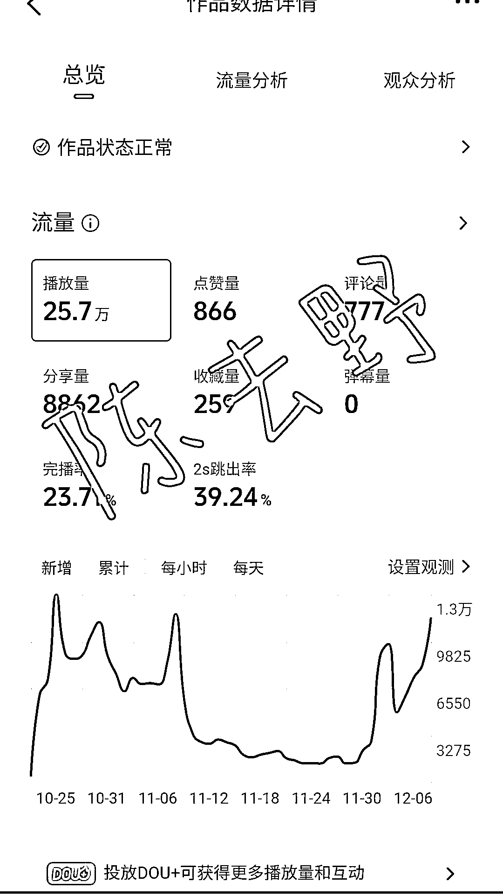

# (42 赞)抖音 CPS 玩家自曝：无经验、无粉丝、无上限…新手友好！快速入局！

没赶上第一趟车，反倒钻出了自己的路。

这位抖音 CPS 玩家，开局并不顺利——第一期没报上名，就自己闷头琢磨出了一套玩法；第二期好不容易挤进航海，榜上倒是挂名了，心里却总觉得不踏实。

成绩谈不上耀眼，但这一路踩坑攒下的感悟，比数据值钱多了。

今天在赚钱圈里，他打算来点不一样的：干脆把自家账号摊开晒一晒，玩法拆碎了讲清楚，给刚进场的萌新和带团队的老手都留下一份可上手的参考。用他自己的话说——让这个账号发挥最后一点余热。

从今天起，也逼自己一把，更新迭代，撞进下一个增长周期。

评论区也不乏叫好声：有人说“带野都牛”，有人喊“野姐厉害”，还有人直接举大旗——看得出来，这位“不去野”的风格，是实打实圈了一波粉。有人好奇专属密令词和普通玩法差距大不大，作者也回了句实在话：用密令词有平台额外激励，收益确实更可观。

没经验、没粉丝、没上限——新人想快速入局抖音 CPS，这条野路子，或许就是你的路子。