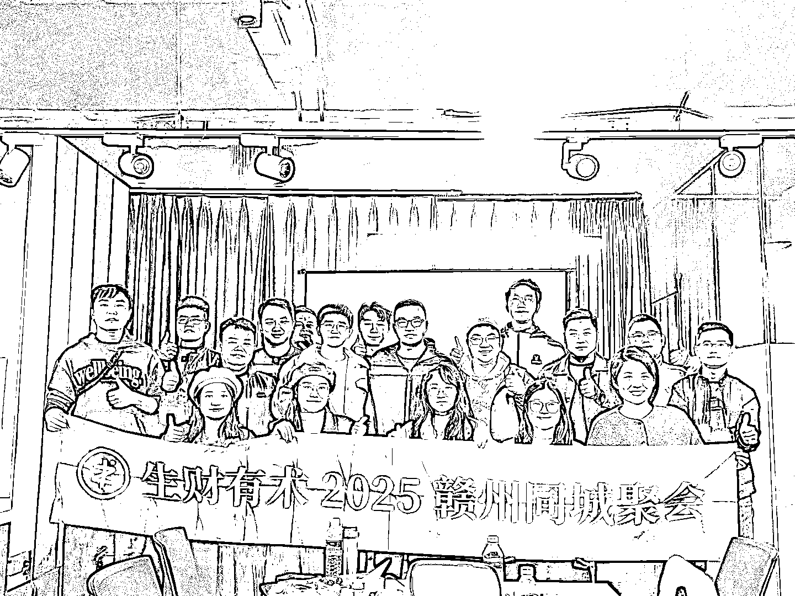
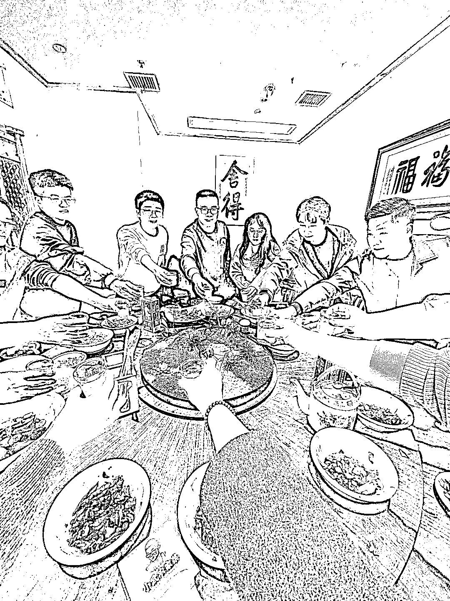
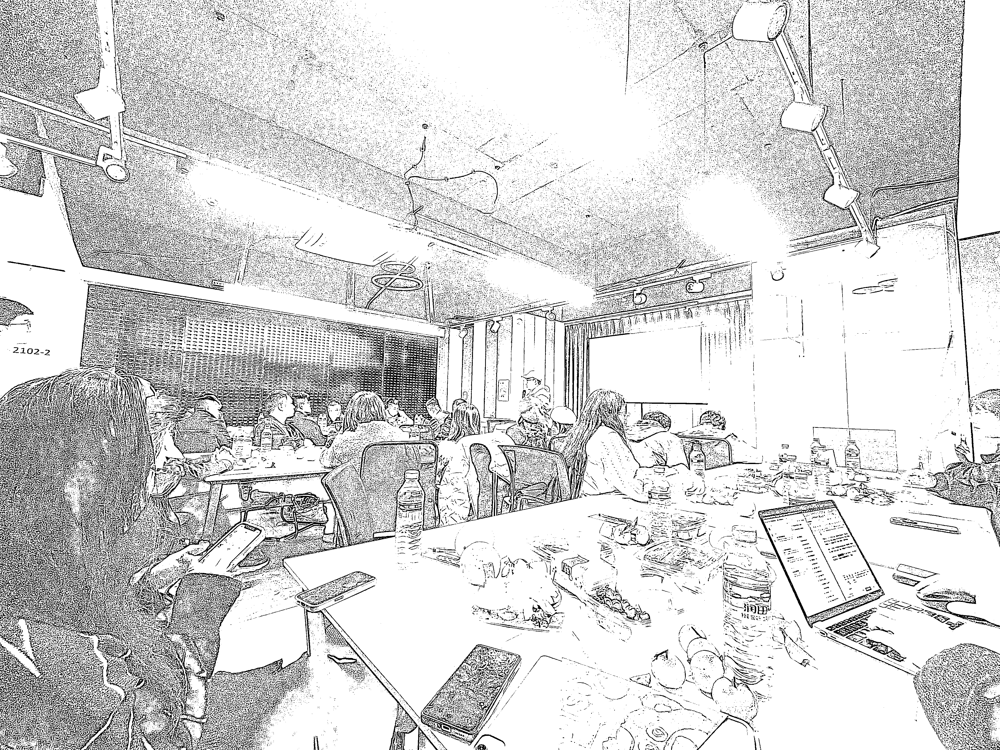
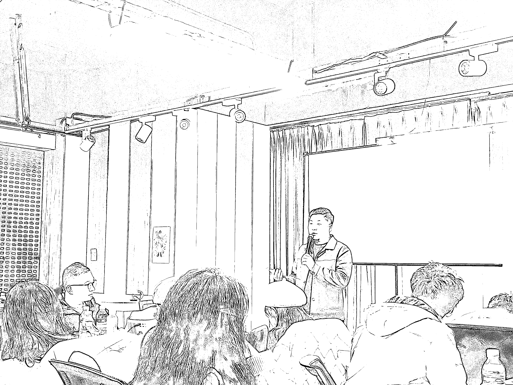
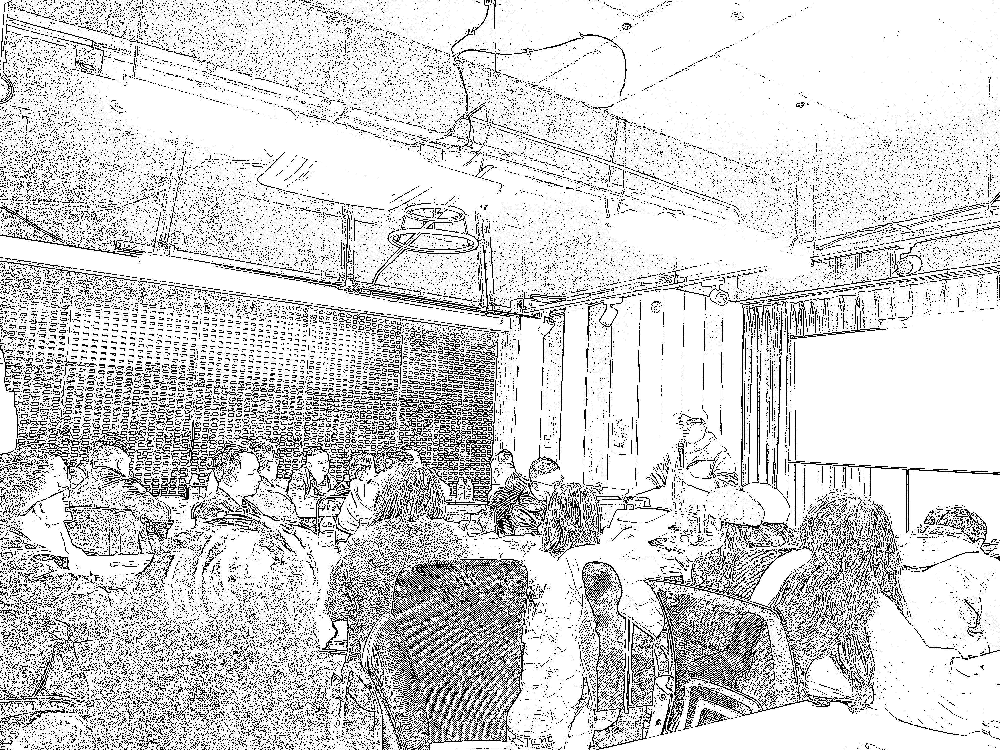
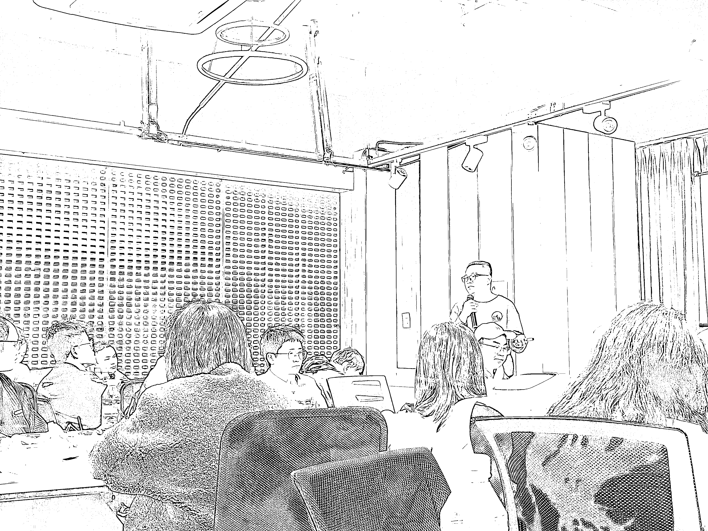
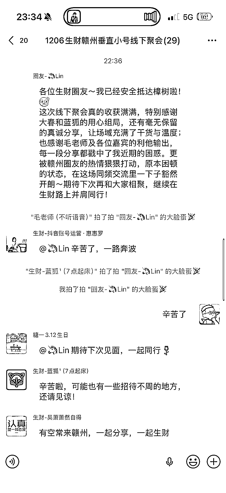
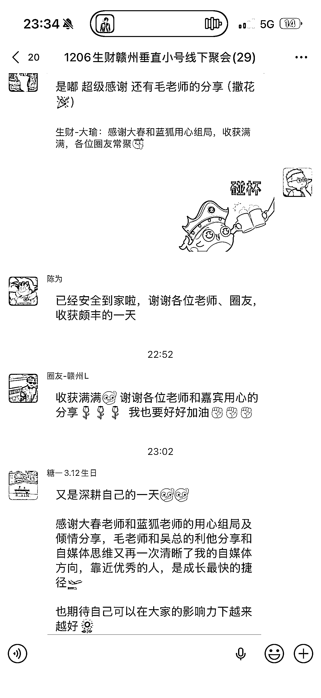

# 30 人齐聚赣州！一场垂直小号线下局，让线上想法瞬间落地
作者：龙哥

周六，江西赣州，本来只打算搞一场 12 人的小范围交流，没想到圈友自发扩散，现场直接坐满了 30 人。

有人从宜春、吉安开了 4 小时车赶过来，有人特意请假从工作中脱身。这样的热情，真的让人很感动。

这次线下交流请到 4 位嘉宾上台干货输出，现场反响非常热烈。

一位互联网行业的一线大咖，复盘了真实实操经验和自己的成长轨迹；一位本地房地产大佬，坦诚聊了选项目和做垂直小号时踩过的坑；一位超级个体玩家，分享了如何操盘几百个垂直号矩阵的底层逻辑；最后由我做了一场系统性梳理，详解垂直小号从 0 到 1，再从 1 到 10 的完整打法。

分享结束后大家一起吃了一顿饭，聊项目、聊进展，才发现彼此的业务竟然有这么多可以联动的点。聊着聊着，合作的思路就出来了。

线下聚会的温度和效率，真不是线上能比的。线上可以聊上千遍，线下聚一次就能点燃火花。

未来会有更好的事情发生，这样的线下氛围会越来越好。

* * *

评论区：

林泓毅 : 太棒啦！行动起来

刘智行 : 行动起来，一同进步。[握手][握手][咖啡][咖啡]

蓝狐 : 氛围很好，这种局要多组织！

椰椰 : 真的收获满满！！！

刘智行 : 常组织，常聚。

刘智行 : 一起努力呀。常聚。

烽火 : 智行在赣州干的风生水起 ，也是垂直小聚

刘智行 : 谢谢烽火大佬，也在努力中。