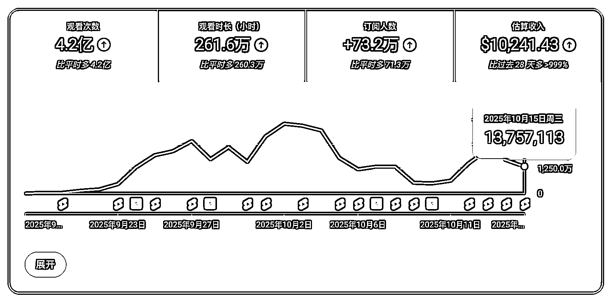

# 从0起步跑通YouTube变现：10个高级YPP、月入万美金，我的全部操作拆解

先自我介绍：我是Zero，过去一整年基本All in在YouTube这条赛道上。到本月初，频道的订阅总量已经迈过200万大关，成功开通的高级YPP账号累计达到10个。

如果按收入来算，目前也就是一个月入刚上五位数美金的水平，离“大佬”这个称呼还很远，能拿出来讲的成绩真不算多。

这篇长文，算是被圈友“催”出来的。这段时间不断有朋友来问我：为什么你选定方向之后总能快速拿到结果？为什么你写的文字能带给别人力量？支撑你一直往前冲的内核到底是什么？所以今天就借着《从零做到月入万刀、手握10个高级YPP的实操路径》这个主题，把这些问题一次说透。

读完之后，你不仅能搞懂我在YouTube上把收入做到五位数美金的整套方法论，还能从我过去十年折腾副业的过程里，看到我是怎么把一个个不起眼的小项目打磨出真金白银的产出的。

[`avbdmra8fx.feishu.cn/wiki/MG5jwIeYWiBKNxkiL1ec5XLenKw`](https://avbdmra8fx.feishu.cn/wiki/MG5jwIeYWiBKNxkiL1ec5XLenKw)

* * *

留言区搬几条过来：

追风yangfh：真的被震到了。必须静下心来多读几遍，向你对齐。慢慢发现，失败的路径各有各的缘由，但能成事的人往往共享同一套底层素质。我也该行动了，得尽早把这条路走通。

烽火：给圈友打Call。

杨飞：[强]太有共鸣了。

Dragon：从头到尾看完了。写得太扎实了，细节给得也很足，向你学习。

时空：每次刷到Zero的分享，都会被那股劲儿重新点燃。

烽火：看得很受触动。想想自己每天大把时间就这么流走了，执行力上的差距确实扎心。

福姐姐：给这位实力圈友点赞。

池sir：请教卷王哥一个问题——你文中提到的母婴自媒体、AI文档、红包封面这几个方向，当时都各有进账。假设哪天你发现手里的项目赚头不大了，但还能偶尔出几单，你会继续耗在上面吗？是一直等着翻盘然后被拖垮离场，还是像你写的那样不给自己留退路、果断换新赛道？