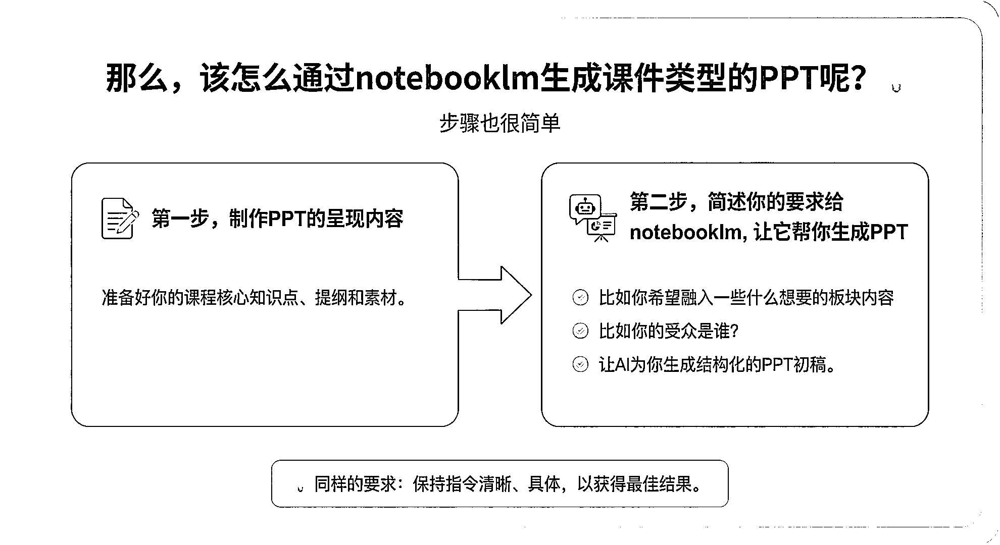
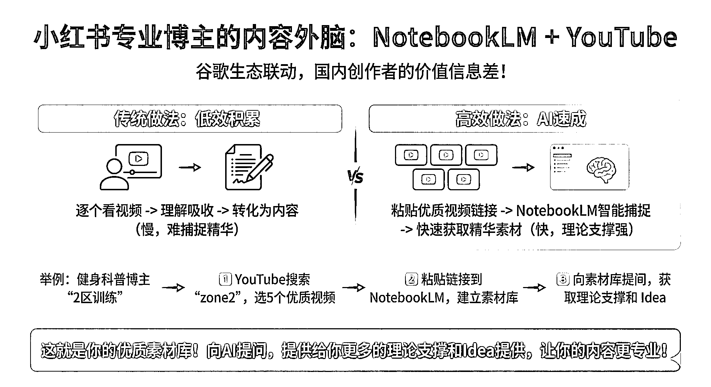
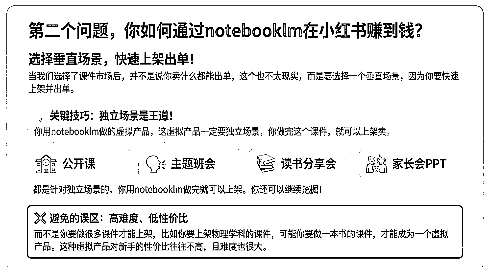

# (精华帖)(226 赞)普通人通过 NotebookLM 构建生意的方法论，含📕虚拟产品操作思路

NotebookLM火成这样，普通人能不能借此赚到钱？这篇226赞的精华帖，把📕虚拟产品的路子讲透了

最近NotebookLM的热度，相信不用我多说。从国内到海外，无数内容创作者都在用它批量生成PPT。但大多数人只是把它当效率工具，而Luke已经从中整理出一套适合普通人的生意构建法。

作为社区里被加精的帖子，这套方法论目前已经有226个赞，评论区更是被“含金量太高”“知识密度炸裂”刷屏。Luke把自己从📕虚拟产品和自媒体IP两个角度总结的玩法，完整地梳理了出来，核心不外乎三点：

1. 用NotebookLM+YouTube+📕，打通个人IP的成长路径。NotebookLM负责内容生产，YouTube承载素材来源，📕则作为IP的展示和互动阵地——三者的组合，恰好构成一条可持续运转的内容生意链。

2. 用NotebookLM制作原创虚拟产品，而且他连具体操作思路都一并给出了，包括原创课件的生产方法。想做📕虚拟产品却不知道从哪下手的人，这套思路就等于递到你手上的施工图。

3. 关于NotebookLM提效的个人经验也很有分量，全部来自实战积累。相比泛泛的AI工具教程，这些经验更接近“老手带路”，拿过来就能嵌入自己的工作流。

还要提醒一句：这并非Luke的第一次分享。他此前写过一篇关于普通人如何在24小时内，从📕上把生意跑起来的文章，而今天这篇正是它的进阶补充。两篇搭配着读，相信你能看到一张更完整的商业路径。

至于更详细的执行细节，Luke已经把它整理成了飞书文档，帖子原文附有链接，直接点进去自取即可。

