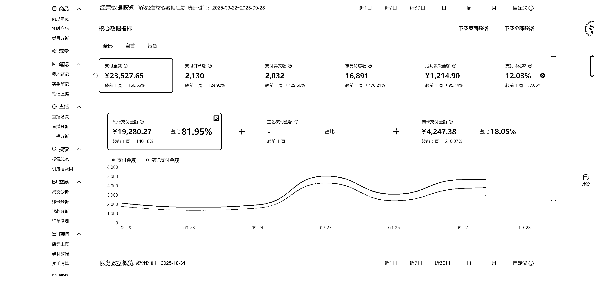
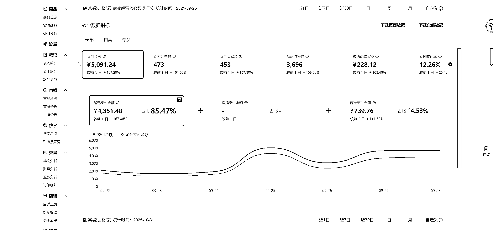
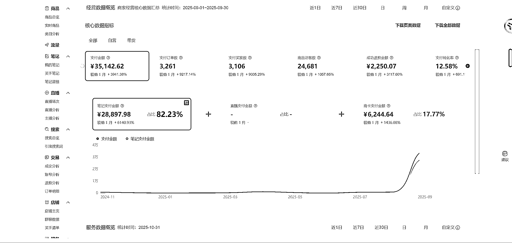
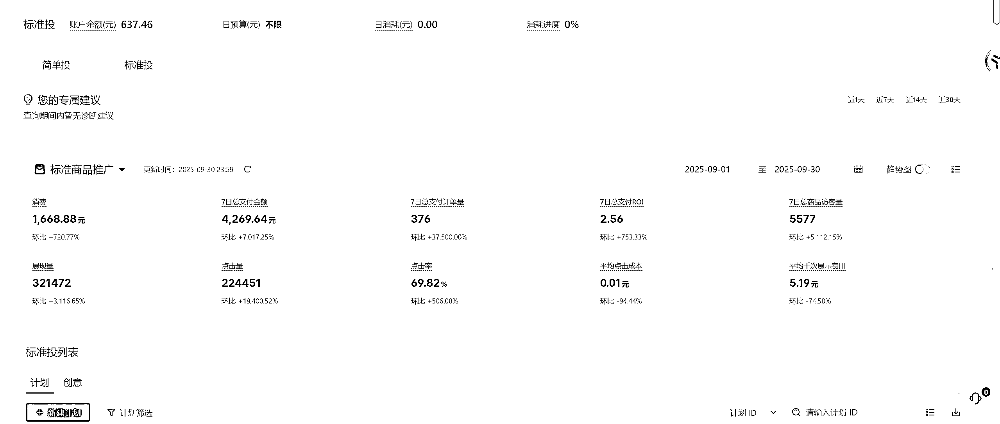
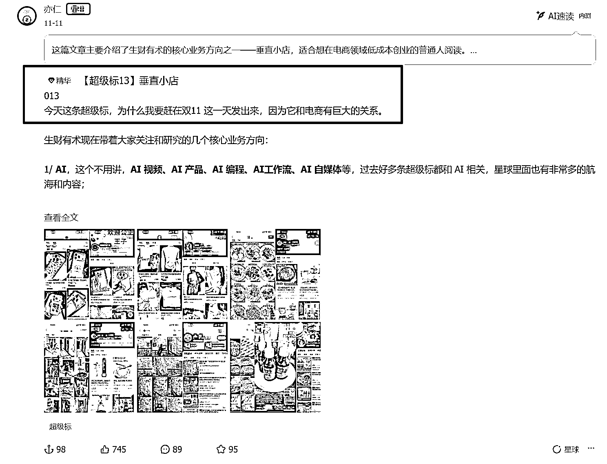

# 2100单/周！拆解📕虚拟垂直小店从0到爆的实操路径

笔者：苏晗
发布时间：2025-11-20

搬进赚钱联合办公空间后，多亏龙哥、王燕楠、枸杞、黄亮老师的指点，以及和金天、虚虚的多次交流，我才真正吃透了笃定执行与保持耐心的重要性。

去年九月，我选择进入自己此前并不算熟悉的内容电商赛道——📕。过往跑通的案例基本都围绕虚拟商品，选品判断和MVP验证是我相对擅长的部分，而平台本身也在享受流量红利期。

**对个体而言，虚拟类目几乎是完美起点：无需囤货、无需备货、无需处理售后，利润能全部归己，发货可全程自动化，稳定后就能形成可持续的被动现金流，值得长期投入。**

我采用的打法是“单品聚焦+垂类小店”。思路很简单，用一间核心店铺搭配三支关联号矩阵，四号体只围绕同一款商品持续发声，日更量保持在30到50篇笔记，很快把该品类的话语权抢占下来。

**单店自运营首周539单，第二周514单，第三周冲至9300单，第四周达到23000单，累计起量3200单，峰值日销5K，月度销售额突破3万。**

**投放验证阶段共测试20套计划，花费1600元撬动投产2.56，带来约4200元转化，千次展示成本维持在5元左右。**

为了把这波打法打扎实，我暂时离开联合办公的热闹环境，回到家中闭关整整30天，全力把这套体系跑通。这是第一次尝试用内容电商的方法论去售卖非服务类型的虚拟物料，起初也是边实践边调整。

**更巧合的是，复盘撰写时发现，这套做法与龙哥老师11号提出的超级标签——📕垂直小店高度吻合。**

借此机会，我把做📕虚拟垂类小店的经验沉淀为四个关键动作：选品、测品、日常运营、放量。我会用尽量平实、可落地的语言拆解，看完即可直接照搬。

**目录结构：**

📕虚拟垂类小店为何值得做
一、选品判断标准
二、笔记制作与测品方法
三、日常运营打法
四、规模化扩张思路
五、额外提醒

坚持信念，持续在场，胜算自然提升

**更细分的表格与案例已整理至飞书：**

[`eqr5180l7jb.feishu.cn/wiki/IxDww95FRiC57EkRZQCcAk2VnNc?from=from_copylink`](https://eqr5180l7jb.feishu.cn/wiki/IxDww95FRiC57EkRZQCcAk2VnNc?from=from_copylink)

* * *

留言精选：

余琪琪 : 在shein航海期间结识苏神，当时他个人成绩稳居第一。十二月📕垂类小店航海我刚报名，就看到你出成果了[憨笑]，向优秀看齐加油！

烽火 : 数据很硬，逻辑很清晰

雨烟 : 想请教下那三支关联号是否完成了实名认证？

嗯 : 厉害

苏晗 : 目前均未实名

简哥 : 好奇作为新手，你是如何把选品、测试、运营、投放、矩阵这些环节想得如此系统？大部分人很难有这种全局判断力，这种能力是如何培养的？

雨烟 : 这三支号会不会触发强制实名？

东宇 : 文章写得很真诚，干货充足，感谢分享

晓言 : 学到了，明天起我也准备照着在视频号上每天发20条试试[坏笑]