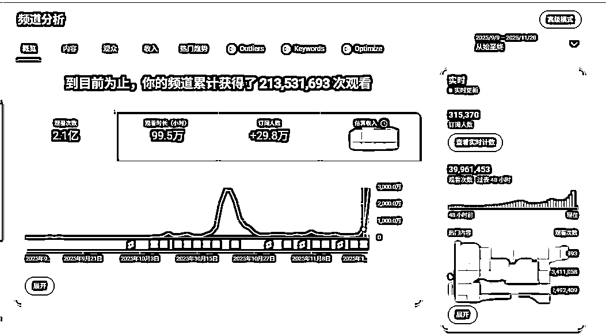

# 从手工到自动化再回到手工：两个月 YouTube 2 亿播放的实战复盘
作者：龙哥

作者：JuGo

日期：2025-11-21

大家好，我是贾羽 JUGO。现在做的是 TikTok 全域运营，同时也在做音乐制作。方向上我更偏向用 AI 工具提效，擅长 AI shorts 的快速拆解复刻和二次改编。马上就要从现在的岗位辞职，转成全职做 YouTube。

这次受赚钱团队邀请写点干货，我酝酿了很久。明天 2025.11.21 我会在深海圈线下展开讲我的实操流程，今天先把文字版放出来。

说的是那个在两个月内累计做到 2 亿播放的账号。

对我个人而言，这是个质变级别的突破。但放在深海圈那些老玩家面前，这个数字真的只是小打小闹。

我想聊的不是光鲜的结果，而是我自己的心态变化。怎么从一开始的完全手搓，到一度全面拥抱自动化，最后又一步步退回到手搓。后来我给这个过程起了个名字，叫“伟大的回家”。

我现在越来越清晰一件事：做内容的根本， lies 在学会把一个爆款逐帧拆开，搞懂它的骨架，再把自己的东西塞进去。塞进你的思考、你的经验、你的表达。只有这样，平台的推荐才有可能注意到你。

所以下面这篇，基本就是我对 2025 年 9 月和 10 月两个月在 YouTube 上深耕的一个彻底复盘。

没错，会很主观，会有很多废话。

如果你现在也卡在瓶颈里，或者像我一样站在辞职的悬崖边，一边激动一边恐惧，那可以留下来看看。我把这两个月里摔的每一个跟头、每个半夜对自己发火的瞬间，都摊开了。

整体思路和细节我放在飞书里了，篇幅太长，这里就不展开：

* * *

评论区：

礼新 : 先赞后看，这个过亿流量的干货分享

Harris : 写得很不错

那时年少 : 你好，贾哥，能否链接一下呢

Rikki : 谢谢分享正在往 youtube 的赛道上行走走