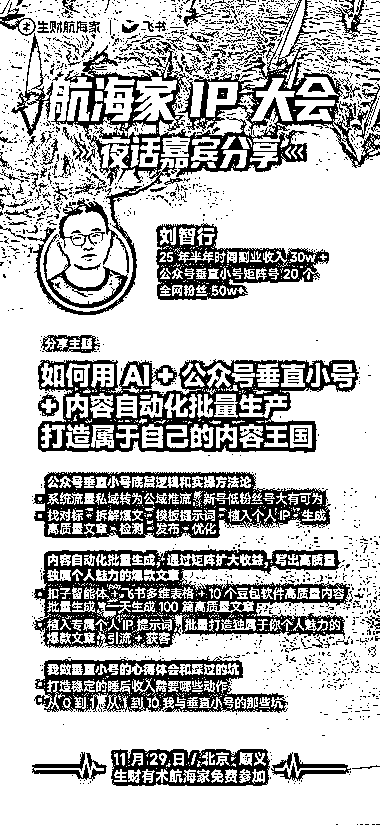
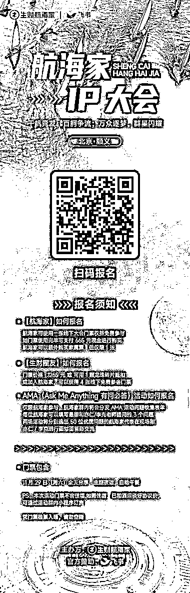
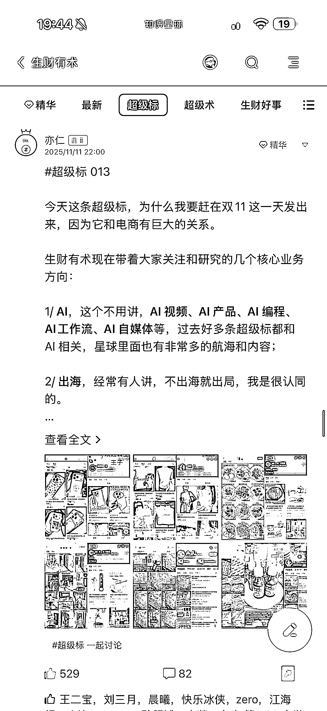
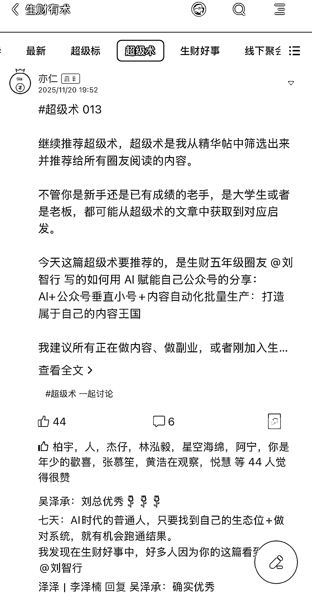

# ('(精华帖)(103 赞)从 0 到 1 做微信生态垂直小店：全域垂直内容+IP 带货全攻略（万字实用版）', (2, 54))

大家好，我是刘智行，见字如面。

前两天亦仁老大在11.11发了一条重磅风向标，我一看心里猛跳了一下：这不就是我默默在做的路子吗？其实我一直都在折腾微信公众号垂直小号+微信小店这套组合，佣金回报相当可观。当时我在回复里提了一句“垂直小号+垂直小店才是王炸”，结果好多圈友点赞追问，催我赶紧把细节写出来。既然大家都这么感兴趣，那我无论如何也得交一份作业，哪怕能给到一丁点思路上的启发，我也觉得值了。

这篇分享原本是准备放在11.29北京航海家夜话上讲的，但现在提前发出来也不亏——毕竟夜话现场还有更精彩的嘉宾和内容等着大家。

先简单交代下背景：我是生财五年期的老成员，前四年基本在水下潜水，默默无闻；到了第五年才算是真正开窍，找到了自己的节奏。今年是我下班后搞副业的第一年，同时也是我死磕公众号垂直小号的第八年。八年下来，这套东西已经长在了我的日常里。

全文主要聊四块：
1/ 我做出的一些项目成绩
2/ 公众号垂直小号+垂直小店背后的底层逻辑
3/ 从0到1的实操方法论
4/ 微信生态全域垂直内容+IP带货的实战做法

内容量比较大，所以我把完整的万字干货整理到了飞书文档里，圈友可以直接点进去看，希望对你有点用：

[https://scys.com/articleDetail/xq_topic/45811414184521888](https://scys.com/articleDetail/xq_topic/45811414184521888)
[https://xc8pgi2dy9.feishu.cn/wiki/DC42wIhg5iRKi4koe6tc64Uhnuc?from=from_copylink](https://xc8pgi2dy9.feishu.cn/wiki/DC42wIhg5iRKi4koe6tc64Uhnuc?from=from_copylink)

* * *

如果你也对微信生态的垂直小店感兴趣，尤其想深入聊聊“垂直小号+垂直小店”的机会，11.29北京航海家大会见。现场还会有更多大咖和干货，想参加我夜话的圈友记得抓紧报名，手慢就没了。[咖啡]