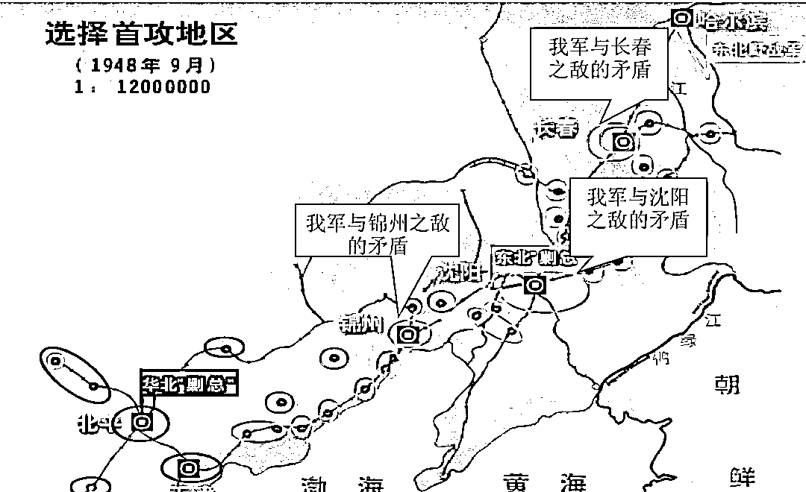

# 老板的能力边界，决定了公司的成长边界

创业跑下来十年，我越来越确信一件事：老板不是一个固定的身份，而是一个随着公司阶段不断升级的段位。

**一家公司的天花板，本质上就是创始人段位的上限。** 但更关键的是，这个段位必须和公司所处的阶段匹配。

段位跟不上，认知拖后腿，公司就会被创始人卡住。段位过高，认知超前于组织，公司同样会因错配而失控。

我见过刚起步的团队，老板还在为现金流焦虑，却整天谈愿景、管理哲学、资本故事，结果离关门就不远了。

也见过已经有了利润和规模的公司，老板依然事无巨细亲力亲为，连一个客服回复都要过目，整个公司离了他就转不动，天花板自然也很低。

在我观察里，老板的进化路径大致可以分为四层：业务型、管理型、决策型、投资型。这不是标签，而是一条清晰的成长路线。

高段位老板共同的底色只有一个：做对关键决策、放到合适的人、搭好顶层架构，而不是亲自下场抠细节。

**一、业务型老板：活下去是第一性原理**

《三体》里说，生存是文明的第一需要。这句话放到公司经营上一样成立。

公司刚出生时，战略只有一个：先活下来。

没钱、没人、没技术，老板本人就是最大的销售、最大的业务线、最大的收入来源。

这个时候要做的，就是躬身到一线，把最小的MVP跑通，赚到第一桶金。

刘邦的钱是打出来的，刘强东的钱是柜台上一盒盒光盘吆喝出来的，我的第一桶金也是自己在淘宝上选品、做图、发货、跟单，一个链接一个链接堆出来的。

这个阶段的老板，必须有在一线打仗的狠劲，能把业务细节钻到骨子里，自己就是一台印钞机。

很多大厂出来的高管创业死掉，就是因为失去了平台资源，却还在用大厂的体系打法。很多老手开拓新业务失败，也是因为没有人、没有规划，就想靠一个人探路。

业务型老板的核心竞争力，简单说就是老板本人。

**二、管理型老板：从“我能赚”到“我们能赚”**

个人精力有限，个人能力有天花板。

一个人走得快，一群人才能走得远。公司要做大做久，就必须从个人英雄主义转向组织化作战。

MVP跑通后，最大的课题是复制。复制流程、复制交付、复制销售，从一个王牌业务员变成系统架构师，建一个不依赖个人的运转机制，这是业务到管理的必经之路。

这里面最常见的卡点有两类。

第一是敢不敢放。扩张意味着成本确定，收益不确定。试错是常态，很多人一次失误就因噎废食，最后永远停留在单打独斗。

第二是会不会放。不是舍不得花钱，而是不知道钱花在哪。既不会识人，也不会用人，惯性还是自己上手。老板觉得员工慢、手生，越干预越亲力亲为，员工得不到实操自然长不大，形成恶性循环。

结果就是人治大于法治，公司像是老板的“手脚”，他是“大脑”，抽不开身，也没时间思考长远。

小老板的天花板通常就在5到10人。少数天赋异禀的，能靠识人和学习搭起几十人的基本盘，但也差不多到头了。

真正优秀的管理者做的是知人善用，搭一个能自动运转的体系。这不是一本SOP，也不是一堆软件，而是一个由流程、制度、工具、人才机制、中后台支撑的精密系统。

招选育用留的人才体系、人事财务行政的中台、业务和数字化的前台，组合起来就像一枚手表，零件齐全就能自转。

管理的本质不是管人和控人，而是设计一个不依赖强人的系统，一个能保下限、能自发培养人才的系统。

当体系和人才密度建立起来，公司核心竞争力就从老板个人，变成了体系、人才和资源。

**三、决策型老板：只定方向，不下指令**

1945年，毛主席在战略上就已经锁定东北。全国工业基础最强、资源最丰富的在东北，把劣势转成局部优势，把精锐部队和干部派过去，先抢占再决战。

要达成“关门打狗”，关键点是锦州。拿下锦州，关外就被锁死。

从地图上看，锦州就是东北的门户。拿下它，敌军就成了瓮中之鳖。

当时东北战场的总指挥林彪希望先打长春再南下锦州。从纯军事角度看不无道理，锦州靠近华北，怕傅作义北上夹击，长春更易包围。

但主席从政治和全局看问题：抗日战争快不得，解放战争慢不得。美苏对峙一旦结束，精力回转中国，统一大业会被干扰。若让东北敌军逃入华北与傅作义合流，后患无穷。而傅作义自保心切，出兵可能性很低。

最后主席力排众议，三令五申先打锦州。四野拿下锦州，东北敌军被一举歼灭，随后百万雄师南下。

这就是决策型老板的孤独。没人能帮你看清远方的迷雾。

决策型老板不负责怎么打，只负责打不打、何时打、打到什么程度。怎么打，是管理型老板和业务型老板的事。

主席对手蒋介石就是典型的微操。明明该做决策，却直接指挥师团调动，绕过前线指挥官。这种不在一线的瞎指挥，对前线是灾难。

任正非说的“让听得见炮声的人指挥战斗”，就是这个道理。

高段位老板的核心职责是做对决策、搭好体系、任用贤能，而不是沉迷执行。判断方向、定好战略、用对人，才是本职。

**四、投资型老板：用资本做生态**

规模越大，老板时间越贵，精力越值钱。资源要发挥更大价值，护城河要更宽更深，资本投资就变得不可或缺。

决策型老板还在找方向找人找资源落地，投资型老板更多是在判断。

这个层级我自己体感不深，只能远观。真正的投资型老板像腾讯、阿里、字节那样，展望未来、构建生态，用资本完成战略布局。

公司发展是分阶段的，老板角色也要随之切换。

能清楚知道公司在哪一阶段，自己该扮演什么角色，在正确的时间做正确的事，并在关键节点完成自我迭代，这才是最核心的能力。

从管事，到管人，再到管势，这条路，几乎每个创业者都要走一遍。