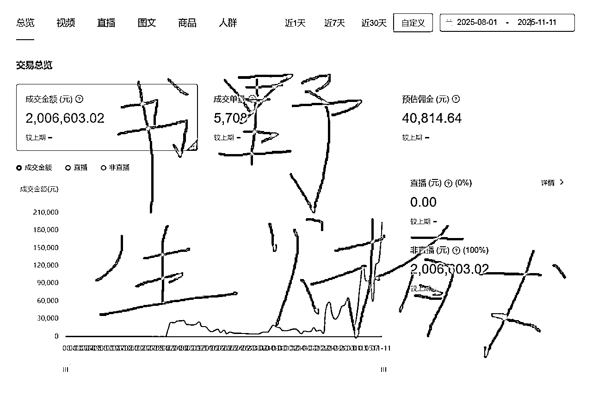

# (精华帖)(92 赞)《只想当个小 UP，却觉醒了 B 站好物系统》
作者：龙哥

## (精华帖)(92 赞)《只想当个小 UP，却觉醒了 B 站好物系统》

作者： 鹿书野

日期：2025-11-19

主业在身，还在读非全日制研究生。每周一到五要上班，周末要上课，真正能全身心投入创作的时间一天也就两小时。刨去生活琐事，一个月也就勉强产出五支视频。家蒙老师当初就点过，月更五条对于起步阶段的创作者来说已经非常扎实，脚踏实地才能仰望星空。

我的路径很笨，就是一步步往前走。第一个月到手五位数，第二个月初入 B 站好物最高等级推荐官，第三个月冲进 B 站百万榜单，下个月数据就能公开了。

算下来总收益破 5 万，其中佣金约 4 万，平台补贴和商单加起来过万。品牌寄来的样品堆满了一间屋子。

看过我往期内容的伙伴应该感受得到，我的风格一直偏干货，这篇也不例外。本文是两个月前作为优秀学员做直播时的讲稿。之所以拖到现在才发，一是想用时间去验证这套打法是不是可持续，而不是运气好一回；二是双十一期间实在被事务压得没空，最后也赶上在忙别的事。

做长视频，本质上就是一座缓坡，需要持续攀爬。大部分人会卡在类似的问题上：剪辑占掉绝大多数时间，最后成片还是不满意；来回返工、效率糟糕、节奏混乱，难以保持稳定且过得去的输出质量。

等产量稳住之后，就别再“先做出来再说”了。选品这件事一旦重视起来，同样的工作量，转化效果会完全不一样，出单会更猛。

* * *

评论区：

老师傅 : 又干又专业的分享[强]，估计同行看到都会直呼分享内容太精彩了[强]，条理清晰，逻辑严谨，步步递进，实战后的精华经验[强]

篮子🍀 : 真的很高精力啊！感谢分享

Dustin : 现在登场的是！深海圈全员认可的 B 站天选之子！

周无限 : 精华帖预定[强]

Mr Bean 憨豆* : 太强了

鹿书野 : [阴险][阴险][玫瑰]

小源 : 敏锐的判断，强大的执行，研究能力的具象化，明年会是起飞的书野[强]

星空海绵 : B 站之子在 B 站犹如鱼入大海，鸟上青天，实力这一块绝对拿捏了[社会社会][社会社会]