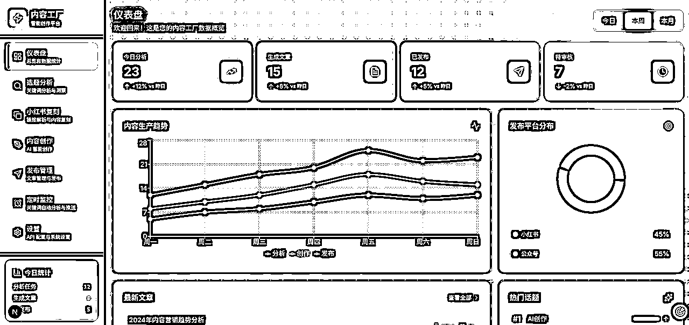

# 两天搭出“内容工厂 Agent”，一周内容几小时搞定！小白也能复刻
作者：龙哥

说真的，以前一想到“做内容”，脑子里就自动浮现一整套麻烦流程：找选题、扒对标、看数据、改文章、配图、发布……一天下来，内容没产出几条，人先累垮了。直到我花两天时间搭了一个“内容工厂 Agent”，原本要磨一周的活儿，现在几个小时就能收工。这效率，谁用谁知道。

它到底帮我干了啥？拆开看其实就四步：

- 输入关键词，自动批量去抓👸号文章和📕笔记；
- 数据收回来以后，一键生成分析和选题洞察；
- 照着洞察，快速改写或创意生成新的👸号/📕内容；
- 写完直接丢进对应平台的草稿箱，连手工粘贴都省了。

拿我自己举个实际例子。我一直在📕做职场内容，以前找对标选题得翻几十篇笔记，再手动拆解热门数据，改稿、配图、发布折腾一整套，一天下来心力憔悴。现在呢？输入一个“2025 职场高效工具”，一分钟左右，100+ 篇高赞的👸号和📕内容就到手了；再花一分钟做分析，系统直接给出一条洞察，比如“把 AI 工具和时间管理结合着写，互动率能提高 40%”；然后基于这条洞察，几分钟就能改出 3 篇笔记，一键送到📕草稿箱。连该配什么 emoji、该带什么标签，都按对标爆款自动帮你设计好了。

这套玩法不只是对👸号、📕好用，小绿书、国外的 X、Reddit 同样适用。本质上就是把那些可重复的脏活累活交给自动化，让效率实现“指数级提效”，我们只负责把精力聚焦在真正重要的事情上。

这次我也是跟着 @钱塘江鲤 教练的航海项目学的，原本目标只是跑通核心功能，学完才发现，搭建思路和落地方法才是最大收获。教练的干货帖放这里了：[https://wx.zsxq.com/group/1824528822/topic/45811414221158288](https://wx.zsxq.com/group/1824528822/topic/45811414221158288)

另外，评论区有圈友问用的什么 AI 工具，也在这里统一说下：前端用免费的 Gemini 3，后端用 ChatGPT 的 Codex，没有搞一堆复杂配置；具体提示词文档里也写了。

别让重复劳动霸占你的创作时间，这个思路去试试，说不定下周的内容，这周就搞完了。