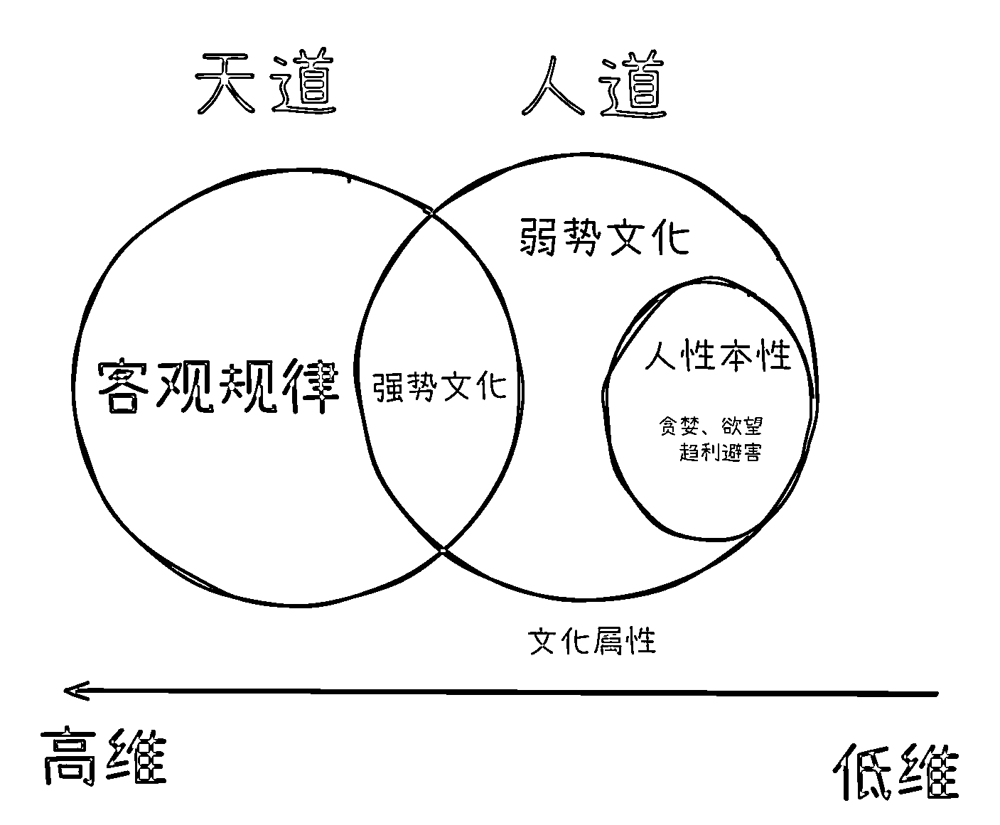

# ('(42 赞)为什么越努力越痛苦？答案藏在一张圆图里', (2, 27))

你有没有过这样的时刻：明明已经拼尽全力，生活却像一潭死水，越使劲越觉得喘不过气？我们总以为问题出在“还不够努力”，但真相可能不是这样。

这篇文章，是一个作者用整整二十年沉淀出来的感悟。它不熬鸡汤，不玩心计，也不讲虚玄的命理。如果你愿意静下心读完，可能会恍然醒悟——许多你认定“再努力也解决不了”的困境，其实所有症结都指向一个你一直没注意到的入口。

那个入口，就画在一张圆图里。

原文链接：https://a0u2vshvubw.feishu.cn/wiki/CekMwCkOfiCZ9OkhqGdcgRi6nUf?from=from_copylink