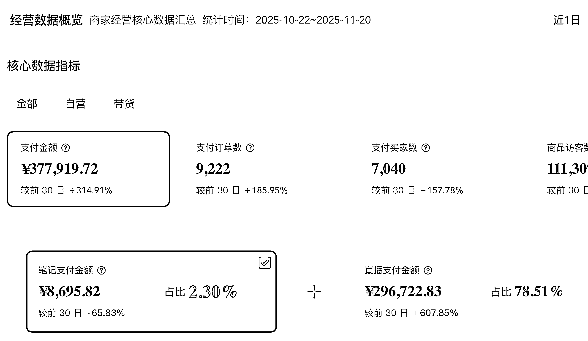

# 一个人扛📕手播直播间：30天零投流卖出30万，毛利高达七成

大家好，我是龙哥，曾在娱乐圈摸爬滚打了七年半。如今的主业是直播电商，至今已深耕近五年。

上个月10月9号，我在📕从零起了一个不露脸的自营手播直播间。至今为止，这家新店的成交几乎完全依赖直播本身，以及直播所撬动的笔记带货，完全没有付费投流。新账号单店，过去30天的GMV稳定在30万左右，综合毛利区间在60%到80%之间，具体会因SKU而异。

这次想把从起号前的蓄水准备、首播当天，到现在实现稳定出单的完整周期，用时间线的方式拆开来讲清楚。把当时的判断逻辑、每一步具体的操作细节，以及复盘后的思考，全部摊开给到大家。

简单做个背景交代。之前我在圈子里分享过虚拟资料副业的内容，所以不少老朋友对我有印象。那个项目我还在维持，但因为盗版泛滥已经不再上新。回归主业，我早期在抖音做带货直播的运营，2023年4月第一次在📕开播，从此就一直没停过。中间废掉过不少账号，那些失败的账号堆出来的经验，才成了今天的底气。更早之前，我也曾在娱乐圈和风投圈打杂做事。

完整的内容笔记我放在了飞书：

* * *

评论区：

申铭呀 : 欢迎大家报名 12 月📕直播航海，领航直播的时候会讲的更详细一些

晴子 : 申铭老师是教练啊，欢迎大家报名📕直播航海😉😉😉😉

戴巍 : 晴子推崇的教练肯定是高手[愉快][强]

、God : 感谢教练讲的好细

申铭呀 : [抱拳][抱拳]

申铭呀 : [抱拳][抱拳]也是给自己复盘一下

冬日暖阳 : 求带带

Kammy : 好详细！真的很用心！！