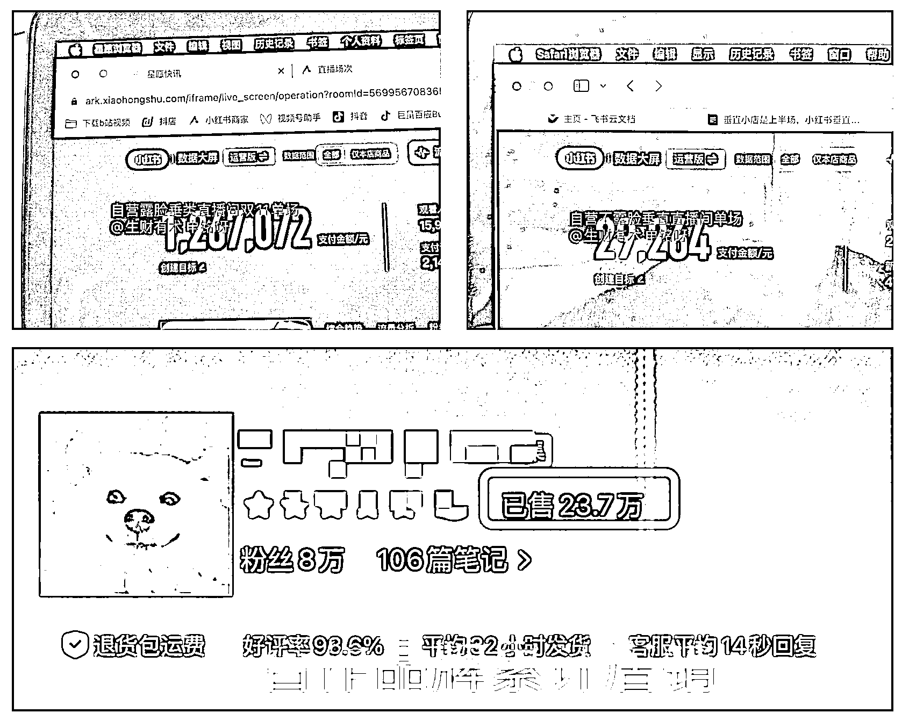

# 垂直小店只是起点，小红书垂直直播才是更大的机会

大家好，我是申铭。

过去七年半，我曾在娱乐圈做练习生。现在，我把主要精力放在了小红书电商直播上。日常生活基本围绕直播间展开：研究数据、筛选商品、复盘场次，几乎每天都有看不完的报表和拆不完的问题。

目前，我们做过几种不同类型的直播业务。

自营的小红书家居垂类直播间，采用露脸形式，今年双 11 单场 GMV 做到了 120 万；不露脸、单人垂直直播间，单场 GMV 也达到过 2.9 万。除此之外，我们还合作运营过品牌垂类店铺号，主要销售牛仔类产品，商品客单价集中在 500—600 元左右，累计销量达到 23.7 万。

前几天，看完龙哥关于“垂直小店”的分享，我的第一反应是：原来我们一直在做的事情，被别人完整地讲出来了。

一方面，接下来肯定会有更多人进入这个赛道，竞争压力自然会增加；但另一方面，这也说明垂直化经营确实是一条值得长期投入的路径。有人关注，意味着市场正在被看见；而市场被看见，也恰恰证明这里还有足够大的发展空间。

在我看来，垂直小店更像是上半场，真正值得继续深挖的，是小红书上的垂直直播间。

小店解决的是“卖什么、服务谁”的问题，而垂直直播间进一步解决了“如何持续建立信任、如何提升转化、如何把人群经营起来”的问题。尤其是在小红书这样的内容平台，用户并不是单纯为了低价而来，专业度、场景感、表达方式以及主播与用户之间的关系，都会影响最终成交。

所以，垂直直播并不是简单地把商品搬到直播间里销售，而是围绕一个明确人群，持续输出内容、筛选产品、搭建信任，并通过直播完成交易闭环。

这也是我们持续投入的原因。

借着这次机会，我想把自己在小红书直播过程中的一些观察、方法和经验整理出来，和大家进一步聊聊垂直直播间到底应该怎么做。

如果你对小红书电商、垂直店铺或直播业务感兴趣，欢迎阅读后面的 7000 字深度分享：

[`ai.feishu.cn/docx/URDldlVMIoEGdSxTjgoc1JyxnIh?from=from_copylink`](https://ai.feishu.cn/docx/URDldlVMIoEGdSxTjgoc1JyxnIh?from=from_copylink)

* * *

评论区：

篮子🍀：没想到还能看到直播方向的经验分享，感谢输出。

吴泽承：感谢分享。

申铭呀：[抱拳][抱拳]不用客气。

申铭呀：[抱拳][抱拳]感谢支持。

ling：谢谢分享。

申铭呀：[抱拳]