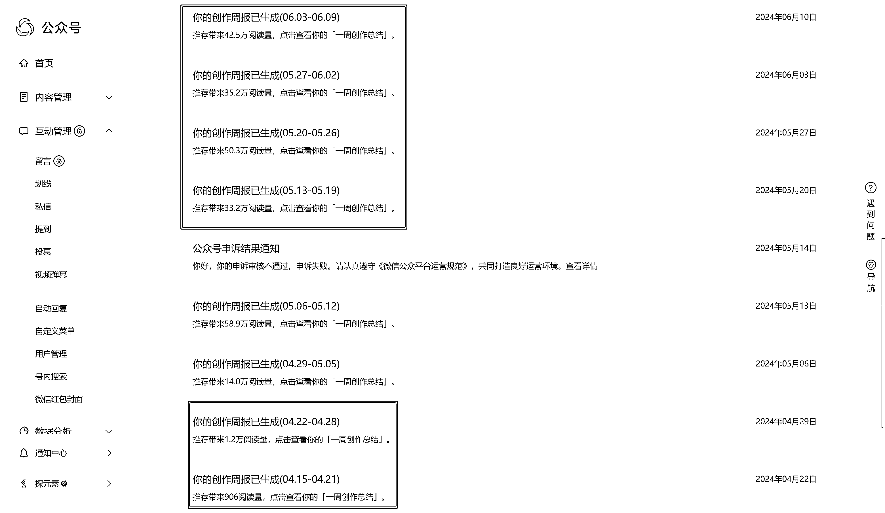
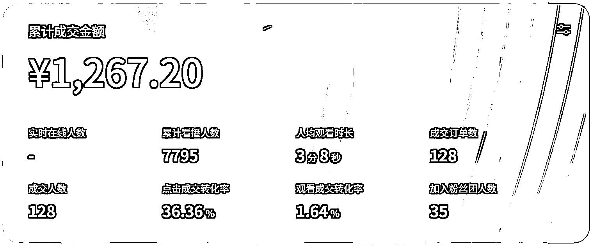
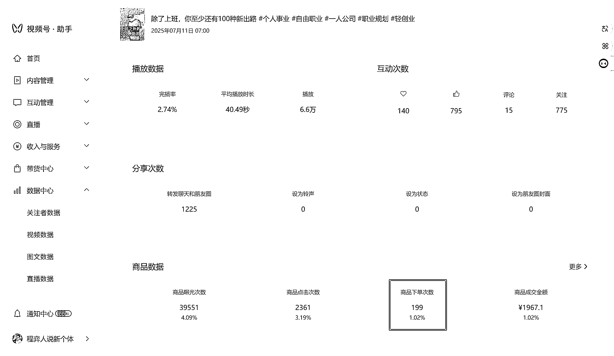

# 从 2024 年起，我们如何靠调整🛰️ IP 获客打法实现持续增长
作者：龙哥

## 从 2024 年起，我们如何靠调整🛰️ IP 获客打法实现持续增长

作者： 探元素

日期：2025-11-24

大家好，我是探元素的创始人弈人，大家也可以叫我 Dylan。

今天想和大家复盘一下，我们从 2024 年至今，在🛰️生态里不断迭代 IP 获客思路的真实经历，希望能给大家提供一些可参照的思路。

我们团队的核心业务，是帮职场人把自身的阅历、技能和爱好，转化为可变现的第二收入，让大家靠自己的长处和热爱赚钱，从而获得更从容、更有选择权的人生。

2024 年之前，我们的客户主要靠📕图文矩阵进来。做了十几个号，通过私信加粉导流到🛰️，再做 1 对 1 的顾问式成交，旺时一天能有 40 到 50 个新加。但从 2023 年下半年开始，📕对站外引流的打击越来越严，号封得频繁，获客变得非常焦虑。

于是 2024 年初我们做了第一轮迁移，把📕的内容同步到👸号做日更。一个月不到，表现就完全变了：周阅读从 900 多一下子涨到 30 万+，客资从一天两三位数提升到日均 300 到 500 人，峰值一天破千。

👸号跑通后，我们归纳了几个关键做法：

1）引流动作一定要走官方合规路径。过去很多人习惯在底部放二维码，这其实是违规的，而且一旦被限流，平台不会提前通知。相对安全的引流方式有：关注自动回复引导、文章内挂载🛰️小店商品链接、评论区置顶一条官方引流推文。

2）进入推荐池的前提是干净合规，进入后能不能放大，核心看粉丝点开率。很多号主觉得只发业务相关的干货就能留住人，这其实是误区。举个例子，做留学的号，如果每篇都是申请攻略，用户一旦申请成功就不会再看了。

我们的做法是围绕核心人群的生活全场景来做选题。还是以香港留学为例，除了申请干货，还可以写同学周末出游路线、在港生活的独特话题。选人比选业务更重要：要清楚你的核心用户是什么年龄、性别、生活状态、兴趣偏好，把内容铺到他们日常关注的各个角落。垂直号的本质，不是垂直于一个业务，而是垂直于一群人。

3）标题决定点击率。写正文花 1 小时，起标题至少要花 2 小时，标题的重要性远超预期。好标题大致分四类：反认知型希望感，比如“主体性回来了，人会自动变聪明”；共鸣型认同感，比如“所有不尊重你的人，都在赌你没前途”；超认知型干货感，比如“一个吊诡的改命偏方：饲灾”；争议型讨论感，比如“你觉得什么好看，什么就是你的阶层”。

4）正文结构可以借鉴议论文的“是什么、为什么、怎么做”，我们探元素的文章大部分都遵循这个框架。

但👸号天然不稳定。2024 年下半年我们因为之前用的二维码引流，被限流过一次，业务直接断崖。那个坑让我们意识到必须寻找更稳的获客方式。

于是进入第二阶段：视频号直播做 9.9 微付费获客。

从 2024 年下半年开始，我们在视频号做直播卖 9.9 元的前端引流课，先试连麦后来转循环直播。纯自然流时单场能做到 80 单，后来加少量付费投放后稳定在 130 到 150 单。

对比👸号免费引流，付过 9.9 的用户质量高很多，且在直播间已经听过我们的表达，信任基础更好，后端转化率是👸号的 10 到 15 倍。相当于一场 130 单的直播，效果等同于👸号带来 1300 到 2000 个新客。而且熟练后，直播的转化更可控。

给新手的建议是先从循环直播起步。连麦不可控强，对控场和答疑要求高。循环直播的逻辑是“讲知识点+卖产品”反复循环。

我们总结了 4 个要点：

1）只循环 1 个经过验证的强留人知识点，贴片内容只是为了互动和留人。
2）干货时长和销售时长保持一致。精准用户在销售环节不会快速流失，但要把痛点、价值、稀缺、福利逼单都讲透。观众最多撑过一个循环，转化不了就会走。
3）复盘核心指标是停留时长。能否让用户停留 3 分钟以上，直接反映内容质量，不够就迭代知识点。
4）重视预约。预约进来的用户画像更准，能带动首批互动，平台会据此扩大推荐；预约数越高，公域推流权重越大。成熟直播间，开播前预约数 x 8% ≈ 首轮出单数。500 个预约，开场大约有 40 单。

直播虽然稳定、成本低，但非常耗人。每天重复讲同样内容，心理消耗很大。特别是当 IP 既要管前端流量，又要管后端转化、交付和团队，压力会非常大。

所以从 2025 年 5 月起，我们又开启第三阶段：用短视频挂车卖 9.9，引流课做🛰️豆投放。跑通后，单条视频生命周期能贡献数百单 9.9，ROI 在 3 到 5 之间。

投放素材完全公式化，固定 5 段结构：3 秒开头 + 用户痛点场景 + 客户案例 + 方法提炼 + 销售转化。下面是一个真实脚本案例：

把你的兴趣“拆碎”，就能赚到钱

我们很多人都有持续投入的爱好，写作、画画、瑜伽、摄影，花了时间也花了钱，却从没赚到一分钱。核心卡点在于总觉得自己“还不够专业”，想再准备再说。如果你也有这种纠结，可以试试把爱好彻底拆碎。

我有个学员晓晓，她痴迷整理收纳，工位每天都收拾得很有美感。收纳变现通常只有线下服务或线上教学两种路，她不喜欢累的上门，又觉得自己没系统学过不敢教。我建议她先单点突破，做一个“工位整理 7 天训练营”，带人用一周时间把工位整理成自己喜欢的样子。现在她靠这个每月稳定增收几千，接下来还要推“卧室整理训练营”。

把兴趣拆到细分环节和场景，就能变成可售卖的小产品。每一个人都能基于自己的经验、技能、爱好，打造属于自己的个人事业，做喜欢的事赚开心的钱。

这个理念我在 2020 年底提出，过去 5 年一直在做。至今全网积累约 150 万粉丝，深度帮助超过 3000 位伙伴孵化个人事业，跑通独立获取收入的商业闭环。基于这 4 年多辅导 3000 名学员的经验，我们做了一个为期 2 天的行动营。用内部直播课的形式，拆解普通人从 0 到 1 开展个人事业的完整路径。第一天教你找到真正适合自己的个人事业定位，第二天教你把定位落地为可收费项目，跑通商业闭环。全程有专业老师 1 对 1 答疑。

不管你是想为主业增加副业、在行业下行寻找第二曲线、向往自由职业，还是很久没工作想重启，都可以先掌握这套方法。因为能靠自己在市场上赚到钱，才是人生底气的基础。

我真心推荐你报名视频下方“启动你的个人事业”2 天行动营。已报名的伙伴请留意短信，点击链接扫码添加助教即可参与。让我们一起，做喜欢的事，赚开心的钱。

短视频投放的优势是，可控且可放量。只要后端转化、交付退费率稳定，成本逻辑清晰，就能按节奏放大。爆款不可复制，但有数据支撑的获客内容是可复制的。

👸号、视频号直播、视频号短视频，是🛰️生态获客的三大形态。它们各自的创作公式是什么？11 月 29 日的航海家大会，我会详细拆解。

* * *

评论区：

西昂 : 又一个 yiren[强]

才 : 要是文章底部挂小程序的连接违规不？

一束欣光 : 在这里偶遇了，之前参加了碳元素的项目