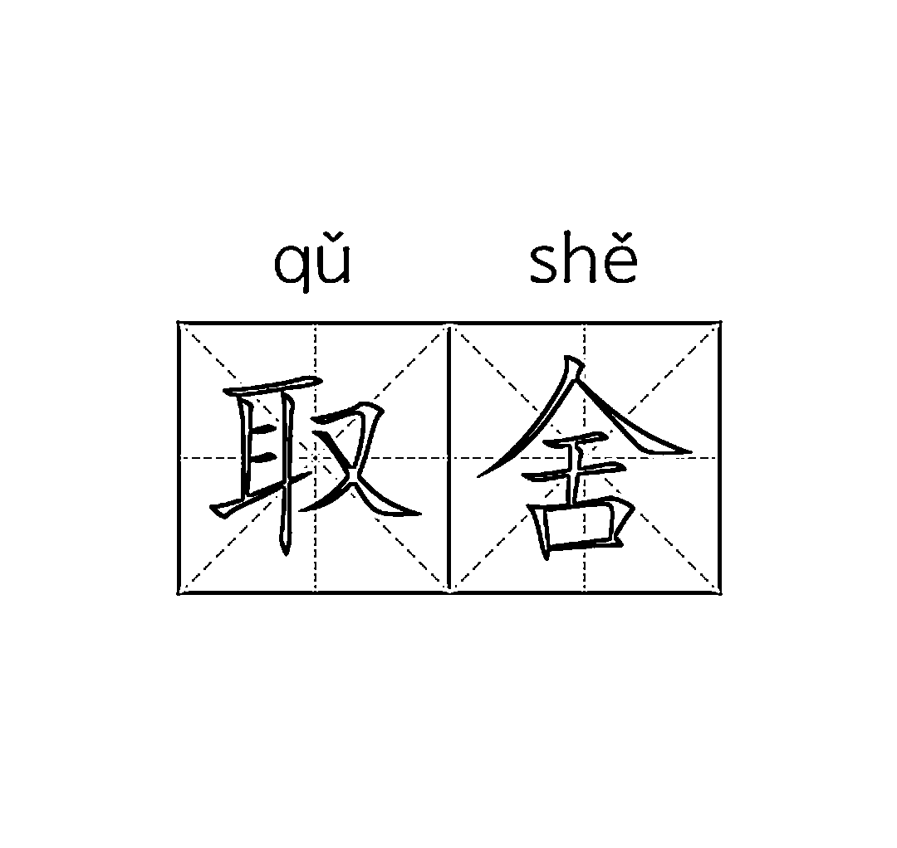

# 别再什么客户都要了：用三维取舍，精准锁定你的钱袋子人群

战略的本质从来不是堆资源，而是做减法。之前在赚钱那篇帖子里提到的第3点，有伙伴追着问细节，这篇就是专门拆解的进阶版。

资源天生稀缺，时间、人力、钱、渠道都扛不住铺摊子。只有把有限的弹药打在最值钱的靶子上，业务才有胜算。取舍不能靠感觉拍板，必须靠数据和洞察来定生死。

一个市场看似整体，其实是无数细碎需求拼起来的。理解市场，就是找对视角，而这些视角就是维度。多维度交叉起来，才能把模糊的“大众市场”筛成清晰的目标人群，避免一网打尽的无效内卷。

并不是所有维度都值得纠结。真正能左右你业务走向、逼着你放弃其他选项的，才是战略级维度。比如你决定主攻年长人群就放弃年轻市场，那年龄就是战略维度；性别若男女性质一样，那它就只是普通标签。

战略维度宁少勿多，三个刚刚好。再多就会分神，战略就糊了。就像开车导航，你只需要看方向、距离、地形，细节再清楚也乱不了大局。

怎么判断该舍谁留谁？用三把尺子量：能不能赚钱、愿不愿意干、配不配得上。

先看能不能做。市场说了算，不是你说了算。先判断需求真不真实、盘子够不够大、竞争厉不厉害。没矿的金山，再怎么挖也是空谈。可做是底线，底线不成立，后面全是空想。

再看想不想做。市场可选的赛道不止一条，筛到能做的以后，得看自己上不上头。你热爱的，做起来像玩游戏；你嫌弃的，做起来像搬砖。没热情撑不住，没热情也穿越不了低谷。

最后看能不能做。单打独斗的时代，学习成本已经被拉低到历史最低。AI、圈子、龙哥盟、互联网获客、世界工厂的供应链，缺什么补什么。要是起步晚，就去AI、视频号、小红书这类新战场，跟大家重新比跑步。

选定三个战略维度后，给每个维度划线。可二分，如性别男/女，地区城市/农村；可三分，如年龄老/中/青，消费力高/中/低；可四分，如家庭状态单身/恋爱/已婚/有娃。

每个维度只留一个选项，三者一乘，人群就立起来了。女性×中等消费×有娃=中产宝妈；女性×中老年×中等消费=广场舞阿姨。

画像把抽象需求变成了活生生的人，你能看见她的日常、痛点、渴望和梦想。需求不再是概念，而是能被触摸的个体。

这张画像直接决定内容写给谁、商品卖给谁。你替谁发声、当谁的嘴替，就不会对牛弹琴；你为谁挑货、当谁的买手，就不会卖梳子给和尚。方向对了，用力才不白费。

战略就是聚焦，狠心放弃九个，死磕一个。从万人想变成一群人，从一堆问题变成一个问题，从多种方案变成一种方案。追两只兔子，最后一只是都不抓。

--- 作者：V 先生 标签： 发布：20251126

修改：20251126

更多：[`t.zsxq.com/ejCdh`](https://t.zsxq.com/ejCdh)[`t.zsxq.com/1OuMP`](https://t.zsxq.com/1OuMP)

* * *

评论区：

七天 : 取舍，我觉得最关键的不是要什么，而是不要什么。

胖虎 : 企业家和商人最大的区别