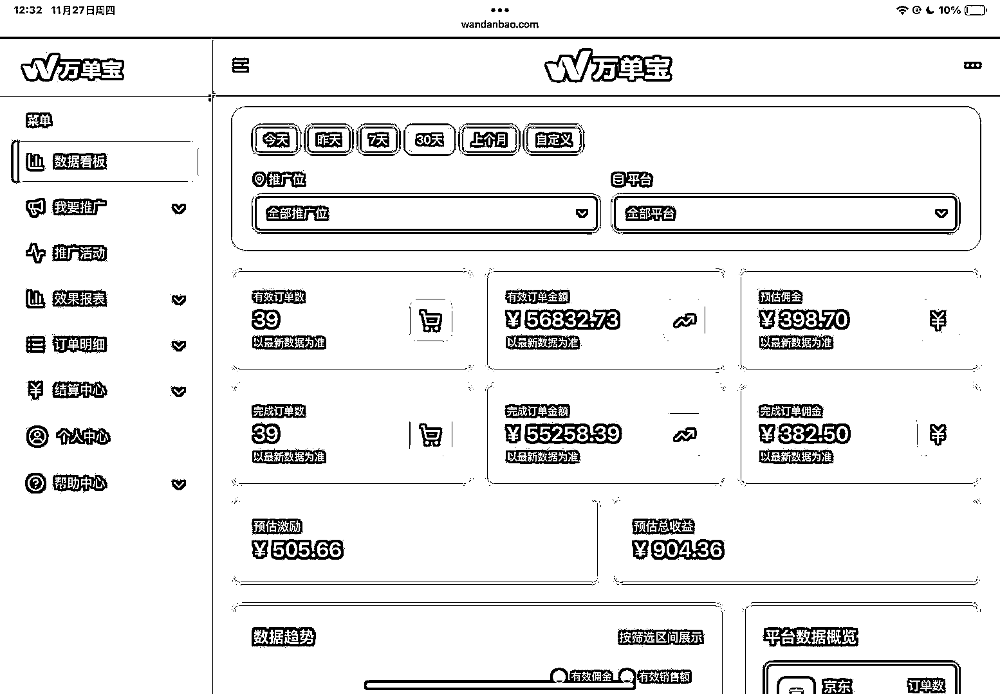
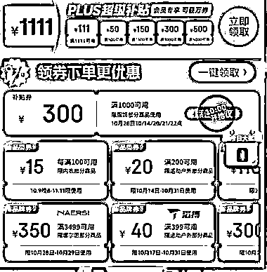
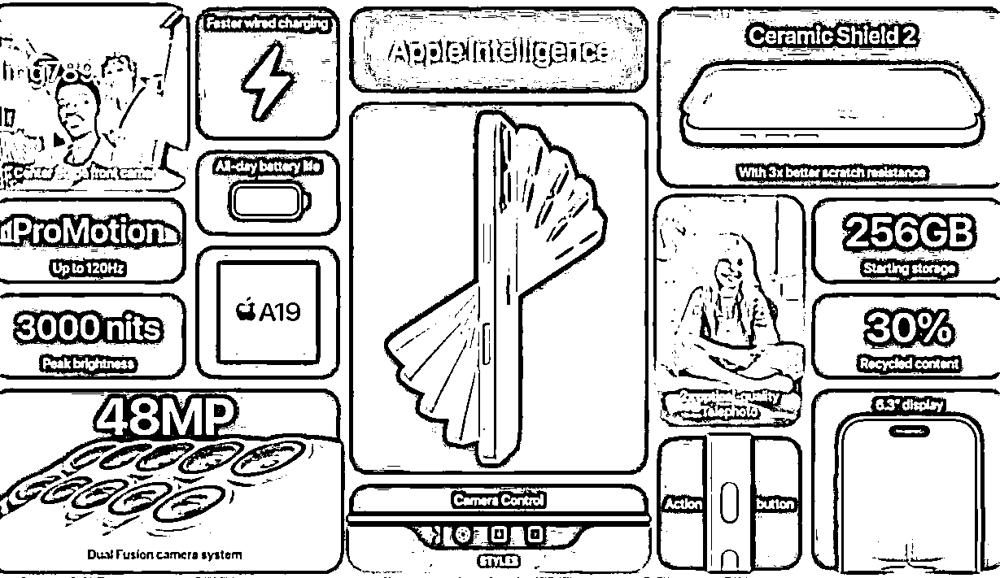

# 新手也能在抖音 CPS 赚到第一笔佣金？我的从零跑通实录

> 原文：[`www.yuque.com/for_lazy/zhoubao/pwkefxxlkuk98drx`](https://www.yuque.com/for_lazy/zhoubao/pwkefxxlkuk98drx)

## 新手也能在抖音 CPS 赚到第一笔佣金？我的从零跑通实录

作者： 毛小雨

日期：2025-11-27

新手小白怎么从抖音 cps 赚到第一块钱

生财的朋友们大家好，我是毛小雨。入圈两年，参加过十几次航海项目，这次第一次认真做抖音 CPS，单期销售额冲到5万，榜单排名40/450，算是把第一个小闭环跑通了，也拿到第一笔1000块的佣金。

作为一期纯新手，我把自己踩过的坑和摸索出来的方法整理出来，给刚起步、刚报名的伙伴们做个颗粒度对齐。内容大致涵盖：

1. 首期实操中的体感总结
2. CPS 的底层逻辑其实是种草
3. 新人如何起步做抖音 CPS
4. 如何找对标，什么是真正有效的对标
5. 利益点要讲清楚，提前拆解好流量款
6. 视频节奏怎么把控
7. 怎么学着模仿
8. 评论区维护和用户引导技巧
9. 口播和曼波的注意事项
飞书👉 [怄火]我们都是在不断试错，等着属于自己的爆款，慢慢来[`icn5limdg3ns.feishu.cn/wiki/NYz5wrUrZiX0XokvlfHcoZwbnnc`](https://icn5limdg3ns.feishu.cn/wiki/NYz5wrUrZiX0XokvlfHcoZwbnnc)

* * *

评论区：

Harris : 先收藏再看

毛小雨 : [跳跳]