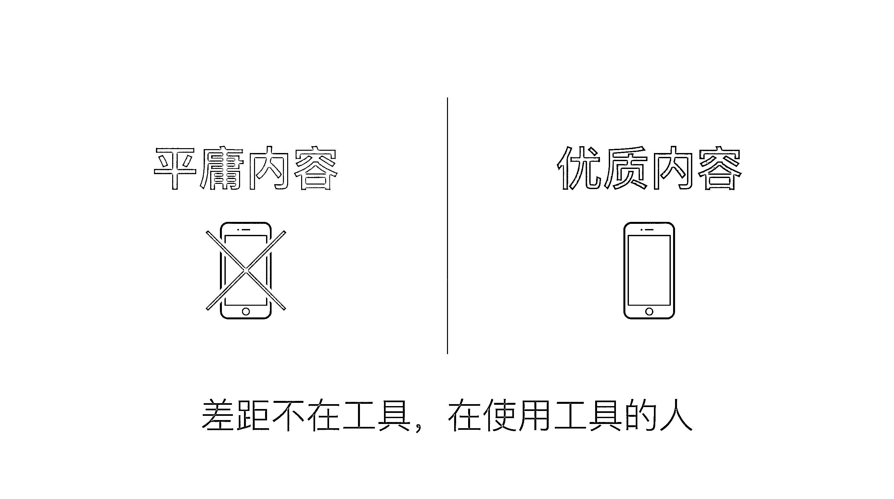
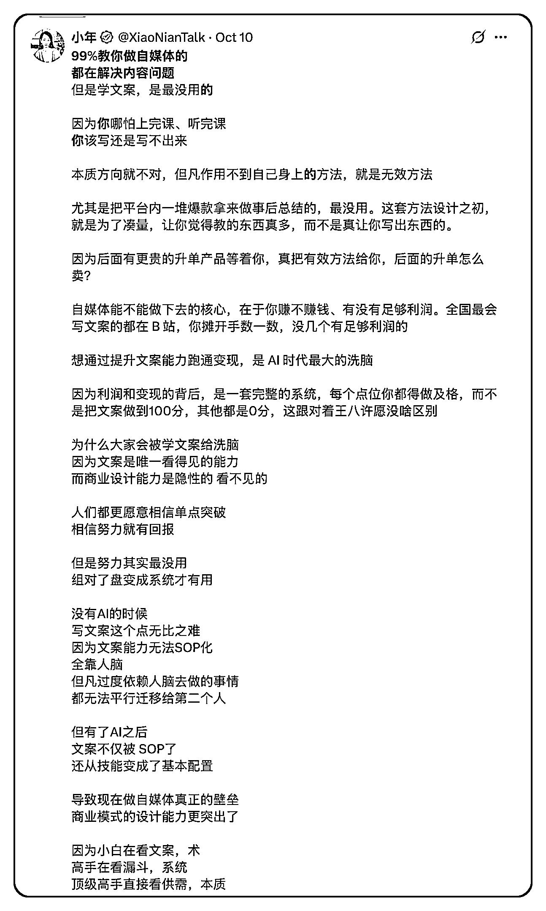
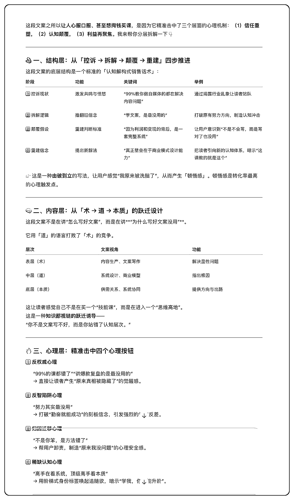
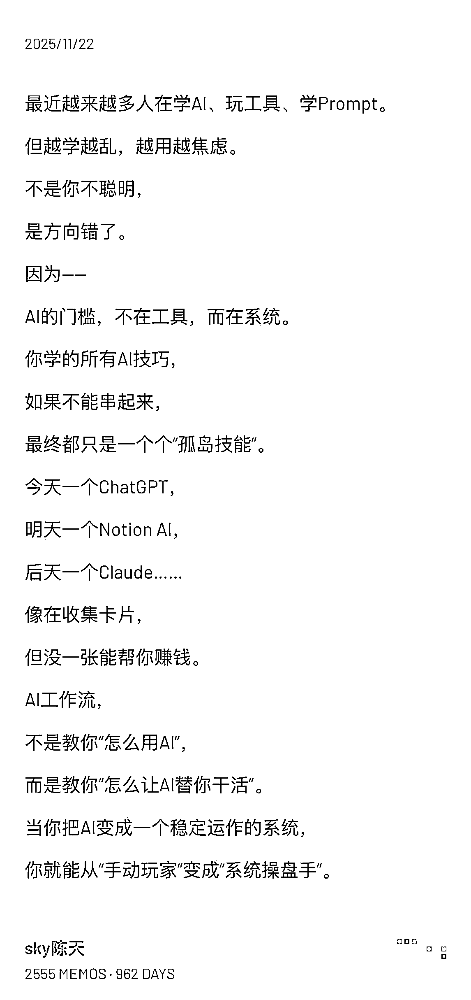
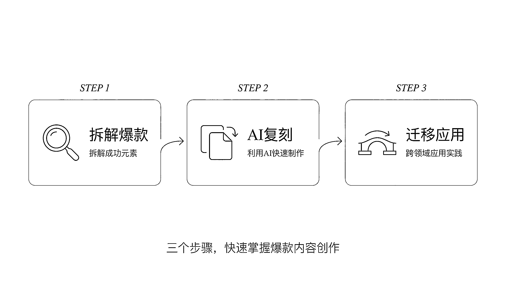
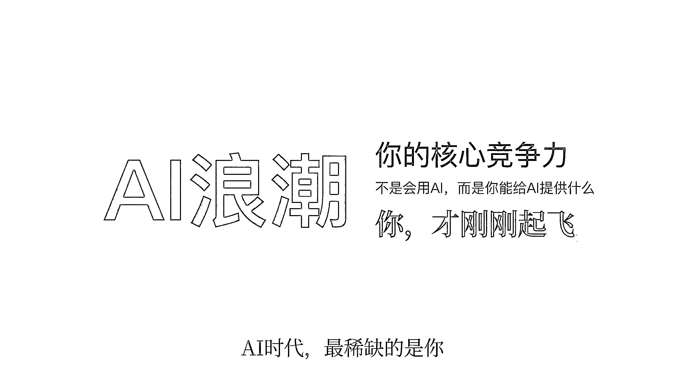
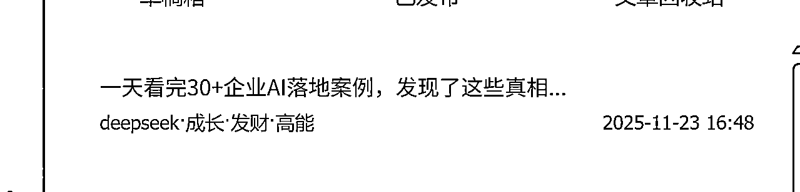

# 别再为提示词焦虑了：写不出刷屏文案，真正拉开差距的是审美与积累
作者：龙哥

一次内训上，我随口问：“大家平时会让 AI 帮着写东西吗？”台下几乎全部举手。紧接着一声抱怨冒了出来：“老师，我也用豆包，可写出来的东西我自己都没脸往外发。”满屋子人一下笑了。

我也跟着笑，但心里被这句话扎了一下：明明是同一个工具，为什么有人靠它场场出彩，有人用它连一条动态都不敢晒？

早些年我开始带项目时也遇到过类似的困惑。同一个班、同样的讲法、同样的示范，怎么有的人回去立刻上手，有的人交出来的稿子还是一股“机器翻译味”？

带着一百多家公司的项目经验，连做了七百多天实操，我总算把这件事想透了。

一篇内容能不能跑起来，不看你会背多少高大上的技巧，而在于五块拼图是否齐全：眼光、工具、框架、提问、私人素材。五块都到位，才谈得上有机会成为刷屏级的内容。

先聊最容易被低估的“眼光”。

什么叫有眼光？你让 AI 写一篇笔记，没病句、不缺逻辑、排版清晰，于是你判断“没问题，发吧”。结果发出去半天，零反馈。这不是工具不争气，是你缺少判断好坏的能力——你只是从自己的角度觉得“看得过去”，却不知道用户会不会被打动。

眼光哪来的？不是天生，是拿大量实例喂出来的。我给那些老师布置的第一道题就是：研究一百篇热门笔记，不是看热闹，而是想明白用户为什么赞、为什么藏、为什么吵。

点赞，是因为情绪被接住了；收藏，是因为觉得这内容以后用得上；评论，多半是想表达立场，甚至想反驳两句。

当你把这些“为什么”弄懂了，再回看 AI 写的初稿，你才会知道该在哪儿动刀。

关于眼光，我讲一个真事。

某天刷到一条讲写作的内容，第一句就像钩子一样把我拴住了：

“99%的人都搞错了，写作从来不是你的瓶颈……”

我看完第一反应不是“这话有没有依据”，而是“这人太猛了，他要卖课我可能真会下单”。

你看，能让人产生行动冲动的文字，才算真正击中了靶心。

我赶紧把这篇文章收进素材库。收完又做了三件事：

第一件：向 AI 发问。我把整篇文章贴进去，问它：“我看着看着就有花钱的冲动，这到底是怎么做到的？”

它列出了几个心理机关：先用“你错了”打破惯性，再对习以为常的说法提出反直觉，最后把结果归因到别的地方。这些我隐隐约约摸到却说不透的门道，被它几句话全串了起来。

第二件：让它搬迁。我对它说：“原帖讲的是写作课，我这边做的是 AI 落地辅导。你照着刚才拆出来的结构，给我再写一篇。”

不一会儿，它的初稿就返回来了。

行业隔了十万八千里，但那股让人一路读下去的势能，几乎完全保留下来。

第三件：把这套流程固定成习惯。我给这种方法起了个名：跟爆款、拆机关、搬套路。看多了，拆多了，你再给 AI 下达指令时，就不再是“随便写一篇”的模糊状态，而是明确知道要借哪股劲。

这也是为什么我能快速帮不同行业的客户找到内容手感：不是因为我有什么神秘工具，而是我懂得先把好内容拆穿，再让 AI 照着重建。

说完眼光，再补另外四块。

工具：市面上的选择越来越多，别急着全都试一遍。选一个用着顺手的，把它的长处和脾气摸透，比手里攥着十个账号更有用。不同助手写出来的语感不同，关键看哪种和你合拍。

框架：内容是流出来的，但得先有容器接住它。框架可以很简单，比如“开头给反常识、中间给方法、结尾给行动提醒”。只是别拿一套框子套所有平台，该长则长，该短则短。

提问：这一步最容易被忽略。很多人不是不会用工具，是不会把脑中的想法转成清楚的需求。同一件事，问得含糊，AI 答得也含糊；问得具体，AI 答得才有价值。提问的精细程度，几乎决定了你到手稿子的上限。

私人素材：最后一个，却往往决定你与别人的区别。AI 能查到全网公开内容，但它很难知道：你的经历中哪些事最动人？你解决过什么稀奇古怪的难题？你对所在行业有哪些不吐不快的观察？这些只属于你的“底料”，必须由你来喂。把底料备足，AI 写出来的东西才不悬浮，才让人读了觉得“这个人真懂”。

我在陪跑客户的时候，最常做的一件事不是帮他们改文案，而是跟他们一点一点盘出那些藏在脑子里的经验。那些经验，才是内容真正值钱的部分。

那天培训接近尾声，我现场演示了一遍怎么拆、怎么搬。台下几位老师的眼睛明显亮了，那个神情我见过很多次，是“原来还能这么玩”的兴奋。

但我还是给这份兴奋加了一句提醒：工具不会替你成为高手，它只会把你已有的东西放大。你有眼光，它就放大眼光；你有一肚子真素材，它就把那些素材变成看得见的文字；你要是既没判断力也没存货，它放大的，只会是平淡和重复。

所以答案是清楚的：同样的软件，有人拿它写出十万加，有人写完自己都嫌弃。差在哪儿？差在拿工具的那个人。

技术这股风，才刚刚吹起来。趁着现在，多养眼光，多攒底料，多练提问，你就会发现：不是工具不够强，而是你还没准备好让它发力。

