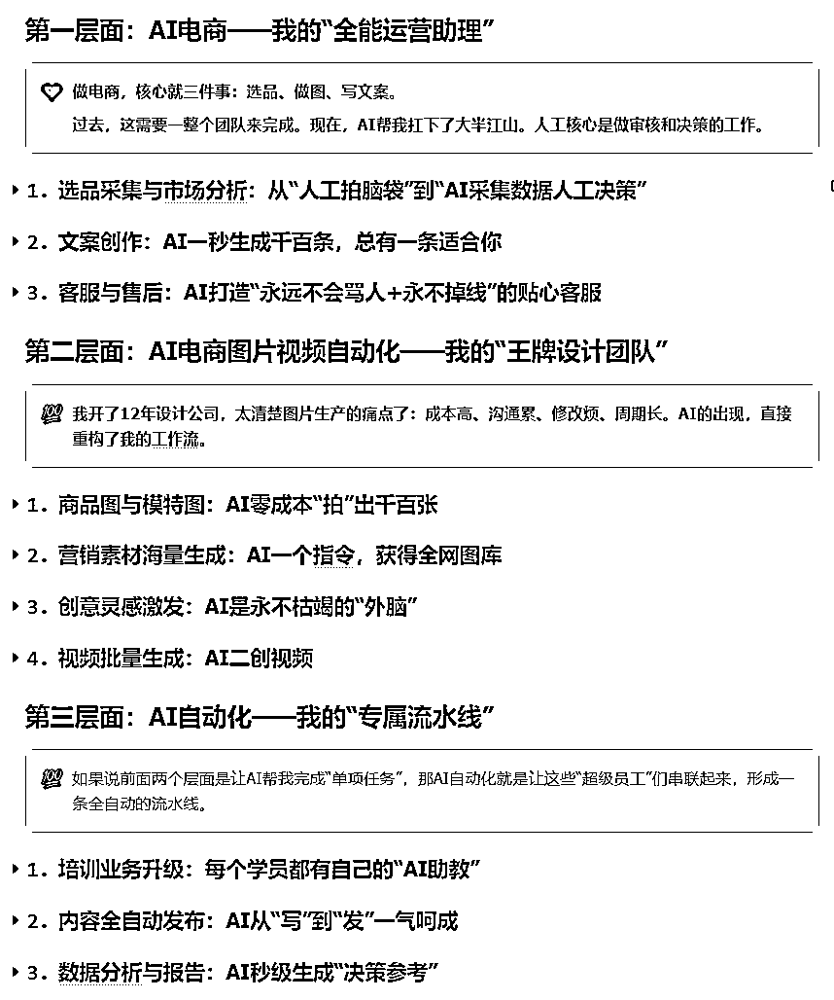
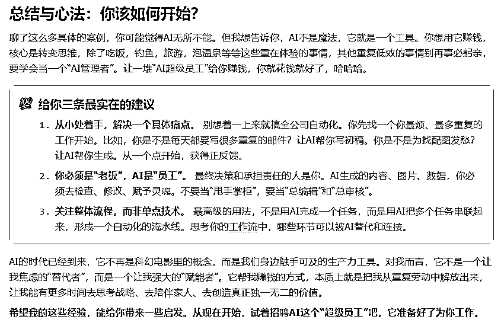

# 用 AI 组建多名“超能员工”，我在三个方向上把时间和利润都赚了回来
作者：龙哥

## 用 AI 组建多名“超能员工”，我在三个方向上把时间和利润都赚了回来

作者： 来来

日期：2025-11-20

哈喽，我是龙哥，AI 热销书作者，已出版三本相关书籍，同时也是龙哥盟航海教练 11 次**（AI 绘画 4 次+AI 视频 2 次+AI 工作流 2 次 N8N 和 COMFYUI+AI 电商 1 次+AI 知识库 1 次+飞书多维表格 1 次)**。

另外我还经营着一家走过 12 年的电商设计公司，现任 CEO，同时做 AI 企业顾问和培训讲师，服务过中国移动、长江商学院、三节课等客户。头衔不少，意味着事务繁杂，时间永远捉襟见肘。过去三年，我把 AI 当成真正下属在用。

**我从不把 AI 视作门槛极高的技术工具，而是纳入公司编制的员工。ta 能 24 小时在线、无需薪资、不会牢骚，电费加会员费对比真人人力几乎可以忽略，而且能力出众。我招的不是一个，而是至少三名“超级员工”。下面展开讲讲我的用工逻辑。**

今天围绕 AI 电商、电商图视自动化、通用自动化这三个战线，分享我这个“人形管理者”如何调配多组 AI 超级员工，实现降本提效、拓展业务、最终增收的实操路径。

  

**想速览结论的同学，直接看下面这段心法总结就够了。**

* * *

评论区：

秋水 : 值得学习！

凯 : 谢谢来来老师的分享[抱拳]