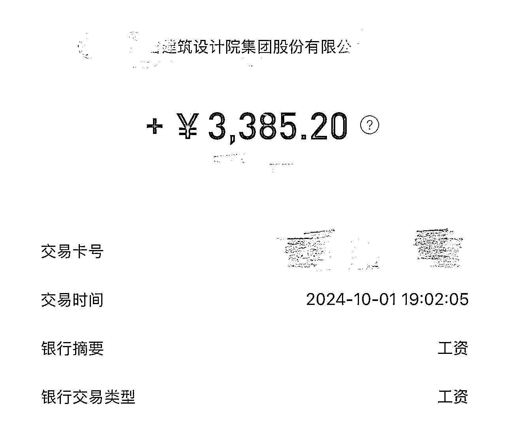
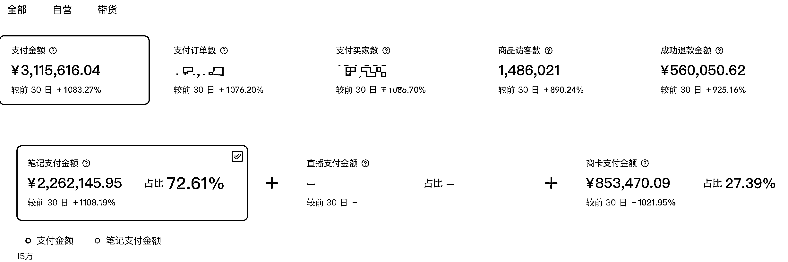
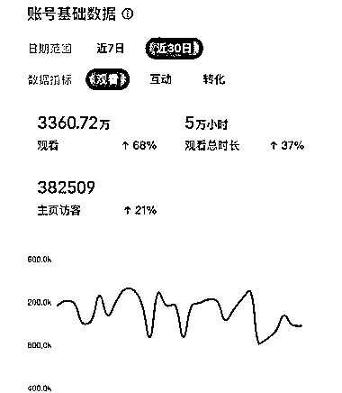
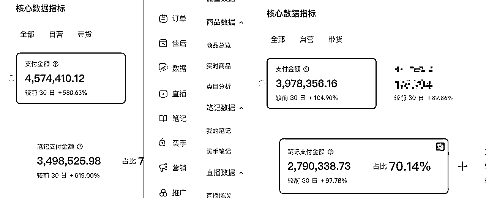
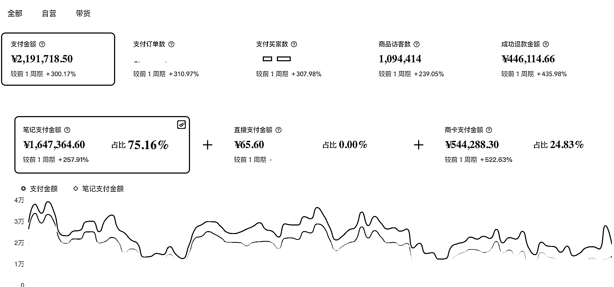

# (44 赞)从国企月薪 3000，到📕月销 100 万的电商达人--00 后女孩📕日产 1000 条爆款笔记的邪修大法!
作者：龙哥

**国企3千月薪→📕月销百万！00后女孩的“量产爆款”野路子，太狠了！**

如果你还在为📕笔记的流量发愁，每天憋一篇都费劲，那今天这个故事，可能会颠覆你的认知。

有个00后姑娘，从国企设计院月薪3000，逆袭成📕月销近100万的电商主理人，靠的是一套“日产1000条笔记”的爆款流水线SOP。这速度，说是“邪修大法”真不为过。

她以前是学建筑的，在国企设计院待过两年。对那行有了解的人都知道，这是工科跟艺术的结合体，最要命的是“快”——一天之内，从设计、建模到出图、汇报，全是家常便饭。这种高压环境，反倒练出了她一套“极端追求效率”的本事：路径要最短，流程要最顺，工作流得反复打磨到极致。

有意思的是，她把设计院那套严苛的SOP思维，直接搬到了📕内容生产上。当别人还在为选题挠头、为文案抓狂时，她已经用这套方法论实现了“笔记量产”，单月销售额直逼100万。

听起来像神话？其实核心就是把“爆款逻辑”拆解成流水线步骤，用最短路径批量生产内容。她现在把这套完整打法整理出来了，从素材库搭建到笔记生产SOP，全是亲测有效的细节。

想知道的，去看她整理的飞书文档：

* * *

评论区：

灵动 : 感觉还没更完？不过思路已经很清晰了，感谢分享