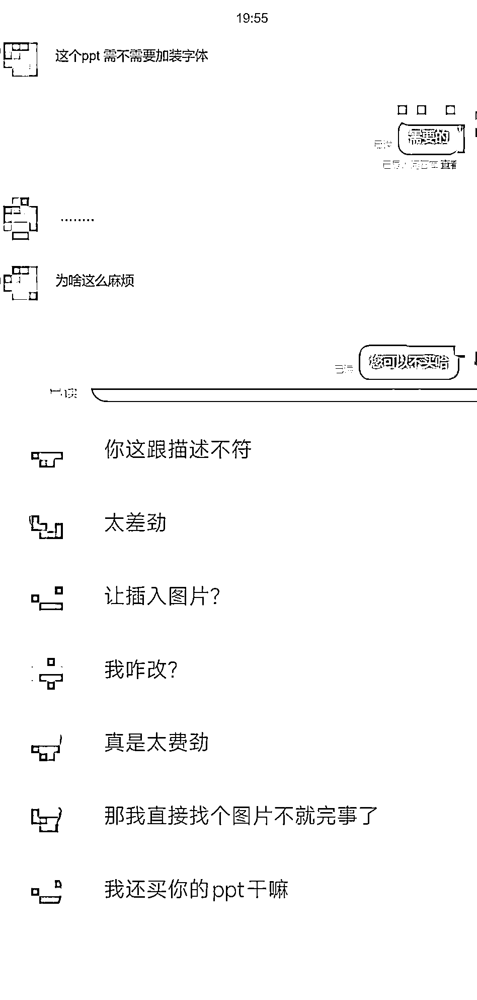
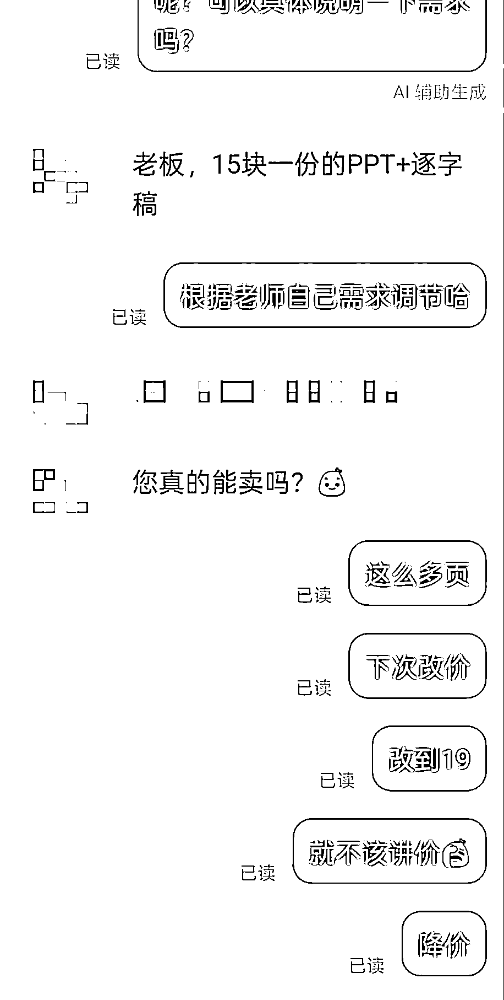
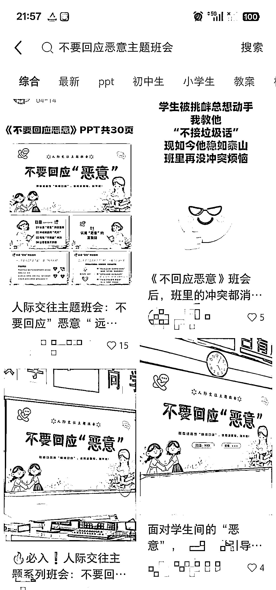
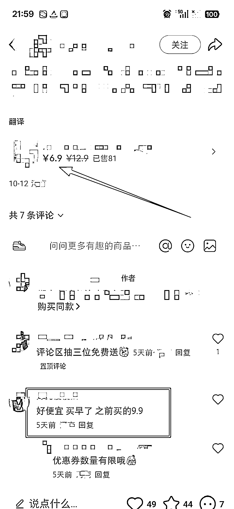
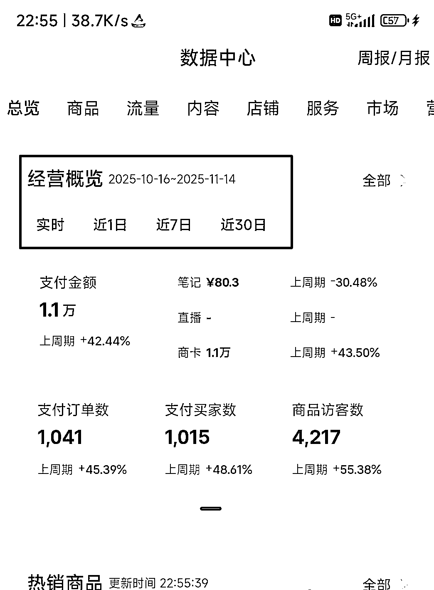
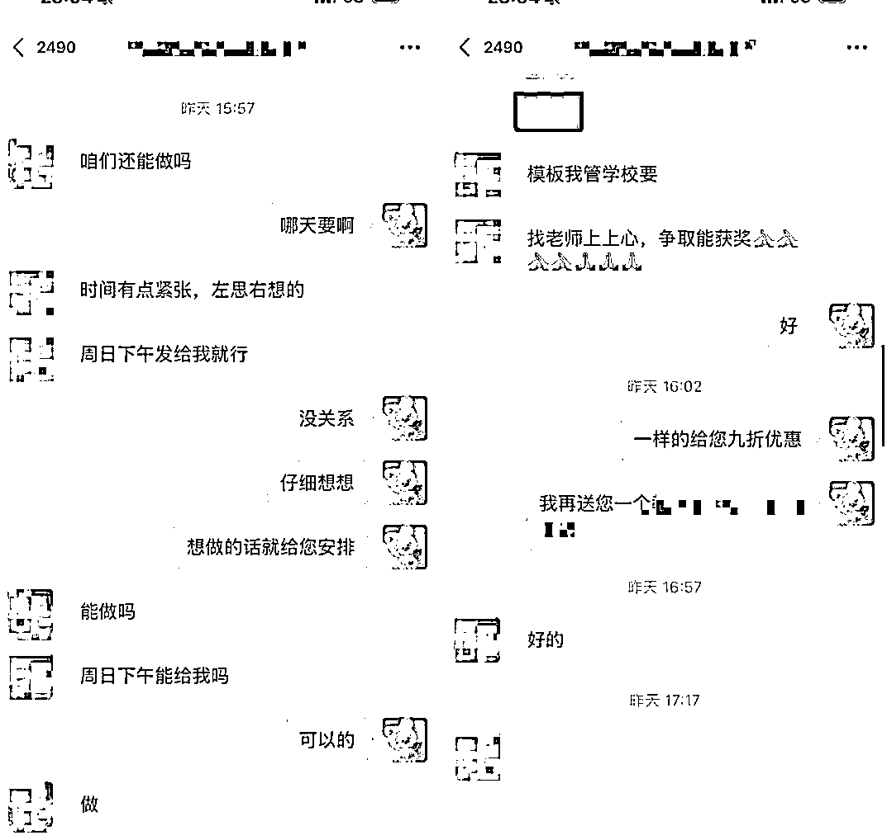

# 📕虚拟电商的5种“花式阵亡”方式，一个比一个离谱
作者：龙哥

> 每月我都要和上百位做📕虚拟电商的朋友打交道，发现现在大家的“翻车姿势”真是越来越清奇了。过去顶多是选品不行、流量惨淡，如今却有不少人栽在你想都想不到的坑里。

**第一种死法：栽在投流上——客单价压得极低，有的标价8.9、9.9的商品，却舍得砸几百块去做推广，吸引来的用户质量普遍不高，计较、事多，还爱无理取闹。最让人头疼的是，这些用户占了便宜还嫌不够，明明只掏了几块钱，却巴不得享受几百块的服务，既不想多花钱，又对产品效果和配套服务百般挑剔。**

**这是最让人唏嘘的告别方式，没有之一。**

有不少人做发售，前端获客成本被抬得很高，单价又压得很低，把全部希望寄托在后端升单来填坑，结果升单率没达标，投流的钱倒是烧了不少。更糟的是，一旦你习惯投流，之后发笔记不买量，几乎就没人能刷到。

**为什么虚拟电商在投流这件事上更容易翻车？**

因为太多人把电商公司经营成了纯粹的投流公司。核心本事不是打磨产品，而是研究算法、琢磨投放策略，不少工作室也这么搞。电商的本质说到底就是竞价排名。用户不管是通过关键词搜索、刷视频还是逛直播间，你的东西再好，用户刷不到就等于零。

**那该怎么办？**

📕的ROI溢价空间确实诱人，如果你擅长投流并且已经跑出了成绩，那就照着自己的节奏继续干。但如果你对投流没有经验，千万别盲目跟风，除非你的笔记已经是小爆款，再加上你懂点推广技巧，或许还能看到点水花，否则基本就是拿钱打水漂。多数人靠自然流量，不断优化虚拟产品的SEO、反复换类目、提高原创度、转移平台也能跑出不错的成绩。一个SEO词烂大街了，就换下一个，不必恋战——开学季就卖课件，期末就推复习资料，节假日就上活动方案。📕做不下去就换视频号，视频号不行再试其他新平台，虚拟资料这门生意，可不止📕一个战场。适当放弃那些低价值客户，时间成本一样是成本。

**第二种死法：栽在跟品上——你辛辛苦苦打爆的款，隔天就成别人的了**

在义乌，同样一把勺子，工厂能变出几十种花样。你在📕出了个爆款课件，第二天就能冒出十个同款。

虚拟产品被抄袭的速度更是快得惊人，不用安排生产，直接复制改改就能上线。你精心打磨的某个班会的课件刚“卖爆了”，三天后就能出现一个标价只有一半的“同款优化版”。

我的一份课件原价15元，后来爆了，我料到同行会拿去低价卖，于是自己改到9.9，结果万万没想到对方是真没底线，直接挂6.9！！！ 

现在不光用户在各个平台比价，平台自己也在比价。有些活动，你要是做不到全网最低价，根本连名都报不上。

虚拟电商唯一的活路，就是差异化。

我的账号，不管是老号还是新号，无论是开店铺还是把流量引到私域，都能保持持续出单。

这并非因为我多么专业、课件做得多么无可挑剔，而是因为我做到了这三点：

**场景差异化：**把目光锁定在开学、期中、期末、节假日这些特殊时间节点上。  
**内容差异化：**在内容里埋入语义SEO，同时把私域钩子搭在产品布局里。  
**价值差异化：**从店铺卖低价资料的人里筛选出愿意付费的客户，引导到私域，用心服务，推动升级到高客单价的代写文稿、定制课件、制作视频等业务。定制化的资料追求尽善尽美，死磕利他思维、提高复购率。

如果你的产品实在实现不了差异化，那就做渠道差异化——同行都在📕，你就去视频号；同行做图文，你就上短视频。

**第三种死法：栽在供应链上——“库存危机”照样能杀死虚拟电商**

好多人觉得只有卖实物才会被供应链拖垮，其实📕上做虚拟电商的同样会遭遇“交付危机”。

有位做女装的网友分享过，库存备了500件衣服，卖了1500单，结果库存还剩300件——那一千多单玩的全是下单、退款、再下单、再退款的无效循环。

虚拟电商的供应链问题更隐蔽，但杀伤力却不小：

- 资料包链接失效，买家根本收不到货  
- 网盘资源被和谐，售后投诉铺天盖地  
- 课程视频没法播放，差评刷屏  
- 客服回复慢半拍，用户直接选择退款  

最致命的是，**退款却不会退广告费。**

如果你走的是付费流量路线，花在推广上的每一分钱，只要用户一退款，就全打了水漂。如今可以考虑把所有虚拟产品都接入📕官方自动发货系统——用户付完款就能秒收到链接，不像阿奇索那样，哪怕电脑关了、没登录千帆后台也照常发货，能大大降低设备投入、售后麻烦和退款风险，算是一个新机会。

**第四种死法：栽在盲目扩张上——在缺氧的地方跑得越猛，死得越快**

做电商的人普遍有个毛病：没流量的时候焦虑流量，有流量的时候更焦虑，总担心明天流量说没就没。

于是一窝蜂去搞新项目、疯狂扩充品类。

但📕虚拟电商真的跟实体逻辑完全不同。制造业的账期、节奏、模式跟虚拟电商根本不是一个玩法，还是要对实体制造业有点敬畏心。

我带过的不少学员，在教师课件这个垂直领域活得很好，就是因为能克制住诱惑、专注深耕一个方向。

很多同行却倒在了疯狂扩张的路上——今天做课件，明天搞教辅，后天又去碰教师培训，最后哪一项都没做透。

在氧气稀薄的环境里，跑得越快，死得越早。

**第五种死法：栽在合规上——你以为的捷径，全是提前埋好的雷**

虚拟电商的合规隐患远比你想的更严重：

- **平台规则方面：**📕一直在严打侵权非原创素材和AI假内容  
- **虚拟商品方面：**资料版权问题、课程资质问题随时可能爆雷  

更可怕的是，很多人根本不知道有这些规矩，直到被罚了才意识到自己踩了线。

我的账号能赚到钱，不是因为我多会投流，而是因为我懂得规避版权、提高原创度，精准抓准“在对的场景，把对的产品卖给对的人”这条原则。

虚拟电商的未来，属于那些：

- 深耕垂直领域，不做万金油  
- 专注用户真实需求，不被虚假流量迷惑  
- 建立产品差异化壁垒，不打价格战  
- 善用好内容工具（比如批量拼图、用各种AI提质增效），不盲目扩张  
- 遵守平台规则，不碰红线的人  

用户不会为你的投流成本买单，但会为你创造的产品价值和沉淀下来的信任付费。谁掌握了流量，谁就掌握了定价权。

* * *

评论区：

暂无评论