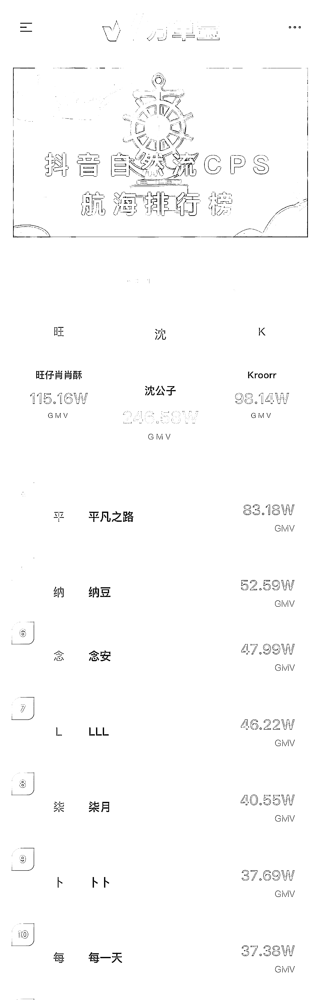

# (42 赞)为执行力干杯——写在抖音自然流 CPS 航海结束

敬执行力一杯！抖音自然流CPS首期航海收官复盘

第一期抖音自然流CPS Mini航海，正式收官。先给所有“云船员”亮一下这次的成绩单：

这一程，我们一共有467位伙伴同行。其中，收益迈过5000元门槛的有10人；满足返航激励条件的有327人，算下来占全员70.02%；还有424位伙伴完成了从0到1的突破，拿到了实打实的结果，比例高达90.79%。

更值得记录的，是很多人在这21天里交出了自己的“第一次”：第一次正儿八经剪出一条短视频，第一次把“创作—发布—推荐—成交—获取CPS分成”整条链路跑通。从什么都不会，到看着后台出现自己的收益，经过21天的坚持和不断放大，大家最终交上了这份成绩单。

但航海结营不是终点，更像是大家从“新手村”毕业了。航海里学到的那些方法，只有练成自己的招式，才有资格进入真正的游戏主线。接下来，期待每个伙伴都能在自己的剧情里不断升级、打出更多漂亮的战绩。

最后提醒一句：第二期抖音自然流CPS航海，今晚就开放报名了。想一起见证自然流CPS奇迹的朋友，别错过，咱们船上见。

这一杯，敬执行力。