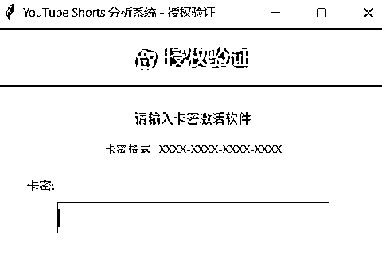
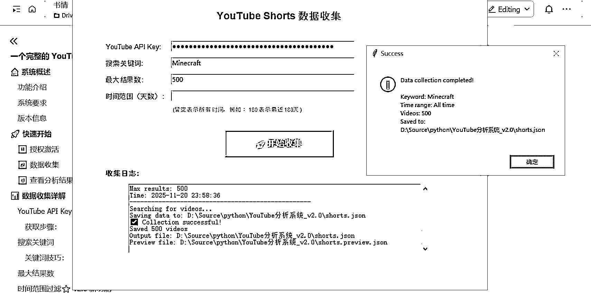
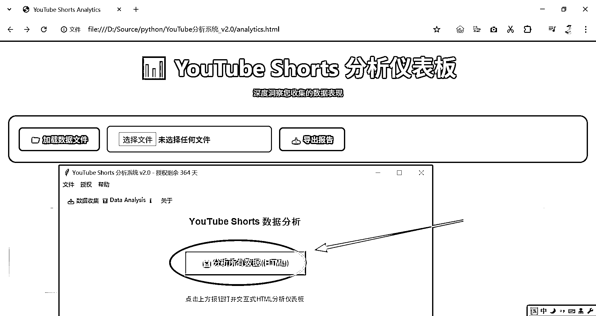
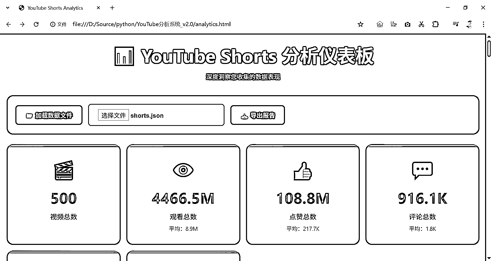
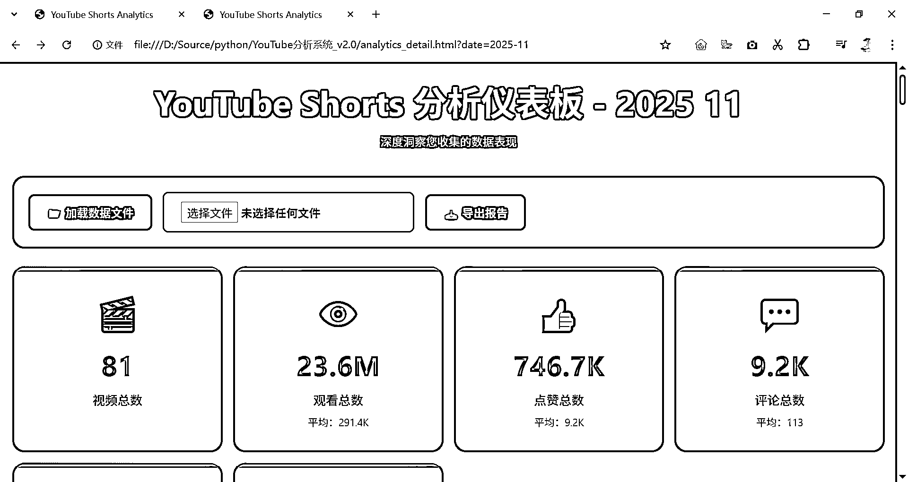
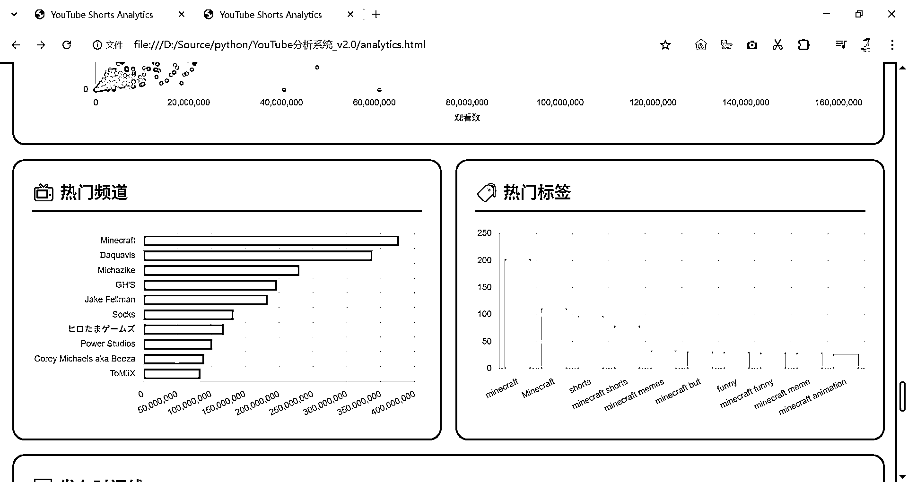

做YouTube Shorts选题，很多人困在同一步：刷了一堆视频，却不知道什么内容会火。与其靠感觉猜，不如让数据来说话。最近发现一套专门针对YouTube Shorts的采集分析工具，能通过关键字打包拉取视频资料，按时间框定范围，再从播放量、点赞、评论、时长等多个维度做交叉统计，还能追踪频道表现和标签热度，最后直接生成报告，整套流程顺手得很。

先说运行环境，Windows 7或更高版本就行，浏览器用Chrome、Edge、Firefox这些主流款，联网之后即可操作，第一回进入需要授权码激活。系统版本号为v2.0，刚刚发布不久，这代升级了不少实用的东西。

整个使用过程只有三步，并不复杂。

第一步是授权。启动程序后，在授权界面把卡密输进去，按下激活键，等待服务器确认后，就能自动进入主控界面。卡密会存在本机，下次启动时自动校验，不需要再手动敲一遍。作者还准备了彩蛋：文章点赞数突破100，就放送100个激活码，想抢先体验的记得蹲一下。

第二步是采集。切到“数据收集”页，把YouTube API Key粘贴进去（第一次用的朋友按后文说明获取），输入想要搜索的词，比如Roblox、Minecraft这类游戏名，中英文词都吃得开。接着定义最大抓取条数，比较建议的是50到10000这个范围。还可以顺手限定只取最近N天发布的内容，不填的话就是全量按时间线抓。配置好后点“🚀 开始收集”，系统跑完会把结果写进shorts.json文件里。

第三步是看报告。切到“Data Analysis”页，按一下“📊 分析所有数据 (HTML)”按键，浏览器里会自动弹出分析面板，图表和指标随之展示，全程不需要手动引文件进来。

分析面板这部分做得很扎实。最上方由6张统计卡组成，视频总量、累计观看、累计点赞、累计评论、平均指标一目了然，整体盘面瞬间有数。面下面铺开8个互动图组：互动分配柱状图、时长区间直方图、观看与点赞联动散点图、按月维度的发布走势折线图、头部频道横向条形图、标签词云、参与度蛛网图，还有占比型的观看分布圆饼图。该看的数据维度基本一把全包了。

追热点的人会觉得时间轴玩耍这个功能特顺手。鼠标挪到折线图的某个月份节点上，当月产出多少视频立刻可见；点一下这个点，系统会开一个全新页面，专门分析那个月的短片表现，图表和数值全部围绕该月重新计算，连页面标题都会标出“2025 11”这样的月份字样。比如你只想复盘去年11月的情况，点一下对应节点就能获得专属分析视图，特别适合月度总结和季节趋势研究。

热门频道那块也挺有意思，榜单排出的是发布Short最勤快的Top10创作者。鼠标悬停时有提示信息，直接按下条形就会拉起新标签页，跳到对应该频道的YouTube主页，想拆解同行打法就是顺手的事。

另外还有几个让人舒服的小设计：热门视频清单支持分页浏览，每页能选10、20、50或100条，导航按钮很聪明，首页只给“下一页”，末页只留“上一页”，中间页则两边都在，数据量再大也能轻松翻；系统还引入了localStorage技术，看过的主页面数据会自动暂存在浏览器本地，开分析页时无缝对接读取，不用再手动拖文件；如果需要汇报，点导出报告按键就能拿到一份JSON摘要，里面有整体统计数值、前20条热门视频、前10位热门频道和前20个热门标签。

再来聊聊背后的机制。时间范围的限制有三层：第一层交给YouTube的API服务端，传入指定天数对应的起始时间戳，服务器只返回这之后的视频，以降低数据量和配额消耗；第二层在本地对时长做筛管，把超过60秒的内容过滤掉，因为API搜出来的“short”里可能夹带最长达4分钟的普通视频；第三层是一个数量兜底，对比已经收集到的条数是否到达用户设的上限。

关于API Key的获取方式，可以到Google Cloud Console里选一个项目（或新建），启用“YouTube Data API v3”，再到凭据里生成一枚API密钥。系统会把密钥写入api_key.txt文件，用Base64编码后保存在本地，下次打开自动填充。这里要特别说明：Base64只是编码处理，不等于加密，任何拿到文件的人都能解码还原原文，所以这份文件千万别漏给别人。

经常被问到的问题也拎几个出来回答：

默认的每日API配额是10000个单位，每次搜索大概要烧100个单位，每获取50个视频详情消耗1个单位，一次别把抓取量顶得太满。如果发现收上来的视频数少于最初设定，不外乎四种情况：该词相关Short本身数量不足、时长超过60秒被过滤、时间范围限制过窄、API配额不够用了。所有数据默认保存在shorts.json文件里，打包成exe后就存在同一个文件夹中，备份只需把这个文件复制到别处就行。

v2.0这一版确实把用户痛点都照顾到了：时间段过滤、本地自动载入、分页浏览、按月份下钻、频道一键跳转，全是日常操作里最在乎的细节。对想在YouTube Shorts赛道试水的创作者，或者想批量调研竞品团队的朋友来说，这套系统能省下不少枯燥的机械劳动。

更详细的说明和配图，作者放了一份飞书文档出来，里面拆得更细。别忘了那个小福利：点赞破100送100个授权码，拼手速。

最近这个数据小工具又悄悄地迭代了一版。虽然只是个 HTML 文件，但这一次的改动，说实话，比想象中要狠不少。

先说大家最关心的**新功能**。时间轴这块，现在支持直接点击任意月份节点，一点就能展开那个月的详细分析面板，想看历史趋势不用再翻来翻去找入口了。热门频道图表也活了，柱状图上的每一根柱子都变成了“按钮”，点一下就直接跳到对应的 YouTube 频道主页，省去了手动搜索的麻烦。界面语言方面，所有 UI 文案都已经全面汉化，不过底层数据还是保留原始语言，保证分析口径不变。

操作体验上，之前那个“请手动加载 JSON 文件”的成功提示框被干掉了，整个流程清爽很多，少点一次确认，少一分烦躁。API Key 也支持自动记忆，第一次输入之后自动存好，下次启动直接填充，不用再翻笔记找密钥。另外还附带了一份完整的交互式使用手册，同样是 HTML 格式，随手打开就能看，不用跑去看长文档。

再说说**幕后改进**。数据收集流程做了重构，现在支持三层筛选机制，过滤逻辑更精细，拿到的数据噪音更少。分析仪表板的布局和交互动线也有调整，看板结构更顺手，操作起来更跟手。错误提示语全部重写了一遍，现在报错信息更直白，能一眼看出是哪里出了问题，不用再靠猜。API 配额的使用效率也做了优化，同样的额度能跑出更多的数据，对高频使用者来说是个实打实的利好。

**修复方面**，三个老问题终于被处理掉了：JavaScript 报错里那个变量重复声明的问题已经解决，CORS 策略导致文件被拦的情况也改成了用 localStorage 绕过，分页按钮在某些边界场景下不显示的 bug 也顺手修完了。

哦对了，如果你是第一次接触这个工具，这里补一下 v1.0 的底子：基础数据收集、HTML 分析仪表板、8 个数据可视化图表、卡密授权系统、导出报告功能，这些从第一版开始就全都支持。

评论区：AI 卷王龙哥 : 有点东西呀