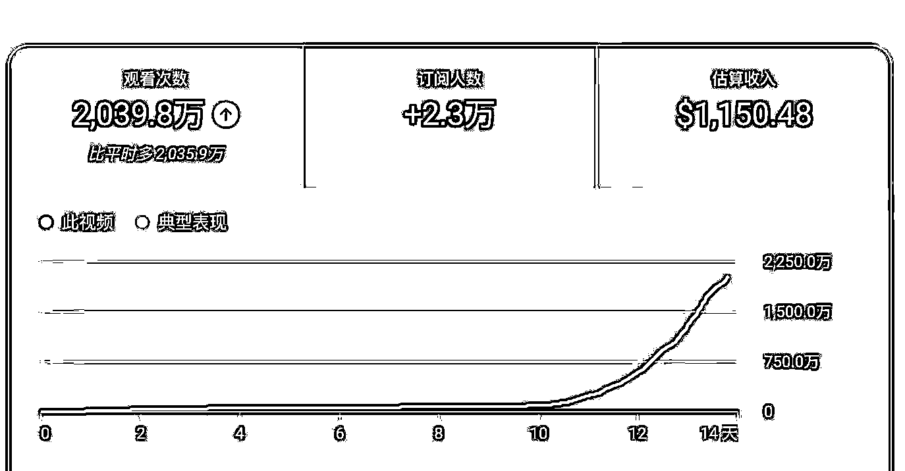
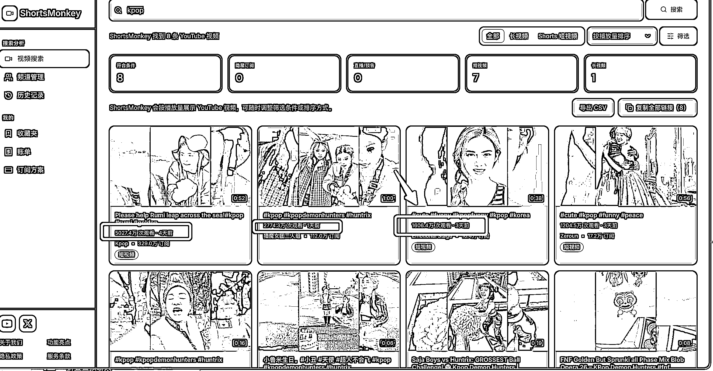

# YouTube 找对标视频又有新工具了：专门挖掘“低粉高播放”内容

在 YouTube 深度圈群里，大家经常会分享自己正在使用的实用工具。既然不少圈友愿意无私公开资源，那我也把最近发现的一个工具分享出来。

先强调三遍：**圈友免费使用！圈友免费使用！圈友免费使用！**

这款工具叫 **shortsmonkey.com**，主要用于实时发现 YouTube Shorts 中正在快速上涨的热门视频，特别适合用来寻找那些账号粉丝不多、但播放量已经明显起飞的内容，作为选题和账号对标参考。

它支持按照关键词筛选视频，并查看相关结果。遇到值得研究的账号或视频，还可以直接添加为对标对象，设置监控周期和播放量阈值。

一旦被监控的视频播放量突破你设定的数值，系统就会自动发送邮件提醒。这样就不用每天手动刷数据，也能及时捕捉正在爆发的内容。

使用教程：  

* * *

评论区：

暂无评论