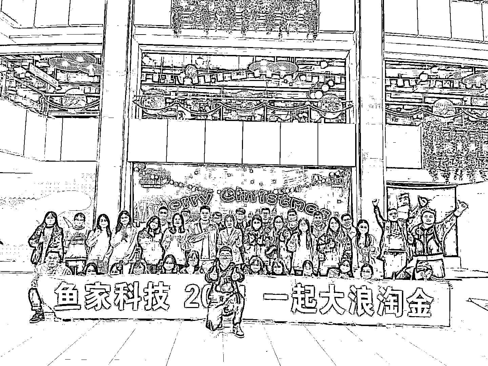
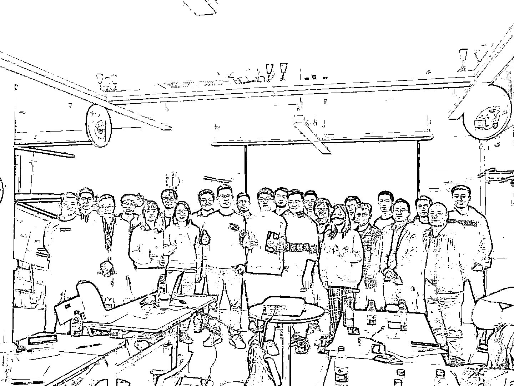
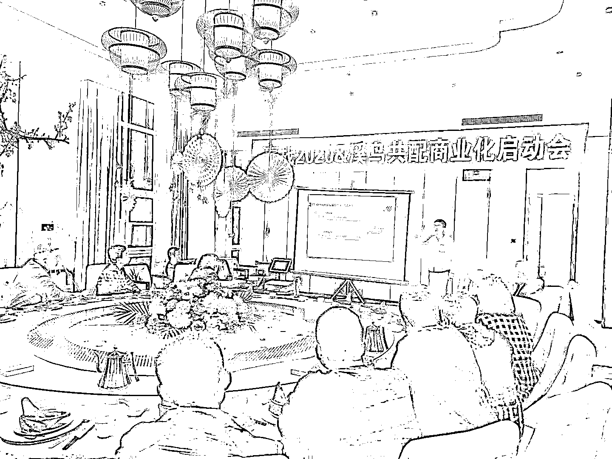
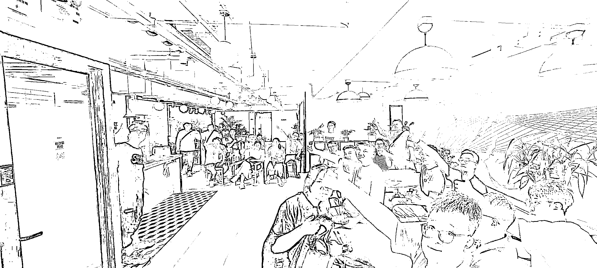
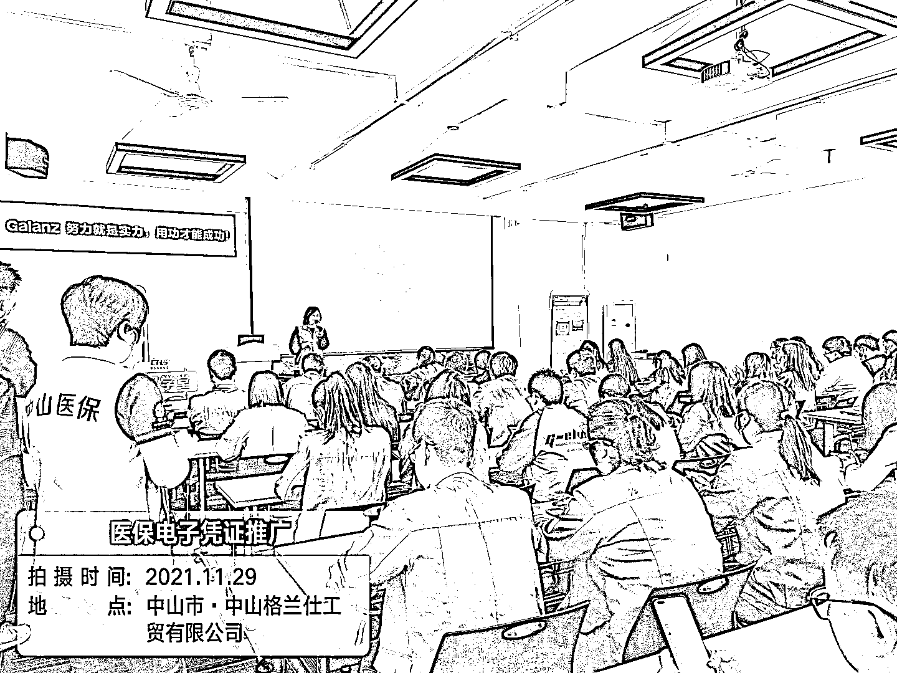

# ('(精华帖)(74 赞)（你需要的不是下一个风口，而是把一个模式复制 1000 遍，中国式阿米巴算是规模化比较好的一种方式）', (2, 63))

很多创业者拼命追逐新风口，可真正的问题不在风口，而在复制。

我这些年带过几百人赚钱，也接触过大量创业者，发现一个通病：不少人赚不到钱，不是不够努力，而是总在换项目，总在从零开始。项目本身没有大小之分，真正的分水岭是——你能不能把一套模式跑通后，批量复制一千遍。

举个例子：淘宝客，一个群一天赚100块，那你搞定1000个群，一天就是10万。APP下载，一个用户给你100块，你只需要找到10万人下载。实体服务，一个商家愿意付1万元，那你找到1000个商家就足够了。

看到没？巨额利润的密码不在于“不断找新项目”，而在于“把1复制到N”。很多人问我：从1到N怎么落地？有没有可操作的方法？

有，我一直在用一套打法——中国式阿米巴。

注意，不是日本那个阿米巴，是适合我们本土玩法的一种组织形式：找一群人，围绕一个共同业务，不拿底薪，直接按项目分钱。

我亲自操盘过三个中国式阿米巴项目：

1. 医保项目——靠资源驱动的阿米巴；
2. 地推APP项目——靠IP驱动的阿米巴；
3. 同城实体发售——靠项目驱动的阿米巴。

每个项目完整跑完，分佣累计都超过八位数。

所以关于这套规模化复制模式，我确实有资格说点实在话。今天我把中国式阿米巴在复制过程中的卡点、优势、坑，一次性系统讲清楚。详细复盘我放在下面这个链接里了：

[`aso41gpxhm.feishu.cn/wiki/N4UVwcz4yisqVikoDb7ckqhAnFl?from=from_copylink`](https://aso41gpxhm.feishu.cn/wiki/N4UVwcz4yisqVikoDb7ckqhAnFl?from=from_copylink)

* * *

评论区：
诗语：赚钱许老师说过，每个赚钱项目都可以做两次。
孙策：对的。
小包：通过阿米巴可以做一千、一万、十万遍了。