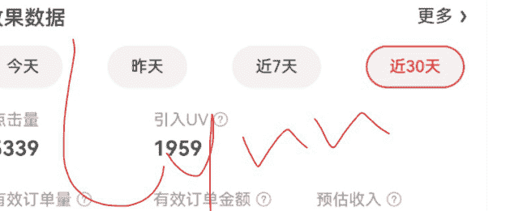
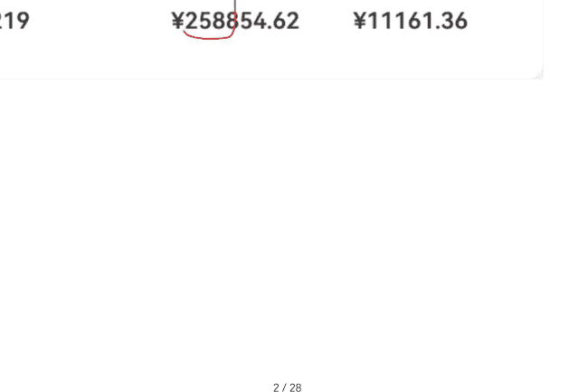
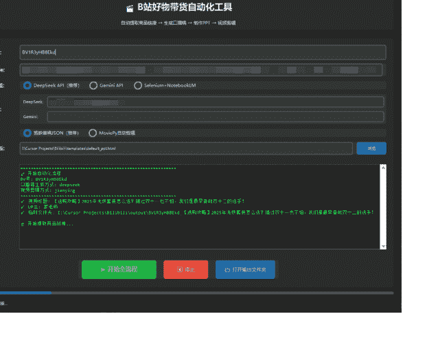

# 从一块小钱开始，到五位数报价，不积跬步，无以至千里

### 260104 副业 SC 精华

公众号懒人搜索，**懒人专属群**独享

懒人微信：lazyhelperl

-- 脚踏实地去赚那看似微不足道的“两块钱”，发自心底地相信“我可以”

## 前言

大家好，我是 Lynn，也常被叫葱哥，今年 95 后，坐标上海。

别人看到的简历挺亮：本科南京理工大学，硕士悉尼大学。

工作是典型的 996，下班后只剩打游戏和周末出行。中年焦虑的影子越来越重，可总是找不到启动的支点。

我也算是生财的萌新，7 月才入圈，8 月跟着 B 站好物深海圈开始试水。身边的老圈友建议我入局，说知乎好物当年很赚钱，B 站这条路应该也一样，家蒙老师的案例也很有说服力。于是我就试了。

结果还不错。入场一个月，没接低价商单，没投钱做推广，几乎零成本，带货 GMV 达到 70 万，佣金 2.7 万。这个成绩在深海圈同期学员里是双料第一。

### 天猫双 11

**成交金额**    以下数据统计截至：2025-11-13 11:29:33

¥56,223.92

- 订单明细

- 推广收益

- 奖励活动收益

- 余额流水

- 淘礼金报表

- 商品分析

### 天猫双 11

#### 成交金额

更

以下数据统计截至：2025-11-13 17:21:16

¥ 59,552.71

### 全部订单统计

近 30 日

- 订单明细

- 推广收益

- 奖励活动收益

- 余额流水

- 淘礼金报表

- 商品分析

| 指标 | 数据 |

| :--- | :--- |

| 点击次数 | 227 |

| 付款人数 | 25 |

| 付款金额（元） | 59,552.71 |

| 付款预估收入（元） | 1,027.88 |

| 结算预估收入（元） | 300.37 |

| 有效付款金额（元） | 47,065.71 |

| 有效付款笔数 | 34 |

| 有效付款预估收入（元） | 720.57 |

| 付款笔数 | 40 |

| 平均客单价（元） | 2,382.11 |

数据总览

包含效果数据为 0 的活动

参与活动数量 16

预估奖励金额 ¥656.9

数据总览

包含效果数据为 0 的活动

参与活动数量 10

预估奖励金额 ¥910.6

### 超级补贴效果数据

+ - 今天

- 昨天

- 近 7 天

- **近 30 天**

- 自定义

- **预估活动总收入** ②  ¥496.95

- **预估补贴收入** ② ¥249.12

- **预估佣金收入** ② ¥247.83

- 平台

- GMV

- 订单

- 佣金

- 奖励

- 补贴

- 总收入

**京东**

| 指标 | 数值 |

| :--- | :--- |

| GMV | 589,393.68 |

| 订单 | 484 |

| 佣金 | 23,543.44 |

| 奖励 | 1,567.5 |

| 补贴 | 496.95 |

| 总收入 | 25,607.89 |

**淘宝**

| 指标 | 数值 |

| :--- | :--- |

| GMV | 115,776.63 |

| 订单 | 127 |

| 佣金 | 1,678.00 |

| 奖励 | 0 |

| 补贴 | 0 |

Total

| 指标 | 数值 |

| :--- | :--- |

| GMV | 705,170.31 |

| 订单 | 611 |

| 佣金 | 25,221.44 |

| 奖励 | 1,567.5 |

| 补贴 | 496.95 |

| 总收入 | 27,285.89 |

双十一收官后，我在深海圈做了场三小时的直播复盘，把选品、文案、PPT 全部拆开演示，甚至把剪辑前三十分钟的流程都现场跑了一遍。很多同学都说没想到十几分钟的长视频也能这么快。

不展开技术细节了，有兴趣可以看我之前的精华帖。

十二月初，星空大神发了一篇关于熬过三个月无反馈期的帖子，群里桑桑老师提问大家都是怎么扛过起步期的，我当时开玩笑说我没无反馈期。手动狗头，其实是有大概一周。

我两天就出单，一周就有爆款，但第一周的体验谈不上顺，预期远没达成。所以这篇文章想聊聊出发时的想法，以及在第一个副业项目里的感悟。

工作六年，我在华为、小米、极氪和一家智驾公司做 AI 图像算法，外人看来是精英岗位，年薪百万，被圈友戏称百万哥。但今天不想聊算法，不想晒履历。

我想以一个跨界创业者的视角，说说“放下”和“拿起”的过程。

主题很简单：不积跬步，无以至千里。不管过去多辉煌，真正能让你起步的，是去认认真真赚那两块钱。

## 一、放下精英标签，新赛道里人人归零

成长最大的阻力，往往不是能力，而是那份眼高手低。

### 大厂工程师的惯性

做 AI 算法，我习惯做逻辑、搭模型，心里总有一点知识分子的拧劲。八月报名 B 站好物深海圈时，第一反应是排斥。看到课程要求真人出镜，又不教 AI 矩阵和自动化玩法，我差点就退费了。

本意是想学自动化提效，手搓一个视频别人三四天，我可能要两周。因为我只有每天晚上两小时。两周一更，连双十一的热度都接不上。

（和志愿者陈同学的聊天记录）

不想露脸也是原因之一。我不怯场，年年年会也上台唱歌。但对一个全新的赛道，内心深处就是抵触。做算法的我，难道要去镜头前像个导购喊口号吗？这种挣扎，本质是放不下“大厂工程师”的身份感。

后来我明白了，背着旧成绩单，就会永远晚起跑。新赛道里，你的头衔清零，你就是个新手。副业形式很多，视频、直播、授课都少不了露脸。想清楚后，我和自己约定：先跑完一个双十一再说。这种先上车的决心，是打破精英幻象的第一步。

也就是这一步，让我不露脸不口播也能找到自己的打法，并不断迭代。第一个视频就开始想提效，第三个视频就半自动化了，后面不断打磨提示词和工具，最后形成半自动 SOP。双十一结束后我在圈里分享，和陈同学第二次聊天时，状态已经变了：

**所以迈出第一步很重要，但有能力时也要善用优势。技术、运营、沟通，任何擅长的都能成为杠杆。比如我入场第一反应就是去找有知乎好物经验、在我之前就用录屏口播流玩到 B 站带货百万榜的原生：**

### 二、尊重微小正反馈，熬过只有两块钱的那段日子

很多人做副业失败，是因为看不上小钱，总想一击即中。可所有的大事，都是无数个小反馈堆出来的。

这种细微的正反馈，对别人是曙光，对我却是前期最难的坎。

### 两块钱的沉默

十月七号深夜，上海已入秋，凌晨两点，我关掉剪辑软件。每天 22 点下班，23 点坐电脑前，用两三个小时磨文案、找素材、做剪辑。累到骨子里，还是发了第一个视频。

两天后午休打开后台，没有爆单，只有几笔零单，佣金栏写着 2.00 元。

办公室很吵，我却安静下来。那一刻不是喜悦，是沉默。

大家都说先完成再完美。可我算了一下，这两块钱的完美能值多少？200？2000？

后来才知道，一个视频做好，爆了之后收益能到两万甚至更高，还会有长尾。先别跑题。

我打开计算器算了一下，100 万年薪折算到每分钟约 8 块，这两块钱我花了两个深夜，放弃了仅有的休息。那种时薪幻觉的落差，几乎要把人击溃。大脑一直在问：值得吗？这点钱连加班费一分钟都不够。

我盯着那两块钱看了很久，心里慢慢冒出另一个声音：它虽小，是我在这个赛道的第一步跬步。在大厂，价值是平台给的；这 2 块钱，是陌生用户真金白银为我的推荐买单，证明路径是通的。

这时候考验心力：是嫌弃小钱走人，还是尊重这点反馈继续迭代？我选了后者，给自己定目标，起码坚持一个完整双十一周期。

我开始试策略。想冲高收益，做了佣金很高的耳机支架，结果扑街。教训就是别走捷径，也别自以为是。

我回到了用户视角，研究痛点，找耗时点，用 AI 提效。试过 DeepSeek R1、智谱清言 glm4.6、Qwen3-max、Kimi OK Computer、GPT5、google notebooklm。

最后定下来：notebooklm 写文案，智谱清言做 PPT。反复打磨提示词后，把 6 小时的流程压缩到 4 小时、3 小时，最后到半小时。

成就感不在于顺风时跑多快，而在于面对两块钱时，还愿不愿意复盘迭代。每个大结果，最初可能都只是几块钱的积累。

### 三、找回掌控感，心力成为引擎

### 柳暗花明，第三个视频的破局

转折在十月十五日。按新思路做的第三个视频上线。

我没焦虑刷后台，直接关电脑睡觉。第二天通勤地铁上点开后台，一笔新订单。没声张，但心里那潭水泛起了涟漪。

当晚看后台，佣金已过 500。反复关开确认，平静大于狂喜。那是一种路径被验证的感觉。

此后视频数据稳步上升，单日佣金不低于 200。它带来了稳定可预期的流量。我才真正懂了滚雪球：第一个视频捏出雪核，第二个裹上雪层，第三个找到了合适的坡道，自己就开始滚了。

### 从被流程推着走，到驾驭流程

前两周我被流程折磨。选题纠结、文案卡壳、剪辑繁琐，像在泥地里拔腿。状态是疲于应付。

转折后，我从执行者变成了设计者。

- **对时间**。我不再抱怨只有两小时，而是把它当成效率优化模型。剪辑是瓶颈，于是各种 AI 工具变成实验室。深夜测试像解算法题，最后用 NotebookLM+智谱清言把核心流程压到 30 分钟，那种工程师的爽感极强。
- **对内容**。我不追热点也不死磕高佣金。建立自己的选品逻辑：真实场景痛点+差异化+视觉表现。AI 是副驾驶，方向盘在我手里。每个视频我仍会花半小时打磨文案起承转合、配 BGM、调转场。爆款是内容极致用心和时机共振，不是撞大运。
- **对结果**。第三个视频成功后我没庆祝，直接复盘标题结构、开头三秒、素材类型、节奏。把特征提炼到下一条。第四、第五条数据曲线一路向上。双十一结束定格在 30 天 GMV 70 万+，佣金 2.7 万。那是一种确定性：按验证路径走，结果可预期可复现。

### 心力才是护城河

有人问我是不是因为懂算法才快。我说算法可能让我更快理解推荐逻辑，但真正拿到结果的，是面对两块钱没走人的心力，是疲惫中仍打开电脑迭代的心力，是放弃捷径坚持打磨的心力。

背景会贬值，工具会普及，但深夜里为一个可能没人看的视频反复较真，为了微小进步坚持复盘的韧性，是别人抢不走的护城河。

### 最高级奖赏是自我效能感

战报出来、拿到双料第一时，钱是次要的。

我收获的是久违的掌控感。在大厂，价值绑定在系统里，成功是团队的，焦虑是个人的。这个 0 到 1 的项目，每个订单都清晰指向我的行动。我的手直接创造了价值。

这种自我效能感是高薪给不了的：我能在一个全新陌生领域独立解决复杂问题并拿到明确结果。

我不再是焦虑的齿轮，我是自己这艘小船的船长。引擎的轰鸣来自内心重新被点燃的创造渴望。我知道，有了这股力，能驶向更远的海。

### 四、信心滚雪球，收益开始放大

双十一结束后，看着后台仍在缓慢增长的数字，我的渴望变了。验证过的玩法，能不能让我更值钱？

### 从流量变现到价值认可，五位数商单

我一直说不接廉价商单，不冒险投流。不是清高，是精力投产比。时间稀缺，必须把分钟用在刀刃上。反复沟通只换几百块的商单，不如做一条有长尾和品牌积累的视频。

例外来自价值重定义。

十二月初，我收到第一笔商单询价。对方没先谈价，而是说关注我很久，欣赏我内容的理性分析感和干净的视觉，认为这和他们品牌的科技美学调性很合。他们要的不是硬广，是基于我个人风格的深度解读。

#### 系统性放大：构建收入金字塔

第一笔商单顺利落地后，我仿佛打开了新的可能性：怎样才能让“B 站好物”不只是靠佣金赚钱，而是逐步搭建起更稳定、多元的收入体系？

**底层，是佣金收入。**  
这是整个模式的基本盘。继续依靠成熟、高效的 SOP 稳定生产优质内容，让佣金成为持续的现金流。即使暂时没有品牌合作，这部分收入也能提供一份踏实感。选品上，我仍然聚焦客单价较高、佣金比例更有优势的商品，把基础打牢。

**中间，是品牌合作。**  
商单的出现，意味着内容能力和个人影响力开始获得更高的价值。当内容积累到一定程度，品牌会主动寻找更深入的合作机会。对此，我给自己定下了筛选标准：品牌是否契合，优先于产品是否靠谱；产品质量之后，再看创作空间，最后才考虑报价。我不想只做一个展示广告的位置，更希望每一次合作都能为个人品牌增添价值。

12 月底敲定的第二笔商单，金额为 4000 元，也再次印证了这套原则。到目前为止，仅商单收入就已经为“年货节战役”提前贡献了 1.4 万元。

**更高一层，是知识与经验的输出。**  
在深海圈做直播分享、发布精华内容后，我收获了意料之外的回馈：既有帮助同行解决问题的满足感，也有来自伙伴们的认可。

这让我意识到，自己从“算法思维”中发展出的副业方法，强调逻辑、效率和可执行性，或许不只适用于 B 站好物。它也可以被整理成一套结构化的方法，分享给那些和我类似、时间有限，却希望实现突破的跨界者。走到这一步，事情的意义已经不只是收入，更是创造价值。

#### 信心带来的复利：目标升级，野心也在生长

双十一结束时，我因为实现了“30 天佣金 2.7 万”而感到高兴。没想到短短一个多月后，商单进账、佣金持续增长，再加上对年货节的预期，让我的月度目标从“超过 2.7 万”变成了“挑战 5 万”。

这并不是盲目乐观，而是正向反馈带来的自然变化。当你亲自跑通从零到一的过程，赚到第一笔钱；又进一步验证这套模式能够放大、复制，思考方式也会随之改变。关注点不再是“我到底行不行”，而是转向“怎样做得更好、更快，创造更多结果”。

我已经不是那个凌晨两点还盯着两块钱佣金、用虚幻的时薪安慰自己的迷茫工程师，而是一个开始掌握自己节奏的跨界创业者。每晚仍然只有两小时，但我知道该把时间用在哪里，也越来越清楚这些投入可能带来什么回报。

能够确认自己的时间有价值，并对它拥有掌控感，这份收获远比账面上的数字更珍贵。

## 再往前一步

把自己的做法分享出去，难免会带来内容趋同，也可能影响到自身利益。但我依旧选择尽可能坦诚地交流。一方面是希望对别人有所帮助，另一方面，也是在督促自己继续进化。

半小时完成文案和 PPT，对我来说还不够；花两小时做出一条完整视频，也不是终点。考虑到主业已经非常忙，我真正想实现的，是“一键生成视频”。到了那一步，我只需隔一段时间远程操作电脑、点击一下，就能继续推进内容生产。

我正在朝这个方向努力：

## 五、送给同行者的一束光：少些犹豫，现在就出发

如果你还站在起点迟迟没有行动，或者总被“专业不匹配”“缺少资源”这些理由困住，我想分享三句话：

- **给还没有开始的人：**别等到准备充分才行动，先迈出第一步。真正动起来，很多焦虑才会逐渐消散。此刻你的背景并非关键，愿不愿意开始才是。

- **给正在考虑放弃的人：**前期赚不到钱很常见。只要你继续走下去，就已经超过了大多数半途而废的人。别小看几块钱的回报，每一笔小收入，都是走向更大目标的过程。

- **给希望再进一步的人：**每天只有两小时也没关系。目标明确，持续投入，微弱的火光也能汇成亮光。重要的是，你是否愿意为那份可能性付出行动。

感谢深海圈的朋友们，也感谢生财团队。正是这份彼此连接的力量，让我有勇气离开熟悉的舒适区。在这里，我看到许多人和我一样，在夜深人静时仍然努力，为生活的改变一点点积蓄力量。

## 结语

如果把做项目比作夜航，技术和 AI 工具就是船桨与罗盘：它们能帮助我们提高速度、辨认方向，却无法替我们熬过风浪。最终能不能抵达对岸、等到日出，靠的是内心那台不熄火的发动机，也就是心力。

别被远大的目标吓退，也不必为微小的起点感到难堪。只要心里的引擎仍在运转，愿意认真走好眼前的每一步，哪怕最初的收益只有两块钱，也能成为照亮前路的微光。

一步一步走，才能抵达更远的地方。愿我们都能在平凡的坚持里，走出属于自己的不凡之路。

### 关于“从零到 70w+”

30 天 70w+，佣金 2.7w。

**最后，推荐小懒的付费社群：**

**懒人专属群**（介绍）

**公众号**

**懒人搜索**

**懒人专属群**

微软：lazyhelper1

> 这里是你抵御信息过载的一道护城河。

社群已稳定运营 6 年，累计拆解、研读 3000 多个互联网商业实战案例，以及行业前沿内参、时政和宏观类文章。

懒人专属群更新记录：

https://hk57gvIx7u.feishu.cn/docx/H0kRdZbSbolBR0xkaXtcuVE0nTg

【免责声明】本资料存放于社群内部知识库，仅供成员开展课题研究与学术交流。查阅后请于 24 小时内删除。