# 做了一年多📕电商，我把选品、测品和实拍方法一次讲透
作者：龙哥

## 260104 副业 SC 精华

大家好，我是龙哥，目前主要做📕电商，也在赚钱联合空间创业。

不得不说，联合空间的氛围确实很神奇。我在 4 月 27 日搬进去，4 月 29 日数据就开始有起色，之后仅用一个月零 5 天，支付金额突破 100 万。

## 先说说我为什么来到杭州

审核终于通过了。

刚开始我也犹豫过：五一马上到了，去了可能只工作几天，又要放假；可如果等节后再过去，又要白白等上半个月。

既然已经选择自由职业，就没必要再按照周末和节假日来安排生活。于是我立刻开始找房子，同时联系了三个中介。

房租、户型、位置，总有一项不符合预期。

后来我想，算了，先过去再说。杭州这么大，总不至于让我没地方住吧？事实证明，杭州确实没有让我失望。一天时间，房子就搞定了。

从收到通知，到收拾东西从上海出发，再到坐进杭州的工位，前后差不多一周。

执行力这件事，关键时刻还是有的。

接下来三个月，准备全力冲刺一波。🤙

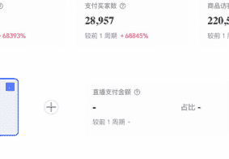

2025 年 4 月 27 日 13:46 杭州市·欧美金...

**商家经营数据汇总**

统计区间：2025-04-28 至 2025-06-02

- 支付金额：¥1,007,741.90
- 支付订单数：29,452
- 支付买家数：28,957
- 商品访客数：220,578
- 笔记支付金额：¥880,395.90，占比 87.36%
- 直播支付金额：暂无

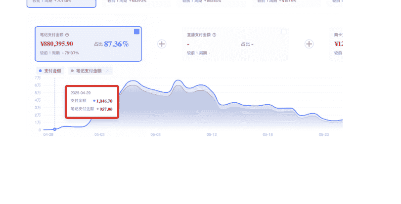

>>> 2025-04-29

>> 支付金额：1,046.70

>> 笔记支付金额：957.00

## 一、从上班族走到创业路上

### 1、月销百万之后，我的账号全部被封

我是一个认定方向后就会长期坚持的人。

2024 年 5 月加入赚钱，6 月第一次参加航海，选择的项目就是📕电商。直到现在，我依旧在做这件事。

在进入联合空间之前，我其实一直是个职场打工人。直到 2025 年 4 月，我第一次做到单月支付金额超过 100 万。

虽然这 100 万不是最终利润，但第一次做到这个成绩，还是非常兴奋的。原来普通人也确实有机会做到这么大的流水。

兴奋之外，我也开始不满足：既然能做到 100 万，是不是还能继续放大？

但对我来说，这次最大的收获并不只是流水本身，而是做出 100 万的过程、方法和能力。它们会沉淀在自己身上，下一次遇到机会时，就能更快判断、更快行动。

后来发生的事情，也证明了这一点。

月销百万后，平台开始管控，我的多个子账号和店铺账号全部被封，最终永久无法使用。

前一天还是月销百万，转眼直接归零。人生起起落落，确实来得很快，甚至有点刺激。

那段时间，我干脆安排了一次家庭旅行，带父母去了烟台。

一方面是给自己放个假，缓一缓情绪；另一方面也是陪陪父母。真正忙起来之后，陪伴他们的时间确实越来越少。既然这次被迫停下，那就正好带他们出去走走。

### 小茗你好呀

第一次带双方父母一起旅行。

看着鱼总把所有行程安排得井井有条，突然发现，我们不知不觉已经成了能够独当一面的成年人。

烟台的海风，像是自带一层幸福滤镜。

下车的那一刻，就能感受到舒服的温度；不冷不热，走不了多远，眼前就是海。

而现在的我，也终于有能力，给家人订下一套距离海边只有 30 米、面积 190 平的大房子。

一家人能够开开心心地住在一起。

或许，这就是赚钱最重要的意义。

旅行回来后，我重新注册账号，开始从头做。

之前做到百万流水的经验还在，所以这次我直接采用多账号、批量测品的方式，重新寻找机会。

运气也比较好。

7 月 8 日我还在烟台，7 月 19 日新品就开始出现明显数据。前后不到半个月，又有一个产品跑了出来，最终卖了 50 万左右，其中大部分销售额是在一个半月内完成的。

### 2、联合空间带给我的变化

现在回头看，加入联合空间是我今年做过最正确的选择。

以前我一个人在家工作，偶尔换到书店或咖啡馆。没有同伴交流，没有人一起讨论，也很难获得新的行业信息，整个人就像漂在海上的一叶孤舟。

每天都在想：

我到底该往哪个方向走？

这个方向是对的吗？

如果选了另一条路，会不会更好？

但到了联合空间之后，完全是另一种体验。

这里聚集了很多自由职业者和创业者，大家交流起来很自然，也更容易互相理解。很多有价值的信息，并不是刻意打听来的，而是在日常聊天中自然流动。

更重要的是，我对自己的想象边界被打开了。

以前我觉得，只要每个月赚回过去的工资，就已经很不错；现在身边的人讨论的是如何扩大规模、寻找合伙人、组建团队、成立工作室。

我开始不断问自己：

**既然别人可以，那为什么不能是我？**

人确实会随着能力和结果不断提高目标。

当你已经完成过 100 万流水，就不会只满足于“赚到这 100 万”，而会进一步思考：怎样把流水转化成利润？怎样让它变成可复制、可持续的系统？

因此爆单之后，我专门找许老师咨询，想知道下一步应该如何放大。

许老师给我的建议，大致可以归纳为以下几点：

1. 做📕店群，尽可能把账号资源铺开，自己只保留选品、实拍等核心环节，其他工作逐步交给团队。
2. 先想清楚三年后的自己要处于什么状态。
3. 补齐能力结构，包括选品、实拍、店群、投流以及组织管理。
4. 直播是另一套独立能力。如果目前不擅长，就要做好长期训练的准备。
5. 不能一直停留在自由职业者的角色里，要逐步完成从“自己干活”到“经营公司”的转变。
6. 不熟悉的领域不要闷头摸索，可以通过付费咨询快速找到解决方案，店群并不是无解的问题。

也是因为许老师了解我的项目成绩，后来赚钱需要筹备 mini 航海时，他把我推荐给了子安，于是我参与了第一批线下实操 mini 航海。

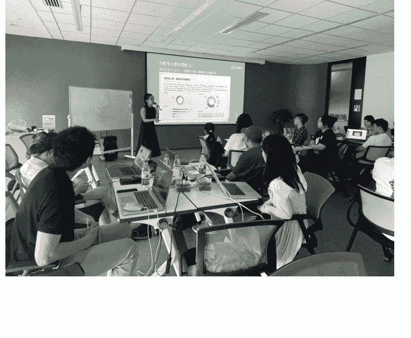

参加 mini 航海的人里，有一位夜校负责人。

航海结束后，对方邀请我去夜校分享课程。后来，我又多了一个身份——杭电夜校讲师。

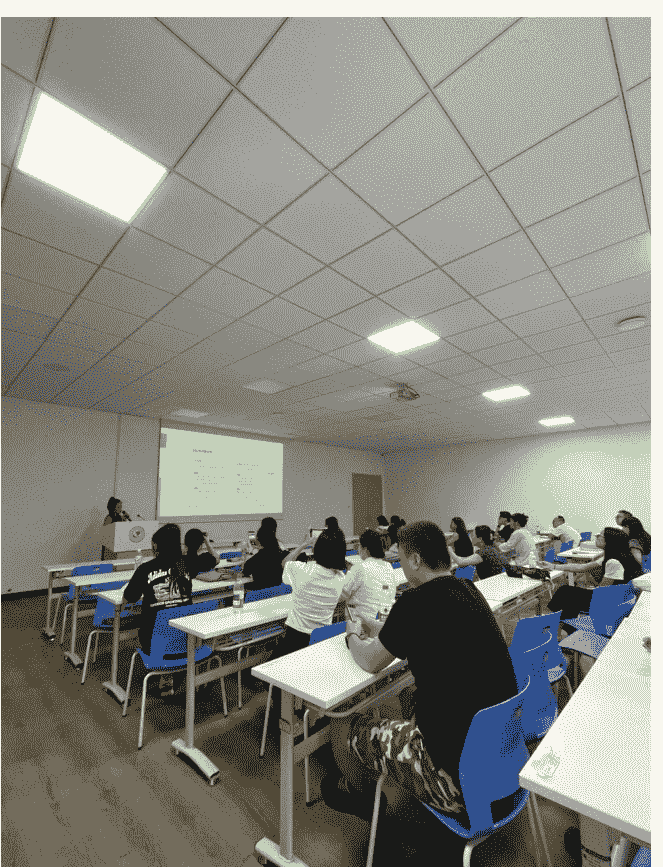

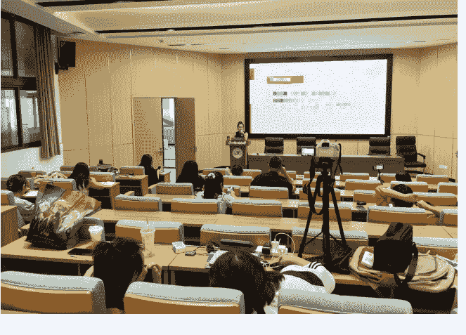

之后有一次，我在电梯口遇到了龙哥。

我们聊到我正在做的项目和具体经营情况，刚好与赚钱当时正在研究的垂直小店方向比较契合。

龙哥邀请我把相关资料整理出来发给他。

没想到在 12 月的航海中，我被赚钱官方邀请，担任📕垂直小店航海的主教练。

可能这就是所谓的近水楼台先得月吧。🤭

小茗你好呀。

那场直播一讲就是两个小时，中间甚至忘了喝水，结束后嗓子都干了。😆

但看到学员的反馈，还是非常开心。

前一天熬夜整理 PPT，也算值得了。

甚至已经开始琢磨，下次直播还可以增加哪些内容。🤭

有学员这样反馈：

> 教练，今天的直播真的很用心。我之前学过📕实拍电商，而且还是付费课程，价格也不低，但整个交付过程都没有你这场直播的干货多。没有对比就没有伤害，所以特别想来谢谢你，今天真的很精彩。

谢谢大家的认可。

其实我自己也是从小白一步步过来的。第一次参加航海之后，我才真正打开了人生的可能性。

现在只是希望把自己走过的路、踩过的坑和总结出来的方法，再传递给更多人。

红包就不用发啦，你继续加油，期待听到你爆单的消息。

加油，等你的好消息。☺️

现在的我，也不再满足于只做一个单打独斗的自由职业者。

我希望未来可以建立自己的工作室，甚至成立一家公司。

人的梦想和野心，确实会随着一次次结果慢慢变大。

所以特别建议大家，不要轻易停止探索，也不要只停留在想法阶段。真正下场去做，把手弄脏，把心沉下来，认真对待每一次航海，也许某一个项目，就会成为打开人生新阶段的钥匙。

不一定第一次尝试就能赚到钱，也不一定每个项目都会有好结果。

但你在过程中积累的判断力、执行力和业务能力，都会沉淀下来，成为下一次机会出现时的底气。

真的，走过的每一步，都不会白费。

前面铺垫了不少，接下来进入真正的实战内容。

下面主要从选品、测品和实拍三个方面展开，全部来自一线实操经验。

## 二、📕电商的具体做法

### 1、选品核心：找“新、弱、爆”的产品

📕电商里，选品的重要性不用多说。

选品方法可以有很多种，但最后都可以归结为三个关键词：

**近期、低粉、爆款。**

什么意思？

- 产品最近刚开始起量，时间越近越好；
- 对标账号粉丝越少越好，账号权重越低越好；
- 产品数据越强越好，尤其是近期加购和互动表现。

#### 账号选品参考标准

| 维度 | 判断方式 | 优先级参考 |
|---|---|---|
| 近期 | 爆发时间越近越好 | 24 小时内 > 3 天内 > 7 天内 > 15 天内 > 30 天内 |
| 低粉 | 对标账号权重越低越优先 | 低粉账号 > 无明显人设账号 > 有人设账号 |
| 爆款 | 数据越突出越值得关注 | 24 小时加购高、笔记点赞高 |

📕里有一个非常重要的数据：**24 小时加购数**。

它指的是，在过去 24 小时内，有多少用户把这个商品加入了购物车。

这个数字越高，说明产品最近的关注度和需求越强。你去跟进时，成功概率通常也会更高。

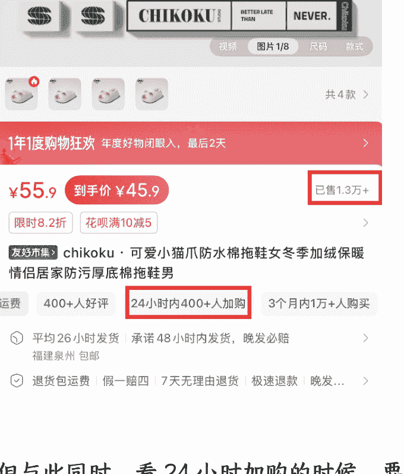

但不能只盯着 24 小时加购。

还必须结合商品累计销量一起判断。

可以使用这个公式：

**24 小时加购数 ÷ 总销量**

这个比例越大，通常说明近期产生的销售占比越高，产品可能正处于上升阶段。

另外，数据一定要看时间的新鲜度。

比如，一篇今天发布、获得 300 个赞的笔记，参考价值可能高于一篇一个月前获得 2000 个赞的笔记。因为前者更能反映当下的需求。

举个例子：

- 保暖口罩：300 ÷ 44,000 = 0.0068
- 小猫拖鞋：400 ÷ 13,000 = 0.0307

在当前数据下，小猫拖鞋的近期活跃度明显更高。

如果只能从这两个产品中选一个，优先测试小猫拖鞋。

畅快大口呼吸

¥58.8 到手价 ¥35.8

限时 6.5 折

商家券满 38 减 3

已售 4.4 万+

# 米度狗·云羔绒保暖口罩，冬季防风防寒，女款高颜值秋冬防冻脸，3D 立体男士潮款

- 1000+ 人好评
- 24 小时内 300+ 人加购
- 3 个月内 9000+ 人购买
- 平均 22 小时发货
- 承诺 48 小时内发货，晚发必赔
- 退货包运费
- 假一赔四
- 极速退款
- 7 天无理由退货

已选：【男士加大透气款】奶油白｜防风……

当然，看到两个数据后并不代表选品结束。

如果样本量太小，结论很可能不准确。你看到的只是当前几个案例，并不意味着它们就是最优解。

因此，选品时一定要保持耐心，持续扩大观察范围。只有样本数量足够，数据才有比较价值。

再看两个更典型的例子。

**A 产品：累计销量 1.8 万，24 小时加购 300**

它可能之前曾经大爆过，前一天甚至卖出几千单，但现在 24 小时加购只剩 300。说明当前热度正在下降，最近的订单可能主要来自过去的爆款笔记。

**B 产品：累计销量 300，24 小时加购 200**

虽然历史销量不高，但最近一天的加购已经达到 200，意味着它可能正处于刚刚起量的阶段，需求正在快速集中。

所以，不能简单认为累计销量越高越好。

对📕电商来说，有时“刚开始爆”的产品，反而比“曾经爆过”的产品更值得测试。

### 2、测品方法：多个产品循环验证

产品选出来之后，就进入测试阶段。

测品的核心不是押中一个产品，而是同时测试多个产品，再根据实际数据进行筛选。

可以简单理解为：

A 产品和 B 产品一起发内容，通过浏览量、出单量等指标判断谁留下、谁淘汰。

例如：

- A 产品：每天获得 50—100 个浏览，每天能出 1 单；
- B 产品：每天浏览量低于 50，可能两三天才出 1 单。

这种情况下，可以保留 A，放弃 B，然后引入 C 产品继续和 A 对比。

不断循环，直到找到更有潜力的产品。

这里有两个常见误区：

第一，不能只发十几篇甚至二十篇内容，就因为暂时没出单而判定产品不行。

第二，也不能因为已经投入很多内容，就对一个数据始终不好的产品死磕到底。

测试需要给产品足够机会，但也要及时止损。

### 3、实拍效率：用数量提高胜率

即使把账号细节全部做好，也无法保证每一篇内容都能成功。

封面、标题、正文、评论区、素材、剪辑、价格、发布时间等，任何一个环节都可能影响最终结果。

📕没有绝对确定的爆款公式，更多时候是在不断提高成功概率。

所以我们的策略是：

**用更大的内容数量，对冲单条内容的不确定性。**

产品确定之后，就需要大量参考对标账号进行拍摄。

而想要持续高频发布，单靠每天临时寻找素材、拍摄和制作，效率会非常低。真正高效的方式，是提前搭建素材库，并将拍摄流程流水线化。

整个过程可以分成三步。

#### 第一步：建立自己的素材资料库

准备越充分，实际拍摄时越省时间。

这里推荐使用 Eagle 来整理素材。软件提供 30 天免费试用，后续需要付费。

下载地址：

https://cn.eagle.cool

Eagle 可以按照不同产品、场景和素材类型建立文件夹。安装浏览器插件后，看到合适的图片，直接拖入素材库即可。

建议采用这样的层级：

**店铺类目 → 封面 / 内页 → 场景分类**

场景分类要结合具体产品和对标账号来设计。

例如，卖杯子时，可以分成：

- 手持
- 车内
- 室内
- 俯拍
- 细节展示
- 打开杯盖

如果卖裤子，分类可能包括：

- 正面
- 背影
- 高铁
- 商场
- 俯拍
- 面料细节

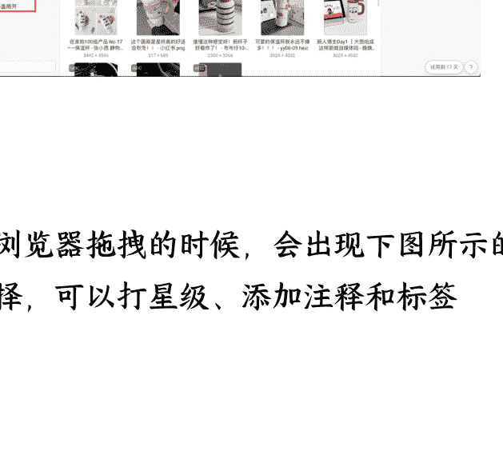

通过浏览器保存素材时，可以同步进行星级、标签和备注管理。

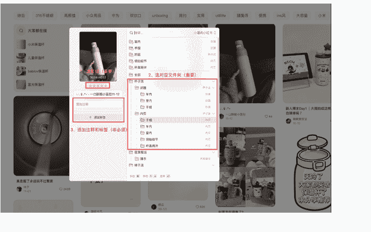

这样一来，拍摄前就能根据当天计划直接搜索素材。

比如今天准备拍“车内”场景，只需要搜索对应标签，就能快速查看：

- 之前有哪些构图；
- 哪些角度值得复刻；
- 哪些素材数据更好；
- 哪些模板应该优先拍摄。

再结合之前设置的星级，就能安排拍摄先后顺序。

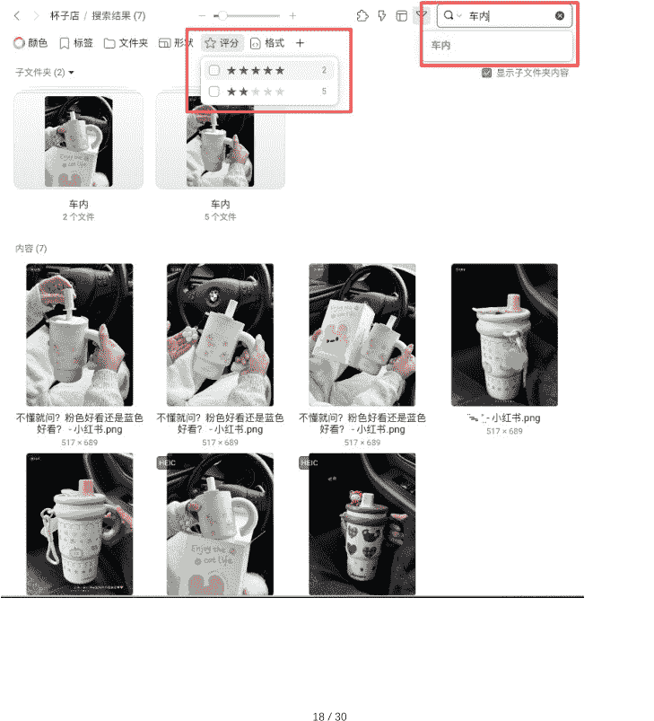

#### 标签应该怎么设置

标签可以按照以下维度建立：

- 产品
- 时间
- 场景
- 角度
- 其他值得沉淀的信息

例如：

- 产品：#西瓜、#月子袜、#红墨镜、#白色工装裤
- 时间：#7月、#8月
- 场景：#咖啡馆、#写字楼、#办公室、#家居

星级也可以根据自己的产品情况调整。

以素材型爆款为例：

- 1 星：约 10 个赞
- 2 星：20—150 个赞
- 3 星：200—500 个赞
- 4 星：500—1500 个赞
- 5 星：2000 赞以上

当然，判断时还要结合对标账号的粉丝数量。低粉账号获得的点赞，通常比高粉账号的点赞更有参考价值。

最好在保存素材时就完成评级和标签，不要等到后面再回头整理，否则会增加大量重复工作。

建立素材库后，至少有两个明显好处。

第一，你会逐渐看出爆款素材的共性：

- 常见场景是什么；
- 构图有哪些规律；
- 使用了什么道具；
- 光线如何处理；
- 产品通常以什么方式出现。

第二，真正拍摄时，可以直接打开 Eagle 对照参考图进行复刻。

因为已经提前完成了评级和排序，所以不会出现面对大量素材却不知道先拍什么的问题。

#### 拆解爆款：你看懂多少，就能还原多少

能不能拍出接近对标的效果，取决于你是否真正看懂了它。

##### 第一层：看见什么，就复刻什么

先进行 1:1 模仿。

例如对一张车内保温杯图片进行拆解：

1. 场景：车内副驾驶；
2. 穿搭：棕色毛衣、深色牛仔裤；
3. 动作：右手拿杯子，袖口位于大拇指第二个关节附近；
4. 光线：左前方打光，并适当降低曝光；
5. 构图：产品放在画面中下方，约占两个网格；
6. 镜头：预计使用 1.2—1.5 倍焦段，后续需要实测；
7. 后期：添加小熊、爱心等贴纸；
8. 细节：车门边缘刚好切到车窗按钮位置。

##### 第二层：理解为什么这样拍

下一步不是机械复制，而是理解每个元素背后的作用。

- 场景选择车内副驾：强化品质感和高级感，让人联想到“有生活品质的人在使用”；
- 棕色毛衣搭配深色牛仔裤：与车内色调统一，让整体画面更协调；
- 手势和袖口位置：主要服务于氛围感；
- 左前侧光并压低曝光：让画面更干净、更有质感；
- 产品放在中下部：突出主体，又保留自然的生活感；
- 小熊和爱心贴纸：增加可爱、轻松的视觉氛围。

##### 第三层：迁移元素，自己创造内容

当你理解了爆款的构成逻辑，就可以把同一套方法迁移到其他产品上。

比如，车内副驾这个场景，除了保温杯，还可以拍：

- 手串
- 鞋子
- 裤子
- 玩偶
- 包包
- 化妆品
- 香水
- 手机壳

同样，副驾驶拍完之后，还可以继续尝试主驾驶、车门、中央扶手等位置。

核心不是死记某一张图片，而是拆解出可重复使用的元素：

**产品 × 搭配 × 场景**

可组合的产品包括：

- 保温杯
- 包挂
- 首饰
- 包包
- 裤子
- 鞋子
- 手机壳

可搭配的元素包括：

- 衣服
- 裤子
- 香薰
- 车饰
- 主驾驶
- 副驾驶

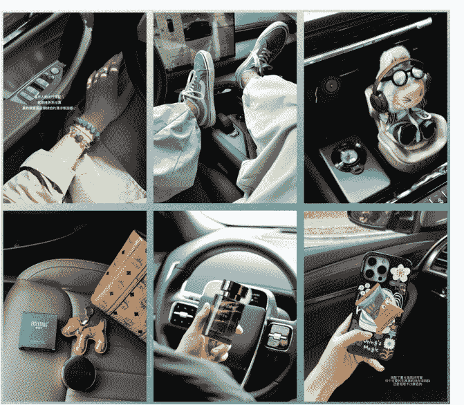

#### 批量拍摄，才能真正提高产能

📕已经是竞争非常激烈的市场。

选品之外，更重要的是在相同时间内生产出更多有效素材。只有内容产能上去了，才更有机会跑出结果。

因此，建议每周固定安排 1—2 天，把接下来一周要用的素材集中拍完。

不要每天重复：

找参考 → 拍照片 → 做笔记 → 发布 → 再找参考。

这种方式不仅效率低，还很容易被琐碎工作拖垮。

正确的方式是把流程拆开，集中完成：

- 集中找对标；
- 集中整理素材；
- 集中拍摄；
- 集中剪辑；
- 集中制作内容。

下面用一个保温杯案例说明，如何把一次拍摄扩展成多组素材。

文案参考：

# 新杯图透👀小奶杯家族新成员➕1!

大家期待的无吸管、带分享杯盖的保温杯终于要来了。

配色像小奶瓶一样可爱，秋冬拿来喝热饮非常合适。

双饮设计，搭配 316L 内胆，高颜值又方便携带。

画面可以这样设置：

- 两个保温杯；
- 两杯咖啡；
- 杯子可以分别呈现盖上和打开的状态；
- 背景使用金属收银台桌面。

如果产品有 10 种颜色，那么同一套构图就可以直接替换不同颜色，拍出一组新素材。

咖啡也不必固定一种，可以依次换成：

- 星巴克
- 喜茶
- Manner
- 霸王茶姬

同一场景又能延伸出多组内容。

拍摄过程中，角度也可以做细微调整：

- 向左移动；
- 向右移动；
- 镜头上移；
- 镜头下移。

还可以将画面改成：

- 一个保温杯 + 一杯咖啡；
- 不同颜色的杯子 + 不同品牌的咖啡；
- 同样的产品组合 + 木质桌面背景。

这样一次拍摄，就能通过替换颜色、饮品、数量、角度和背景，批量获得大量可用素材。

这就是实拍电商里非常重要的能力：

**不是每一张图都重新开始，而是把一个有效模板不断拆解、组合和延展。**

#OLO HOLOHOLO.Life

关注

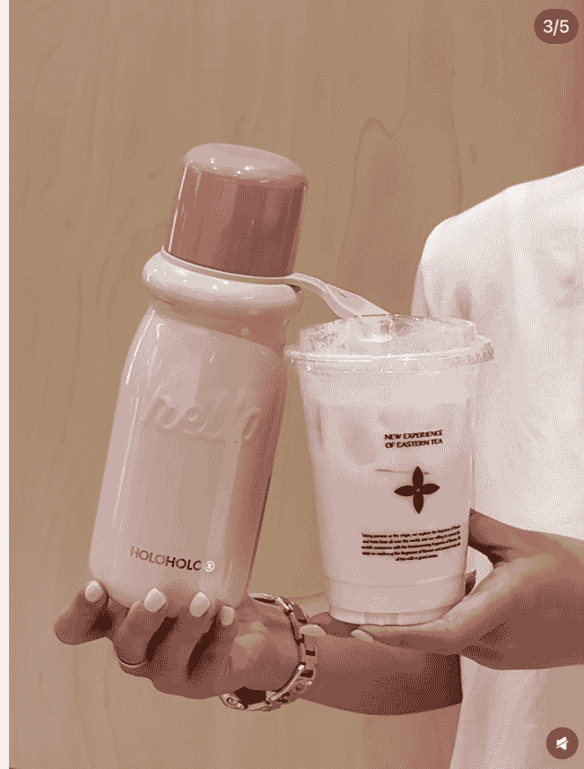

新品先睹为快👀 小奶杯大家庭再添一员！

一直被呼声很高的款终于要来了——不配吸管、配上可分享式杯盖的保温杯。

圆润可爱的小奶瓶配色，拿去配秋冬热饮简直太搭了！

支持双模式饮用，内胆采用316L材质，外观在线的同时也好带出门。

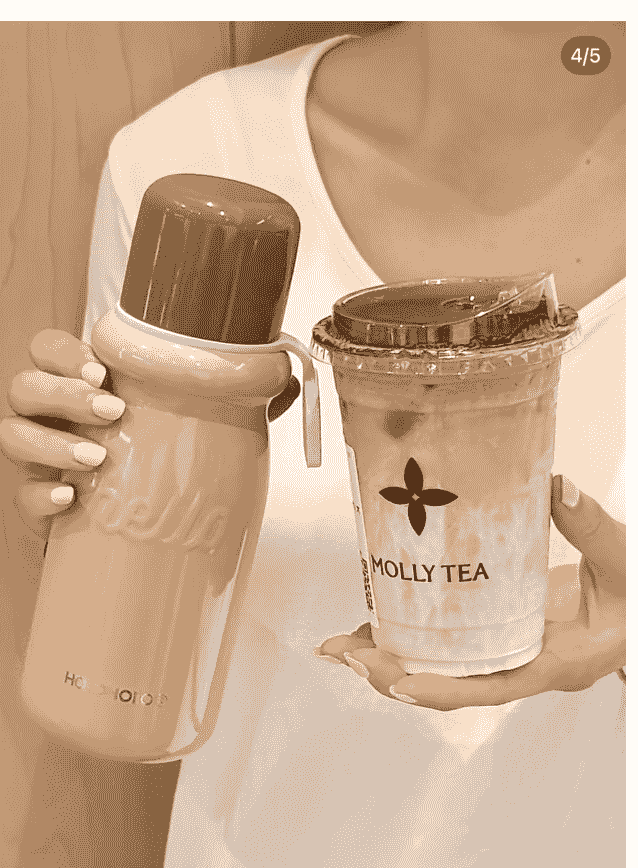

## 新品先睹为快👀 小奶杯大家庭再添一员！

大家念叨已久的无吸管版分享盖保温杯，即将上线。

奶呼呼的配色做成小奶瓶体型，入秋喝暖饮用它刚刚好。

双口径设计 + 316L 内胆，颜值耐看又方便携带。

画面可以用的元素有：保温杯、咖啡、模特、人字T恤、木纹墙面。

- 手上10款颜色的杯子，搭配不同咖啡或饮品，就能衍生出超多组合。

- 模特在画面里的占比，可大可小都很OK。

- 只需要把模特身上的T恤换色，就又是全新的一组。

固定构图和搭配，换成大理石台面、窗帘布景、其它木质背景来拍，也能出一整套系列。

要注意的是，近期📕对同质化内容审核更严了，所以不要在一个场景里拍太多张，尽量多换场景来丰富素材。

## 三、未来的底气

回头看看这一年多的变化，从地产下行周期里的普通职员，到现在敢于聊工作室、聊未来的创业者。

我最大的转变，并不是账户数字的变化，而是认知边界被打开了。

认识赚钱的朋友很多，主业或多或少都有些压力，大家想靠副业多赚一份收入，本质上想要的都是对抗不确定性的底气。

龙哥老师说过：“一个人独立在商业世界里挣钱的能力，才是他最硬的底气。”

📕电商的红利会不会退潮，具体的打法会不会失效，这些都不确定，但“在低谷里重建、在下行中上行”这种韧性，会一直跟着我们走。

把手弄脏一些，把心沉一沉。

希望我们既能在这个商业世界里穿上盔甲生存下来，也能保留那颗会热泪、敢于重新开始的心。

这种底气，是别人夺不走的。

这就是你对抗信息噪音的壁垒。

已稳定运营6年，累计拆解研读3000+个互联网商业实战案例、行业前沿情报以及宏观时政类文章。

我们不做搬运，只做优质信息的过滤器和放大器。

