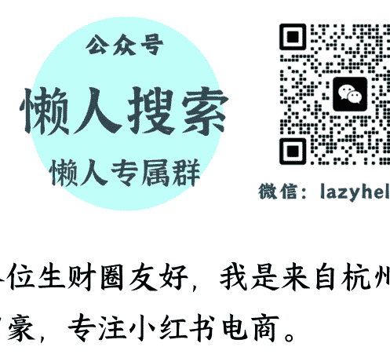
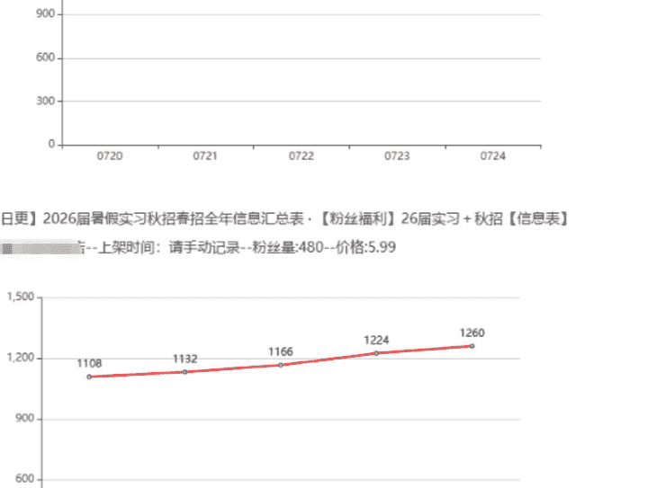
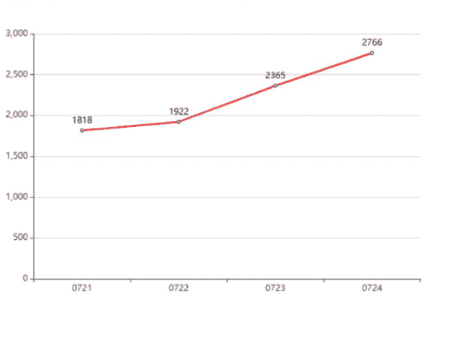
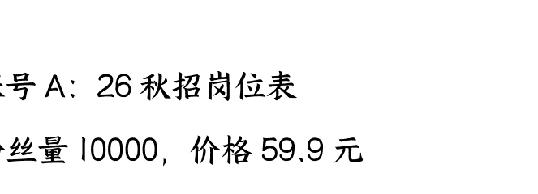
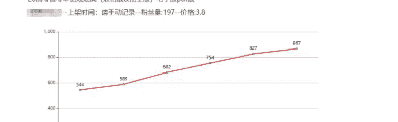
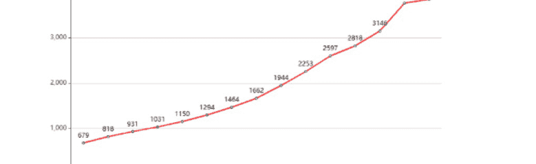
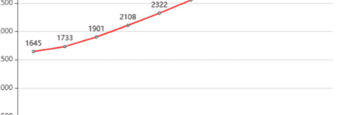
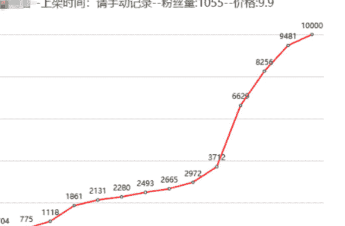
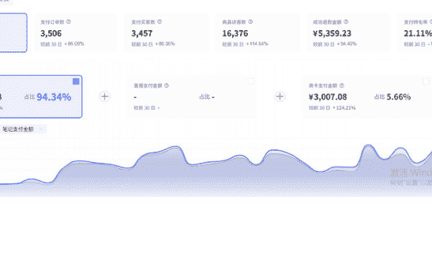
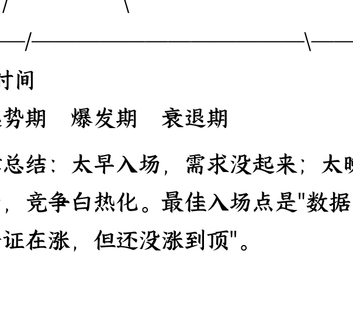

# 📕虚拟产品赛道实战复盘｜年净利润150万，如何靠数据找到好产品

## 260104 副业 SC 精华




大家好，我是龙哥，过去几年主要做📕电商。

感谢龙哥盟这个平台，让我在创业过程中接触到不少有效的方法。创业第六年，公司仍然在持续经营，我个人也连续六年实现年收入过百万。早期加入赚钱时，我还获得过龙哥老师的微天使支持，这份信任一直推动着我继续尝试新的生意模型。

过去三年，我参与运营了30多家📕店铺，曾经通过内容电商做到千万级营收。不过，单纯依靠剪辑、搬运和内容分发，始终会受到平台规则与推荐机制影响，经营结果并不稳定。

因此，从去年开始，我们逐渐把资源转向虚拟产品方向。经过一段时间的测试和调整，团队在这个赛道实现了年净利润150万左右。

今天不重点讲投放，也不展开标题技巧，只聊一个更容易被忽略、却直接影响结果的环节：选品。

我见过不少人，一开始就埋头制作资料、修饰页面、优化文案，最后才发现，市场根本没有足够的购买意愿。

真正应该先确认的是：

- 这个需求是否已经出现？
- 用户是否正在主动寻找？
- 同类产品是否已经产生真实成交？
- 这个需求当前处于上升阶段，还是已经过了高峰？

我们能够持续找到有潜力的虚拟产品，并不是因为团队比别人更辛苦，而是因为在投入制作之前，先完成了市场判断。

## 虚拟产品卖的不是文档，而是特定阶段的解决办法

虚拟资料看起来是在售卖文件、表格或课程内容，但用户真正购买的，往往是某个阶段里的“省时间”和“少走弯路”。

比如：

- 大四学生通常会在秋季集中查找招聘岗位信息；
- 准备省考、国考的人，会在报名和备考阶段搜集申论表达素材；
- 考研冲刺阶段，英语写作模板的检索热度会明显上升。

这类需求有非常鲜明的时间属性。同一个产品，提前太久发布，用户还没意识到需要；等到热度完全爆发后再做，又可能已经挤满竞争者。

所以，判断一个产品值不值得做，不能只问“内容好不好”，还要同时回答：

**它解决什么问题？服务哪批人？在哪个时间段最容易被购买？**

只有产品内容、目标人群和时间窗口同时匹配，才有机会形成规模化增长。

## 产品选择，会限制流量上限

📕的推荐与搜索，本质上都围绕用户需求展开。

当某类搜索词持续升温，相关笔记更容易获得平台分发。若你的内容刚好处在需求抬头阶段，就更容易被目标用户看到。

但如果选的是过于冷门的方向，或者用户热情已经消退，即使页面精美、内容完整，也很难突破流量瓶颈。

选品正确，相当于顺着水流前进；选品错误，再多努力也可能只是低效消耗。

## 这个赛道拼的是发现机会的速度

虚拟产品最大的特点之一，是复制和模仿成本较低。

某个方向被验证后，很快就会出现大量相似商品。因此，竞争不只是比谁做得更好，还比谁能更早发现需求变化。

提前数周甚至提前一两个月布局，往往可以获得更宽松的竞争环境；等市场已经被大量卖家占据，再进入，利润和曝光都会被压缩。

换句话说，选品要同时满足两个条件：

**方向正确，进入得早。**

## 一、用销量变化寻找新机会

为了提升判断效率，我们投入十几万元搭建了内部监测系统，用来记录不同赛道的商品表现。

以前团队主要靠人工把信息抄进文档，再每天重复检查，容易漏数据，也很难及时发现异常。后来，我们把人工流程与AI、自动化工具结合起来，让团队能够持续追踪不同方向的变化。

监测维度包括：

- 所属方向
- 商品标题
- 商品链接
- 店铺信息
- 粉丝规模
- 当前销量
- 商品价格
- 当天是否完成观察
- 资料存放地址

目前覆盖的范围包括中小学内容、考试备考、幼儿教育、课堂PPT、英语学习等方向。

| 序号 | 当日监控状态 | 网盘链接 | 赛道 | 商品名字 | 商品链接 | 店铺名称 | 粉丝量 | 销量 | 商品价格 |
| :--- | :--- | :--- | :--- | :--- | :--- | :--- | :--- | :--- | :--- |
| 1 | 监控完成 | 等待补充 | 中小学 | 幼儿 | 403 抖音大挑战 54 条 PDF 电子版...实物... | 链接 | 嘉喜全科商量的店 | 8102 | ["20250911":, "3"... | 3.8 |
| 2 | 监控完成 | 等待补充 | 中小学 | 幼儿 | 005 图拟家粉·数字启蒙 LUt 音频... | 链接 | 艰难的店 | 10000 | ["20250911":, "3"... | 5.8 |
| 3 | 监控完成 | 等待补充 | 中小学 | 1-6 年级语文/数学/英语知识点] 高考晚... | 链接 | 是外面的妈妈的店 | 64000 | ["20250911":, "1"... | 3.8 |
| 4 | 监控完成 | 等待补充 | 考试 | 考公 | 26 套高考分析公式默写。通案。题型识别... | 链接 | 美是我们要的店 | 1030 | ["20250911":, "3"... | 3.9 |
| 5 | 监控完成 | 等待补充 | 考试 | 软件 | 公考 8 口元 2026 年行政类理论图软件 APP... | 链接 | 苹果的店 | 874 | ["20250911":, "5"... | 9.9 |
| 6 | 监控完成 | 等待补充 | 考试 | | 25 国省考考试真题答案解析历年真题... | 链接 | 上半年的愿行的店 | 903 | ["20250911":, "3"... | 3.99 |
| 7 | 监控完成 | 等待补充 | 考试 | 公考政治理论时政热点图面霜 app 公务员事... | 链接 | Lucky 宇宙学习... | 857 | ["20250911":, "1"... | 15.9 |
| 8 | 监控完成 | 等待补充 | 幼儿 | 中小学 | PPT | 50 款课前小游戏 ppt 电子版 (如下... | 链接 | 恩贝 Nice 的店 | 4038 | ["20250911":, "1"... | 14.8 |
| 9 | 监控完成 | 等待补充 | 幼儿 | PPT | 30 多款课堂互动趣味游戏 PPT 课件...(稍... | 链接 | 小方老师。的店 | 49000 | ["20250911":, "1"... | 88 |
| 10 | 监控完成 | 等待补充 | 英语 | 幼儿 | PPT | 46 款课前小游戏些课件 (如下各... | 链接 | 小布老师。的店 | 14000 | ["20250911":, "2"... | 19.9 |

### 重点看增长速度，不要只盯总成交

很多人会优先寻找销量最高的商品，但这类商品往往已经被充分验证，竞争也同步加剧。

我们更关注的是：

- 最近几天是否持续增加；
- 增长是否来自多个账号；
- 不同粉丝规模的卖家是否都在上涨；
- 低价和高价商品是否都存在成交；
- 增长是否能够延续，而不是只出现短暂高峰。

总量高，说明过去卖得不错；增速快，才可能意味着新的需求正在形成。

### 实战案例一：求职信息资料，提前布局招聘季

我们在八月开始整理这个方向，比理想时间晚了约四周，但产品依然取得了较好的结果。

### 总览

| 商品 | 流量 | 内容 | 店铺 | 服务 | 市场 |
| :--- | :--- | :--- | :--- | :--- | :--- |
| **经营概览更新时间** | 21:29:19 | 全部 > | | | |
| 实时 | 近 1 日 | 近 7 日 | 近 30 日 | | |
| **支付金额** | ¥502.6 | 昨日 289.0 | | | |
| **笔记** | ¥194.9 | 昨日 158.4 | | | |
| **直播** | ¥0.0 | 昨日 0.0 | | | |
| **商卡** | ¥307.7 | 昨日 130.6 | | | |
| **支付订单数** | 53 | 昨日 30 | | | |
| **支付买家数** | 52 | 昨日 30 | | | |
| **商品访客数** | 646 | 昨日 385 | | | |

### 热销商品

| 商品名称 | 支付金额 | 商品访客数 |
| :--- | :--- | :--- |
| 26 届实习/秋招/春招公司招聘信息... | ¥494.90 | 640 |

### 经营数据概况：商家经营核心数据汇总 统计时间:2025-07-01 至 2025-09-30

| 维度 | 近 1 日 | 近 7 日 | 近 30 日 | 转/归属 |
| :--- | :--- | :--- | :--- | :--- |
| 核心数据指标 | 全部 | 自营 | 带货 | |
| **支付金额** | ¥62,488.32 | 数据下滑 • | 数据下滑 • | 数据下滑 • |
| **支付订单数** | 6,260 | 数据下滑 • | 数据下滑 • | 数据下滑 • |
| **支付买家数** | 6,207 | 数据下滑 • | 数据下滑 • | 数据下滑 • |
| **商品访客数** | 32,229 | 数据下滑 • | 数据下滑 • | 数据下滑 • |
| **成功店铺金额** | ¥701.30 | 数据下滑 • | 数据下滑 • | 数据下滑 • |
| **支付转化率** | 19.26% | 数据下滑 • | 数据下滑 • | 数据下滑 • |
| **笔记支付金额** | ¥52,465.18 | 占比 83.96% | 数据下滑 | + |
| **直播支付金额** | ¥6.90 | 占比 0.01% | 数据下滑 | + |
| **商卡支付金额** | ¥10,016.24 | 占比 16.03% | 数据下滑 | 数据下滑 |

### 多账号销量记录

9/69

**26 秋招岗位表**（持续维护一年，短信发

−−−订阅...−−上架时间：请手动记录−−粉丝量:10000−−价格:59.9



【日更】2026 届暑假实习秋招春招全年信息汇总表 •【粉丝福利】26 届实习 + 秋招【信息表】

−−−订阅...−−上架时间：请手动记录−−粉丝量:480−−价格:5.99



(每天更新！)26 届暑假实习/秋招/春招公司信息网申表，自动秒发

...店−−上架时间：请手动记录−−粉丝量:2226−−价格:9.9



下面是我们在七月份保存的三份样本。

**样本A：岗位资料合集**

粉丝规模：10000  
售价：59.9元

7月20日销量为1789单，7月24日达到1950单。五天增加161单，平均每天约32单，且客单价相对较高。

**样本B：全年求职信息汇总**

粉丝规模：480  
售价：5.99元

7月20日销量1108单，7月24日1260单。期间新增152单，体量很小的账号同样能够持续产生订单。

**样本C：实习、秋招、春招网申资料**

粉丝规模：2226  
售价：9.9元

7月21日为1818单，7月24日升至2766单。四天增加948单，平均每天约237单，是三者中上升最快的商品。

### 从这组样本可以得到什么？

#### 1. 同方向的多个卖家同时上行，才更有参考价值

我们同时观察了不同规模的账号。大账号、小账号、低价产品、高价产品都出现增长，说明这并非某个卖家偶然拿到流量，而是求职资料本身正在形成市场热度。

单个商品的上涨可能源于特殊内容或偶发推荐；多个账号在同一时期表现变好，可信度就高得多。

#### 2. 一个产品同时承接两类需求

这类资料既能满足暑期实习人群，也能服务秋招准备者。

暑期前后：

- 大三学生开始寻找实习岗位；
- 大二学生了解日常实习机会；
- 大四学生提前准备招聘季；
- 低年级学生也会关注企业和岗位信息。

当同一份资料覆盖“实习、秋招、春招”几个阶段时，潜在人群会明显扩大，内容也能拥有更长的销售周期。

#### 3. 招聘资料要在热度完全起来之前发布

如果等到九月招聘季全面启动才开始制作，通常已经错过较好的准备期。

更合理的节奏是：

- 六月：学生进入假期，开始了解实习机会；
- 七月至八月：暑期实习需求增强，同时进入招聘预热阶段；
- 九月：正式招聘季到来，竞争明显升温。

在六月或更早开始准备，可以先获得实习需求，再承接后续招聘需求，面对的竞争也相对温和。

## 我们如何落地这个产品？

### 1. 选择可持续更新的交付方式

我们没有采用传统静态文件，而是使用飞书多维表格。

原因很简单：求职信息最重要的不是排版，而是完整、及时和方便筛选。在线表格可以随时增加新岗位，用户也能按照行业、城市、岗位等条件查找，实际体验明显优于普通PDF。

### 2. 规划资料结构

内容主要包括：

- 暑期实习岗位；
- 秋季招聘岗位；
- 次年春招信息；
- 互联网、金融、快消、地产、四大、国企等行业分类；
- 企业名称、岗位名称、申请入口、截止日期、薪资范围等字段。

### 3. 按阶段调整内容表达

同一份资料不必全年只用一种表达方式：

- 6月至7月，突出暑期实习；
- 8月至9月，突出秋季招聘；
- 次年2月至3月，转向春招需求。

通过调整封面、标题、关键词和内容重点，可以适配不同阶段的搜索习惯，延长产品的生命周期。

### 这个案例给我们的提醒

1. **优先寻找需求能够叠加的方向。**  
   一个产品同时解决多个相近问题，覆盖人数会更广。

2. **不要等到需求爆发才开始。**  
   在用户开始集中搜索之前完成准备，往往更容易获得先发优势。

3. **交付形式也能制造竞争力。**  
   静态文件只是基础，在线更新、筛选和协作会带来更好的使用体验。

4. **目标人群越清晰、覆盖越合理，流量空间越大。**  
   从低年级学生到毕业生，只要需求链条能够贯通，产品周期就会更长。

简单说，好的产品不是单纯把资料做得更多，而是在合适的阶段，用更适合用户使用的形式，解决更大范围人群的具体问题。

## 实战案例二：国考申论表达素材，矩阵账号同步增长

这个方向我们采用多账号测试，不依赖单一账号获取结果。

## # 经营概览

近 1 日 | 近 7 日 | 近 30 日 | 自然日 | 自然周 | 自然月

### 交易构成 2025-11-01~2025-11-30

+ 全部

自营

带货

- **支付金额**

  - `**2.0 万**`

  - 上周期 +48.18%

- **笔记**

  - 1.8 万

  - 上周期 +52.70%

- **直播**

  - 上周期 -

- **商卡**

  - ¥1,055.9

  - 上周期 -2.41%

- **支付订单数**

  - **3,589**

  - 上周期 +58.04%

- **支付买家数**

  - **3,546**

  - 上周期 +60.02%

- **商品访客数**

  - **1.6 万**

  - 上周期 +27.81%


2025-02 ... 2025-10

### 人群构成 2025-11-01~2025-11-30

+ 首购周期

180 天

365 天

**首购用户金额**

- `**¥18,810.96**`

- 96.24%

- 较前 1 月 +43.79%

**首购用户数**

- **3,416**

- 较前 1 月 +55.56%

| 全部自营账号 | | 11,985 | 1,734 | 823 | 549 |

| :--- | :--- | :--- | :--- | :--- | :--- |

| **核心数据** | | | | | |

| **30,734.34** | 5,559 | 5.46% | 14.83% | 686,546 |

| **18,658** | 4.22% | 9,765 | 0 | |

### 多账号销量记录

以下是我们在11月初保存的两条商品走势。

**账号甲**

粉丝数：332  
价格：3.8元

11月1日累计销量1936单，11月9日升至3228单。九天增加1292单，平均每天约143单。

**账号乙**

粉丝数：21000  
价格：28.88元

10月31日累计销量2267单，11月9日达到3636单。十天增加1369单，平均每天约137单。

除此之外，我们从九月起就持续观察这一方向，当时已经有部分账号开始出现明显增长。





### 这组数据说明了什么？

#### 1. 增长具有连续性

两条曲线都不是短时间突然冲高后迅速回落，而是在观察周期内持续向上。对于资料类商品来说，这通常意味着用户需求正在扩大，而不是偶然获得一波推荐。

#### 2. 粉丝规模不是唯一决定因素

332粉的小账号和21000粉的大账号都在增加销量，体量差距很大，但表现方向一致。

这说明商品的成交并不完全依赖账号基础，更重要的是市场本身是否存在足够强的购买动机。

#### 3. 不同售价都有成交空间

3.8元的低价版本能够卖出，28.88元的高价版本同样有订单，说明用户并非只接受最低价格。

只要资料能够有效解决备考问题，并且产品结构、更新质量和使用体验足够匹配，价格就可以根据内容深度和服务方式进行区分。

## 最后总结

虚拟产品赛道并不是“随便找份资料上传就能卖”。

更稳妥的路径是：

1. 先观察用户正在寻找什么；
2. 再判断需求是否处于上升阶段；
3. 用多个账号和多个价格带验证趋势；
4. 在热度形成前完成产品准备；
5. 通过交付形式和内容结构建立区别；
6. 根据不同时间段持续调整表达方式。

不要只看谁的累计销量最高，也不要仅凭感觉判断市场。真正值得关注的，是需求有没有持续升温、不同卖家是否同步变好，以及用户是否愿意为不同层级的产品付费。

选对方向，再选对时间，最后用更好的产品形态承接需求，这才是虚拟产品能够持续产生收益的关键。

在虚拟资料这个行业泡得越久，我越相信一件事：能爆的品，大多能在数字里提前读出迹象，而不是靠一把梭的直觉。当你长期盯着的多个账号，粉丝量、客单价完全不在同一水平，销量曲线却整整齐齐朝着同一个方向抬升时，那么大概率意味着赛道正在升温，而且红利窗口没有被关上。

我第一次尝到这个甜头，是在公考方向。国考时间表刚敲定，监控池里就有好几个卖申论材料的账号，体量、定价各不相同，但成交量都同步上扬。我们快速出手，整合出一套结构化的申论标准词表，拆成政治、经济、文化、社会、生态五个维度，并为每个词都写出了使用场景和参考例句。这本册子上架第一周就开始连续出单，后续越放越大，直到在公考资料产品矩阵里成为主力款。

所以，在选定一个赛道之前，永远要做一次多账号交叉验证。单独一个账号猛涨，可能是撞上了好运；一群账号一起猛涨，那就不叫运气，就叫趋势。

考研英语作文模板那场仗，也沿用了同样的判断路径。不到一个月时间，单品利润冲到10万以上。而最初的线索，就藏在我们对多账号销量数据的持续观察中。

10月31日，我们把目光落在一个销售“2026考研英语作文模板＋英语真题卷”的账号上。粉丝只有2948，售价9.9元。对它跟踪了10天，完整记录如下：

| 日期 | 当日销量 | 对比前日 |
|---|---|---|
| 10/31 | 1645 | — |
| 11/01 | 1733 | +88 |
| 11/02 | 1901 | +168 |
| 11/03 | 2108 | +207 |
| 11/04 | 2322 | +214 |
| 11/05 | 2555 | +233 |
| 11/06 | 2782 | +227 |
| 11/07 | 3013 | +231 |
| 11/08 | 3272 | +259 |
| 11/09 | 3460 | +188 |

把十日看成一个整体，净增1815单，日均181单。就是这组数字，让团队毫不犹豫地下了注。

我后来反复复盘，觉得当时敢下手，主要因为三点。一是曲线的形态优质。整个周期几乎是一条向右上方延伸的直线，看不到大幅起伏，也没有中途熄火。这说明购买背后不是临时热点，而是极稳定的刚性驱动。考研日期锁定在12月底，11月正是冲刺段，考生对模板的需要是确定的、可持续的。二是每日增量没有减速，反而在爬坡。从+88慢慢抬升到+200以上，整体走势依然处于上升区间。早一步进场，分到的就是最肥的一段流量。三是账号体量小到可以忽略，却依然能做到日均180多单。换句话说，这个生意不吃粉丝积累，内容踩准了就能出单，新手照样能做。

虽然信号足够清楚，我们依然没有马上行动。10月31日启动跟踪，到11月9日才收手，中间等了整整十天。为什么要等？一两天数据说服不了人，连续5到10天的走势才有资格说明问题。我们要拿到的不是赌一把的勇气，而是确定性的证据。11月10日，三项证据全部到位——增长稳定、增势向上、小盘可跑——开盘。

聊一下我们执行层面的细节。产品先交了一个最简版本，先把英一、英二的大作文和小作文模板做出来，按热门话题分成科技、文化、社会等单元，每个模板配上一步步引导用户填写的说明。上线动作也同时铺开：标题铺满“26考研”“英语作文”“作文模板”“稳分”“冲刺必备”等关键词；发帖时刻定在晚上9到11点，那是考研人群最活跃的时段；封面统一强调“模板”“稳分”“提分”。

模板市场本来就拥挤，如何打出差异？我们押了三张牌：内容上接住2024-2025年的大热门，包括人工智能、新兴产业、银发趋势等；设计上强调引导填写，不只给模板还教用户怎么往里填；销售上把真题卷打包进去，价值感直接翻倍。

11月中旬产品悄悄上线，等到12月上旬，销量冲到最高点。12月底考试结束，关注度自然回落，我们正好吃完整个冲刺段的红利。

这场仗还留下了几条方法论。日期明确的大事件，比如考研、考公、秋招，永远是产品选择最可靠的锚点；在任何判断里，数据优先于直觉，数据不会骗人；入场时机最好卡在上升斜率刚起来的位置，太早需求没有形成，太晚竞争早就白热化。另外，速度比完美重要，时间窗一旦关闭，再好的产品也来不及。

其实这套思路一直按照“三层核验”来走：需求侧的核验是搜索热度有没有起来，用户是不是真在找；时机侧的核验是当下是否处于爆发前段；竞争侧的核验是拥挤程度如何，并且我们有没有错开身位的空间。三关全部通过，资金和人力才跟进去。

上面讲的三个案例，全部围绕“确定性事件”打转。接下来要说的思路，出发点完全不同——它依托的不是日历，而是人性。

引出这条线的，是一个游走灰色地带的小说账号。

它看上去平平无奇：粉丝1055，定价9.9元。可十五天的销售曲线让人很难忽略：

11/21 → 704单
11/24 → 1861单
11/27 → 2493单
11/30 → 3712单
12/02 → 6629单
12/04 → 9481单
12/05 → 10000单

从704到10000，用了十五天，净增9296单，平均一天增加619单。后段几乎是垂直上升，在虚拟资料行业里并不常见。

但数据漂亮并不能让我们心安。那边是高风险内容，账号随时会被封掉，违规的代价太大，生意也没有可持续性。可是我们也没有立刻走开，而是多问了一个问题：它靠什么起量？到底满足了什么？

答案很直接：情感。它贩卖的是对爱情的想象、对亲密关系的渴望，以及对情绪补偿的强烈需求。能卖出近万单，不是因为它内容考究，而是因为它的钩子，正好挂在人性最底层的那根弦上。

这次思考直接把我们的选品思路换了一个维度。过去，看到什么涨就做什么；现在，先问为何涨，背后是哪一种人性需求，以及有没有更体面的方式去满足同样的需求。

具体做法可以拆成四步。第一步，找出异常增长的赛道；第二步，把它背后的需求解构清楚；第三步，做需求转移，找到一个安全、合规、又能装下同样需求的路；第四步，用低成本的测试去验证。

回到刚才那个小说账号。灰色内容能起来，本质上承接的是年轻群体对亲密关系的浪漫化想象。换个方向想，校园言情难道不能装下同样的想象？高中生、大学生正处于好奇心最强的年纪，他们当然愿意在小说里体验一场又一场恋爱。而且这个方向没有任何合规风险，完全可以放开手做。

中心思路一旦切换，动作就快了。我们开了一个新号，专门做校园言情小说推荐和书单合集，第一批整理了甜宠、暗恋、双向奔赴三类书单。笔记全部按📕的逻辑来做：封面强调“甜”“上头”“熬夜读到天亮”这类情绪词，标题带上“高中生”“大学生”“宿舍”等现场字样，正文采用书单推荐、原文截图加情绪化文案的组合。

上线不到一个星期，后台涌进一大批订单。系统记录显示：成交订单137笔，交易额272.6元，退款25.9元，访客数929，访问量1321，成交率14.8%，系统随后给出“现货爆单”的提醒。

事后复盘，校园言情能走起来，原因是三层叠加的。第一层，情绪匹配太精准。目标人群处在恋爱渴望最强烈的阶段，小说提供的就是最低成本的替代满足。第二层，基本盘太大。全中国数以千万计的高中生、大学生，哪怕只覆盖一小部分，也能做成大生意。第三层，重复购买的比例高得惊人。小说看完一本还有下一本，甜宠看完换虐恋，校园看完换职场，用户根本停不下来。

更深一层的启发，是这个案例给了团队三条心法。第一，不能碰的赛道，反而是最灵敏的需求雷达。它用极高的销量告诉我们背后藏着一个多大的需求池，我们要做的，只是把这个需求池引到安全的渠道里去。第二，人性驱动的生意没有周期。考试才分淡旺季，但对爱情的期待、对安慰的渴望、对娱乐的依赖，从不看日历。第三，年轻人的消费习惯对卖家极其友好。他们时间多，刷手机频率高，下单决定快，还乐于分享给朋友。小金额消费对他们来说几乎不存在门槛，而足够大的频次会把利润堆得很高。

方向跑通以后，新的麻烦又来了：内容从哪来？人工写，产能跟不上；直接搬，风险兜不住。我们的解法是让Claude进入生产流，批量产出原创内容。在拆具体流程之前，必须先讲一条原则：用户消费的从来不是文章本身，而是读文章时产生的那种体验。她们付费，买的是心动、是满足、是意难平。因此，选题真正要锚定的不是“构思怎样的情节”，而是“给到哪种情绪”。

拿测试结果来说，引爆率最高的题材基本汇成四条路。

第一条，禁忌感。青梅竹马却突然对彼此脸红，曾经相看两厌的死对头偏偏被越推越近，假装情侣最后无法出戏，签了契约却把真心赔进去。这类设定生来就自带张力，会让人忍不住追问结局。

第二条，身份反差。冰山尖子生和跳脱的后进生，聚焦众人目光的校园明星和对什么都提不起兴趣的路人，表面冷淡私底下却恋爱脑，对外散发着“生人勿近”的气场、关上门却黏人到不行。反差会不断制造成惊喜，让读者想看人物在私下的另一面。

第三条，单向暗恋。把这份喜欢藏了好几年，毕业前才敢说出口；以为只是一个人的兵荒马乱，多年后才发现是双向的暗自在意；邻座的两个人，隔着课桌的那条线，谁也没敢跨过去。暗恋几乎是几代人共享的青春记忆，最容易让读者一头栽进去。

第四条，甜到极致的宠。生活化的小甜段子，把所有的温柔独独留给女主的男主角，带有执拗占有欲的男友，娇气小公主和拿她毫无办法的宠溺型对象。这类作品负责提供纯粹的愉悦感，不需要烧脑，读完心情大好。

把它们再往深里压一压，会发现爆款公式其实很固定：```
爆款选题 = 人设反差 × 关系张力 × 情绪钩子
```人设要有明显的反差碰撞，感情线里必须存在“不该在一起”或“很难在一起”的障碍，并且从头到尾都要有一根让读者放不下的情绪钩子。

公式听明白了，就进入实际生产环节。

第一步，定方向。在四个方向里选一个，让Claude一次性给出10个创意。每个创意的输出需要包含一句话故事梗概、男女主设定、核心冲突与情绪卖点。给AI的指令里还必须写清：目标读者是18到25岁年轻女性，场景限定大学校园，主角都是成年人，要求带有反差感与新鲜度，避开老掉牙的展开。

第二步，出大纲。选定某个创意后，要求AI生成完整大纲。人物设定部分，写明男女主角的名字、年龄、性格、外貌特征以及人物标签；背景部分，说明时间、地点和两人的初始关系；主线剧情按五个阶段推进——相遇、试探、冲突、转折、结局，并为每段准备对应的事件设计；另外还需要单独产出三个名场面，分别对应全场最甜、最揪心、最上头的段落；最后，在关键位置预埋3到5句适合截图传播的台词。

第三步，拆章节写。千万不能让AI一口气写完整个故事，而是逼它一章一章来。每一章的提示词里附上大纲和本章节所处的阶段，标注本章要完成的情节任务和情绪基调。同时，写作细则要写得足够硬：字数3000到4000字，视角用第三人称，但要保留女主角的内心世界；风格轻盈、俏皮、容易代入；对白比例控制在40%到50%，要让人物声音各具辨识度；必须有关于眼神、小动作、内心描写的细节；结尾一定要留一个让人想点开下一章的开口。

第四步，磨名场面。用户最愿意截图传播的，永远是情绪浓度最高的瞬间。把提取出来的名场面交给AI，直接下指令：以下是我小说中的一个关键场景，请帮我继续优化，让它更让人上头：

做内容这门生意，最憋屈的死法不是做不出东西，而是方向没押对。方向顺的人，随手发一篇就有人追着问在哪儿买；方向拧巴的，熬几个通宵做出来的东西，发出去连个水花都没有。

今天把我们从零做到月入五万的路子整个摊开。不绕弯子，不藏私，核心就几件事：怎么找冷门方向、怎么判断值不值得做、怎么把控节奏。

先聊最反常识的一点：真正让你赚钱的货，常常看着并不起眼。

大部分人的习惯是，谁火了就蹭谁。可一个东西一旦开始走量，赛道早就挤满人了。这时候再进去，除了拼价格，还能拼什么？

真正肥的地方长这样：有买家却搜不到卖家，有人反复追问，却没有谁站出来卖。这种错位，就是利润的缝隙。

我管这套玩法叫冷门切入法。今年市面上没几个同行做这件事，我们单店月销已经摸到五万。



为什么空白反而有机会？因为买家已经在了，货却还没人供。看什么涨就追什么，那是给别人抬轿子；看到没人管的渴望，把它稳稳接住，才是自己的轿子。

去哪里找？翻热评。

搜索栏里是大家都想得到的明牌，底下留言里才是活生生、还没人认领的渴望。凡是互动热闹的内容，帖子下面一定有大量真实的信号——“在哪儿买”“同款求个渠道”“希望博主直接整理一份”“跪求打包好的资料”……这些句子背后站着同一群人，掏钱意愿已经写在脸上。

冒出一两条，可能只是随口一问；十条八条都指向同一样东西，那就是明晃晃的提示。


看到提示后别急着动手，先过三关。

第一关，确认普遍性。翻几篇不同的内容，如果同一样东西总被反复提起，而且追问的人各不相关，那它就不是一个人的临时起意。

第二关，确认供给。拿这个东西去搜一圈，半个卖家都搜不到，说明是真的无人供应；只有两三家零星在做，蓝海还能挤；满屏都是同款，趁早掉头。

第三关，确认真假。留言区说想要的人，不一定真掏钱。有些东西看着热闹，挂上去就是无人问津；有些货一直没人碰，未必是没被发现，而是藏着合规的雷、高昂的制作成本或者甩不掉的售后麻烦。

所以我的原则是：轻量测试，绝不重注。花两天做个能用、但远谈不上完美的版本，丢出去看反应。收藏怎么样？付款的人多不多？这两组数据会告诉你答案。有戏就加码，没戏就收手，不跟它耗。

这套打法跑出过好几个至今还在出量、还在挣钱的品类。印象最深的是一次在热帖下面看到不少人求某种资料，全平台搜不到卖的。我们连夜赶出简版上架，才几天就开始有人拍。因为全世界只有你有，来搜的人没有第二家可比。

这个逻辑不只用来卖虚拟内容，实物也照跑。刷到过一个专测办公室低卡零食的博主，粉丝不多，每篇只有几十人点赞，可底下每天都有人追着问购买方式。大家不关心内容，只关心这个东西哪儿能买——这就是典型的蓝海信号。


我们还做过一个低卡零食测评的👸号，专门挑办公室场景里高频出现的小零嘴。随手拍、随手写，几乎每篇都有人来问购买方式。Day 7 和 Day 6 两期发完，互动热度已经很高：


Day 5 测了轻食兽的低GI饼干，留言区问得最凶。


Day 4 是果丹皮，一样不少人求渠道。


Day 3 的紫薯芋泥饼，那篇收藏量后来高得不像话。


同一天发的还有麻酱毛肚，口味猎奇，留言区直接吵起来了。


这些零食哪来的？楼下超市货架而已。卖点从来不在拍得多好看，而是“办公室低卡”这个标签自带一群精准的、有购买力的人。

说完了找方向，再拆三个我们真刀真枪打过仗的品：秋招求职信息表、国考申论规范词、考研英语作文模板。

先记住一句话：这种生意，早半拍是开路人，晚半拍只能接盘。



几款货打法各不相同，但摊开看，规律惊人地一致。

秋招求职信息表，七月初就被盯上，七八九三个月持续放量。新号老号涨势都猛，卖贵卖便宜都有人买单，说明这东西是全民刚需，不挑人。

国考申论规范词，九月初发现，十一月彻底爆。最值得琢磨的是，两个粉丝基数差了六十倍左右的号，增长曲线几乎重合。这不是谁运营能力强，是整个品类的东风来了。

考研英语作文模板，十月底动工，十一月冲到顶点。连续十天稳步往上走，日成交从88单一路涨到259单，而且涨势还没有停。

几款货背后是三条同样的规律：

第一，押中的全是日历上写好的必然事件。考试不会取消，招聘季不会消失，时间一到，大批人自动涌进来。押这种题比追任何热点都稳。

第二，从来不看单点数据。只有某家号在涨，很可能只是运气；要看到大号小号、各种体量的号一起往上走，贵的便宜的都有人买，才敢相信这波趋势是真的。

第三，进入的时机总是卡在起量段的中间。太早，熬不到风来；太晚，挤不进最肥美的区间。最好的位置，是数据已经证明在涨，但离顶点还有距离。


这三条落到操作上，就变成内部的三道闸门：

闸门一，验的是广度：多个号的涨势是不是同步的？涨得有没有持续性？
闸门二，验的是时机：现在是起量段中段，还是早就过了高点？
闸门三，验的是余地：市场还有没有自己的位置？还是已经挤不进人了？

三道全过，果断重仓；任何一道不过，宁可空着也不乱伸手。

这几仗打下来，最大的体会是：挑方向不是靠灵感，靠的是把数据盯穿。单次挑对也许是运气，回回挑对，靠的是系统。

但方向选对了，还只是上半场。想一直有的赚，更要命的是节奏。

不少人有种执念：找一个常青款，一个货吃一辈子。但常青款太难找了——能穿越四季长卖不衰的，要么早就被卷死，要么天花板肉眼可见；为了找它，反而把眼前一茬又一茬的机会全耽误了。

后来我换了个思路：为什么非要找一个常青款？把每一个应季机会连成整条产品链，这条链自己就是常青款。三月春招，六月实习，九月秋招，十月考公，十一月考研，十二月新年——到了什么节点，就有什么钱等着你去赚。

内部排了一张作战图，逻辑简单：提前一个多月蓄力，起量时进场，最旺时收割。

具体节奏分四段：

第一段，暗地里蓄力。等大部分人还没回过味儿来，我已经在盯着头部同行的动作、囤积素材、试探更文频率了。等风真的起来，号的权重，还有内容的底气，都攒足了，好处自然被你先捞走。

第二段，全面加速。风口一起来，加更节奏拉满，多个号一起放量，反复试封面、试标题，直到找出转化最高的那套打法。此时，只讲一个快字。

第三段，见好就收。热度一退就撤，不恋战。每周只发一点东西，让号保持呼吸感，把劲省下来留给后面的爆点。

第四段，第二年重复。日历翻到同样的位置，想要的那波人又会准时出现。旧内容换个新年份的壳，发布重新加密，就能再收割一遍。号没丢，底蕴还在，照着去年的路再走一次就行。

这套打法的效率高在哪？

第一，时间花在刀刃上。需求淡的时候不硬推，省下的力气全部留给下一步要爆的方向。

第二，团队节奏极其清晰。十月专心攻考公，十一月只做考研，十二月备新年，人人清楚手上该干什么。

第三，每一个号都是存下来的资产。考公的号、考研的号、求职的号、新年的号……今年打完，明年照样能用。号越积越多，家底越攒越厚，花销反而越摊越薄。

所以，还需要去等某个常青款吗？我的答案是真的不用。当把日历上那些每年都会重来的日子连成串：一、二月有新年款，三、四月春招，五六月实习，七八月开始为秋招造势，九月正式秋招，十到十二月的考公、考研和新年准备——什么节点都有东西在卖，什么节点都有人付款。这跟常青生意有什么区别？

它只是换了一种形态：不是靠某个单品吃一年，而是全年都有货在卖。你真正拥有的也不是哪一个爆款，而是一整排随时可以开卖的排期表。

最后一句实在话：挑货的眼光，决定你能走多高；踩对节拍，决定你能做多久。

选品眼光好的人不少，真正能把品做成爆品的人稀少。核心差距不在判断，而在节奏——该猛攻的时候犹豫不决，该及时止损的时候死扛到底，该换赛道的时候恋恋不舍。

于是出现了这种尴尬：品挑对了，机会窗口却错过了，红利被别人吃光了。

我们团队之所以能做到“每个月都有爆款，每天都在持续成交”，靠的不是运气，而是把选品变成了可复制的节奏管理：

- 提前 1-2 个月预埋：在市场还没热起来之前，我们的产品、素材、流量准备已经到位；
- 高峰期集中爆发：把资源全部压上去，快速抢占声量与转化；
- 下滑期干净利落撤退：不恋旧、不硬耗，及时收回精力；
- 账号长期孵化：维持基本盘的健康，等待下一个周期再出发。

顺着市场周期走，顺着用户需求走，你才能一直踩在风口上。

如果要用一句话概括这套选品逻辑：选品的本质，是在正确的时机，用正确的方式，卖正确的商品。

- 数据追踪法，帮你锁定市场上正在起量的“对的品”；
- 人性洞察法，帮你挖掘用户心里没说出口的“隐藏的品”；
- 空白市场法，帮你找到竞争对手还没注意到的“被忽略的品”；
- 年度爆品时间表，帮你永远卡在“对的时间”。

把这四种打法串联起来，就形成了一整套闭环的选品体系。不是靠撞运气，不是靠直觉，而是靠系统、靠方法、靠节奏感。

希望这套思路对你有启发。去落地，去检验，做出属于你自己的爆品。

做📕电商，我观察到一个普遍现象：95%的人卡在自我怀疑上，总觉得自己经验不足、基础薄弱、怕学不会。实际上，学习新技能、探索新生意，最关键的是先建立信心。相信自己能行，你才真正能学会。

很多时候，真正限制你的不是能力，而是你不敢迈出那一步去试。

与诸君共勉！


### 这里是你对抗信息过载的护城河。

已稳定运行 6 年，累计拆解、研读 3000+ 个互联网商业实战案例与行业前沿内参和时政/宏观文章。

我们不搬运垃圾，只做高价值信息的筛选器与放大镜。


