# 亚马逊 CPS 项目实操复盘：从零到 GMV 7000+ 美金，我的全流程拆解

> 260105 副业 SC 精华
> 公众号懒人搜索，懒人专属群独享
> 懒人微信：lazyhelper1


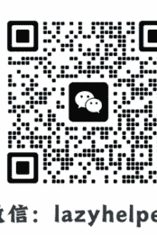

微信：lazyhelper1

## 写在前面

大家好，我是千寻。先给大家拜个早年，祝除夕快乐。

初中那会儿，偶然翻到一本《穷爸爸富爸爸》，光看封面我还差点以为是讲“三妻四妾”的小说，结果一读进去就彻底被震住了，财商瞬间被点燃。

书里有句话一直刻在我脑子里：“想成为富人，就得不断买资产，让资产替你生钱。” 从此我就踏上了寻找“睡后收入”的路。基金、股票、房产这些虽然也算资产，但门槛太高，没个几十万根本玩不出水花。

我毕业后当了三年程序员，钱是赚了不少，可每天通勤上班，尤其碰上刮风下雨下雪天，整个人都emo了，最后索性辞了职。

2025 年底，我从西安搬到广州过冬。出发前各种琐事缠身——给猫咪找新家、收拾屋子、打包行李、赶飞机、调时差……整整三四天没碰电脑。

然而让我意外的是，打开后台一看，项目居然在这几天里默默出单了。

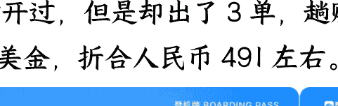

12 月 9 号落地广州，8 号到 11 号，电脑压根没开机，却悄无声息地出了 3 单，躺赚 70.23 美金，折合人民币差不多 491 块。


那一刻我突然明白，这不就是我梦寐以求的“资产”吗？不用费心打理，自己就在那儿生钱。

于是就有了今天这篇干货长文，我会把整个项目的玩法和心得毫无保留地分享出来，一步步带你拆解这个神奇的“资产”项目。

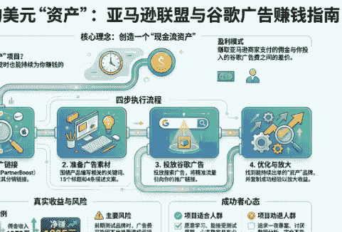

## 项目拆解

## 收益概况

先说结果。我是 11 月中旬启动的，11 月 19 号拿下第一单，当时兴奋得不行，后面就越投越多。

| 日期 | 点击 | 订单 | 转化率 | GMV | 佣金 |
| :--- | :--- | :--- | :--- | :--- | :--- |
| 2025-11-26 | 48 | 0 | 0.00% | $0.00 | $0.00 |
| 2025-11-24 | 83 | 1 | 1.20% | $309.11 | $24.72 |
| 2025-11-23 | 79 | 1 | 1.26% | $154.57 | $12.36 |
| 2025-11-22 | 4 | 0 | 0.00% | $0.00 | $0.00 |
| 2025-11-21 | 2 | 0 | 0.00% | $0.00 | $0.00 |
| 2025-11-20 | 26 | 0 | 0.00% | $0.00 | $0.00 |
| 2025-11-19 | 1 | 1 | 100.00% | $62.99 | $6.29 |
| 2025-11-13 | 55 | 0 | 0.00% | $0.00 | $0.00 |
| 2025-11-12 | 25 | 0 | 0.00% | $0.00 | $0.00 |
| 2025-11-11 | 1 | 0 | 0.00% | $0.00 | $0.00 |
| 2025-11-09 | 8 | 0 | 0.00% | $0.00 | $0.00 |
| 2025-11-08 | 28 | 0 | 0.00% | $0.00 | $0.00 |
| 2025-11-07 | 8 | 0 | 0.00% | $0.00 | $0.00 |
| **Total** | **4980** | **51** | **1.02%** | **$7,097.49** | **$521.07** |

截至 1 月 2 号，MVP 已经跑通，累计 GMV 达到 7097.49 美金，佣金 521.07 美金。需要说明的是，这里的数据其实偏保守——因为用户从下单到确认收货再到佣金结算，中间有延迟，后台显示的往往是三天前的数据。

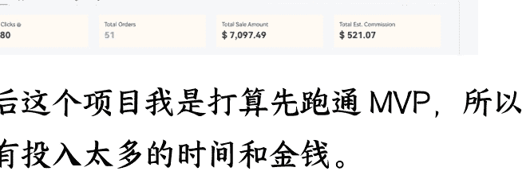

前期为了验证模型，我没有投入过多时间和资金。但这个项目的天花板极高，月入万刀的大有人在，后续我肯定会加大投入，把收益滚起来。

## 项目流程

整个项目逻辑极其简单，核心就三步。

### 一、申请推广品牌

先去**联盟平台**拿分销链接。我用的是 Management Platform - PartnerBoost（简称 PB），上面大部分都是亚马逊店铺的分销资源。拿到手需要关注两样东西：**分销店铺链接**和**分销地区**。

点击【Get Link】就能拿到专属的**分销链接**了。

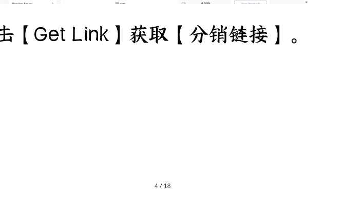

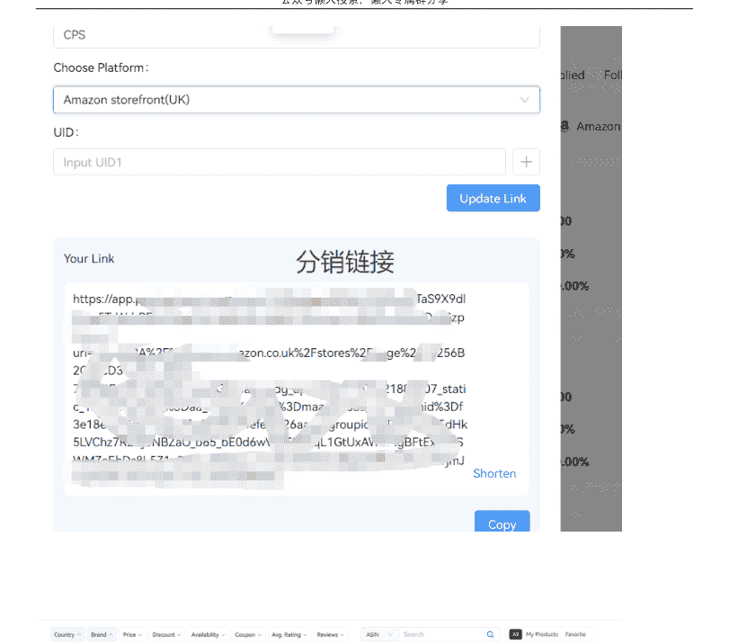

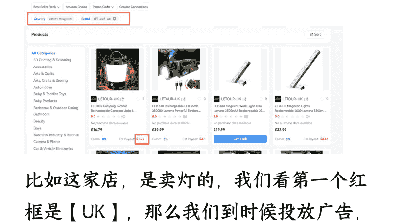

比如这家卖灯的店铺，红框里标的是【UK】，那咱们投广告就要瞄准英国市场。

#### 常见国家代码速查：

- CN — 中国
- US — 美国
- UK/GB — 英国（标准是 GB）
- JP — 日本
- KR — 韩国
- FR — 法国
- DE — 德国
- CA — 加拿大
- AU — 澳大利亚

### 二、编写广告素材

拿到链接后，就可以开始写广告素材了。素材一共分四块：

- 关键词
- 标题
- 描述
- 投放链接

前三个板块必须严格围绕你选的品牌和商品来写，这玩意儿全靠积累，写得多了自然就有手感了。

数量和长度要求如下：

- 关键词：若干
- 标题：15 个，每个 30 字符以内
- 描述：4 条，每条 80 字符以内

第四个“投放链接”，就是访问分销链接后浏览器地址栏生成的那个链接，通常以亚马逊域名开头。

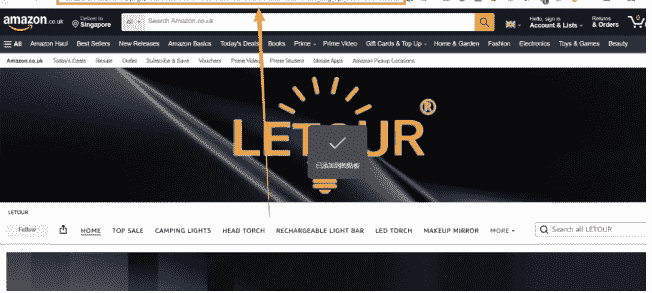

### 三、广告投放

接下来去谷歌广告后台，把刚才写好的素材投出去就行。

```
http://www.ads.google.com
```

下面说下具体操作步骤。为了保持网络环境干净，我特意用一台没装任何国产软件的笔记本专门跑这个项目，所以截图不方便传输，我就直接拍屏幕了。

#### 1、选择投放目标

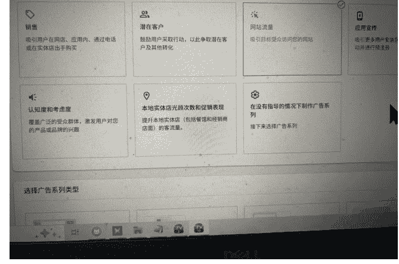

这里选“网站流量”。相当于你们平时发视频、写笔记赚自然流量，而我这边是直接花钱买精准流量。

#### 2、选择广告类型

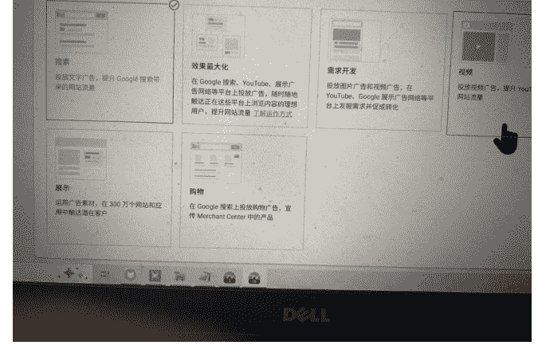

我们要拿的是谷歌搜索流量。比如刚才那个品牌，当用户搜【LET0UR】或类似关键词时，咱们的广告就会冒出来，这些可全是精准客户。

#### 3、选择转化目标

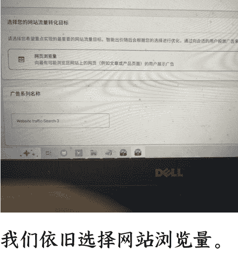

依然选“网站浏览量”。

#### 4、设置出价

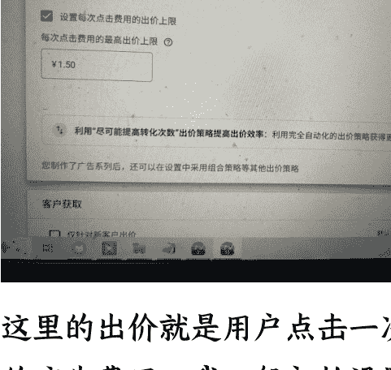

这个出价就是用户每点一次广告，我们付出的成本。我一般初始设 1.5 元人民币，如果没出单就慢慢往上加。

#### 5、选择推广方式

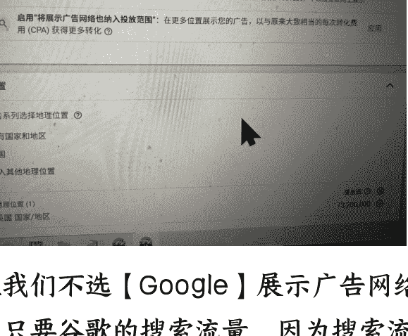

这里一定不要选【Google】展示广告网络，咱们只要搜索流量，因为搜索流量是最精准的。然后地理位置，投哪儿就选哪儿，选错了广告费直接打水漂。

#### 6、选择语言

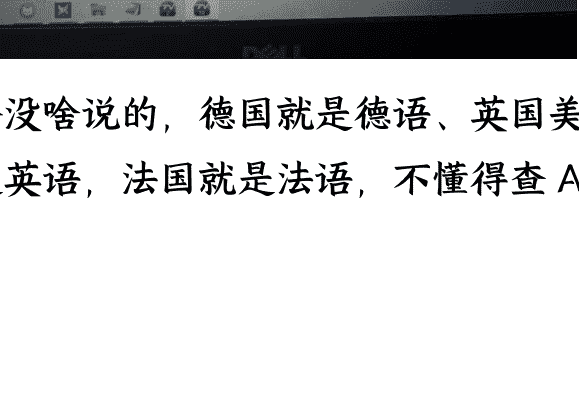

这步没啥好说的，德国用德语、英国美国用英语、法国用法语，不确定的就问 AI。

#### 7、填写关键词

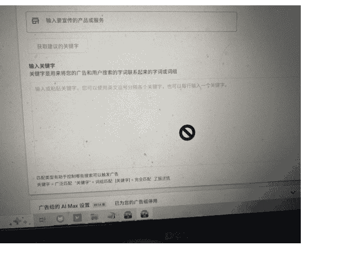

把刚才写好的关键词填进去，具体怎么组合，只能靠不断试错来积累经验。

#### 8、填写最终链接

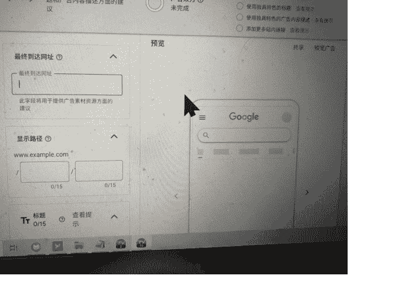

这个在刚才“编写广告素材”那一步已经提过，就是那个**投放链接**。

#### 9、填写标题

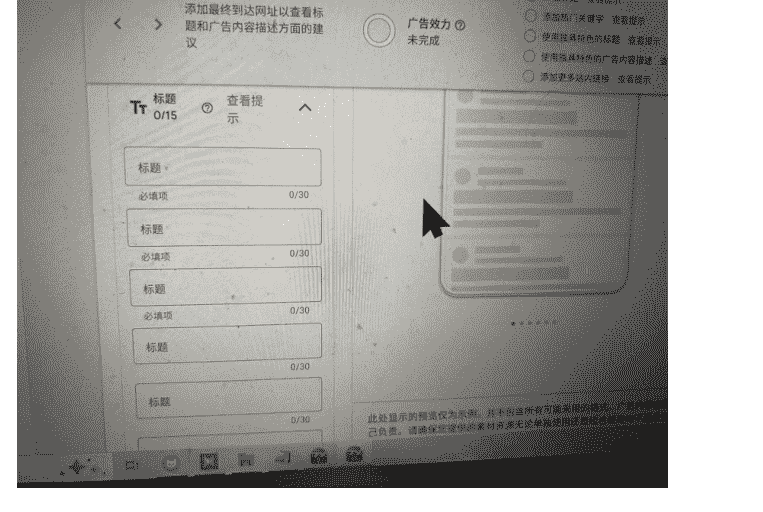

#### 10、填写描述

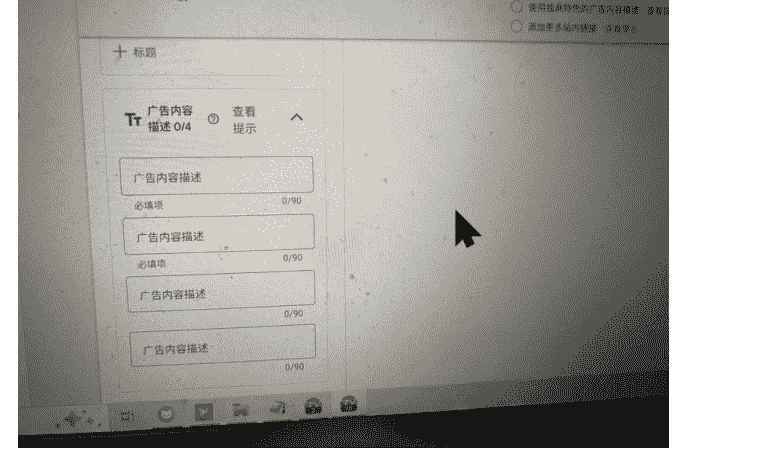

#### 11、发布广告

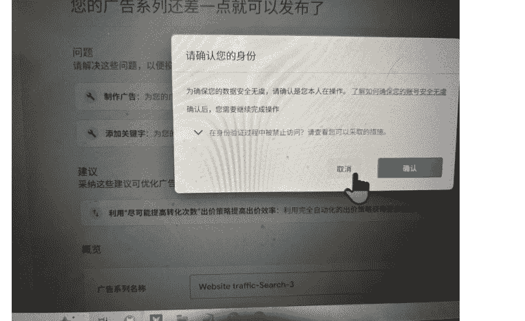

一般会过个身份验证，填个验证码就搞定了。

### 四、出单刷量

投放完成后，记得在不同 IP 环境下访问**分销链接**刷 20 次，之后每出一单，再刷 20 次。

刷量的核心目的，就是让联盟平台后台的数据看起来更真实。

为啥要刷？

因为咱们走的是“邪修”路线。谷歌广告不允许直接投放分销链接——因为分销链接会跳转到最终页面，谷歌禁止投放有跳转行为的链接。所以我们投的是最终链接，但问题来了：用户访问最终链接时，联盟平台后台根本记不到点击数据。结果就是平台发现你“没点击却出单了”，这种异常很可能导致佣金被扣押。刷量就是为了补上这个点击缺口，让后台数据看起来合理。

到这里，整个流程就闭环了。

### 五、日常任务

往后每天要做的，就是多挑几个好品牌，然后盯一下谷歌广告的消耗情况——如果 7 天没出单，就加价试试；还不行，直接换品牌。

前期基本都在测品，一旦遇到持续出单的品牌，那这个品牌就是你的“资产”。只要保证广告余额充足，谷歌广告就会在你睡觉、吃饭、打游戏的时候，24 小时不停地帮你赚钱。

最后来几个灵魂拷问，测测你听懂了没！

#### 问题一：赚的到底是谁的钱？

> 答：亚马逊商家给的销售佣金，减去你的广告花费，剩下的差价就是利润。

#### 问题二：流量从哪来？

> 答：谷歌付费投流，获取搜索精准流量。

#### 问题三：怎么放大收益？

> 答：多开谷歌广告账户。账户越多，流量就越大，出单自然越多。

#### 问题四：有风险吗？

> 答：有，但可控。谷歌账户里的钱随时可以提出来，最大的风险在于前期测品——选了个品牌投下去，结果只出点击不出单，那广告费就白亏了。

解决方案：多学多练，提升选品能力和素材写作水平，亏的次数多了自然就摸到门道了。

另一个亏损点：部分用户用优惠券下单或退款，也会导致广告费白花。

解决方案：多选品。你指望某个品一定出单是赌运气，但选一堆品放在一起，盈利的品覆盖亏损的品绰绰有余。

#### **正所谓想吃苹果，只种一棵树就得看天吃饭，但你要是有片果园，每天都能稳定吃上苹果。**

这就是用数量抹平概率。

最后，晒一个我目前在跑的“资产”品牌：

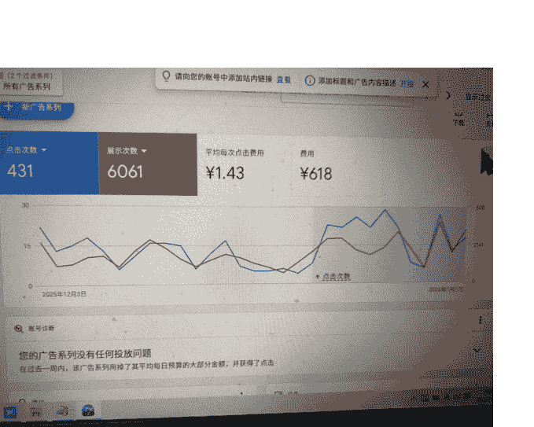

#### **2026 年，咱们一起赚美刀！**

这个品牌的谷歌广告花费是人民币 618 元。

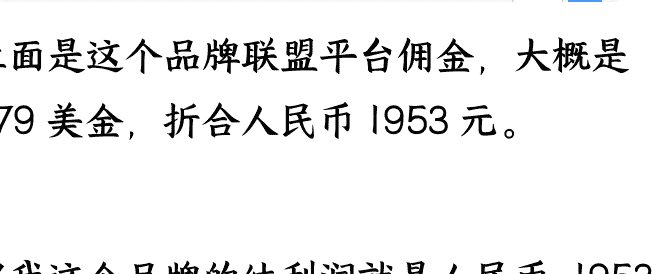

对应的联盟平台佣金是 279 美金，折合人民币约 1953 元。

算下来纯利润就是 1953 - 618 = 1335 元。

注意，这只是**一个品**。我现在才测出两个稳定出单的品，要是测出 10 个，利润直接乘以 10。这么一想，月入万刀还遥远吗？

## 劝退人群：

- 想“一夜暴富”的：这项目是滚雪球逻辑，不是暴利投机。
- 完全接受不了亏损的：测试期浮亏太正常了。

### 适合什么样的人：

- 能接受测试期的人：前期要不断试品牌、试素材，不一定一上来就赚钱。
- 有点启动资金的人：广告得先烧钱，建议准备一笔“亏得起”的测试预算。
- 愿意学习的人：选品、关键词、广告优化，越做越熟练。
- 心态稳、能复盘的人：不出单不慌，冷静看数据调模型，而不是情绪化加钱或放弃。

这项目有学习曲线、回报上限高，也有不确定性。它不是“短期投机”，而是需要长期打磨才能真正变成“资产”的系统工程。

今天就写到这儿了。有问题欢迎在【生财评论区】留言，看到会回。

这项目表面看着简单，真正上手才发现全是细节和门槛，篇幅所限没法把每种情况都写全。但只要抱着“不出单不罢休”的劲儿，逢山开路、遇水架桥，多问 AI、多请教大佬，没有过不去的坎——太阳底下无新事，你遇到的问题，早有人解决过。

## 2026 年，一起赚美刀！

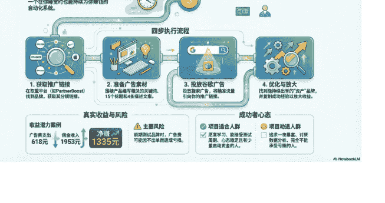

最后，安利一下小懒的付费社群：

懒人专属群（介绍）

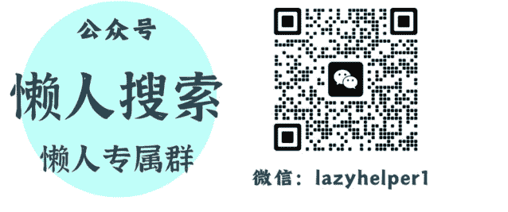

这里是帮你对抗信息过载的“护城河”。

稳定运营 6 年，累计拆解、研读 3000+ 个互联网商业实战案例与行业前沿内参，以及时政/宏观深度文章。

我们不搬运垃圾，只做高价值信息的筛选器与放大器。

### 懒人专属群更新记录：

https://hk57gvIx7u.feishu.cn/docx/H0kRdZbSbolBR0xkaXtcuVE0nTg

【免责声明】本资料归档于社群内部知识库，仅供成员课题研究与学术交流，请在查阅后 24 小时内删除。