# 传术师分享 - AI 时代个人出海赚美金
作者：龙哥

## 传术师分享 - AI 时代个人出海赚美金


### 一、林悦己自我介绍

**在赚钱的20个月复盘**

2024年3月底加入赚钱，首月流量放大10倍，副业月入稳定过万，8个月拿下人生第一笔非职场六位数收入。

年末开始接触AI编程，跨年参加首场传术师线下会。

完成Cursor航海后报名龙珠悬赏，斩获第一篇龙珠贴。

文章被龙哥和小排老师关注，受邀前往杭州，从此启动AI出海之路。

2025年前我与人工智能、互联网、产品、工程毫无交集，纯新手。116天硬啃把智能应用出海从0到0.1跑通，第二款产品9天完成首单。

9月底关停产品线，转向海外AI内容。

国庆在TikTok起号，产出百万播放作品后，第三个项目上线3小时即成交。

TikTok运营3个月粉丝达7.5K。

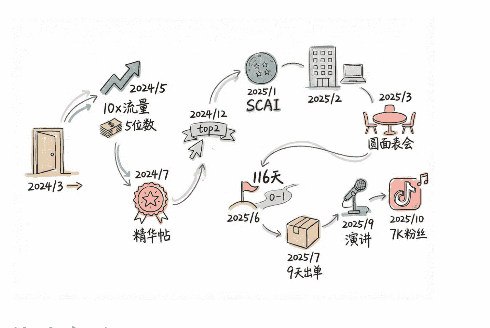

### 快速索引

#### 我经历的三次出海尝试

- 对话记录分析：龙珠悬赏心路，116天走通成交
- 灵魂伴侣画像：产品验证到流量闭环
- Sora2.0邀请码：72小时实现百美元收入
- 需求校验：30分钟快速检验法
- AI编程：站点拆解教学与Creem收款实操
- 自媒体进展：垂类小号内测概况，海外内容首月复盘

### 二、从智能产品到海外内容

#### 1. 产品三角：先判断自己的强项

做AI编程类的出海，核心是三维评估。

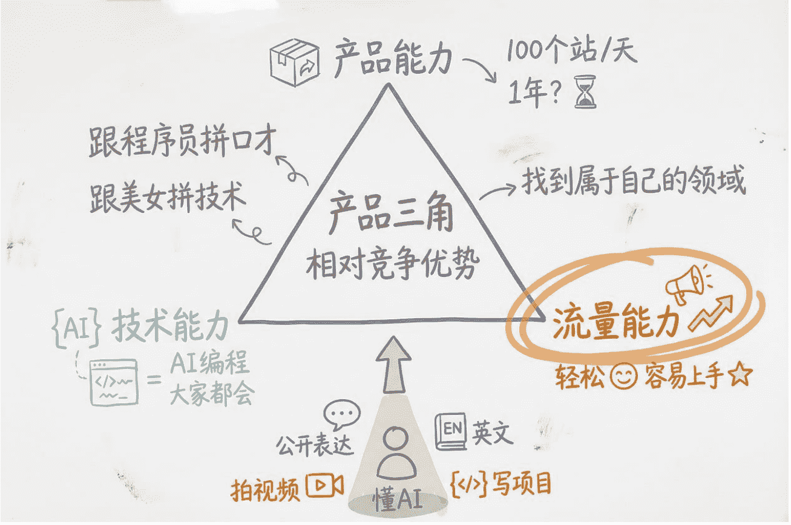

**产品力：**

> 定义：把灵感落地成可用Web/App的能力。
> 现状：产品力靠积累。导师要求每天拆解百款产品，我最多日拆20个，月拆五六百个。对比从业5-10年的PM，我仍差距明显。

**技术力：**

> 定义：实现落地的手段。
> 现状：工具平权。借助Cursor、Claude等，普通人可达及格线。2025年底模型比年初更强，基础功能已非壁垒。这是三项里差异最小的。

**获客力：**

> 定义：把东西卖给海外用户并收款的能力。
> 体会：跑通后发现，我缺产品背景也无工程积累，真正胜出的只有获客。

非均衡策略：别追求平均。把短板从60提到90要十倍投入，不如把长板从100打到120。单点引流打爆后，会有技术、产品合伙人主动找上门分利或共创。

劝退提示：三国都不沾，建议先观察。

#### 2. 地图思维：必须闭环0到1

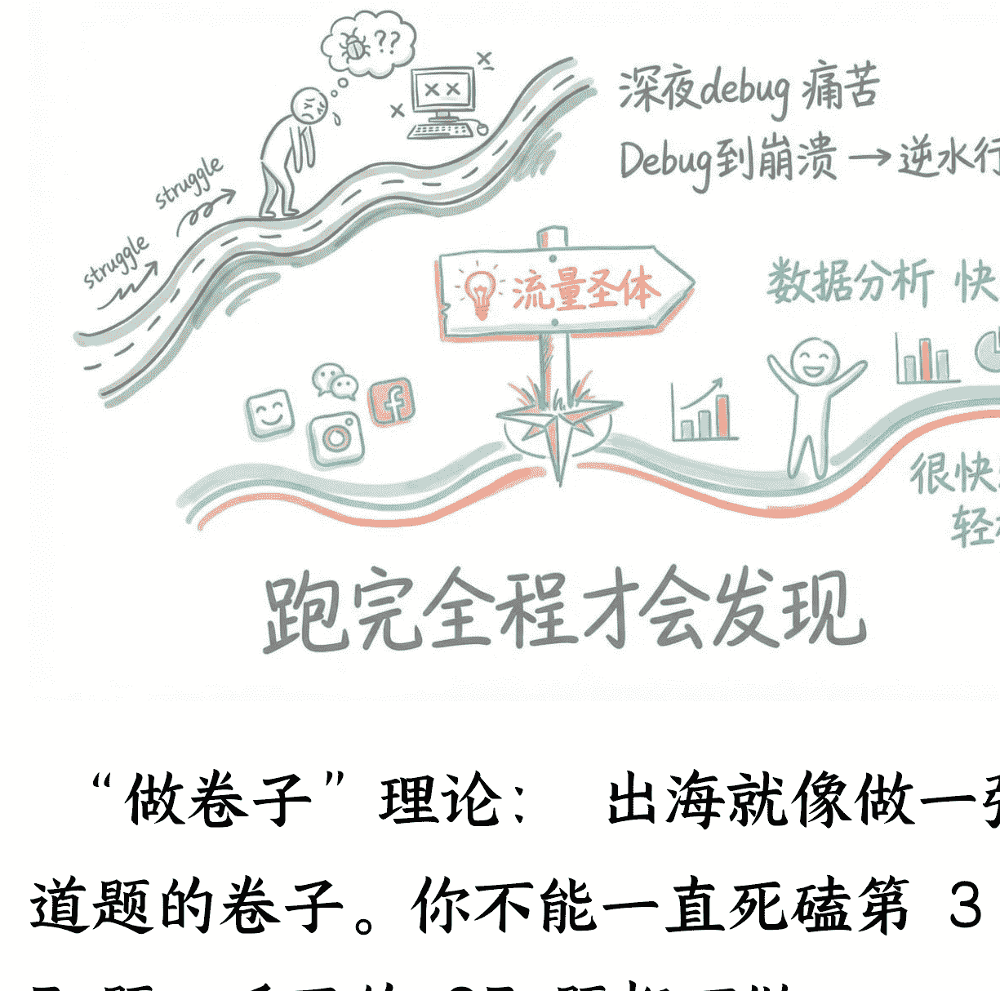

卷子理论：出海像100道题，不能只死磕第3、5题。哪怕蒙题也要继续，直到交卷。完整走完从想法到收款，你才知道优势在哪、卡点在哪。

#### 3. 真需求误区与触达

很多人以为需求真实就能变现，这是常见误判。

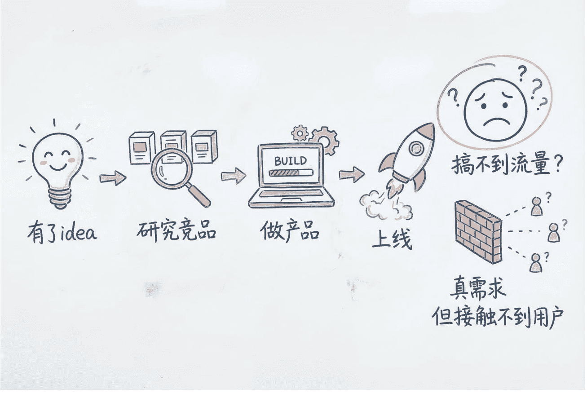

触达即生死：

- 即便痛点真实、产品完美、市场有人月入百万，触不到人群也卖不掉。
- 例子：目标为“20岁单身女性”。若自身即该人群或在海外能感知她们的刷屏习惯，就能触达。若完全陌生，想象不出她们用TikTok还是Instagram，找不到鱼塘，等于自嗨。

两种获客逻辑：

- 主动推送：明确用户画像，去TikTok、IG、Reddit驻点、伪装、投放、产出内容，能达能转。
- 被动承接：像哥飞做SEO关键词覆盖，等用户来搜。策略门槛高，见效需3个月起。

#### 4. 逆向：流量是资产，产品是收银台

**注意力即成本**：用户时间固定。不发就是被分走，发就有机会抢回几秒。

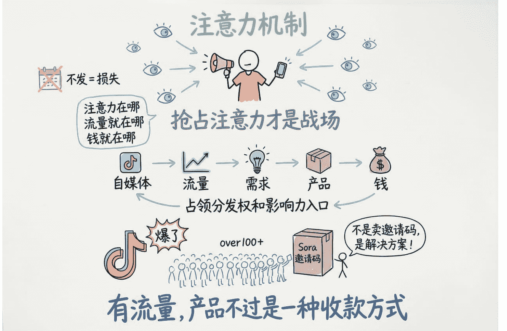

**垂类号策略**：泛流不值钱，垂直才值钱。圈住“独立开发者”，就能卖资讯、课程、工具。

**Sora2.0复盘：**

- 起因：国庆Sora2.0发布，全网求码。
- 动作：发视频演示用ChatGPT找邀请码方法。
- 结果：百万播放，私信爆满。
- 变现：当晚2小时搭站挂支付链接售卖获取渠道。
- 收益：两天卖出百余刀。
- 结论：有流量后产品只是收款手段。我不是改变世界的人，只想赚钱。流量挖掘需求，满足需求收钱，链路合理。

### 三、出海全景

#### 1. 出海是什么

走出国门，用产品、内容、服务向全球用户收外币，并且可延续。

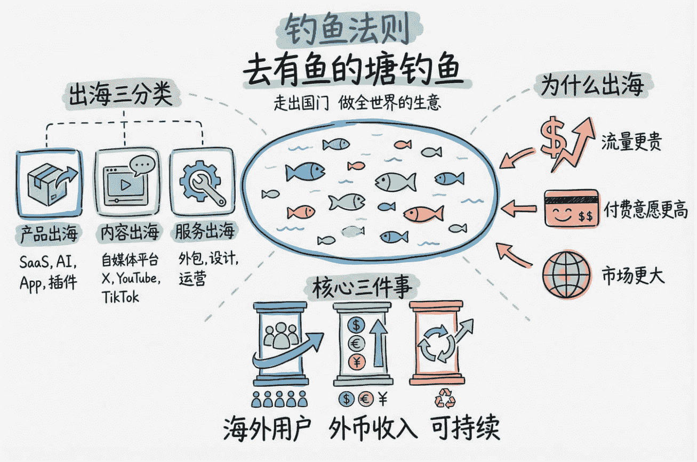

**分类**

- 产品：SaaS、智能应用、App、插件
- 内容：X、YouTube、TikTok等
- 服务：外包设计、运营、工程

**为何出海**

- 流量单价高：美国CPC美元级，东南亚几分钱。
- 付费习惯好：海外用户习惯订阅付费。
- 市场规模大：全球盘子远超单一市场。

**变现方式**

- 产品：订阅、买断、按量
- 内容：广告分成、订阅、联盟、赞助、自营
- 服务：项目制、时薪制

### 四、海外内容打法

#### 主流平台

- **X**：重互动与圈层
- **TikTok/Shorts**：短视频爆款逻辑，内容为王
- **YouTube长视频**：搜索导向，知识型
- **IG**：审美驱动，生活方式感

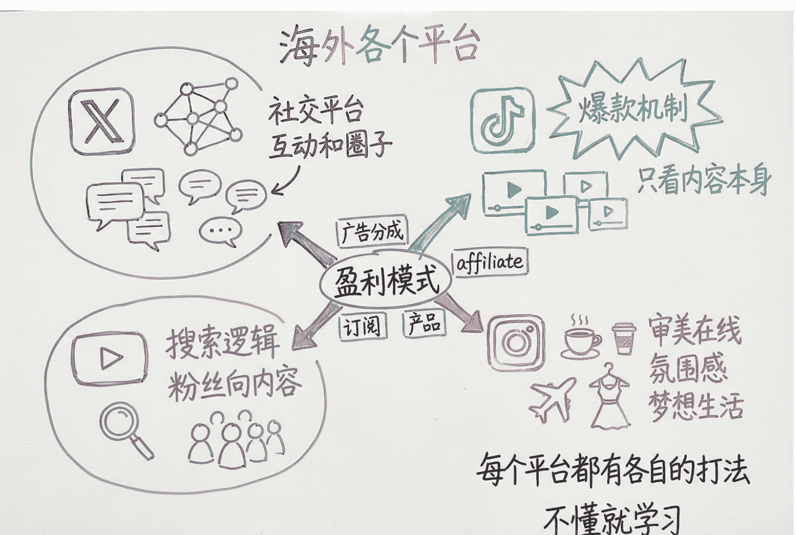

平台玩法各异，不懂即学，盲试浪费时间。

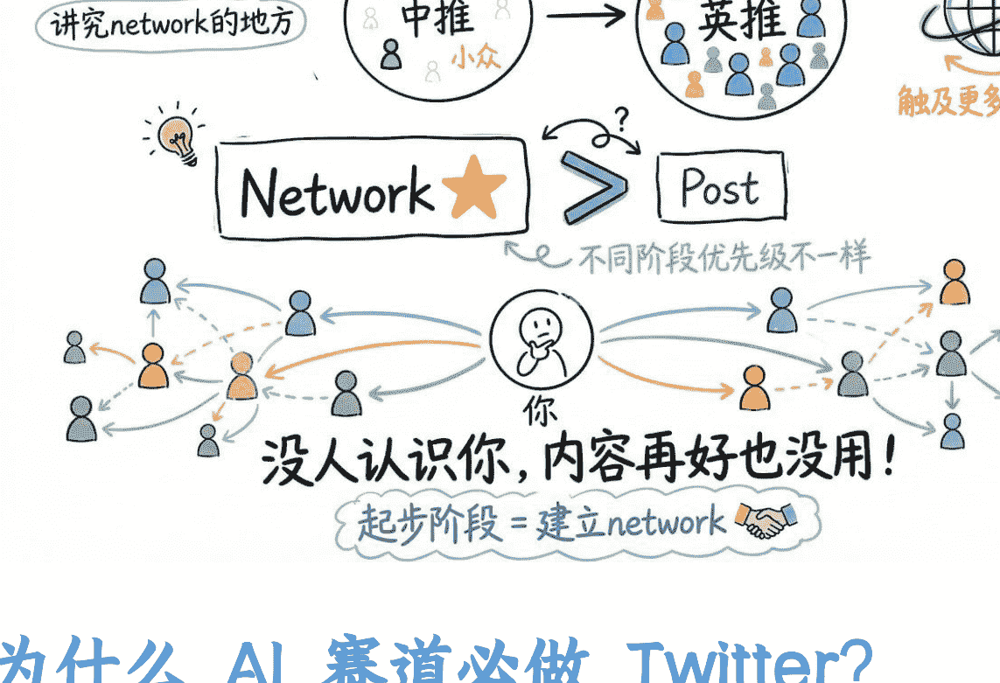

#### AI赛道为何绕不开X

- 信息源头：X是AI一手资讯，国内多为搬运。
- 人群精准：独立开发者常在此公开构建。
- 杠杆：大V一条图文可达数万人曝光。

#### X定位法4-3-2-1

别直接说“我做AI”。

1. 列4个熟悉话题
2. 每个写3个子话题
3. 剔除2个不熟或难变现
4. 剩1个核心，如AI工具

原点可延展为AI视频、绘图、编程等，形成内容池。

#### 头像页装修

- Banner：广告位，别留白
- Avatar：第一印象。案例：圣诞头像戴帽点击提升
- 风格：专业路线需看专业
- Bio结构：身份、做什么、成绩、关注收益

### 运营核心：先混圈

0-1000粉时发帖像沙漠喊话，关系建设才是关键。

**A.找锚点**
锁定50个关键人物。搜OpenAI，筛选简介含Researcher @OpenAI者；用福布斯AI榜单顺藤摸瓜。

**B.高质量互动**
拒绝“太棒了”“666”。

杀招1交作业：大佬发Prompt后实操返图。
杀招2梗图：在文字流里显眼。
杀招3引用转发：附带总结观点。

### Twitter蓝标是否值得

- 建议订阅 $8/月
- Grok：可实时读取X数据做竞品分析
- 数据面板：仅会员可见，复盘必备
- 回复置顶：降低折叠

#### 账号增长清单

思路：三大巨头OpenAI、Anthropic、Google→官方+相关人群
获取方法：AI浏览器用Grok搜bio含OpenAI者
人传人：关注者的repost、quote对象持续追踪

### TikTok另类玩法

英语不是拦路虎，🪜解决即可成功80%。逻辑同国内，大力出奇迹。

#### 3.1录屏+AI配音 资源分享

https://www.tiktok.com/@github.awesome

- **@github.awesome** GitHub Awesome
- 5 Following | 28.5K Followers | 182.3K Likes
*   ⚗ GitHub Daily Discoveries
*   Full videos on YouTube: @GithubAwesome
*   📧 phantomparadoxon@gmail.com
*   🔗 linktr.ee/githubawesome.com/

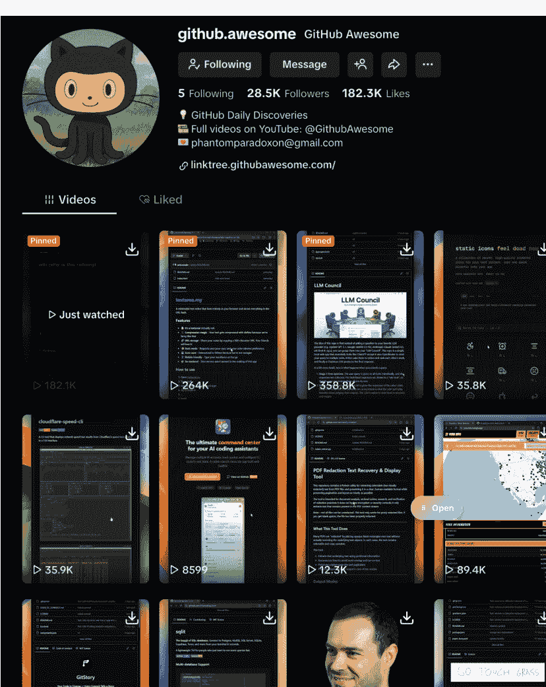

#### 3.2PPT起号 纯图流

https://www.tiktok.com/@prompttlab

@prompttlab
- 21 Following | 7109 Followers | 68.5K Likes
- Leave a follow 👇
- For the best results, you need the best prompts 💬

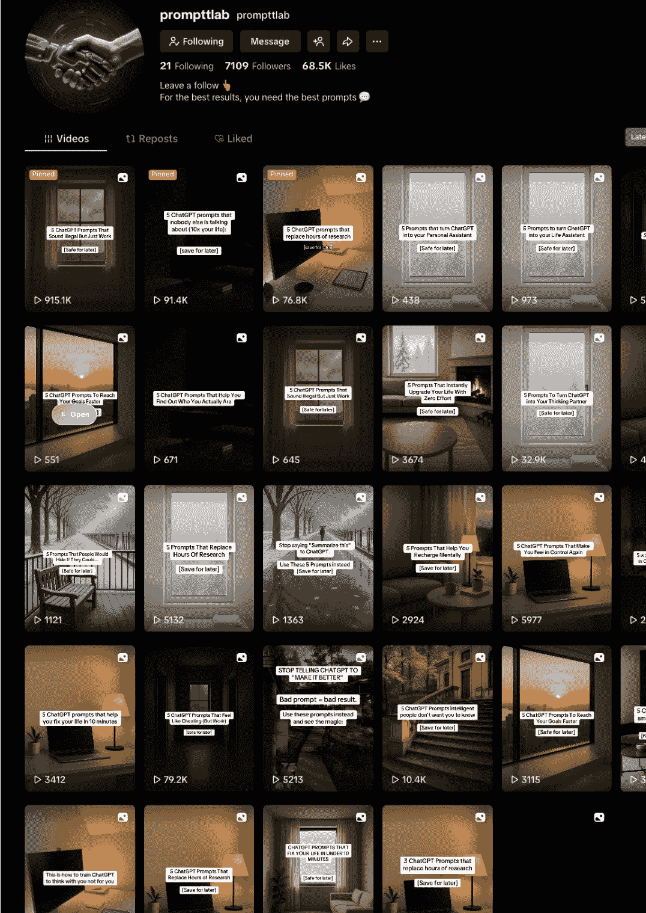

https://www.tiktok.com/@promptdrill

https://www.tiktok.com/@aihubspace

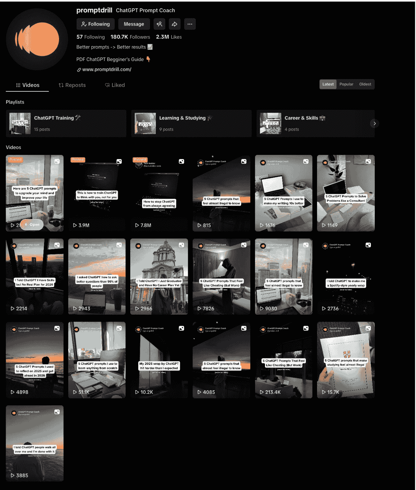

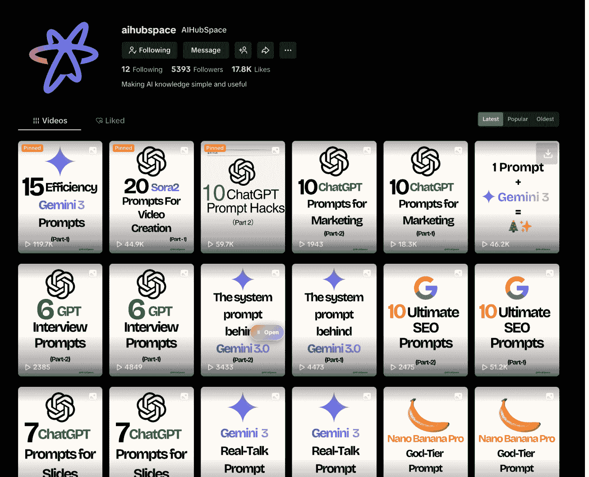

https://www.tiktok.com/@periciacards

#### 3.3产品推荐夹带私货

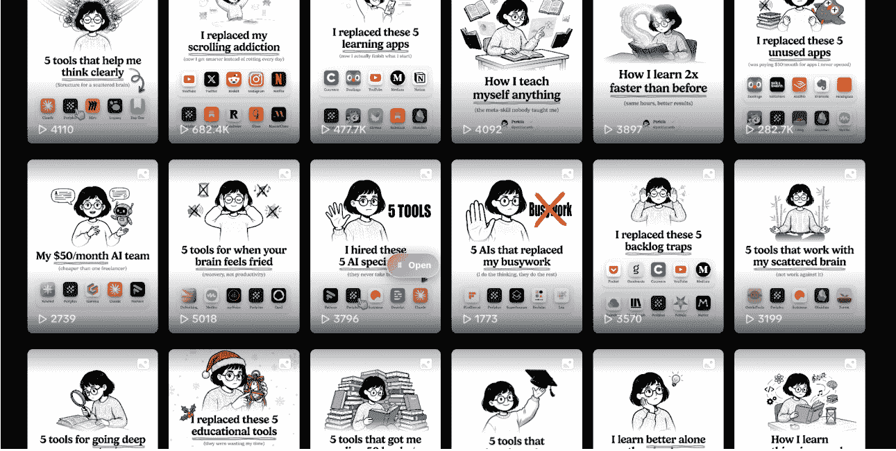

#### 3.4视频+提示词

```
https://www.tiktok.com/@itsdreamai
```

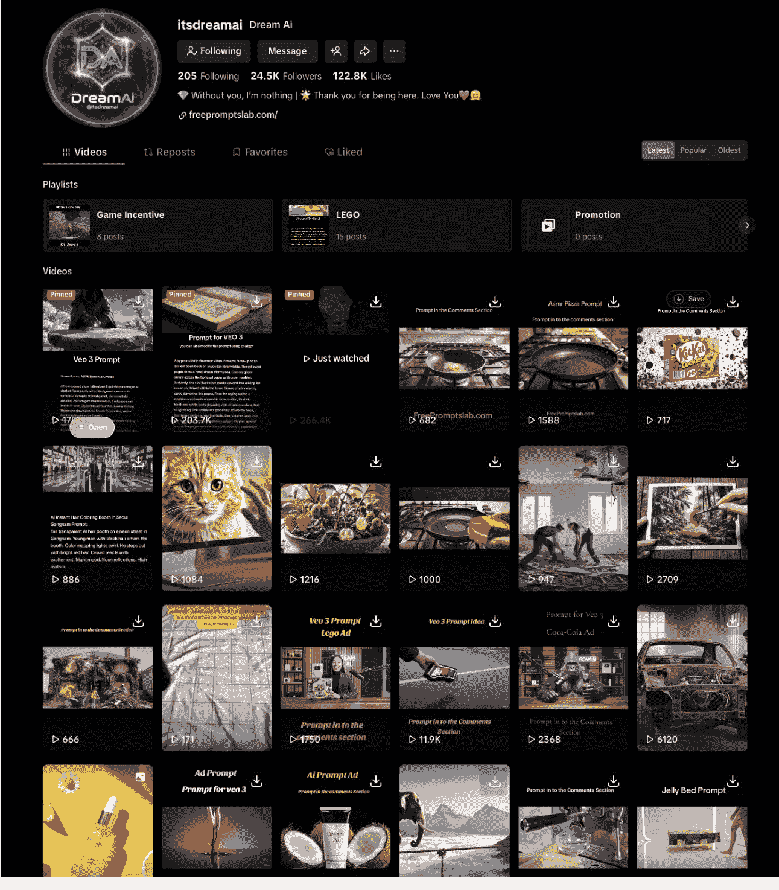

#### 3.5不出镜

```
https://www.tiktok.com/@theaitriggerr
```

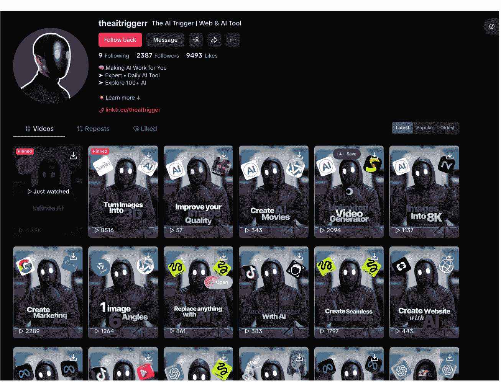

### 五、不用AI即与效率为敌

#### 日常工具箱

- ChatGPT：主力对话、教练、口语
- Comet/atlas：AI浏览器，洞察评论区话题
- AI Studio：编程出Demo
- Claude Code/Codex/Antigravity：工程级编码
- Gemini：追新功能、教育优惠
- Notebooklm：PPT、文献、信息图
- Evolink.ai：主流生图生视频模型
- YouMind：资料收集与加工，👸号常用
- Grok：深聊+X爬虫
- AlphaXiv：论文阅读
- FlowWith：多模型对比、翻译、自动化Agent
- Gemini CLI：本地文档秘书，免费

#### 👸号工业化生产

理念：优质信源+标准SOP=高产出。

Step1高端食材：跨媒介跨语言，YouTube/Podcast优质源，积累50个频道。
Step2风格提取：AI味问题。用本人100篇日更提炼文风，或抓取喜欢的博主100篇提取风格，生成personal style.md。
Step3爆款拆解：找低粉爆款，拆钩子、铺垫、收尾，输出结构化提示词。
Step4配图风格：保存收藏向图片，分析风格输出中英双格式：
- 1. 风格名

### 2. 拆解视觉风格：只分析呈现方式，不涉及文章内容

最终整理输出：`blog 配图风格.md`

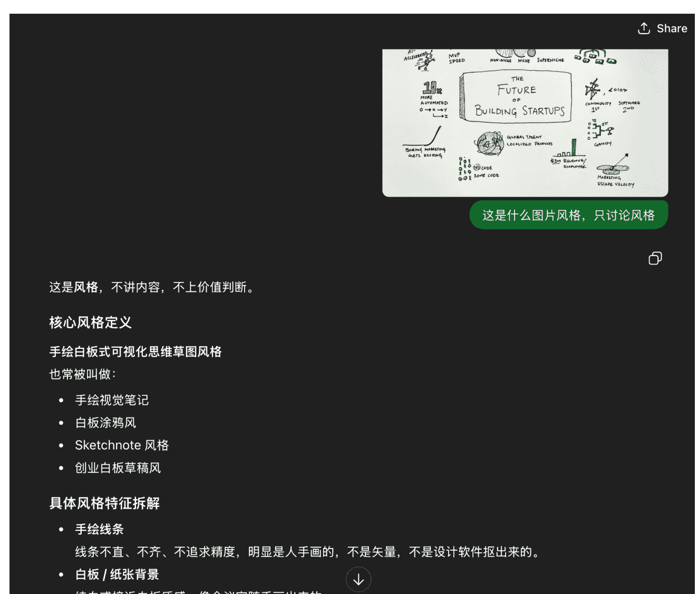

### Step 5：把内容做成可复制的生产流程

**输入环节：**  
使用 Chrome 插件，直接提取视频中的文字与核心信息。

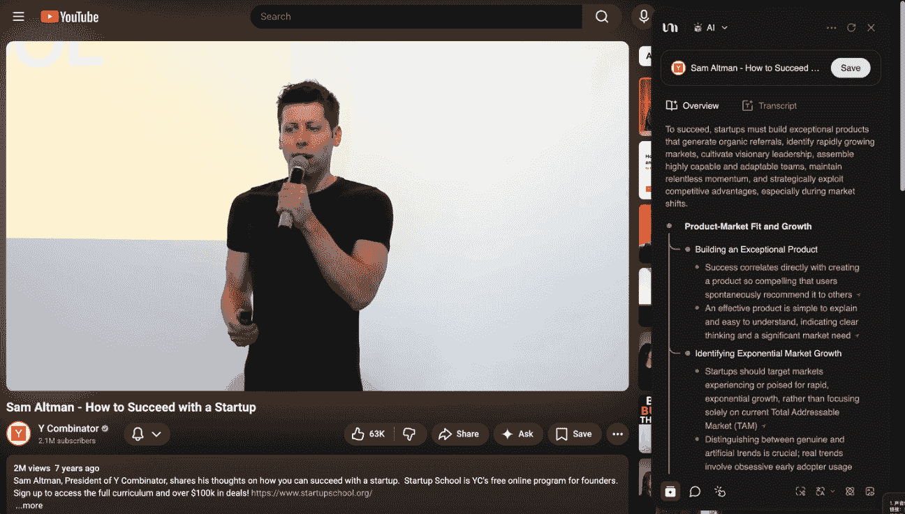

**处理环节：**  
拿到[逐字稿]后，结合[个人风格]与[爆款结构]进行重组，再按照既定的 blog 配图风格，生成一篇适合发布在👸号的文章。

### Step 6：自动排版并发布

**使用工具：**  
借助 YouMind 完成一键渲染与排版，随后复制到👸号后台即可发布。

**实际效率：**  
当整套流程熟练之后，一篇内容从提取到发布，大约 5—10 分钟就能完成。

---

## 风格名称：手绘白板式视觉思考草图风格

> 只描述视觉表达方式，不涉及具体内容。以下提供中英文版本。

### 中文名称

- 手绘白板式视觉思考草图风格

### 常用叫法

- 手绘视觉笔记风
- 白板涂鸦风
- 思维草图风
- 创业者白板草稿风

### English

- Hand-drawn Whiteboard Visual Thinking Style

### Also known as

- Sketchnote style
- Whiteboard doodle style
- Visual thinking sketch style
- Founder-style brainstorming sketch

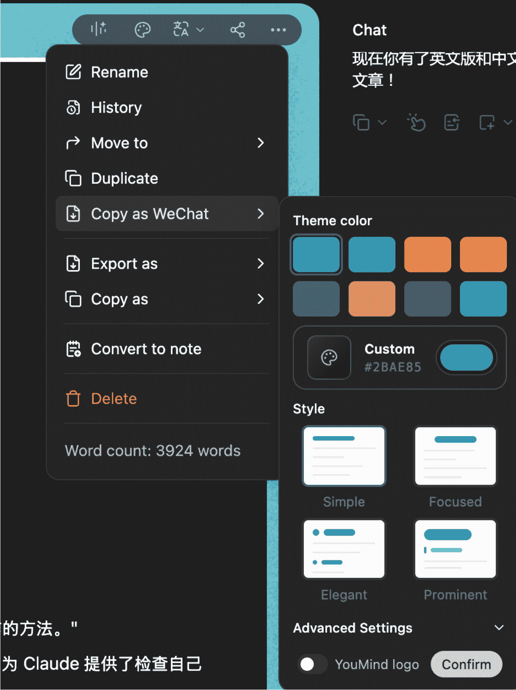

## 六、回看 2025：一些零散但真实的感受

原本打算专门写一篇 2025 年度复盘，后来一直没有真正动笔。没想到，一场持续 5 个小时的分享，反而把这一年的经历重新串联了起来。

年初，我带着很强的冲劲投入 AI 出海。那时候只有一个念头：既然开始了，就一定要做出结果，不到最后不放手。连续硬扛 116 天后，终于完成了第一笔订单。

随后，我继续验证自己的方法论，并让第二个产品更快完成从想法到落地的闭环。

当我开始站到更高的位置重新观察全局，也逐渐接受现实，决定换一条赛道，转向 AI 自媒体。

10 月到 12 月，几乎没有参加太多线下活动，主要精力都放在海外自媒体上。一方面，需要补课和学习的内容非常多；另一方面，这条路本身也充满了挑战。

### 关于流量与低谷

即便开局取得了不错的成绩，后续也依然不能松懈。每一天都像是在未知水域里继续试探，既要保持状态，也要想办法避免流量下滑。

可顺风局不可能一直持续。

12 月成为我明显的瓶颈期。流量突然下降，无论怎么调整都难以回升。我开始不断尝试新的方法，做拆解、改版本、看数据、找原因，但那段时间的状态很差，情绪也跌到了低谷。

脑子里装进了大量信息，却没有足够的时间把它们整理出来，更别说持续输出。

元旦时，我和 SCAI 的伙伴们一起跨年。没想到，2026 年第一天，视频数据突然重新有了起色，其中一条还获得了小范围爆发，整体流量也逐步恢复。

### 记录的意义

那些犯过的错误、走过的弯路、熬过的夜，往往会随着时间被自己淡忘。

如果不是重新翻看曾经写下的内容，我可能很难再想起那些让人恨铁不成钢的时刻，也很难重新感受到半夜卡在 bug 前、无助到想哭的瞬间。

所以，记录并不只是为了总结成绩，更是为了保留当时真实的自己。

### 感谢一路同行的人

2025 年，特别感谢龙哥哥给出的机会，感谢小排老师的认可、鼓励与支持，也感谢大哥天团的前辈们一路上的指导。

同时，也谢谢 SCAI 的兄弟姐妹们一直陪伴，更感谢赚钱提供的这片土壤，让我这颗种子有机会慢慢发芽、成长。

人会受到环境影响，圈子也会塑造一个人的状态与选择。

所以，身处什么样的环境，和什么样的人同行，真的非常重要。

愿 2026 年，我也能成为风口上那头幸运的猪。🐷

---

### 最后，推荐一下小懒的付费群：


这里，希望成为你应对信息过载时的一道防线。

社群已经稳定运营 6 年，累计拆解、学习过 3000 多个互联网商业实战案例，同时持续整理行业前沿资料，以及时政和宏观类文章。

我们不追求简单搬运，而是希望成为高价值信息的筛选器和放大镜，帮助你减少噪音，把时间留给真正值得关注的内容。


