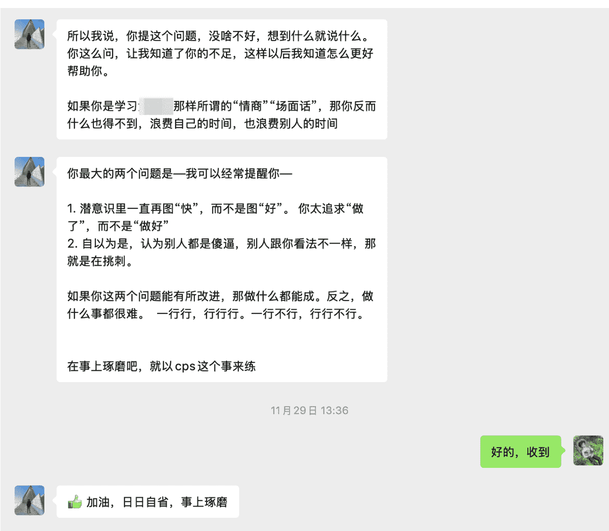
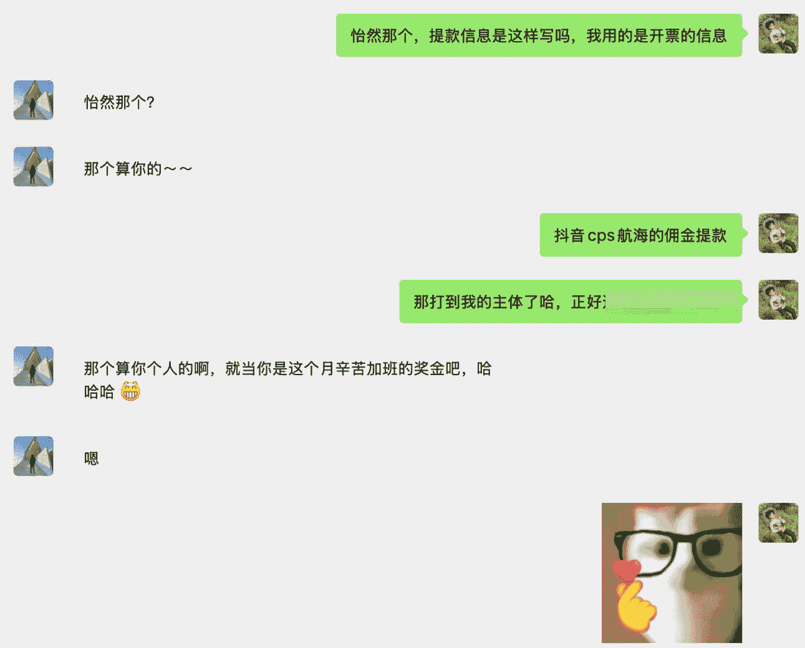
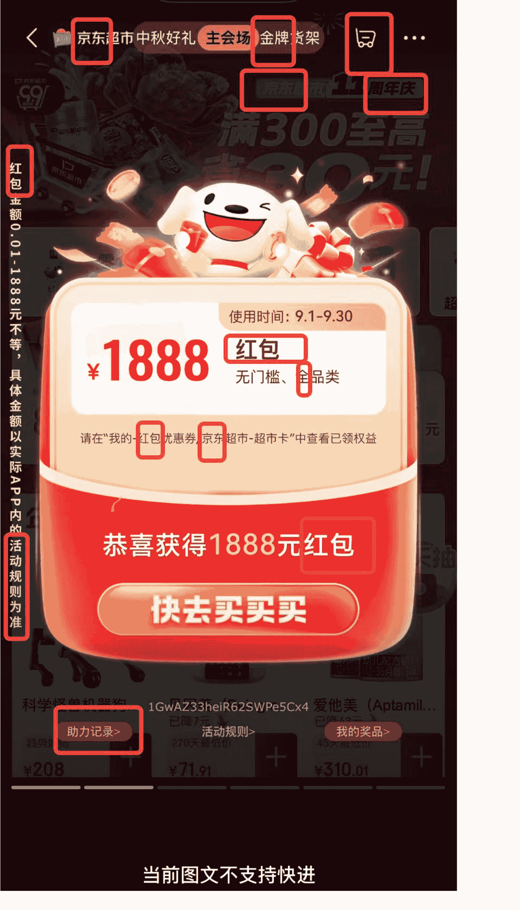
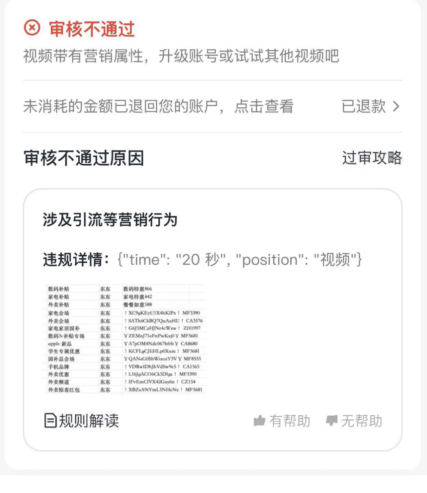
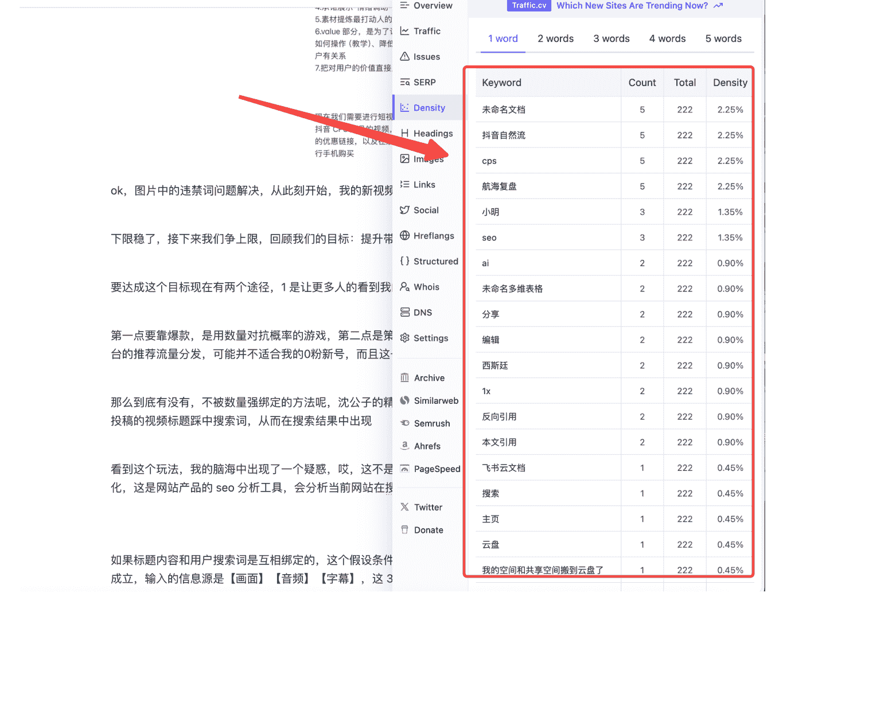
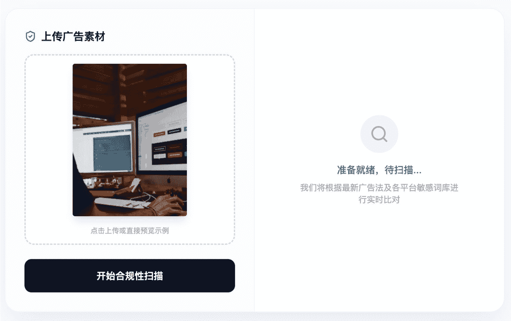
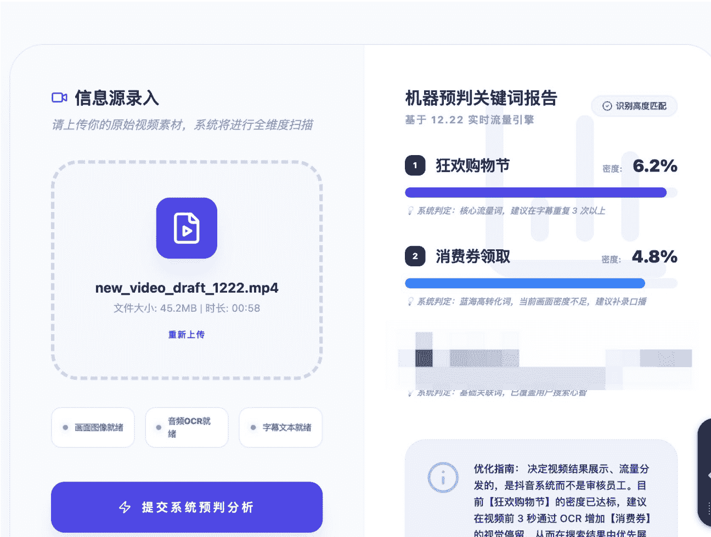
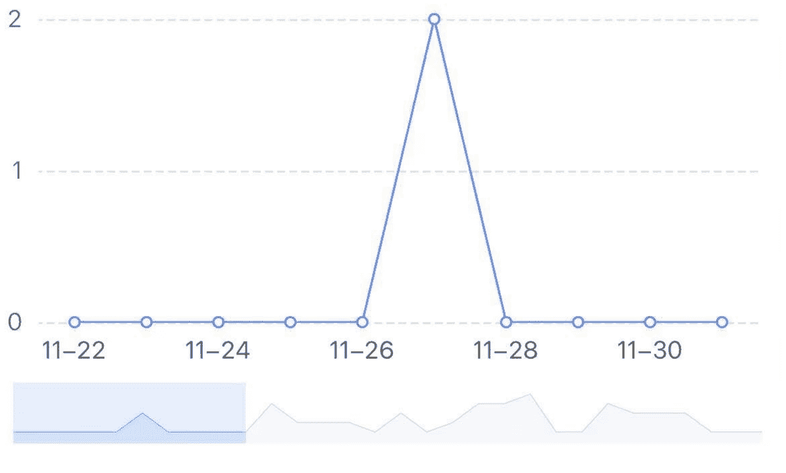
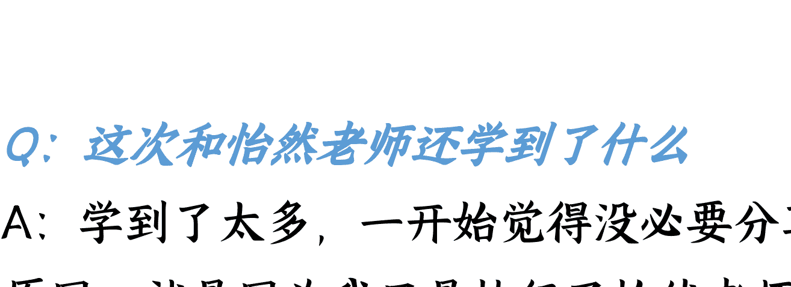

# 新手上路，21 天做到 480 万 GMV，余热再滚到 600 万，搜索流量的确定性打法

260106 副业 SC 精华

## 自我介绍

大家好，我是小明，属小排团队。

目前给自己起个外号，怡然老师关门弟子。

03 年出生，毕业一年半左右，平时爱烘焙、练钢琴、出去玩。

今年四月入了龙哥盟，学费小排垫付的😄。要是你还没进圈，估计得让老板检讨下赚钱思路和认知边界。

25 年 11 月，我跟小排聊想搞点事，他给我安了怡然老师的抖音自然流 CPS 航海。在他的资金和精神加持下，我全职冲这件事，学得认真做得扎实。

## 起步前

## 收官后

## 全程复盘

## 这趟航海在做什么

尽量把我在航海里的实操记录、思考沉淀，都摊开来讲。

先说底子：我基本不是抖音用户，除开搜东西几乎不刷短视频，也没做过短视频投放，对网感一窍不通。起点和绝大多数人一致，就是纯新手。

## 模式拆解

抖音 CPS 的核心就是：用户看你的视频，按教程操作，把你的分销信息植入设备。分销信息可以是口令词也可以是短链。后续只要产生合规交易，电商就会认定是你带来的增量，给你分销佣金。

怡然老师团队资源很硬，能拿到平台方的口令词，散户也能用上这个权益。再加上万单宝平台 https://wandanbao.com/ ，我们拿到的分成比例比官方公开的更高，比如某品牌扫地机器人能到 12%。万单宝让 CPS 变成了人人可做的自然流变现路径。

前阵子公告说万单宝开放散客申请口令词了，有兴趣的可以去 https://wandanbao.com/ 看看。

## ## 高佣单品

京东这边给的支持很足。

## II 起号前的准备拉满

视频大致分两类：曼波和口播。

没想过裸奔上阵，12.1 航海开打前，我把上一期全部精华帖梳理了一遍，先把项目轮廓拼出来，也把能讲的内容和拍摄思路理清楚。

下面按播放量卡点来回溯这次航海的经过。

## ## 50 播放阶段：零基础做视频，违禁词是最大拦路虎

11.27 我开了 5 个号，按航海手册拍条测试视频，看能不能过 50 播放。

内容是我自搭的电脑，讲参数和性能，用抖音自带录像，讲显卡、补贴、到手价。

5 个号连着拍连着发，放了三天不看。三天后基本每条都在 500 左右，有条评论区炸了，有人说真香，有人说配置不行，有人求方案。那条评论 20 多条，播放冲到 6000。

当时我有点飘，觉得这不就是个体力活吗？挂个口令、标题塞个链接，钱不就来了。

结果 12.1-12.4 四天，我一天 10 条，一单没出，GMV 零。视频基本卡在 50 以内，唯一 50 块还是我自己点外卖刷的☠。

我尝试了真人口播、数字人口播、明星代配、曼波、录屏、手指录屏、图文、小视频加动图、be like、AI 生成...后来才知道抖音别发境外政治人物，TT 没事。

没做过视频营销，我意识到肯定哪里不对。

先问 AI，缠着 Gemini 一条条问这条强在哪我为什么过不了 50，但我给的信息太少，比如内容边界、风控规则没讲清，模型给不出干货。

AI 不行就去找人。我请上一期的沈公子、旺仔肖肖酥帮忙看片，很感谢他们抽空分析，但当时关系还浅，说话比较客气，没点透。

没办法，我忐忑地加了怡然老师🛰️，火力全开发了 4-6 条视频。本来想着大神能看一条就不错了，我把最关键的放第一条。结果怡然老师全看完了，一条条很细地指出问题，对我来说简直是天使🙂。

### 12 月 3 日 下午 11:09

> （聊天记录内容）：

>

> 材的话，它可能有一定的偶然性，因为整个画面里没有很确定性强的一些句子或者信息能够把用户吸引过来看

>

> 你看直播啦 我那个其实就是因为看了你的素材跟大家讲的。我下午看到你发的视频了，但那会比较忙没回你

>

> 嗯嗯收到

>

> 怡然：第二（条的话）整体内容挺信息挺少的，就是这种素材如果你是有对标的原素材的...

>

> 然后第三条，你看一下你的那个口令复制过去，京东打开是没有红包那个会场的，所以可能描述和你内容不太符合，你应该是转成另外一个会场了

>

> 明白了，这个有点尴尬🤦‍♂️谢谢怡然老师🌹🌹🌹

>

> 第四个视频有些音画不同步，也是音频有些不连贯，生成音频的时候注意下文字的分割

这些是细节问题。再往上说，看完后我作为用户完全没被吸引，开头钩不住。

怡然老师点出很多质量问题：画面信息不确定、人声爆破、情绪不到位、音画不同步、优惠不聚焦、会场不对等。这些细节都要认真学。她让我们先对标再开拍，大概就是为了在模仿里捕捉这些点。

## 这次沟通我记下的优化点

- 1. 评论要具备路人说服力
- 2. 对标素材别选偶然爆的
- 3. 画面信息要足够明确
- 4. 会场链接必须对
- 5. 音画不同步要处理
- 6. 流程外内容吸引力不足就多学优秀作品
- 7. 代入目标用户，做到自己想下单
- 8. 直播注意违禁词
- 9. 直播 CTA 要加强

质量差影响留存，但不是 50 播放的核心原因。

结合当晚直播，我锁定了真正原因：违禁词。

没过 50 基本就是违禁词问题。字幕我已经筛得很严了，那问题肯定在画面。我对照参考视频逐帧截图，发现别人的京东搜索框和我不一样，他的图上马赛克很多。灵光一闪：抖音可能用 OCR 识别图里的违规信息。

确认方向后，我把素材库全部过一遍，图片能删的都删了。

| 文件名 | 修改日期 | 大小 | 类型 |

| :--- | :--- | :--- | :--- |

| 必剪音频 | 12/8/25 上午 11:43 | -- | 文件夹 |

| 参考视频 | 12/2/25 下午 4:03 | -- | 文件夹 |

| 数码主会场活动素材 | 12/15/25 下午 7:39 | -- | 文件夹 |

| 通用表情包 | 昨天 下午 3:27 | -- | 文件夹 |

| 主播被坑素材 | 12/2/25 下午 7:14 | -- | 文件夹 |

| img_v3_02sl_57cb...-50d694a440eg.png | 12/4/25 下午 6:11 | 9 KB | PNG 图像 |

| 京东 app.png | 12/1/25 下午 11:13 | 890 KB | PNG 图像 |

| 京东活动界面.png | 12/1/25 下午 11:15 | 839 KB | PNG 图像 |

| 京东家电红包.png | 12/7/25 下午 11:36 | 1.6 MB | PNG 图像 |

| 京东省钱卡.jpg | 12/2/25 下午 7:12 | 204 KB | JPEG 图像 |

| 京东数码 3c 活动.mp4 | 12/1/25 下午 11:17 | 837 KB | MPEG-4 影片 |

| 京东双十二补贴证明.png | 12/7/25 下午 11:29 | 186 KB | PNG 图像 |

| 京东图标.png | 12/4/25 下午 3:25 | 312 KB | PNG 图像 |

| 联想 logo.png | 12/1/25 下午 11:22 | 47 KB | PNG 图像 |

| 领券巨省 1.jpg | 12/15/25 下午 5:45 | 501 KB | JPEG 图像 |

| 领券巨省 2.jpg | 12/15/25 下午 5:45 | 481 KB | JPEG 图像 |

| 领券巨省 3.jpg | 12/15/25 下午 5:45 | 399 KB | JPEG 图像 |

| 领券中心优惠图 1.png | 12/2/25 下午 7:16 | 444 KB | PNG 图像 |

| 领券中心优惠图 2.png | 12/2/25 下午 7:17 | 406 KB | PNG 图像 |

| 领券中心优惠图 3.png | 12/2/25 下午 7:18 | 616 KB | PNG 图像 |

| 某东抽奖界面.png | 12/2/25 下午 7:23 | 775 KB | PNG 图像 |

| 年底隐藏消费券.jpg | 12/15/25 下午 5:37 | 148 KB | JPEG 图像 |

这时我进入了【知道自己错在哪】阶段。但肯定还有【不知道自己不知道】的问题。大佬时间太贵，不能浪费在无限细节排查，我得用巧劲撬外力。

于是我把图片素材 2 秒一张拼成长视频，花 30 块投抖+，让官方人工来审。如果审出问题，就能精准定位哪张图有问题。人工和机器尺度可能不一样，但对我这种笨鸟，先摸清边界最重要。

## 审核不通过

视频带有营销属性，升级账号或试试其他视频吧。

审核不通过原因：涉及引流等营销行为。

违规详情：`{"time": "21 秒", "position": "视频"}`。

审核不通过。

该视频暂未通过审核，可更换视频重新下单。

审核不通过原因：违反相关平台规则。

违规详情：素材涉及无资质新闻/伪新闻的内容，如：搬运/二次创作媒体机构或政府机构发布的新闻视频内容、模仿新闻报道发布的内容等形式，暂不适合上热门，请修改，谢谢。

怡然老师第一次直播就说过，越自然视频流量越好，别让抖音觉得是广告，你做的是帮用户解决问题的内容。我这才彻底明白抖音对营销广告的边界定义，后面就顺了。

航海期间怡然老师、海宇老师的直播一定要记笔记，落地率决定质量高低。

## 第一次直播要点

- 1. 找对标要一模一样，脸除外
- 2. 一图一事一数字
- 3. 第三人称叙事，更真实
- 4. 承诺展示 - 情绪调动 - 分享引导
- 5. 素材提炼最打动人的点
- 6. Value 用于证明 Hook 为真，包含操作教学、降低学习成本、与用户相关
- 7. 把用户价值直接点破

接下来是脚本创作环节。抖音 CPS 视频的本质是吸引用户复制链接或去京东输入优惠码下单。

## ## 500 播放阶段：布局搜索，用数量累筹码

图片违禁词处理完，新视频播放稳过 50。

下限稳了，冲上限。目标提高 GMV 和佣金，有两条路：1 让更多人看到并转化，靠爆款靠数量赌概率；2 让更精准的人看到，靠策略。

0 粉新号纯吃推荐太看运气，有没有不被概率绑定的确定性方法拿到搜索流量？沈公子精华帖给了思路：先找蓝海搜索词，让视频标题踩中该词，从而出现在搜索结果里。

我脑子里冒出网站 SEO 的感觉：定位用户搜索词，做优化。这时我做了个大胆假设

如果标题与用户搜索词是绑定关系，假设成立。

结合违禁词坑让我发现抖音有 OCR 和视觉识别能力。

那视频内容与搜索词绑定也可能成立。

视频喂给系统的是【画面】【音频】【字幕】三者。按网站 SEO 方法，我也可以对字幕和文本做分析，用小工具预判抖音搜索引擎的识别结果。

让机器判断关键词，别靠人猜词频。因为决定展示和分发的，是抖音系统不是审核员。

## 素材违规审核

## 关键词密度分析

从此刻起，在保证质量前提下，我开始野路子操作。做视频前先拉取前一天实时搜索数据，再看近七天趋势。不能滞后，因为双十二快到了。然后把视频内容丢给模型，让它找【直接适用】【边缘适用】【其他高价值】词。大模型的语义向量处理比人快。

| 排名/关键词 | 昨日搜索次数 | 操作建议 |

| :--- | :--- | :--- |

| • vivo x300 | 4,395 | 主标题核心覆盖 |

| • vivo x300 pro | 3,242 | 副标题/首评引流 |

| • 手机国补 | 10,295 | 口播 + 画面锚点 |

| 扩展词汇 | 昨日搜索次数 | 匹配逻辑 |

| :--- | :--- | :--- |

| 双十二狂欢购物节 | 24,984 | 时效/大促 |

| 消费券 | 8,364 | 利益点 |

| vivo 降价 | 15,420 | 消费决策 |

| 国补手机型号 | 8,290 | 政策红利 |

| 双十二买手机划算吗 | 12,400 | 决策犹豫 |

| vivo x100 国补 | 5,630 | 精准竞品 |

我不是专业营销，不清楚哪些词热度高，就让语言模型顺着我的内容把高价值搜索词主动找出来，补上认知盲区。

之后每条视频聚焦 3 个搜索词，把这 3 个词揉进字幕、口播、音频、画面，提升密度到系统认可。下面是我一个账号截止 12.22 的数据，重点看搜索。

## 经营数据

部分数据次日更新 | 近 30 日 ▼

### 作品 ②

投稿 1150%

播放量 70453%

完播率 -69.8%

8.26%

互动指数 4.66%

点赞量 194140%

作品搜索 3043991%

弹幕量 0

封面点击 23.21%

这是搜索流量的日波动图。反向操作，让高价值搜索词找到我，我挖出了【狂欢购物节】【消费券】等之前不知道的高价值词，押对了。

12.23 那天搜索流量 109w。

**主打双十二词，12.12 当天达到峰值**

## 数据中心

## 经营数据

## 作品

弹幕量

12.20 渡过双十二大促，换关键词后搜索流量回升。

## 经营数据

**12.20 双十二结束，换词后搜索流量回升**

短视频行业抄袭成本低，同质化严重。但多数人无脑抄，我在画面、音频、字幕细节里用工具做的密度优化，没在市场上看到过。

关键词藏在系统能识别的地方，密度比别人高，其他环节不犯错，吃搜索流量的概率就更大。双十二期间搜某些词，首页第一屏出现的视频，大概率是我 12.11 前后做的。

其他条件如剪辑手感和养号，我做得一般。账号常被要求实名，评论偶发违规，内容完播率低，30-45 秒视频优质完播应 33%，我只有 8%。所以只要认真执行怡然老师的话，成绩会更好。

目前我具备的优势：

【搜索排名靠前】【不踩线】【内容达标】

那段时间我把更新节奏拉到最满，凡是数据还行的表现方式，基本都试过一轮：单人对着镜头讲、旁边配表情包互动、纯录屏展示操作……直到撞见一种固定拍法，不管拿哪个号发，保底都有500多播放。既然这么稳，我就把重心全压在这个形式上，持续批量产出。

### 十万级流量的关键期：抢搜索入口，靠持续小热门撬动权重

这个固定拍法是怎么浮出水面的？怡然第二次开播时，为了引导大家动脑，她直接举起手机，打开京东的订单页面，展示了一台以旧换新后两千出头拿下的iPhone 17 Pro，还顺势用指尖滑了几下屏。弹幕立刻炸了，满屏都是“真的假的”“原来还能这样搞”。

用户的反应如此热烈，说明这个素材是被验证过的。我当晚就照着方向补录了一条。结果第一条完全败在情绪上，怎么演都不对味。拿给怡然看，她一下子点出关键：声音里没有情绪起伏，太“念稿”。我试过憋出那种亢奋状态，但真的喊不出来，索性换了个思路——录制完成后直接替换音色，用一条更有激情的男声来配。这条视频就此从500出头冲到了1000播放。

当时我手里账号的优势非常清楚：
- 关键词排名可以顶到前面
- 平台没给任何违规记录
- 内容被判定为优质

中间还出过一段插曲。五个号同时在更新，其中三个突然出现了完播接近满格、却没有任何互动的怪流量。怡然帮我复盘：这些视频大概率被同行转进了某些群，带来一堆只看不点的“哑巴流量”。平台直接把这几个号标记成恶意刷量，之后发什么数据都归零。

作品数据详情

切换作品

总览

### 流量分析

### 流量上涨较多

播放量 **1491**

播放量较往期上涨 487.01%，对比往期有所提升，您的表现非常出色，其中 **平均播放时长** 和 **平均播放占比** 数据表现很棒。

**查看优化建议**

### 内容吸引力

**完播率**

92.38%

比往期 +574.57%

**平均播放时长**

**55** 秒

比往期 +515.1%

**2s 跳出率**

**3.02**%

比往期 -89.29%

**5s 完播率**

**93.06**%

比往期 +127.48%

**平均播放占比**

**100**%

比往期 +255.61%

### 观看趋势

**留存分析**

**低谷 1**

75% 50% 25% 00:00

00:10 00:15 00:20 00:25 00:30

当前作品

同类作品

**推荐学习以下热门同类作者视频**

### 流量分析

### 流量上涨较多

播放量 **2058**

播放量较往期上涨 2174.03%，对比往期有所提升，您的表现非常出色，其中 **平均播放时长** 和 **平均播放占比** 数据表现很棒。

查看优化建议

### 内容吸引力

**完播率**

### 50.69%

比往期 +588.61%

**2s 跳出率**

### 23.85%

比往期 -43.52%

**平均播放时长**

### 33 秒

比往期 +412.01%

**平均播放占比**

### 100%

比往期 +396.99%

**5s 完播率**

### 60.13%

比往期 +104.38%

### 观看趋势

**留存分析**

**跳出**

[图片]

**低谷 1** 推荐学习以下热门同类作者视频

这支视频成了整趟项目里的第一份正面反馈——连同行都开始跟着做了，说明方向没跑偏。我随即砍掉其他尝试，只围绕这个固定形式做文章，剩下的两个号，每天各发四条。

转机发生在12月10号。我按这个形式更新的第三条作品，播放直接破了万，留言也涌进四十多条。怡然之前讲过，评论区热闹起来往往是视频起飞的信号；她还说，要让平台觉得你是一个能解决问题的人。

我于是在留言区正面接住各种质疑：为什么能做到这个价？怎么买还能更便宜？依据是什么？底层原因是什么？聊着聊着，评论区自己长出了新生态——有人直接把下单截图甩进来，问我买亏没亏、还有没有别的补贴可领。一来一回之间，火花越擦越大，这条视频冲上了10万播放，并且因为留言氛围不错，转化也很可观，当天GMV大概摸到了五十万。

再后来，10万级作品越来越多，每一支里搜索来源的占比都相当高。我的推测是：一旦系统认定内容足够优质，就更容易把它放进搜索流量的赛道里去赛马，进而被推到搜索首屏甚至第一位。那个阶段，我的条件变成：

- 搜索排名高
- 没有任何违规标记
- 内容质量优
- 留言区氛围好

我手里最稳的那个号，新作品发布后通常三千播放打底，其中八成是搜索进来的人；能冲到十万级的作品，主要靠推荐流量扛大头，因为我锁定的搜索词，抖音全站一天总共也不超过二十万搜索量。

[图片]

用一支作品来打样：每千次观看约产生3.4次点赞、1.1条留言、76.7次转发、2.1次收藏，弹幕为零，不感兴趣的比例只有万分之一。流量来源方面，搜索90.7%、个人主页6.5%、合集1%、消息页0.9%、其他0.7%。

另一支作品的数据也有参考性：点赞率0.91%、评论率0.5%、分享率7.86%、收藏率0.42%；相比7天前，分享率拉升了1207%，评论率涨了130.87%，点赞率则回落25.09%。来源构成是：搜索91.8%、个人主页4%、消息页2%、合集0.9%、其他0.8%。

展开更多

为什么说搜索流量是最金贵的？因为GMV的波动几乎和搜索量走同一条曲线。看过上面三组数据就能明白——用户点进来之前，心里的购买意愿已经存在了。运气好的话，他就算不看视频也会下单；但如果他搜到了我、点进去、照着操作，那这笔订单佣金就该归我。

所以事情回归到最朴素的两点：让平台认可你的内容质量，同时让系统判断你的作品和用户搜索词足够匹配，然后保持固定频率更新，结果自然会浮出来。

至于流量怎么分配、用户有什么偏好、内容和搜索怎么匹配，这只能靠自己下场去悟。我在上一篇文章里也写过一些底层的思考方式，虽然没被加精，但那是我个人思考逻辑的完整展示。底层逻辑吃透一个，就能演化出无数种打法——这就是赚钱里常说的“道”与“术”的关系。术天然可量化、可复制，容易传播；但我相信真正的价值还是在道上面，去理解本质。

### 大促节点：搜索流量迎来集中爆发

- 12月11号，单日GMV破100万
- 12月12号，单日GMV破170万

双十二前，我通过模型看过实时的搜索数据，“狂欢购物节”这个词的搜索热度非常高。但当时绝大多数同行都在争“双十二”“双十二福利”这些词，我有意避开了正面战场，于是在双十二当天吃到了一波搜索高峰。

非大促时期，这套逻辑依然成立，只不过波动会平缓很多。拿12月20号之后来说，我更换了新的搜索词，流量照样在稳步向上。

**12月13号和14号**其实是双十二优惠的延续期，本来应该保持高密度更新，这是事半功倍的窗口。但我特意选择了停更——因为12月13号当晚是双子座流星雨。

那天晚上我去了北京柳沟，从十点待到凌晨一点，和一位很重要的女生躺在雪地里，数了二十多颗流星。希望能和她成为彼此重要的人。

出发前我严重低估了零下十度，浑身上下只穿了三件衣服，在雪地里硬撑到凌晨两点实在顶不住，于是半夜升了炭火开始烧烤。那种岁月静好的感觉，现在回想起来都觉得很值。

[图片]

[图片]

[图片]

**12月13号和14号**两天我没有更新内容。怡然提醒我注意留言区维护，我权衡之后做了个决定：把留言权限改成“互关才可评论”，相当于两天里不对路人开放。但奇怪的是，即使这样，GMV依然在涨。这件事让我更确信：短视频的核心是内容本身，其他因素都是毛毛雨。把精力集中在音效、字幕、画面这些内容细节上，才是最高效的做法。

**12月14号**之后，我遇到了新的挑战——小热门被同行成批1:1复刻，流量开始受影响。可能是这个形式入局的人太多，也可能是我自己一直在同一场景里深耕，新作品的播放量从5000一口气掉回500左右。同时我还在粉丝列表里发现了100多个同行的号。

我点进那些复刻作品看过，在对方的作品区里，抄我的那条数据确实比他自己的其他内容高出不少。为了保护生态，这里不放截图。为了不让流量继续失稳，我先做了个动作：把所有关注我、给我点过赞的同行号全部拉黑——比如那些名字叫“羊毛攻略”之类的账号。因为这些号会干扰正常的流量分发。

接着我想到怡然老师在直播里提过的思路：用控制变量的方式保持变化。于是我在作品里逐渐加入小道具、调整台词、加滤镜、换背景，数据开始慢慢回升。等恢复稳定之后，我才有底气去尝试全新的场景。

后来，点赞区里同行出现的概率明显下降，而我也等来了一个5万+播放的新场景——用双机位拍摄下单流程。只可惜那会儿已经到了收官节点，GMV的增长是有滞后性的。

### 收官数据：一个没到500万的小遗憾

截止到12月22号停船，GMV停在478万。没摸到500万，但我一点也不难受，留点遗憾挺好的。

12月28号写下这篇复盘的时候，GMV自己又爬到了520万——中间没有更新任何内容，也没有做任何动作，全靠存量视频的搜索流量在续命。

[图片]

[图片]

再看一眼整体经营数据：投稿量25支，累积播放135.2万，平均完整看播8.26%，互动指数4.66%，点赞总量9712，作品搜索曝光103.5万，弹幕0，封面点击率23.21%。

航海排行榜上，我在其中的赛道里排到了第一，成绩是478.54万；其余几个赛道的头名分别是站场CP（253.22万）、3站场CP（244.84万）、星辰（208.06万）、小老板立天冠军奖（134.21万）、月亮（52.81万）。

### 需求怎么辨真假：一次公开的实战演示

参加抖音CPS航海的同时，我也是深海圈AI产品航班的助教。圈子里大家经常讨论的问题只有一个：需求怎么找？什么样的需求才算真？

从前我们讨论这些，大多只能围绕小排老师那张经典表情包打转——因为大家都在水下偷偷干活，不方便把方法摊开讲。这一次，排行榜把成绩暴露在水面上，反而成了一次难得的公开案例：需求到底怎么发现、怎么验证。

我用的方法其实很粗暴，正是小排老师一直教的：如果没发现需求，就去参加航海，参与的过程中一定会遇到还没被解决的问题，然后把它做成产品。这次活动里，我用自建的工具解决了我遇到的三个麻烦：

1. 批量识别图片素材里的违规词；
2. 把视频内容丢给AI，让它找出搜索量大但竞争低的词，让词主动来找我；
3. 用分析工具查看，在系统的认知里，我视频里的关键词和用户搜索词到底匹不匹配，进而优化排名。

[图片]

[图片]

如果你愿意为这个工具每个月付99元，请在下面点赞。保持诚实，别干扰判断～点赞组件需要登录飞书查看↓□↓□↓□（或通过鱼丸联系我）

小排老师对需求的判断标准我一直记着：愿意付费的才是真需求，不付费的都是开发者自嗨。确认需求为真之后，下一步更简单——直接算人效。一个工具如果月入到不了两万，就没有上线运营的必要。所以我给自己定了个线：点赞人数到200才正式公开发布，同时保证服务质量；没到200就继续当自用工具。

这就是Micro SaaS的做事风格，直来直去，不搞弯弯绕。自己都不敢开口收费的，多半是伪需求；验证出来是伪需求，反而省下大量开发时间，怎么都不亏。如果你对Vibe Coding感兴趣，希望自己有能力把生活中的问题做成工具，可以关注深海圈AI产品，体验他们课程里专门做的快速开发脚手架：https://sistine.dev/

再推荐一个深海圈AI产品一期学员打火机做的产品：https://evolink.ai/_060001 面向C端用户，按批发价提供API服务。我亲眼看着这个产品一步步盖起来，她的需求挖掘方式和产品获取流量的动作都值得认真学习。

### 几个高频问题，用问答形式一次说清

最后这部分，我用QA形式来写，保证逻辑完整。

A：一定，并且是最重要的一条——认真听怡然说的每一句话，不折不扣地执行。她人很随和，但不要因此觉得她的回答和帮助是理所当然的。她说的每一点都要珍惜。认识她之前，我就听过她的名字。小排当年带过她，她是抖音最早的产品经理之一，小排对她的评价是：她比我更懂抖音。这次航海中，我遇到很多事都会反过来想她为什么那么说、背后有什么逻辑。她的思考方式里有明显的流派意识，平时也在不停地总结方法论。研究她的话、理解她的逻辑内核，其实比单纯学会怎么做这单生意本身更重要。

Q：CPS这件事，成功要素怎么拆？
A：70%的有效视频数量，加20%的内容本身，再加10%的策略玩法。这是怡然在直播间里替圈友问的问题，我当时的答案和现在完全一致。说得更狠一点，有效视频数量和内容本身本来就是一个整体。别想那些花里胡哨的抖机灵——什么同城开不开关不关的——把内容做扎实，比什么都管用。

Q：投流了吗？
A：没有。为什么火过的视频也不加热？因为怡然提到过，投流内容的玩法和自然流不一样，一个是“广告+内容”，一个是“纯广告”，效果没法保证。还记得我花30元“白嫖”审核人员帮忙查素材吗？那30元余额后来投了一条视频，数据差到离谱，跟假的一样。这次项目里我们只做抖音自然流。

Q：视频有没有发到其他平台？
A：没有。怡然在直播里确实说过，一条视频可以在抖音之外的平台分发，比如B站、快手、视频号，但要抖音先发。我理解她这么讲，是因为一份素材多渠道发确实可能多带来一些小单，所以她不方便直接说“你们只发抖音”。但这次项目叫“抖音自然流”，只选抖音一定有其原因。所以我坚持只聚焦在抖音，任何偏离主线的事统统砍掉。这是一个指数型增长的世界，目标之外的事都是干扰项，什么都想要的结果就是什么都得不到。

Q：收益怎么样？
A：我不太喜欢公开晒收益，但可以分享订单结构和比例。怡然老师的团队在行业里很有实力，我们跟着拿到了不少专属密令词。我的做法是：在一条视频里塞1个口令加2到3个密令词，用户很容易就在多个会场被我绑住，所以订单结构非常漂亮。

**手机品类**，佣金一般在1%-3%：
- Apple/苹果【12期免息】iPhone 17 Pro Max 512GB 深蓝色 支持移动联通电信5G双卡双待手机
- Apple/苹果【12期免息】iPhone 17 Pro 1TB 星宇橙色 支持移动联通电信5G双卡双待手机
- 一加Ace 6T 12GB+256GB 闪速黑 oppo第五代骁龙8 165Hz超高刷电竞屏 学生游戏智能手机 国家补贴
- 荣耀500超级标准版 肖战同款2亿人像全能实况 青海湖电池5G AI学生 新款拍照手机12+256 月光银
- 荣耀X70 8+256 竹韵青 金标十面抗摔8300mAh青海湖电池 IP69防水 荣耀绿洲护眼屏 AI手机 国家补贴
- Apple/苹果20W USB-C充电器 type-c充电器苹果手机充电器原装手机快充头 苹果17手机充电器
- Apple/苹果【12期免息】iPhone 17 Pro Max 256GB 银色 支持移动联通电信5G双卡双待手机
- 荣耀X70 8+128 竹韵青 金标十面抗摔8300mAh青海湖电池 IP69防水 荣耀绿洲护眼屏 AI手机 国家补贴
- vivo X300 Pro 16GB+1TB 自在蓝 蔡司2亿APO超级长焦 蓝图影像双芯5年持久流畅 OriginOS 6 AI手机
- 小米14 徕卡光学镜头 光影猎人900 国家补贴 第三代骁龙8 16+512 白色5G手机国补
- 小米(MI) REDMI Turbo 4 Pro 第四代骁龙8s 7550mAh长续航12GB+256GB 黑色 小米红米5G手机
- vivo X300 12GB+256GB 幸运彩 蔡司2亿超级主摄 蔡司APO超级长焦 5年持久流畅 OriginOS 6 拍照AI手机

**家电品类**，佣金一般在5%-10%：
- TCL京东联名款一级能效波轮8KG大容量洗衣机全自动家用宿舍租房家电国家补贴20%以旧换新 B80L2R
- 康佳电视85G10 85英寸易AI电视机 MiniLED液晶智能平板 惊鸿芯片576分区低反屏 以旧换新家电国家补贴
- 创维壁纸电视A7F 85英寸超薄壁画艺术miniLED智能平板家电液晶以旧换新 国家补贴
- 海尔（Haier）出租房滚筒洗衣机全自动家用 超薄家电国家补贴 10公斤大容量 京东自营 MATE29S 一级能效
- 金正（NINTAUS）高温高压蒸汽清洗机清洁机家用厨房空调家电油烟机清洗消毒擦玻璃神器清洁机油污净

**最后一个品类**，我愿称之为“十九世纪人类第二伟大的发明”，佣金一般在1%-2%：
- 党的十九届 福利产品 [10572] 【隐形Feel】杜蕾斯正品避孕套超薄3只装男用超薄安全套套成人用品店情趣用品套 byt 默认规格
- 杰士邦 零感超薄玻尿酸天然橡胶胶乳避孕套 10只/盒

## 这次航海，我真正补上的不是技巧，而是一块认知拼图

参加航海之前，小排提醒我要认真投入，兔老师也特意告诉我，她和怡然老师聊过，觉得怡然老师非常不简单。尤其是她提出的“先胜后战”，和我过去习惯的做事方式差别很大。

以前的我，总觉得越难的事情越值得做，把能力提升放在第一位，哪怕过程非常痛苦，也认为这是成长必经之路。可走到现在，我开始重新审视这种“苦行僧式”的成长观：如果一直只追求高难度、只接受负反馈，人也可能在过程中被消耗掉。

这次航海让我第一次认真思考，也许可以先去做那些更容易获得正反馈的事情，先建立胜利，再不断加深、做实。过去做产品时，我已经习惯了从负反馈里找问题；而当我尝试进入一个反馈更快、更直接的领域后，确实感受到了完全不同的节奏。

## 我和怡然老师、小排老师学到的共同点

他们都是典型的长期主义者。

他们非常清楚什么值得投入，什么应该主动放弃。怡然老师在航海过程中反复提醒大家，把注意力放在内容本身的改进上，而不是把精力放在评论区截流、互相对打等短期动作上。她管理团队也是如此，比如团队里的“分手日记”，本质上也是在做长期价值积累。

小排老师同样如此。做产品时，他更关注那些有机会持续增长二十年的用户问题，而不是通过截流、蹭品牌词等方式换取短期收益。

这并不是站在道德高地上批评别人，而是他们主动选择了更具长期回报的路径：放弃短期的小便宜，把资源集中到更高价值的事情上。

怡然老师开设这次航海，也是基于对趋势的判断。她观察到抖音的流量分发正在向自然流倾斜，同时判断自然流散客推手的盈利空间可能会持续扩大，于是推出了这次航海，并打造了让散客推手也能享受内部价格的万单宝：

https://wandanbao.com/

## 这次航海，对我的主线有什么帮助？

答案是：帮助很大，而且恰好填上了我长期忽略的一部分。

我的长期目标，是做出拥有指数级增长潜力的产品或生意。按照我自己的拆解，这件事需要五种能力：

- Engineering
- Product
- Design
- Market
- Influence

在 2025 年以前，Engineering 几乎是我的短板。作为文科生，我借助 AI Coding 的机会和小排老师的课程，逐渐补足了技术能力。如今在 Micro SaaS 领域，除了算法方向仍然不够擅长，数据库设计、系统架构、服务链路、性能优化等方面，我基本已经能够独立完成。自己搭建的开发脚手架，也被不少人应用到真实生产环境中，并陆续产生了订单，这也从侧面验证了我的技术能力。

但怡然老师的航海让我意识到，我在 Product 和 Design 上其实存在盲区，而且是“连自己不知道缺什么都不知道”的那种盲区。

产品反馈往往比较慢。除非产品已经拥有足够大的用户规模，否则一个新模型上线后表现不佳，究竟导致多少付费用户流失，通常很难快速定位。

视频则不同。用户在第几秒离开、哪一段内容出现问题、哪个表达没有吸引力，反馈几乎可以即时呈现。通过这次航海，我第一次如此直接地观察用户行为，也因此获得了一次隐藏但重要的能力提升。

这份提升未必会立刻显现，但我相信，它可能在未来某个阶段成为关键变量。

至于 Influence，也就是大家常说的 IP，我并不着急。IP 更像是长期积累后的结果，而不是一开始就能强行设计出来的东西。只要我持续把事情做好，影响力自然会在某一天出现。

把能力拆开来看，也就能更清楚地理解：这次航海到底帮我补上了什么。

## 为什么正文里有一些加粗内容？

这是我从师父那里学到的一种思考方式。

遇到任何困境时，不把自己定义成受害者，而是努力寻找自己能够改变结果的地方。

比如视频播放量低，我不愿意把原因归结为平台、运气或外部环境，而是先问自己：我是否还能对结果施加影响？

如果结果没有达到预期，那通常意味着问题来自两部分：

- 我已经知道，却没有做好；
- 我还不知道，因此没有找到正确的解决方式。

所以，当视频数据不理想时，我会优先从自身寻找原因。不是为了自我否定，也不是为了进行无休止的自我批判，而是因为只有把自己重新放回“能够影响结果的位置”，才真正有机会改变局面。

## 最后的一点分享

12 月 13 日有双子座流星雨。

流星划过夜空的时间很短，轨迹也转瞬即逝，但它足够明亮，也足够频繁。很多事情或许不会永久停留，却依然值得认真经历、持续捕捉。

## 最后，安利一下小懒的付费群

## 懒人专属群（介绍）

❉这里是你对抗信息过载的护城河。

这个社群已经稳定运行 6 年，累计拆解、研读了 3000+ 个互联网商业实战案例、行业前沿内参，以及时政与宏观类文章。

我们不做低价值内容的简单搬运，只专注于筛选真正有用的信息，并通过拆解与整理，把它们放大成可理解、可复用的知识。

## 懒人专属群更新记录

https://hk57gvlx7u.feishu.cn/docx/H0kRdZbSboIBR0xkaXtcuVE0nJg

> 【免责声明】本资料归档于社群内部知识库，仅供成员课题研究与学术交流，请在查阅后 24 小时内删除。

## 相关商品与佣金信息

### 成人用品

精选避孕套、润滑产品及情趣用品，包括超薄、玻尿酸、延时、颗粒、狼牙等不同类型，适用于不同使用需求。

### 扫地机器人及家居清洁用品

佣金通常在 5%-10% 左右，包含扫地机器人、洗地机、拖布、滤芯、滚刷、边刷、集尘袋，以及扫把簸箕等清洁耗材和工具。

### 人类第一生产力

佣金通常在 1%-2% 左右，涵盖延时避孕套、超薄安全套、润滑剂及相关成人用品。

具体分佣比例请关注：

https://wandanbao.com/

PS：商品数量为什么这么多？这个问题我也想问。没有发布擦边视频，大家放心。