# 一个月从0到10万营收，我是如何用📕企业矩阵啃下展会这块高客单肥肉的

# 260109 副业 SC 精华

## 背景介绍

### 个人介绍

大家好，我是龙哥。本科硕士双985，欧洲公派交流过；研读应用心理，兼做绘画心理分析师。毕业后进入央企做培训讲师，生活安稳到像提前退休。奈何内心不安分。

2024年果断离职杀入市场，开启漂泊状态......期间做过实体获客导师，带过大场主播并做主播培训，做过企业获客代运营，也玩过短视频IP，踩坑踩得足够多。

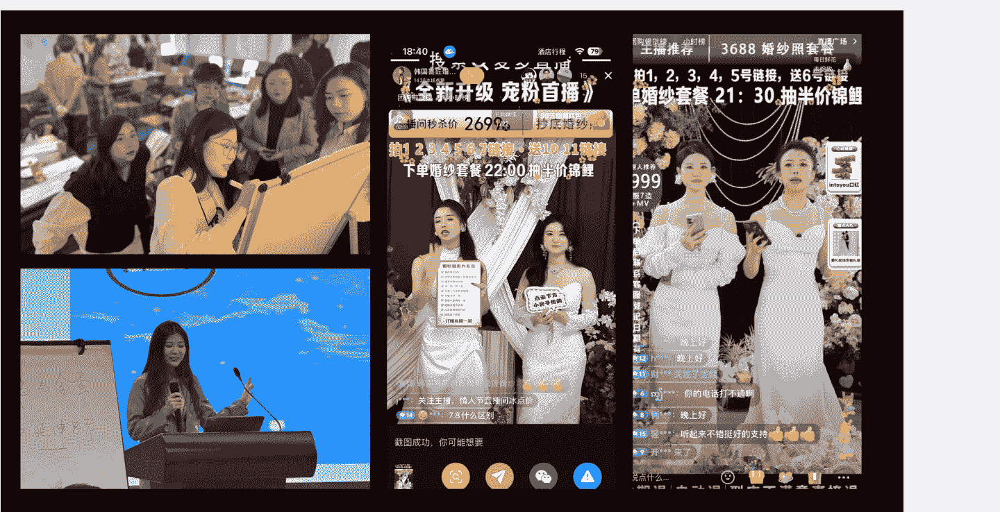

### 业务介绍

现在主攻企业展会业务，用📕企业矩阵拿精准需求，服务高客单展会客户，本质是帮客户解决酒店场地信息不对称的痛点，也是本次复盘的核心项目。

我对📕一窍不通，却把展会项目从零跑通，首单月GMV 7.5万，累计收款破10万，净利稳定在15%-20%。验证了“📕企业矩阵获客 → 付费流量转化 → 私域高客单成交 → 供应链交付”这套闭环。

这篇是过去一个月的心路复盘，也是我在选赛道和落地项目中沉淀的方法论，分享给圈友们。同期我在联合办公还报了小喜，也顺便聊聊线下办公的价值。

## 项目机遇

### 机遇一 线下联合办公带来的跃迁

去年业务进入瓶颈，被圈友推荐加入赚钱联合办公。借用石神马老师的说法，那里像是一次信息跃迁。身边都是实战创业者，我一下子进入了更高的信息层级。

加入第一个月基本是被信息轰炸。联合办公聚集了大量人才，氛围就是多吃饭聊天。我一个月吃了20多顿饭，深度交流，了解大家的项目，震撼感不断：原来还能这么赚钱。

信息太杂，我每次聊完都会立刻做笔记梳理。正是这些梳理，让我最终锁定了📕展会这个方向。也是在联合办公，我遇到了展会项目的引路人——慷慨哥。他详细拆解了他去年在📕做展会的战绩和模式，让我意识到这是一个小蓝海。

机会很多，关键是找到能跟自己匹配的机会。

### 机遇二 赛道试错与自我认知

#### 业务前半生

2024年中从央企出来后，顺势进入孙策老师的同城实体获客项目，担任一年团队长。收获很大，完成了从职场人到市场人的切换，也重塑了自信。但我没继续做下去。

一是客户集中在教培，客单偏低，行业进入红海，靠人力跑的模式天花板明显；二是我想做自己的盘，从纯执行抽离，搭建可复制的系统。

2025年上半年，我们四人合伙做实体老板的代运营，做短视频+直播全案，瞄准婚纱、工厂这类高客单老板。理想很丰满，现实很骨感。4个人拼线下沟通，成交效率极低；线上获客又被经纬老师、孙圈圈老师等头部降维打击。抖音已全面付费，自然流几乎为零，投流成本收不回。

最后发现客户基本都是线下谈来的，线上全亏。代运营本身也难长期：月付就是外包，天花板是自己的运营成本；按效果分润，做不好被投诉退费，做好了客户自己吃掉。这条路也就终结了。

虽然没商业大成，但成长很清晰：

- 核心优势：快速学习新行业、线下销售获客、团队协调、项目落地、SOP拆解培训
- 需要补足：顶层框架搭建、商业模型认知、高阶销售、机会嗅觉
- 明确诉求：坚信同城有机会，想在联合办公里找到新的同城生意切口

### 机遇三 蓝海挖掘与筛选标准

我长期深耕线下，发现对95后00后而言，线下本身就是蓝海。他们习惯线上解决一切需求，线下被严重忽视。加上大家普遍社恐，不愿当面被拒，线下更少被优先考虑。

反过来，这就造就了巨大的信息差。传统行业利润惊人却不懂线上，正如小鹅年终分享说的，她花百万去培训才发现很多传统老板线上很弱但很赚钱。

这时AI工具开始发挥作用，帮我梳理圈友分享的信息。我的预期不是找到终身事业，而是补齐能力拼图：机会嗅觉、销售、对接资源、市场洞察、算账能力，让自己具备0-1起盘的能力。

项目筛选我定下四条：

1. 竞争小：一年内见证过蓝海变红海，新手更难入场维持收益。
2. 技能匹配：与我线下获客、学习、执行能力匹配度越高越好。
3. 非标产品：利润更高，靠服务和口碑，个体才有机会。
4. 单价够高：学历焦虑让我不想做低客单，低客单客诉多、信任差；高客单客户更理性，愿意为确定性买单。

基于这四点，我把联合办公20多位圈友的项目汇总给DeepSeek逐一打分。结果里📕会展赛道得分最高：已验证的蓝海，是完美的实战场，操作性90分。

### 机遇四 赛道判断

跟慷慨哥交流后，我对企业展会📕矩阵深信不疑。最让我印象深刻的是他说的矩阵逻辑：一个城市铺50个企业号，10个城市就是500个账号，手握500个渠道，什么行业做不起来？宝岛眼镜CEO王智民靠7000大众点评+800📕+200知乎+20抖音的矩阵打出口碑就是证明。

展会赛道我做了深度研究：

业务刚需：年会、发布会、商务接待，高净值个人培训沙龙等线下需求持续旺盛，线下是秀肌肉的场。  
用户决策：高客单买的是体面和省心，怕翻车大于比价，愿意付溢价。  
供给混乱：展会预定无人整合，酒店平台不覆盖，涉及场地、灯光舞美、设备租赁、礼仪、花艺茶歇等分散非标资源，极度需要统筹。  
平台匹配：📕高净值用户多，内容调性偏搞钱+审美；对接人多为女性行政人力，爱用📕搜索。  
能力匹配：我有两年线下经验，展会属于同城线下延伸，正好锻炼资源统筹和项目盘能力。

### 机遇五 矩阵是确定性的答案

流量越来越贵，靠单号博运气已死。我调研发现，抖音常规作品自然流从500掉到100-200，📕从200-300掉到100以内。

所有拿到结果的人都在做矩阵。云蔓教IP，实际是200+矩阵号在承载流量。矩阵+付费是唯一稳定的解。现在是平台4.0付费时代，抖音已全面付费，📕紧跟，流量新手保护期已过。

MCN的打法是标准答案：至少5个账号同时起步，每号每天发3条各投100元，第二天看数据加码。参哥、群响、程前采访的对象，90%线上结果靠矩阵。不要听大佬说什么，要看他们做什么。

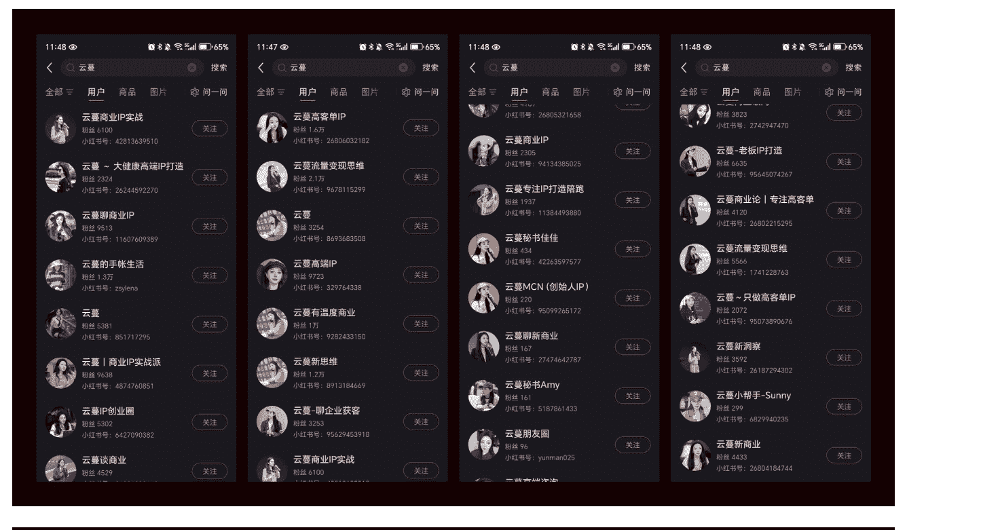

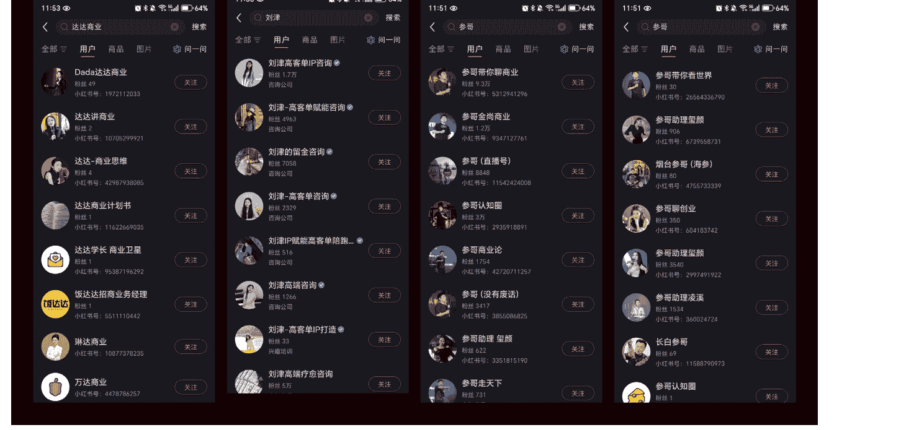

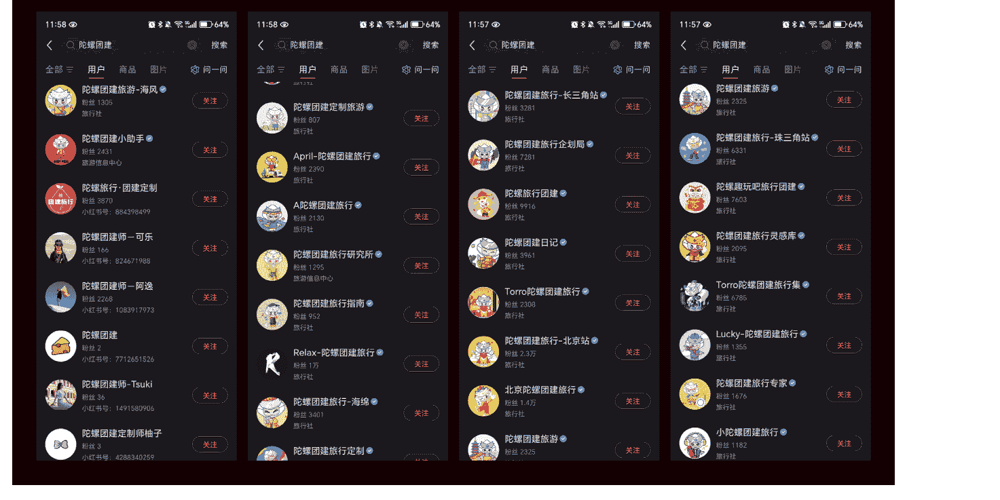

### 机遇六 图文还是视频的取舍

视频信息量大，但我们坚持图文，原因三点：

成本更低：图文时间与人力成本远低于视频，AI批量生图文已成熟，视频生成成本高。  
平台基因：📕是图文起家，搜索属性强，图文关键词覆盖更广。当年郑州帮靠批量素人号垄断关键词赚到封号，证明图文力量。  
打法契合：展会是小众搜索需求，用户习惯打开📕搜「展会场地/会展策划」。搜索流量精准且关键词可穷尽，打完所有关键词就能占领市场。参考云蔓老师的“关键词断层第一”打法。

## 案例启动

### 1. 内容流量

#### 1.1 账号数量先行

确定后我们定下规矩：一周内人均至少10个企业账号。单号跑同城生意不确定性太大，矩阵是把运气变概率。

最大坑不是内容，是手机号。

初期用电信一拖四，一张主卡带四副卡，月租百来块。后来发现异地办卡更便宜，比如上海电信无忧卡月租8块；电商平台的注册专用卡5-8块/月更划算，成本可以压到极低。

#### 2. 账号认证流程

企业蓝V正确顺序：注册→先认证→再发帖，否则易风控。

我最大坑：注册未实名先发帖，第二篇直接跳实名，账号永封冻结。已有实名号无法重复实名，客服说蓝V认证解不了永封。

我注销重注册，结果手机号被平台拉黑永久不能再用。

两个解法：找路人先实名100元内搞定，再升级企业号；或直接认证蓝V，客服说不行但实操可能行。最忌讳封控状态下直接注销，先认证再发是最稳妥。

我们作为企业蓝V付费客户，后面违规封号直接找官方朋友对接就捞回来了，平台给金主留后路是必然。

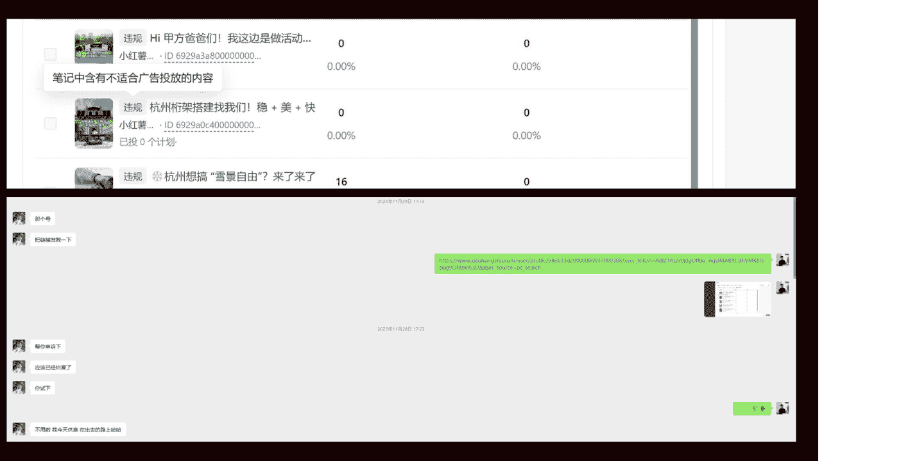

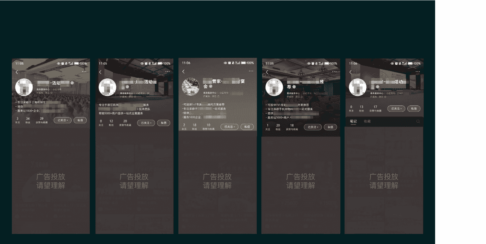

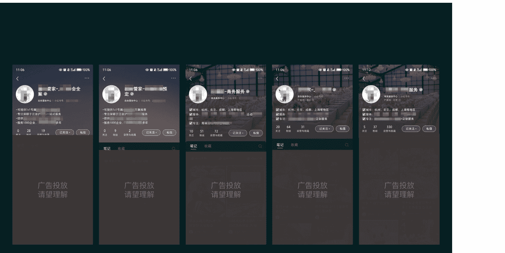

梳理清楚后，一周内铺了十几个企业蓝V，先占位生态位再谈内容投放。

### 1.2 笔记内容解决

第二周攻克内容。我从0开始摸索，第一步卡在封面。不会设计，连合格线都不知道。我的土办法：先大量对标，1:1模仿再超越。看一百个做一个。

要感谢慷慨哥指点，封面核心：标题醒目、重点突出、图清晰、排版好看。从丑图到可复刻优化，新技能get。

很多人做项目时，第一反应是盯着同行学习。但如果你所在的是一个竞争不充分、参考样本又很少的赛道，盲目模仿同行，反而可能把自己带进低效路径。

我的方法是：跨行业寻找“可迁移的样本”。

只要目标用户或关键词存在交集，就值得研究。比如我做企业展会相关业务时，会去拆解团建类账号。虽然两者并不是同一种生意，但它们在封面设计、版式安排、标题表达、信息呈现和图片组合上，都有很多可借鉴之处。

最初我并没有急着创新，而是先把已经被验证过的内容结构照着做出来。先复制，再调整；先跑通，再形成自己的风格。

当内容量开始提升后，工作重点也从“模仿单篇内容”转向“搭建生产模板”。

我逐渐发现，图片和文案其实都能找到规律。以副图为例，前期不需要每一张都精雕细琢，可以批量收集质量较高的图片，然后进行两两组合。方法看上去不够精致，却特别适合账号冷启动阶段：短时间内就能产出大量观感不错的内容，先把账号的内容池填起来。

规律被提炼出来后，我又把整个流程拆成几个固定环节，形成了一套按天执行的生产节奏：

- 周一：集中找案例、拆结构、做分析；
- 周二：统一完成封面模板和主图视觉；
- 周三：批量处理所有笔记的文案；
- 周四：集中发布到不同账号；
- 周五：统一进行📕投放。

这样安排之后，最大的变化不是单纯变快，而是减少了频繁切换。

过去完成一篇内容，往往会在封面、图片、排版和文字之间反复跳转，一会儿想标题，一会儿改图片，时间和精力都被切碎了。现在每天只处理一种类型的任务，脑力消耗明显下降。

按照这套方式，我们一周最多可以发布约60篇内容。虽然其中仍然有大量人工参与，并非完全依靠AI自动生成，但对于一个最开始连图文内容都不会做的人来说，能够在一天内把5个账号的内容铺好，确实意味着整个生产能力已经被打通。

## 投放没那么可怕，真正难的是花不出去

很多人一听到投放，第一反应就是担心预算失控：钱投进去以后，会不会一晚上全部烧完，却没有任何结果？

我以前帮企业做广告时，也有类似顾虑。尤其刚开始投放时，总觉得两三千元可能转眼就被平台消耗掉。但实际运行后会发现，这种情况并没有想象中那么常见。

在蓝海项目里，更常见的问题甚至是另一种：预算想花，却花不出去。

因为目标人群规模有限，系统需要时间学习和寻找有效受众，消耗速度可能会非常慢。那时我才真正理解一句话：

投放最糟糕的，不一定是跑得太快，而是根本跑不动。

能够持续消耗，至少说明市场存在需求，系统也找到了部分有效人群。只要计划设置合理、素材和规则没有明显问题，预算突然失控的概率其实并不高。相比之下，无法稳定消耗，才意味着系统还没有建立起有效模型。

所以，投放需要适当“去神秘化”。它不是一笔钱扔出去就等结果，而是一套需要观察、调整和持续学习的验证机制。

## 后端咨询：线下业务必须亲自建立体感

项目进入第三周后，我开始大量跑线下。

做同城项目，最危险的并不是暂时不懂，而是只停留在想象里。线下业务的信息差很大，很多东西如果不亲自看、不亲自问，就无法真正理解。

因此我用了最笨、但也最有效的方式：不断去现场。

仓库、库房、酒店、活动场地，只要能去，我就尽量去。

### 为什么一定要看供应商库房？

不看库房，就很难理解实际交付到底有多重。真正到现场之后，我至少获得了三类具体认知：

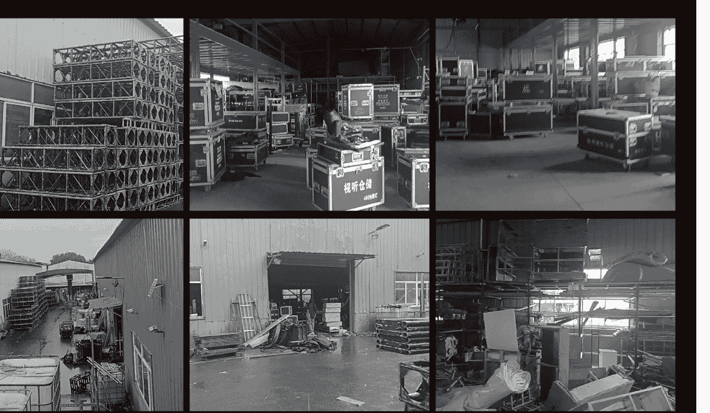

**第一，建立物料认知。**

我开始知道各种租赁设备分别叫什么、具体长什么样、尺寸和重量如何、库存数量怎样，哪些属于容易损坏的物件，哪些又是整个项目的关键设备。

**第二，建立交付认知。**

很多设备能不能顺利进场，并不是看图片就能判断的。需要了解现场是否有足够层高，门的宽度是否满足要求，电梯尺寸是否能承载，卸货口是否方便使用。

**第三，建立商业认知。**

和库房老板交流时，我会重点了解他们如何获取客户、如何报价、怎样控制风险、如何减少项目中的责任争议。

这些信息一方面能帮助我判断供应商是否值得合作，另一方面也让我更清楚自己面对客户时，应该如何设计价格和服务边界。

### 为什么还要去酒店和别墅区筛选场地？

第一，是为了形成自己的场地评估标准。

只有看过足够多的场地，才能真正分辨什么叫“高端”。例如空间是否方正、是否存在明显立柱、层高是否足够、整体质感是否匹配客户需求，这些都需要通过大量对比才能建立判断力。

第二，可以直接认识场地销售。

不同销售的专业能力、响应速度和沟通方式差别很大。找到靠谱、顺畅的合作对象后，后续推进会轻松很多。

第三，可以更准确地提炼每个场地的卖点。

当我熟悉各个场地的特点后，就能根据客户的预算、人数和活动类型做针对性推荐，而不是简单丢一份场地清单过去，这会明显提升成交效率。

## 成交：先搭建系统，再进入实战

第四周开始，我把重点放在销售转化上。

这个业务并不是简单地把客户和场地连起来。一个客户背后，往往要同时协调HR或行政、酒店销售、场地、宴会团队、工程搭建、茶歇、运输等多个角色。

刚开始时，客户问我的很多问题，我都无法立即回答：

哪些属于展会服务范围？  
哪些需要额外寻找第三方？  
具体问题应该找谁确认？  
行业里通常的标准答案是什么？

当时我基本处于“信息中转站”状态：

客户提问，我去问酒店或供应商，再把结果转回来。

同时还必须注意保护供应端信息，不能把关键联系方式直接交给客户。因为一旦客户掌握了场地名称和联系人，就可能跳过我直接去谈价格，我前期筛选、沟通和获客的价值就会被完全削弱。

随着沟通案例增加，我才逐渐建立起边界：

- 哪些问题可以现场回答；
- 哪些内容必须让后端确认；
- 哪些时候需要先让客户补充信息；
- 哪些需求属于额外服务；
- 哪些环节必须提前写进合同。

但真正棘手的地方在于，很多客户本身就是HR或行政，他们的职责之一就是控制成本、比较价格。这类客户天然容易绕开中间环节。

最典型的情况是：我整理了五六个场地供客户选择，客户确定其中一家后，只要知道酒店名称，就可能直接联系酒店争取最低价，把我当成一个免费信息提供者。

这个问题不是靠几句销售话术就能解决的。因为一旦核心信息完全交出去，我就失去了存在价值，而客户又未必认为筛选、比较和协调本身值得单独付费。

因此，最终方向只能调整：

要么深度绑定少数场地，成为它们的稳定获客团队；要么进入交付壁垒更高、能够承载溢价的细分领域，让自己从单纯的中介变成真正的统筹方。

## 定位调整：不是所有“大而全”都适合小团队

最初我们的设想，是做一个区域化场地平台：

平台负责买流量，酒店负责交付，我们从中获取差价或返佣。

但这个模式运行了近一个月，投入了一轮资金，也积累了一批客户，却没有办法迅速变现，于是我们开始重新审视定位。

### 原因一：现金回收周期太长

场地业务客单价较高，但成交和交付周期也更长。

我是在11月15日开始操盘的，而许多需求集中在年会、发布会等时间段，往往要到次年1月至2月才真正落地。也就是说，最理想的情况下，也可能需要两三个月才能看到回款。

对于大多数创业者来说，连续一个月没有正反馈，还要持续投入资金，已经足够消耗信心。更不用说长时间等待。

所以我必须寻找一种能够更快成交、更快交付、更快回款的业务形态。

### 原因二：模式本身存在利润缺口

场地属于标准化产品，信息又相对透明。作为中间方，我们的替代性很高，而行政和HR通常也很擅长比价，并不愿意额外支付中介费用。

酒店销售体系同样不可能被我完全控制，我很难拿到真正意义上的独家合作，也就无法建立排他性。

最终就变成：获客成本由我承担，客户和酒店却可能直接完成交易，利润不断被压缩，甚至直接跳过我。

这次经历虽然损失了真金白银，但也让我用成本买到了一条非常重要的经验。

### 原因三：资源规模无法覆盖真实需求

一开始，我们试图整合杭州全部酒店资源，做到尽可能全面。

但现实是，杭州的酒店和场地数量非常庞大，一个人一个月最多整理几十家，距离“全覆盖”差得很远。想真正完成大规模整合，需要一支成熟的自营团队。

更麻烦的是，当客户进线后，如果手上的资源不够，就会出现无法匹配需求的情况，线索也会因此浪费。

所以我们决定先利用已经掌握的少量优质资源完成变现，先把现金流和信心建立起来，而不是继续追求一个短期内根本无法完成的全量平台。

## 案例优化：从全城中介转向定向合作

后来，我们对场地业务进行了重构。

不再追求“覆盖全城”，而是集中选择少数优质酒店进行深度合作，再利用手中的企业矩阵流量，专注打透一条细分赛道。

这个赛道需要满足两个条件：

一方面能够连接酒店等大型资源，另一方面又能延伸到个体客户，为后续企业培训等业务留下空间。

最后，我们选择了高端宴会方向。

主要基于三点：

- 手上已有少量五星级酒店合作资源，彼此关系稳定；
- 拥有全国宴会后端私域资源；
- 团队成员具备米其林宴会赛事评审等行业背书。

这意味着我们必须放弃“大而全”，把有限资源集中到一条更有增长空间、也更容易形成优势的赛道里。

另外一个重要调整，是不再把“企业展会”作为一个复杂整体去销售，而是拆成多个可以单独成交的服务模块：

- 工程搭建；
- 酒店订餐；
- 物料和设备租赁；
- 商务茶歇；
- 租车与运输；
- 乐队演出；
- 美陈和气模定制。

先把单一垂类打透，再根据客户需求组合服务。

这样一来，前端沟通就轻了很多。客户不需要一次性理解全部环节，我们只要先确认一个明确需求，通过标准化方式完成初步沟通，再由后端承接具体交付。

成交链路更短，解释成本更低，溢价空间也更大，同时更适合通过账号矩阵复制规模。

## 第一单最难的地方：不是成交，而是流程

这单项目让我最疲惫的，并不是跑现场，而是成交和交付之间那些以前完全没有考虑过的流程。

合同一遍遍修改，是常态；客户法务、财务审核完后再调整，也是常态。

发票开什么类型？税点怎么计算？双方责任如何写进合同？收款节点如何约定？这些问题，如果没有真正做过B端项目，根本不会提前想到。

我原本没有法务和财务基础，只能一边做、一边补课。遇到问题就请教外包财务、律师朋友，再把结论落到合同和流程中。

做完几单之后，我对这些内容的理解已经比过去深入很多，甚至逐渐具备了半个法务的工作能力。

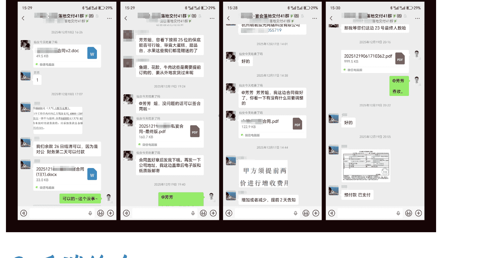

## 后端能力，决定高客单项目能否稳稳落地

这次能够把一笔7.5万元的项目顺利交付，核心并不只是前端销售做得好，更重要的是后端团队足够强。

合作方拥有多个国家官方认证的美食行业宴会团队背景，也担任过多项行业赛事评委，同时具备高端全案私宴的丰富服务经验。

更难得的是，他们不是接到订单后完成任务就离场，而是真正把客户体验当成共同目标。为了推进关键节点，他们会和客户沟通到凌晨，把方案、预算以及每一个细节逐项确认。

因此，我只需要把前端沟通和关键节点控制好，后端就能够把交付稳稳接住。

## 交付当天，我一定到场

无论距离多远，活动当天我都会出现。

有一位客户的活动现场，来回需要4个小时，但我仍然坚持到场。因为客户真正担心的不是我能不能帮忙搬东西，而是现场会不会失控。

我到场的价值，是把未知风险提前转化为可控结果。

高端宴会最昂贵的，往往不是食材，而是信息传递错误、现场混乱、客户焦虑以及由此带来的信任损耗。

我作为客户的第一联系人，必须对最终结果负责。

活动当天，我主要做四件事：

1. 和客户重新确认关键流程与重点需求；
2. 现场发生变化时由我统一协调，尽量不让客户直接面对供应端；
3. 持续向客户同步进展，让对方知道项目一直在掌控中；
4. 拍摄现场照片，既用于验收，也为后续案例传播留下素材。

还有一个小细节：我几乎不会空手到现场，通常会给客户和当天的对接人员准备咖啡或奶茶。

这不是为了刻意讨好，而是让现场沟通一开始就处于更顺畅的状态。很多时候，合作效率和沟通氛围，也会影响项目最终是否顺利。

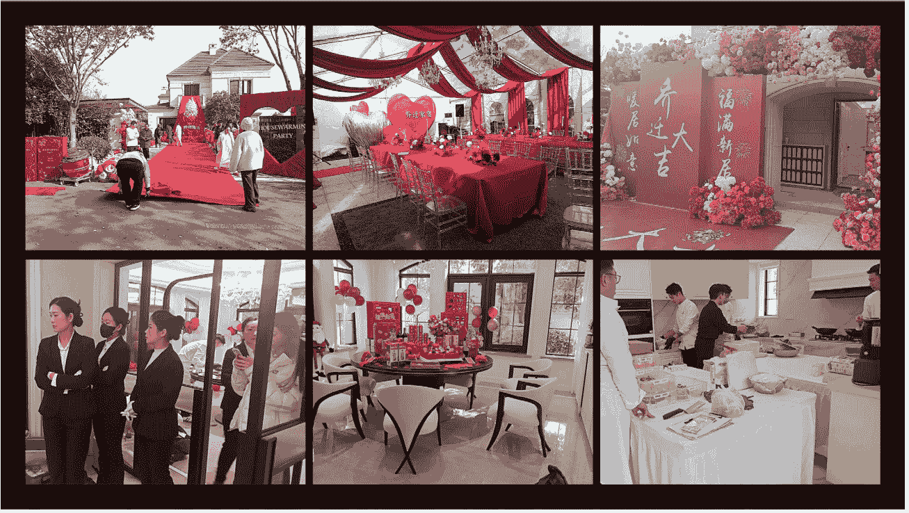

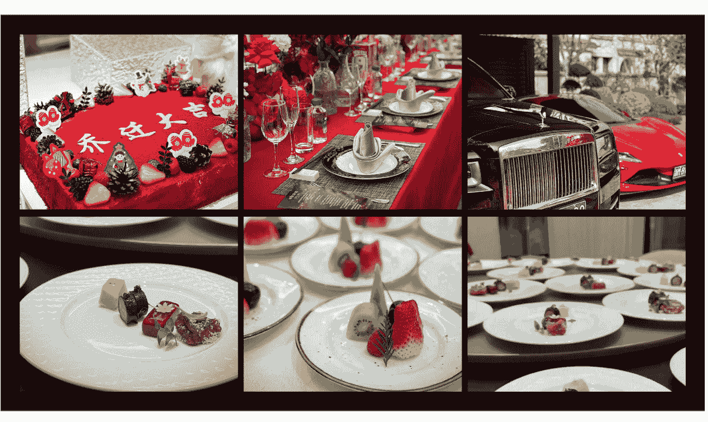

## 10万元营收，真正来自什么？

很多人以为，这段时间的收入主要依靠投放运气。

其实不然。10万元以上的营收，主要来自3个高端宴会全案项目。

整个增长过程可以概括为：

先用第一单建立信任，再用第一单沉淀出的案例，推动后续成交。

第一单完成后，它就不再只是一次交易，而是变成了能够持续使用的案例资产。更巧的是，这位客户本身是抖音大V，她将宴会过程制作成视频并发布在自己的账号上，相当于给我们带来了高质量曝光和公开背书。

高端宴会本身就具备较强传播性：画面有质感、氛围高级、情绪价值明显。当潜在客户看到真实结果，再叠加大V的正向反馈，信任会自然前置。

后面两单之所以推进得很顺，并不是我的能力突然发生了巨大变化，而是客户在沟通前就已经完成了大部分判断：

他们看过案例，见过传播内容，也对团队的专业能力和交付水平有了预期，所以前期解释变少，磨合时间缩短，成交速度自然更快。

高客单业务真正有效的增长方式，很多时候不是不断说服客户，而是把证据提前摆出来，让客户自己得出结论。

当交付满意、案例可传播，客户不仅愿意付款，有时还会主动催促结算。

这就是高端服务的复利：流量只是起点，真正能持续带来成交的，是一次高质量交付所形成的案例资产。

## 经验总结：线下业务必须做好现场控盘

### 1. 现场交付不能缺席

对于宴会类项目，作为统筹方，一定要到现场。

客户首先联系的是我们，整个项目的责任归属也落在我们这里，所以交付阶段主要要控制三件事。

### 控制信息：避免需求在传递中失真

线上，我会把相关人员统一拉进服务群，尽量让所有人看到同一套信息，减少多头沟通。

线下，在宴会团队进场前，我需要和客户确认活动点位、整体风格、注意事项以及重点细节。很多问题如果不去现场，单靠线上沟通很难发现。

例如迎宾台究竟放在哪里，不同场地的条件完全不同；现场电压能否支撑设备，也需要实际测量。

宴会细节非常多，我通常会把客户的表达通过语音转文字，及时记录到备忘录中。到现场后，再将这些信息准确同步给搭建团队，减少理解偏差。

有一次，我的合作伙伴甚至直接带着电脑到现场，和客户确认完需求后立刻绘制点位图，这样后续执行会更加精确。

### 控制节点：避免时间安排失控

一方面要管理客户节点。

客户往往需要提前确定宴会团队、场地和预算，因此我们必须明确活动前多少天完成方案确认、什么时候签约、什么时候锁定资源。

另一方面也要管理供应端节点：

什么时候进场？  
什么时候完成搭建？  
什么时候由客户验收？  
出现变更后谁来确认？

这些都必须提前排进时间表。

### 控制风险：让客户感受到确定性

现场管理的目标，不是等问题发生后再补救，而是尽可能在客户感知之前处理掉风险。

客户最信任的，通常是一直和他沟通的人。只要我在现场，客户就会更安心，因为他知道一旦出现问题，可以第一时间找到我。

## 一个简单但有效的人情沟通技巧

为了让合作更顺畅，我会给客户和后端人员准备一些咖啡或奶茶。

过去一个月，光是咖啡奶茶就送出去几十杯。

这并不是为了靠礼物换成交，而是为了让跨部门沟通更顺滑。宴会项目往往涉及行政、HR和多个负责人，信息需要层层传递，过程中很容易出现偏差。

一杯饮品带来的，是更好的第一印象、更高的配合度，以及对方在沟通中愿意多留一点弹性。

大型项目出现小插曲很正常。上一单结束后也出现过一些可大可小的问题，最后客户没有继续追究，很大程度上也与此前建立的良好关系有关。

人与人之间的信任，有时就是这样一点点累积出来的。

## 真正拉开差距的，是解决细节的能力

这段经历看起来只是做项目，实际上逼着我补齐了很多基本功。

写这篇内容时已经是凌晨1点，第二天早上6点还要坐两个小时地铁去跟现场。最初做场地业务时，我一天甚至要跑五六个地方，长时间走路、久站、久坐，最后还出现了腰椎和足底方面的问题。

B端宴会项目还涉及大量财务和法务内容。为了处理这些问题，我开始系统学习发票、税点、合同、付款方式和责任划分。

有一次，客户公司的财务对发票类型有非常严格的要求，原本的开票方式无法直接匹配。我们临时协调处理，最终解决了问题，也因此和客户建立了更深的信任。

同时，还要做到对客户保持稳定，对供应商保持要求；及时跟进双方🛰️消息，催促供应方响应，避免遗漏关键信息。为了不漏掉消息，我甚至把手机提示音一直开着。

经过这一轮项目，我真正沉淀下来的是一套可复制的交付控盘框架：

**信息统一 → 节点管理 → 风险处理 → 流程优化 → 案例沉淀**

信息统一，靠服务群和统一口径；  
节点管理，覆盖进场、布置和验收；  
风险处理，要尽量把问题消灭在客户发现之前；  
流程优化，把每次踩坑转化成标准动作；  
案例沉淀，让完成过的项目继续产生价值。

很多人只知道寻找供应商，却不知道如何控制整个盘面。真正决定线下业务能不能稳定增长的，不只是资源，而是你能否把资源组织起来，把交付结果控制住。

## 做线下业务，本质上要解决三个系统

如果把整篇经历重新拆解，线下项目至少要搭好三套系统：

### 第一，前端流量系统

解决客户从哪里来、如何持续获取线索的问题。

### 第二，后端供应链系统

把供应商、场地和服务资源组织起来，让前端流量能够被及时承接，并且稳定交付。

### 第三，平台规则系统

给客户和供应方建立规则，利用合同、流程和责任边界降低风险，同时设计能持续运转的收益模式，让自己成为不可轻易替代的连接节点。

这三套系统一旦成立，线下业务的大框架基本就搭起来了。

回头看，这一路确实辛苦，但也正是在一次次跑现场、谈客户、改合同、处理突发状况的过程中，我逐渐补齐了销售、财务、法务、体能、关系维护和项目管理能力。

最终拿到结果的那一刻，才发现自己真的比想象中更能扛。

也希望每一个正在尝试新项目的人，都能找到适合自己的方向，少走一些弯路，尽早获得属于自己的正反馈。

## 最后，推荐小懒的付费群

这里是你对抗信息过载的护城河。

社群已经稳定运行6年，累计拆解、研读3000多个互联网商业实战案例，以及行业前沿内参、时政和宏观文章。

> 我们不搬运低价值信息，只做高质量内容的筛选器和放大镜。

