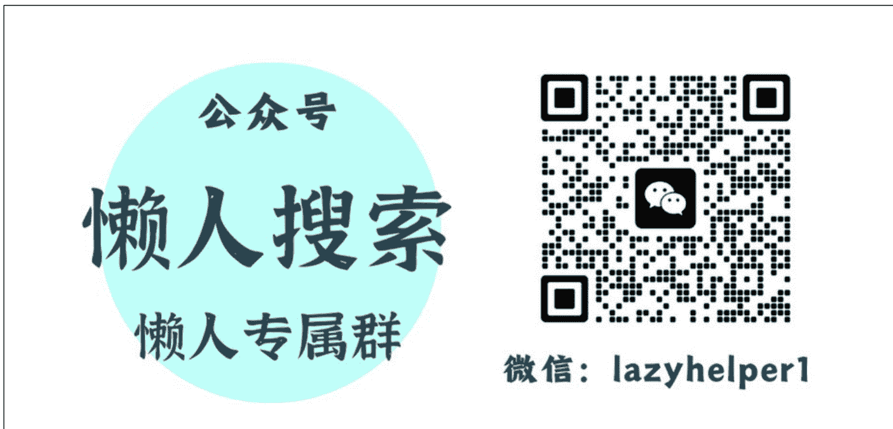
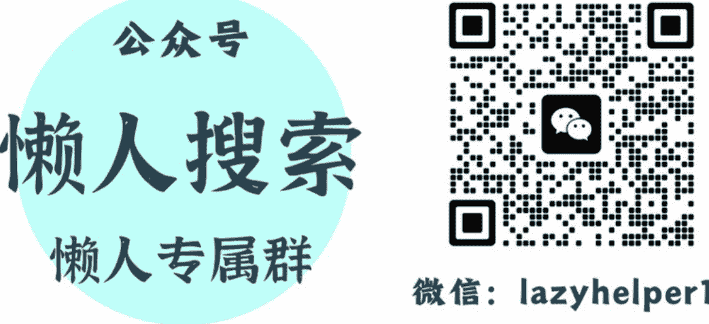

# ('深耕亚马逊两年，分享做电商开品的底层思路，国内也适用，新人可参考', (5, 37))

两年电商开品实战，我把“爆款”这件事彻底想明白了

一个亚马逊开发眼中的底层方法，国内同样适用



我是女巫的蛋挞，一个刚刚从亚马逊电商开发岗位离职的普通女孩。2023年毕业，先做了4个月铺货开发，之后在精品开发岗做了1年7个月。更让我自己有底气的，是那段精品开发经历——店铺月利润一度做到近70万元。最近半年，我又开了小红书店铺，第三个月的销售额就超过了10万元，现在虽然偶尔回落，但每天依然能稳定在2000元以上。我还参加了小红书直播航海，第五次开播成交额做到了1611元；我教的朋友也快接近单场千元。明显能感觉到，平台正在给直播不少自然流量。

我为什么想聊开品？因为电商的竞争已经到了“你不做差异化就活不下去”的阶段。选品当然重要，但开发产品的能力，才是把店铺做出辨识度和竞争力的关键。开品更像是选品之后的二度创作——不是复刻，而是把工艺、创意、市场判断重新捏合。我的例子多数来自亚马逊，但方法和思路在国内电商同样适用，新人也完全可以拿来就用。

进公司时，我就特别喜欢啃硬骨头。记得有款竞对产品卖得很好，但成本居高不下，而公司的模式又是FBA——货物先运到美国仓库，卖不掉就等于把钱扔水里。为了让成本降下来，我不断找供应商、试新工艺，硬是把那款产品的价格打掉了一半。这个结果离不开领导的指导，而它带来的直接收益，是每个月这一块的销售额能增加几十万元。另外我特别愿意和新运营搭档，因为每推一个品都能得到大量真实反馈，这反而倒逼我的开发思路不断迭代。

（一）从工艺上找突破口

先说我最常用的“工艺突破法”。逻辑很简单：找到一类销量不低、但因为工艺复杂而少有卖家敢碰的产品，主动去匹配供应商，一起把技术难题啃下来，再把这个工艺和当下的热卖元素结合，做成一个“独家款”。工艺壁垒天然会拖慢跟风者的速度，让你多卖一阵子。

我在亚马逊做过一个手机壳案例：一个细分工艺款，单SKU一个月能卖300件，这放到手机壳类目已经算得上小爆款了——要知道一款普通手机壳通常要几十上百个SKU才能达到这个量级。然而市面上几乎只有纯色款。我判断，如果同工艺加上图案，应该会有机会。难点也摆在眼前：现货市场的新链接很难和已有爆款拼，而定制供应商起订量高、交期长，连上级都不看好。但我就是忍不住想攻克它。后来反复沟通，终于找到一家价格合适、起订量低但极不靠谱的供应商，采购和仓库被我折腾得够呛。可最终，这个品成了那位运营店铺的主打爆款，后续衍生品一个月能带来几十万甚至上百万的销售额。

找供应商的方法，我把1688、拼多多、淘宝、华强北、抖音几乎翻了个底朝天。每找到一家，我都会主动开口：先报定制需求；对方嫌量少，我就把同款爆款的销售数据发过去，说服对方用现货供货；再不行，就适当包装一下公司实力，争取把起订量谈下来。微信、电话要持续跟进，问一次就放弃等于白问。

（二）把爆款图“二创”出网感

第二个方法，是元素融合，也叫“爆款二创”。把两款热销产品的优势叠在一起，比如A款的畅销面料+B款的畅销图案，强强联合，产生新的吸引力。但这件事最卡人的地方是审美和细节。我的经验是，多看爆款，慢慢就会有“网感”。新手尤其要注意：背景、元素、颜色，每一个你能看见的点都要问一句“它有没有热卖依据”。一个可能爆的图，背后是大量思考和修改。

改版爆款怎么才能超过原版？我的答案是：借力插画师和AI工具。插画师能把排版和色彩做得更讲究，AI则经常给出让人意外的灵感，工具我用豆包。下面是我当时给一个爆款产品改图的部分过程：

```
for iPhone 17 Pro Max Case Flowers Floral for iphone cases with Screen Protection]Slim Shockproof for 17 ProMax case girly Design-1
Brand: TXXO
4.6 (25) | Find specific info
Amazon's Choice
500+ bought in past month
```
（提示词方向：油画风、丙烯立体奶油肌理、暖色调复古、白色雏菊+橙黄色枝叶、半幅构图、留白背景、层次丰富、艺术装饰感。）


（初稿后迭代：生成四张莫奈画风油画，画面以红粉白三色雏菊铺满屏幕，利用印象派光影和色彩交融表现灵动感。）


（微调指令：继续莫奈画风，强调红粉白雏菊铺满画面，色彩交融、自然光感再明显一些。）

AI出图不满意，大概率是指令还不够细，就继续改；再不行，就交给插画师做二次拼接和改造。因为AI和插画师都没有爆款数据积累，真正让图“能打”的，是你对爆款审美的判断。

（三）加颜色，是最容易被低估的改动

比二创更省力的，是在爆款上做“微调”：直接加新颜色、新尺寸，或者换一个应用场景。多巴胺色系就是一个很典型的切入点。如果你没有插画功底，可以找有实力的供应商帮你改。

我在这上面踩过坑。小红书店铺的主力款，我是跟爆款做起来的，当时已经成了同款第二个卖得好的链接。本来想加几个新颜色，但供应商起订量要500件，主业又忙，就想着“过几个月再说”。结果不到一个月，一个新店直接上了6种颜色，其中还有爆款色玫红，再配上好图和标题文案，10天就卖了3000多件。对方每天更新十几篇笔记，而我当时一天平均只有1.5篇，很快就被甩开了。这件事给我一个很深的教训：电商迭代的速度远超你的计划，想到了就立刻做，等几天可能连汤都喝不上。

（四）一条小爆笔记，如何接住流量

说一个和“起量”有关的插曲。当时看中一个品，是因为它24小时内已经有5000人加购，对方粉丝只有1.6万，但已经有好几个链接在卖。我的操作是：把这家的产品和Casetify放在一起拍照，用“站在漂亮孩子旁边，自己也会显得好看”的思路来衬托自己，同时优化主图。因为时间和能力限制，我没拍视频。

第一条爆款笔记发出去5小时后，数据是这样的：点赞收藏9个，浏览750次，进店118人，加购36人，但0下单。当时链接实际只成交了2单，还是刷的。当天晚上，我找人刷销量，又设置了一条置顶评论，大意是“新品29.9元、前100单包邮、下单送运费险”，然后每隔一小时在置顶评论下倒计时：“还剩30单”“还剩20单”。这条笔记我抓稳了，链接顺势起量。后来销量稳定了，我就删了那条评论，整个过程只用了一两天。但必须提醒：这个方法有风险，想试的圈友一定要先找教练确认。

选品真的能决定生死。我另一个品花了整整两周，所有办法都用尽，拍照也拍到手软，最后一单都没卖出去。

（五）捡漏“遗珠”，改包装就能起量

还有一种思路，叫“捡遗珠”。那些已经在市场里存在一段时间、排名不算低但又不显眼的产品，常常被忽略。我的第一个亚马逊爆款就是这么来的：一个美容护肤类产品，排在类目新品榜60多名，上架时间接近半年，似乎是慢慢爬上去的，不像头部链接那样吸引眼球。我让供应商的插画师重新设计包装，做出更符合市场审美的视觉效果，上架后直接卖爆，单月销售额最高冲到10万元上下。

（六）嫁接和衍生：从“抄”到“超”

再往上一层，是“嫁接”。把你在一个产品上验证过的热卖元素，平移到另一个爆品的新工艺或新载体上。比如手机壳上跑通的图案，可以尝试耳机壳、充电宝。在亚马逊，版权问题非常严肃——它的一面是雷区，随时可能让你踩上；另一面也是保护自己的武器。与其贸然做一个和原有品类差异很大的新东西，不如在成熟但缺少创新的产品上加一个新工艺载体，这几乎是降维打击。

嫁接的进阶版，是“深度衍生”：不要只看爆款表面，要问它到底满足了用户的什么深层需求。把这个需求和一个新的爆点结合，就可能做出比原款更受欢迎的产品。功能、设计、内容、营销一起做组合，再配合精准运营，爆款概率会成倍提高。这一步，就是从“抄”到“超”。

（七）视野越宽，爆款越近

开品不能闭门造车。我会长期盯着独立站、TikTok、Instagram上的流行色和视觉风格，Y2K、多巴胺、美拉德这些词，早就是电商圈的“风向标”了。大公司和供应商的新品动态也要放在雷达上——他们往往是最先嗅到趋势的人。

大型文化活动同样是爆款发动机。《芭比》全球热映那年，玫红色横扫服饰、手机壳、挂饰等品类，直到今天依然是能打的颜色之一。但一定要警惕：电影里的具体人物形象几乎都踩侵权红线，所以要学的是色彩和氛围，而不是角色元素。更高级一点，可以主动研究色彩心理学。芭比粉已经不只是一个颜色，它代表女性力量、自我表达，你卖的不只是产品，更是一种情绪认同。

供应链消息也能提前布局。比如苹果17在9月发布，其实7月就有消息说会新增橙色。如果那时提前围绕手机配件布局橙色款，发布会后就能吃到大波流量。这种信息，需要你多扫描不同领域的头部品牌。

（八）用户没说出口的，才是金矿

很多机会藏在“客户没被满足的细节”里。我会重点收集三个渠道的信息：产品链接下的评论、自己亲身使用的感受、刷社交媒体时的灵感。跟爆款时，不要只复刻，一定要一边跟一边迭代功能。我还会画一个“产品—用户”矩阵，把已有的产品和用户群都列出来，看哪个格子是空的——空格往往就是被忽略的需求。跳出现有产品去做新东西，非常考验洞察力，也考验运营能力：如果你的店铺没有标签基础，再好的细分品也很难推到对的人面前。

（九）快，就是优势

最后说速度。市场新品往往很讲究“首发红利”，大型供应商自己就有独立开发能力，他们开出来的品常常就是未来的爆款。电商同行做到后面，信息来源高度重叠，你慢一步，别人就抢先了。我在公司时，只要感觉某个新创意能起来，就会拼命推着各个环节往前走，确保我负责的运营是全网第一个上架推广的人。结果也很明显：一位新运营因为我从中抢出约一周时间，直接把产品送上了亚马逊手机壳新品榜第14名；后来跟上的同款链接数据也还行，但和第一名差了一大截。一条爆款链接，足以带起整个业务。

垂直店铺是隐形的助推器

除了具体方法，还有一个容易被忽略的底层变量：垂直度。同样一款有潜力的新品，放在垂直细分赛道里，爆发速度会远远超过泛类目店铺，流量和转化率经常是翻倍的。我在亚马逊手机壳类目里见过太多这样的店：一个小店只做一个工艺、一种素材壳，结构极简，不铺货不杂乱，80%以上销量来自一条爆款链接或一个系列。

后来看到亦仁老大提出“垂直小店”模型，我一下子被击中了——这不就是我一直验证过的东西吗？平台自然流喜欢标签清晰的店铺，消费者也更信任专注于某个领域的“专家店”。这个逻辑从亚马逊这样的货架电商，到抖音、小红书这样的内容电商，内核完全一致。在亚马逊，垂直体现为细分品类、工艺、素材的深耕；在内容平台，垂直体现为“单一品类+持续内容输出”的账号。

说白了，垂直的本质就是降低平台的识别成本和用户的决策成本。平台规则再怎么变，这套逻辑都不会变。所以，选品和开品时，请多问自己一句：这个品能不能帮我在某个细分垂类里建立认知？开品不只是在开发一个产品，更是在为你的垂直小店找一块坚实的基石。

爆款的本质：抄、改、创

最后总结一下。看了那么多成功案例，爆款的本质其实就是九个字：抄、改、创。很多爆款，都始于一个小爆款的“改”，或者来自一个还没被满足的需求；然后在借鉴的基础上，融入更优的网感审美和运营策略，最终实现“创”。体系化选品、灵活开品、快速执行、垂直运营，这一套组合拳打下来，你命中爆款的确定性会明显提高。当然，产品成功离不开运营的紧密配合，运营本身也是一门系统协作的功课，我自己还在路上。

我的分享到这里就结束了。如果里面有一个细节能让你觉得“哎，这个我也能用上”，那就有意义了。搞钱之路，祝大家越来越有钱。

最后，私心安利一下小懒的付费群：懒人专属群。



🧊 这里是你对抗信息过载的护城河。
懒人专属群已稳定运行6年，累计拆解、研读了3000多个互联网商业实战案例与行业前沿内参，内容涵盖时政和宏观文章。这群不做垃圾搬运工，只做高价值信息的筛选器和放大镜。
群内更新记录：https://hk57gvlx7u.feishu.cn/docx/H0kRdZbSboIBR0xkaXtcuVE0nTg
如需了解更多，也可以通过公众号“懒人搜索”找到我们，或者添加懒人微信：lazyhelper1。

【免责声明】本资料存档于社群内部知识库，仅供成员课题研究与学术交流，请在查阅后24小时内删除。