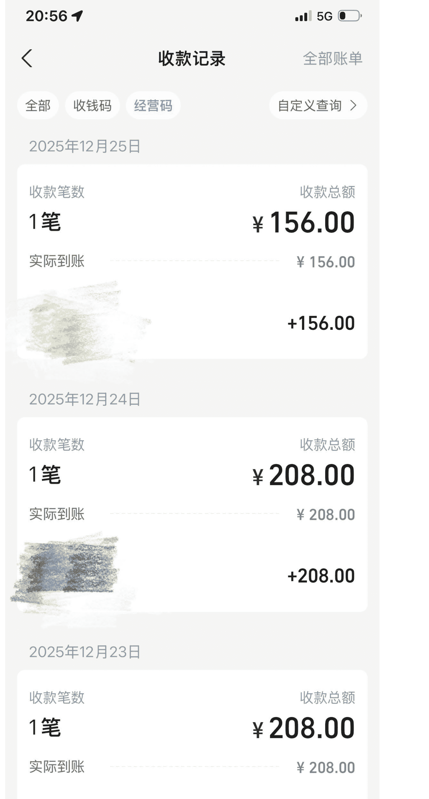
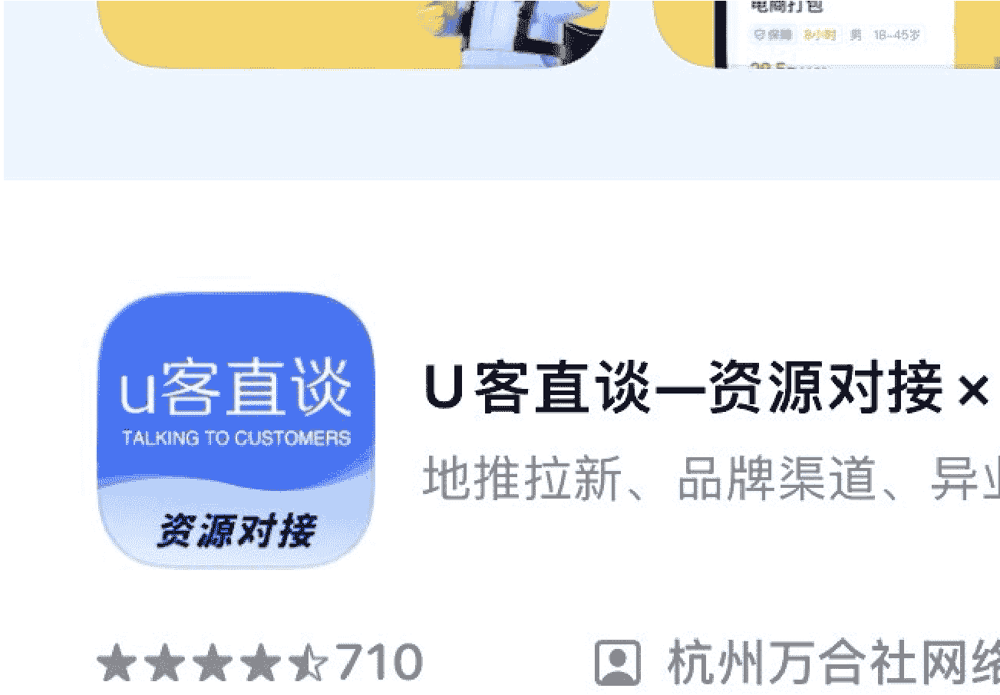
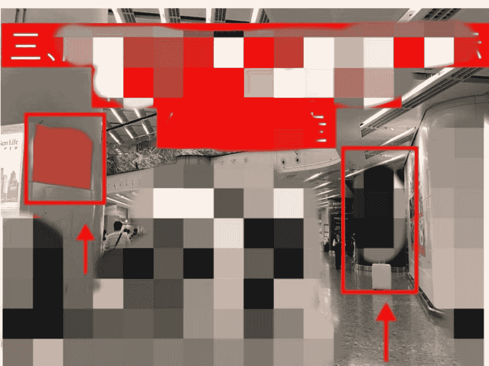
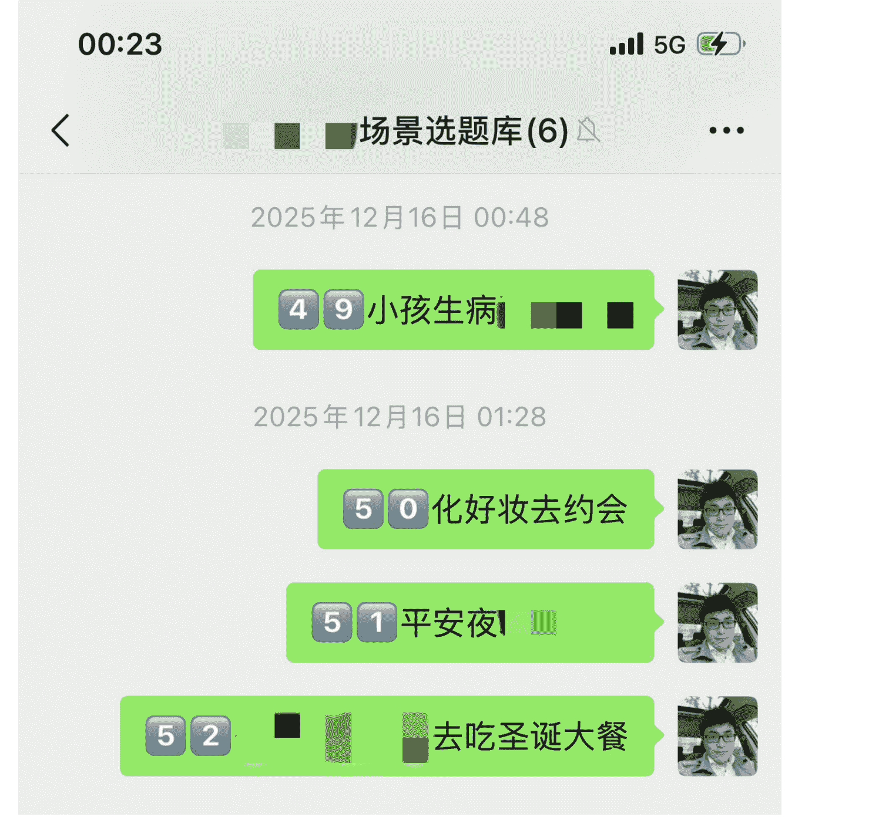
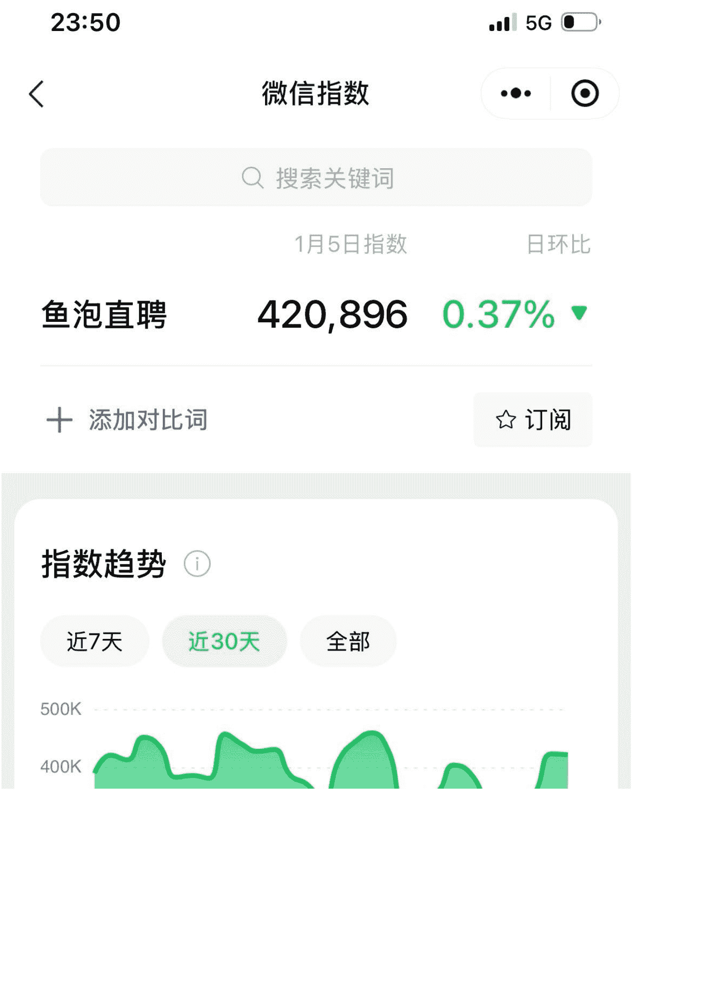
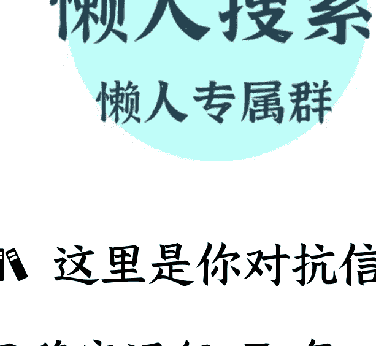

# 10分钟日更，首月到手6000+：用碎片时间玩转垂直小号，精准拉新轻轻松松变现

260114 副业SC精华

## 一、缘起

各位老铁大家好，我是赚钱第一年圈友启茵。

受赚钱官方邀请，今天跟大家拆一拆我是怎么把垂直小号跑通的。

我今年2月入圈，跟着参与了2025年全部的大航海。

上半年先把AI写作从0到1跑通，再升级成培训，把两倍的赚钱门票赚回来了。

下半年换个打法，用👸号做垂直小号，又把另外两倍门票赚回来了。

## 二、我的小成绩单

从2025年10月27日开始起号，到现在2026年1月1日，月度变现累计6656元，两张门票到手。

做的拉新单价稳定在40-60元一单。

有篇文章晚上8点发，第二天中午才15个阅读，却已经成交4单，赚了200多。算下来eCPM相当漂亮。

跑了一个月后回看，单篇平均收益能稳定在100元左右。

在我这种👸号新手眼里，这已经算一次不小的突破了，也让我真真切切感受到了低粉也能变现的逻辑。

准确说是低粉低流量也能变现。变现效果跟粉丝量几乎脱钩。

昨日阅读 18

昨日分享 2

关注我的人 28

付费内容收入 去开通

流量主 去开通 NEW

我的足迹

内容助推

首页 消息 我

更关键的是，成交几乎全自动。👸号菜单里虽然挂了🛰️，但客户基本不会加我，佣金照收。售后退款为零。

玩垂直小号就是玩精准，不是靠泛流量堆人。

## 三、方法拆解

### 3-1 选赛道

目前的号主打海外小众CPA拉新，具体品种不展开了。

这个品类生命周期有限，也装不下太多同行，平台对网推有管控。

但玩法是通用的。👸号做垂直小号，本质是可迁移的。学会后基本能套用到各种高客单的垂直CPA。

### 3-2 先找后端，再做前端

机会是在U客直谈上刷到的。圈内人熟，圈外人基本没听过。

信息差就是我的壁垒。2025年9月我泡在U客直谈上找项目，每个账号有6次免费联系名额，我有5台手机，30次机会几乎全用光了都没找到合适的。

剩2次时很多人会放弃，我没放弃，最后刷到一个刚上线的项目，一分钟判断出是我擅长的方向，当晚就联系上了，聊半小时直接开干。

为对冲风险，我又用最后一次免费机会找了同类项目，验证了方向没问题。

### 3-3 为什么能赚

不是靠流量主。我要是走流量主，没大流量就赚不到钱。

我选了拉新佣金做后端，受之前AI写作公域-销售-私域的路径影响，我更习惯低粉高转。

对新手来说，几十块一单很合适练手。

### 3-4 实操路径

方法很糙，但好执行，正反馈快。

A. 当晚拿到项目就定策略。
B. 第二天找本地朋友线下实操出第一单，把全流程走通并截图。
C. 给每张图编号步骤一到五，做成傻瓜式流程。
D. 让朋友再多试几单，收集不同情况的素材。
E. 凭第一单的截图写第一篇保姆级教程，用人话、简单化呈现，等于把傻瓜+保姆+喂饭做到极致。
F. 封面做大字报风格，后来越做越垂直，也正好把路人粉筛掉。
G. 发完第一篇不盯数据，24小时内再发一篇场景应用文，第三天就出单，正反馈直接拉满。
H. 写作我基本手打，AI没用在写字上，只用来扩选题库。
I. 坚持“铁打的人群，流水的选题”，30天接近日更。用不同场景文章吸同一个垂直人群，每篇文末都挂回第一篇教程链接。第一篇的浏览量就成了转化率的晴雨表。
J. 过程中慢慢学会了用1-2个关键词锚定目标人群。

执行力+用户视角+圈定人群。

### 3-5 怎么做到自动化

菜单里有🛰️，却很少有人加。因为第一篇教程写得足够清晰，用户看完就能自助完成拉新。

另外我无意中埋了不少关键词，引来不少精准搜索流量。这类人多半参与过同类活动，看了就能懂，不需要人工引导。

我的表达风格就是简单直白，99%的目标用户都能看懂。

后面的场景文也形成了一个SOP：点名人群-场景切入-放大痛点-给方案-文末挂教程链接-收佣金。每天换个场景套公式就行，封面也是大字报+场景图。

### 3-6 选题库怎么建

我围绕的是“铁打的人群，流水的场景”。

具体做法：
A. 锁定核心关键词，1-2个就够。
B. 把关键词丢给AI，让它先出30个场景。
C. 把场景拆成恒常场景和节日热点场景。
D. 有节日就优先节日，没热点就用恒常。
E. 恒常场景不够就让AI基于关键词找痛点，痛点即场景。

核心关键词-让AI拆解-出选题-排序-痛点延展。

### 3-7 关键词打法

A. 先用一句话介绍自己的业务，说不清就让AI帮你梳理。
B. 举例：👸号发HR感兴趣内容做鱼泡直聘拉新。HR和鱼泡直聘就是两个核心词。
C. 再拓展：人事部、人力资源、Boss直聘等。
D. 用🛰️指数看搜索量。
E. 再用腾讯广告验证热度。
F. 建表长期复用。
G. 👸号关键词权重：标题>封面>正文前100字。
H. 布局要自然，文章为王。

### 3-8 还能玩吗

第一个号变现了，第二个号测试也变现了，证明👸号做垂直CPA拉新是通路。

我没做到日更，运营也没用全，内容也很粗糙都能做出来，高手做起来效果会更好。

我这个小众赛道机会不多，几千块变现属于起步。但同类CPA很多，国内外的都有。比如字节系海外产品的拉新，单价都不低。

只要你能拿到稳定客单价的CPA项目，且目标人群会用👸号，就能用这套打法。

### 3-9 普通人怎么复制

A. 先执行起来，别等资源。
B. 理解垂直小号的本质：做一米宽一万米深的内容，别看粉丝数。
C. 有海外资源更好，更贴近用户。

四步抄作业：
1. 找到合适的CPA拉新项目，对接后端。
2. 自己或朋友完整走一遍流程，每步截图并大字标注。
3. 把流程发成一篇操作指南。
4. 用不同场景文章持续引流，文末挂指南链接。

保持更新，就能开始变现。

### 3-10 踩坑提醒

做海外项目一定要注意当地法律法规。国内习惯不能直接套用到海外，否则用户踩坑你也跟着翻车，号也会没。

## 四、复盘

每个项目都要自己先跑一遍，知道能赚多少，再复盘调整。

👸号更适合做垂直人群和精准流量。

第一次尝到低粉高转的甜头，认知直接升级。

这几千块的变现之外，思维上的收获更大。

最后，安利下我的付费群：

这里是你对抗信息过载的护城河。

已稳定运行7年，累计拆解、研读3000+个互联网商业实战案例与行业前沿内参和时政/宏观文章。

我们不搬运垃圾，只做高价值信息的筛选器与放大镜。

