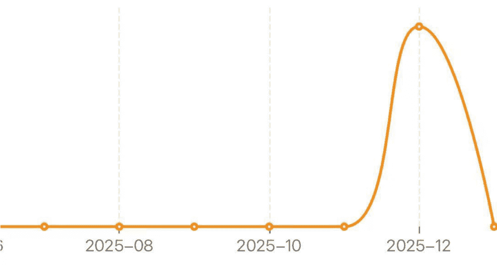
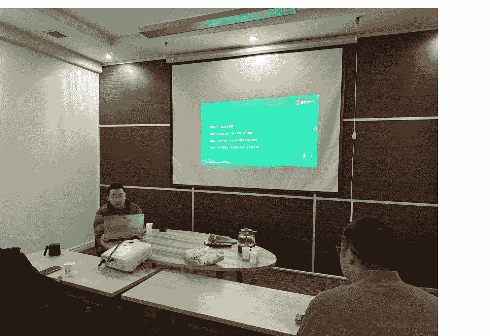
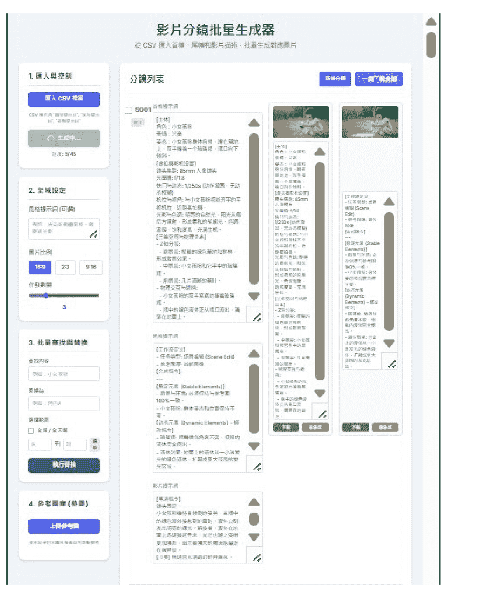
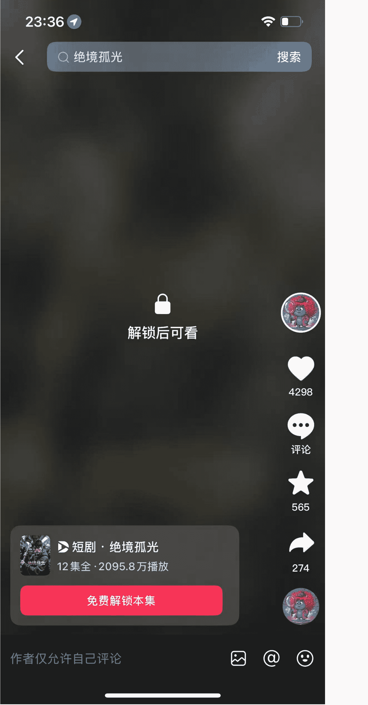
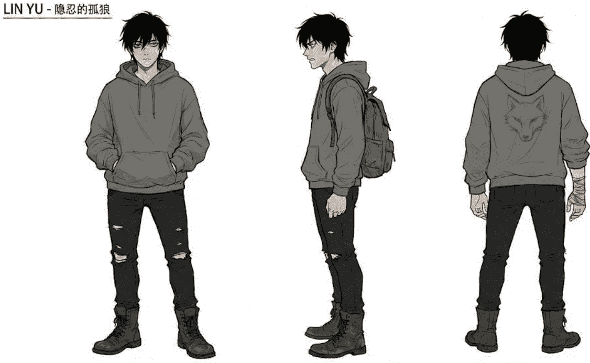
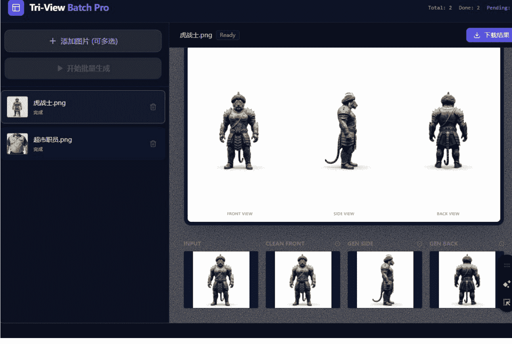
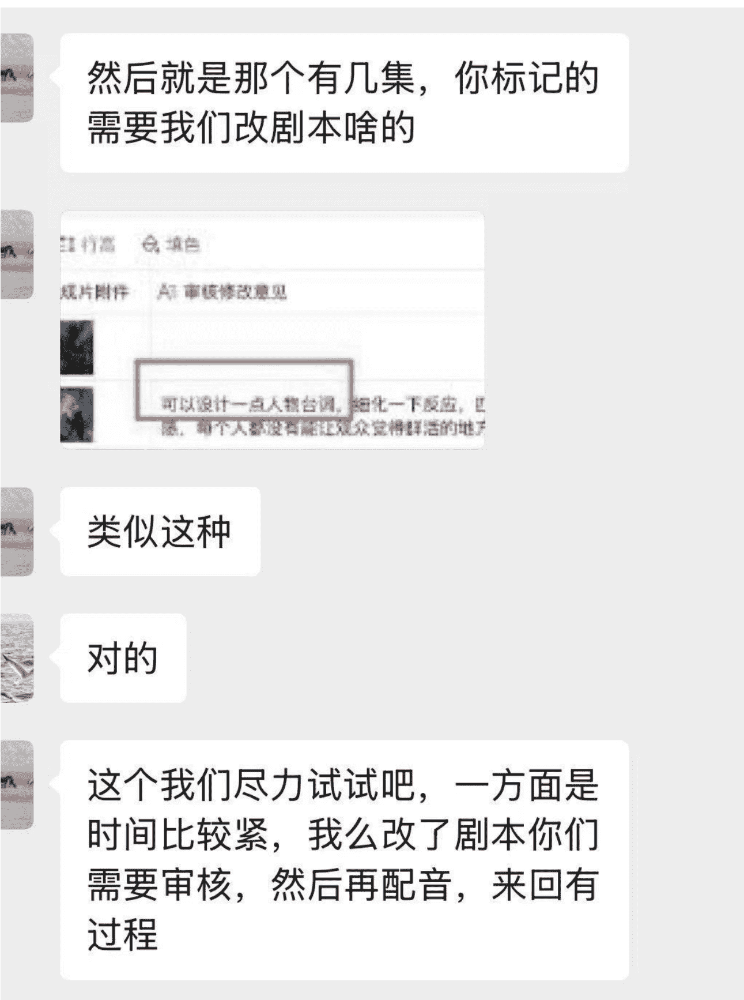
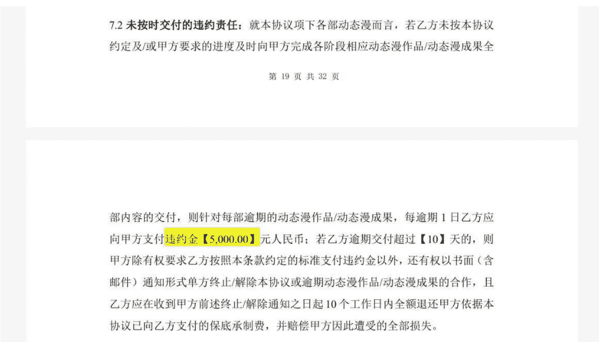

# 【AI漫剧实战】5人小队用30天交付108集，拿下8万元承制费：从接单到成片的复盘，以及13个不能踩的坑

# 260115 副业 SC 精华

大家好，我是龙哥。

最近漫剧项目热度很高，后续行业会怎么走，我作为刚入场的实践者不敢随意下判断。但有一件事可以确定：我和几位朋友，已经把“客户沟通—试做—签约—批量生产—交片”这条链路实际走了一遍。

实操后我发现，赚钱不少伙伴并不缺制作能力。真正卡住大家的，往往是两件事：不知道去哪里找订单，也不清楚项目中有哪些隐蔽风险。

所以，这篇文章不讲空话，直接把我们的项目结果、团队分工、生产方法和踩坑经历全部摊开。

先看结果：

2025年12月，我们5个人临时组队，在一个月内完成了一部108集、总时长203分钟的漫剧项目。合同承制金额为8万元，目前已收到80%的款项，另外还有17%的项目收益分成。

由于签署了保密协议，暂时不能透露具体片名。如果后续作品表现不错，再回来向大家汇报。

## 服务性(收入)

2025年12月

尾号000

交易笔数：3

交易金额：¥64,001.00

- +¥1.00

- +¥24,000.00

- +¥40,000.00

交易明细 交易对手

这个项目的时间节点也很有意思：我们开工时，正好赶上短剧航海启动；最终交片日是12月24日，也正好是航海结束的日子。

那段时间，我一边参与项目制作，一边担任航海志愿者。手册里的提示词拿来就在vidu上测试，遇到高频角色技能、招式连续性等问题，也和教练反复交流。

随着项目推进，实际参与人数一度接近10人，其中不少是航海里的伙伴。有些人原本只是交流，后来想亲自参与，就以兼职方式加入制作。最终的结果证明，赚钱伙伴们的技术储备，确实足以支撑商业化漫剧项目。

现在，我们正在洽谈第二个项目。也欢迎有兴趣的朋友一起交流资源、工具和制作经验，共同寻找变现机会。

几个月前，我们还只是各自摸索生成工具的普通人。能走到今天，首先要感谢龙哥盟、龙哥、七天，以及所有持续分享经验的作者。

这次复盘，也是被七天在传术师群里的“多输出一些”推动出来的。平时我不太喜欢在圈子里发言，但这次想把走过的弯路、验证过的方法，以及团队实际使用的流程，完整记录下来。

另外，前段时间我受重庆-羊羊羊邀请参加线下交流，现场完整分享了项目承制过程，也从其他同行那里听到了不少新信息，认识了一些未来可能并肩作战的朋友。

越分享，越容易获得新的连接和反馈。这一点，我越来越相信。

如果你也在考虑进入漫剧制作，希望这篇记录能帮你少交学费，把时间和精力用在真正有效的地方。

## Part 1 起点：两次行业信号，让我们开始积累能力

先说说团队结构，给想尝试类似项目的朋友做个参考。

我们5个人都不是一开始就专门做漫剧，而是在不同方向上积累能力后，临时组合到了一起：

- 1位擅长商业广告制作的伙伴：熟悉多种图像和视频模型，是团队的技术主力；
- 1位航海教练：长期使用各种新工具，负责处理复杂的技术问题；
- 2位内容创作者：有网感，也具备画面审美和内容判断能力；
- 1位项目统筹，也就是我：视频制作、内容运营、AI工具开发都会一点，主要负责客户沟通、任务拆解、人员协调和节点推进。

这些能力原本是分散的，真正让它们产生商业价值，是因为我们先后受到两次行业信号的影响。

第一次是在2025年2月，龙哥发布了关于AI服务的主题内容。

那时我第一次意识到，生成工具不只是用来娱乐，也可以包装成企业愿意付费的服务。之后我开始在朋友圈分享自己的提示词和案例，陆续接到9.9元、29.9元的小订单，例如制作海报、短视频等。

第二次是在2025年6月，龙哥分享了关于YouTube中长内容机会的判断。

这让我看清了视频生产的基本链路：

提示词设计 → 生成画面 → 动态化处理 → 后期剪辑。

于是我开始尝试制作YouTube中视频，还开发过一个根据分镜批量生成画面的小工具。遗憾的是，当时没有持续做下去，也没有拿到明显结果。

所以，当客户把试稿剧本发过来时，我并没有觉得完全陌生。我们很快召集平时联系较多的朋友，把各自擅长的部分拆出来：有人负责提示词，有人负责画面，有人负责剪辑，也有人负责推进和沟通。

大家讨论后决定先把样片做出来，验证可行性，再正式签约。最终，我们接下了这份100多集的项目。过程中当然出现了不少突发问题，但好在最后顺利完成，没有半途而废。

## Part 2 如何找到客户：3条值得优先尝试的路径

很多人并不缺技术，真正的问题是：第一份订单究竟从哪里来？

结合我们自己的经历，下面三种方式最值得优先尝试。

## 1. 先从熟人网络翻一遍

不要不好意思展示自己正在做生成内容。现在市场上，客户和制作团队都在增加，但服务方水平参差不齐，客户通常不会轻易把重要项目交给完全陌生的人。

我当时只是逐个询问身边做生成内容、接商业项目的朋友，没想到很快就发现，有人手里正好有客户尚未分配出去的剧本。

我们的第一单，就是这样通过熟人介绍拿到的。

有中间人的信任背书，双方更容易开始合作；后续出现修改、延期或沟通问题时，也更容易找到解决方式。

一个实用提醒：不要只让负责人找订单。团队里的每个人都可以主动问资源。我们第一个项目和正在洽谈的第二个项目，就是由不同成员分别带来的。

## 2. 把公开账号当成展示橱窗

在公开平台持续发布作品，本质上就是在发自己的业务名片。

可以选择展示：

- 完成的样片；
- 精彩镜头；
- 分镜画面；
- 人物设定；
- 前后对比；
- 制作过程。

发布渠道可以覆盖📕、抖音等平台。内容有了曝光后，潜在客户可能直接私信；与此同时，这些作品也能成为你向平台申请合作时的案例证明。

抖音还可以通过作品和账号本身获得额外变现机会，具体见下图。

## 3. 直接申请平台合作

目前，多家短剧和漫剧平台都在招募制作团队，例如抖音、书旗等。按照平台要求提交资料即可，我们目前也在准备申请。

通常最重要的两类材料是：

1. 已完成的作品；
2. 播放数据、合作记录或奖项证明。

这里有一个很容易忽略的细节：平时练习时不要只保存最终视频，最好把整个制作过程也留存下来，包括模型参数、提示词、剪辑工程和素材源文件。

平台审核时，可能会通过源文件判断作品是否为团队原创，以及团队是否具备修改和二次制作能力。

| 信息源 | 内容 |

| :--- | :--- |

| 短剧版权中台成品漫剧业务介绍及合作指引 | |

| 红果短剧创作服务平台 https://www.dramaland.com/ | |

| 抖音集团短剧版权中心 https://www.shortdramas.com/ | |

| 抖音集团短剧版权中心-漫剧操作指南 | |

| 抖音集团短剧版权中心-短剧操作指南 | |

| （知乎）重磅！抖音集团短剧版权中心（番茄+抖音）入驻教程 https://zhuanlan.zhihu.com/p/1955590524573587445 | |

| 抖音集团短剧版权中心正式上线，融合番茄与抖音内容合作平台！ https://www.juduanduan.com/2025/1021/2518.shtml | |

| https://www.shuqi.com/comic/rule | 书旗漫剧 |

| https://nova.yuewen.com/coop-intro | 阅文漫剧 |

## Part 3 制作流程：把创作拆成可复制的生产系统

很多人觉得漫剧项目难，不一定是工具不会用，而是没有建立稳定的协作方式。

我们的做法是把项目分成两个阶段：

- 前期试稿：决定能不能拿下订单；
- 后期量产：决定能不能按时交片。

## 第一阶段：先用样片赢得信任

客户让你试做，实际上是在判断三件事：

- 你能不能理解剧本；
- 你能不能稳定还原角色；
- 你有没有批量交付能力。

通常客户会让团队先完成第一章或部分内容作为样片。这个阶段不适合保守发挥，第一印象往往直接影响后续合作。

### 1. 样片推进顺序

前期了解客户过往作品  
→确认本次试做要求  
→逐项对齐细节  
→完成样片  
→客户验收  
→沟通后续数量、价格与周期  
→签订合同

不同客户的流程会有差异，但核心环节大致如此。

### 2. 没有案例时，先借已有成果打开局面

如果客户问你有没有成熟作品，而你暂时没有，不要直接回答“还没有，我现在开始做”。

更高效的方式是寻找身边已有经验的人合作。例如，我们就邀请了有商业广告经验的伙伴，用他过去完成的作品作为团队初次沟通时的展示材料。

先让客户相信团队具备能力，再用后续执行证明自己。

### 3. 人物设定决定样片质量

客户看样片时，通常会重点关注人物是否符合故事气质。

我们将人物设计拆成三个动作。

#### 第一步：先判断故事类型

先确认作品属于哪种方向：

- 大女主；
- 玄幻热血；
- 甜宠恋爱；
- 古风权谋；
- 都市情感等。

之后再去同类型漫画或短剧中寻找视觉参考，帮助团队快速确定人物的整体方向。

#### 第二步：把人物拆成外形与气质

外形部分包括发型、脸部特征、服装、配饰等，可以从文字设定中提取。

气质部分则包括冷漠、偏执、腹黑、天真等性格信息，需要通过五官、姿态、表情和光影共同表现。

比如哈莉·奎茵这个角色，观众不需要看说明，仅从造型、表情和姿态就能感受到她的疯狂与不稳定。

#### 第三步：提前确认声音方向

这里我们吃过一次亏。

当时我们按照剧本，设计了一个外形强悍、气质成熟的男性角色。结果客户后续提供的配音却是偏年轻、偏可爱的声音。画面和听感完全不在一个频道，只能重新调整，造成了额外返工。

后来我们把流程改成：

人物设计前，先向客户索要配音小样。如果客户暂时没有，就先按剧本完成初版，但拿到配音后必须重新核对音色、年龄感和人物设定是否一致。

发现冲突时，尽早沟通，不要等全部制作完成后才返工。

## 第二阶段：批量生产要靠标准化

合同落地后，项目就从创意阶段进入产能阶段。此时最重要的不是偶尔做出一张惊艳画面，而是让几十个人、几百个镜头都保持稳定。

### 1. 先整理剧本，再搭建项目资料库

第一步是从剧本中提取：

- 出场人物；
- 发生地点；
- 道具；
- 技能和特效；
- 出场集数；
- 镜头数量；
- 时间与空间信息。

我们曾使用Gemini Pro的研究模式辅助整理剧本，最后输出成结构化文档。

| 序号 | 场景分类 | 出现集数(含100集) | 共出现集数 | 总镜头数 | 时间(日/夜) | 场景类型(内/外) |

|---|---|---|---|---|---|---|

| 1 | ... | 4, 5, 6, 11, 12... | 30 | 37 | 夜/日 | 外/内 |

| 2 | ... | 5, 6, 7, 8, 9, 13... | 13 | 20 | 日 | 外/内 |

| 3 | ... | 29, 30, 31, 32, 36 | 12 | 18 | 日 | 外 |

| 4 | ... | 3, 7, 10, 38, 41... | 11 | 14 | 日 | 外/内 |

| 5 | ... | 3, 64, 65, 66, 67... | 8 | 10 | 日 | 内 |

| 6 | ... | 62, 65, 79, 89, 92 | 7 | 10 | 夜/日 | 外/内 |

| 7 | ... | 15, 16, 17, 34, 35 | 5 | 6 | 日 | 外/内 |

| 8 | ... | 58, 59, 61, 79 | 4 | 5 | 日 | 内 |

| 9 | ... | 84, 85, 86, 87 | 4 | 8 | 日 | 内 |

| 10 | ... | 43, 44, 45, 46 | 4 | 7 | 日 | 外 |

| 11 | ... | 75, 76, 77, 80 | 4 | 6 | 夜/日 | 外/内 |

| 12 | ... | 47, 72, 74, 76 | 4 | 5 | 夜/日 | 外/内 |

| 13 | ... | 49, 55, 57 | 3 | 4 | 日 | 外/内 |

| 14 | ... | 47, 60, 69 | 3 | 6 | 日 | 内 |

| 15 | ... | 70, 79, 81 | 3 | 3 | 日 | 内 |

| 16 | ... | 48, 58, 70 | 3 | 4 | 日 | 内 |

| 17 | ... | 20, 21, 23 | 3 | 3 | 日 | 内 |

| 18 | ... | 88, 89, 96 | 3 | 4 | 日 | 内 |

| 19 | ... | 22, 24, 25 | 3 | 3 | 日 | 外 |

| 20 | ... | 1, 2 | 2 | 3 | 日 | 外 |

| 21 | ... | 4, 6 | 2 | 2 | 日 | 内 |

| 22 | ... | 82, 83 | 2 | 4 | 日 | 内 |

| 23 | ... | 71, 73 | 2 | 2 | 日 | 外 |

我们使用飞书多维表格管理资料，建议至少设置以下模块：

- 人物资料：角色正面、侧面、背面和特殊动作；
- 地点资料：主要地点的空镜与多角度画面；
- 道具资料：戒指、武器、法杖等关键物件；
- 特效资料：高频技能、招式和能量效果；
- 进度资料：每一集由谁负责出图、生成动态画面和剪辑。

| 人名 | (正) | (背) | (侧) | (特) |

|---|---|---|---|---|

| 女娲 | | | | |

| 接引道人 | | | | |

| 准提道人 | | | | |

| 太清老子 | | | | |

| | | | | |

这里有一个管理细节非常重要：资料库必须指定负责人，不能让所有人随意上传和覆盖。

我们曾经因为两个人同时上传了同一地点的不同版本，导致不同集数使用了不同画风。出现这种问题后，后期很难补救。

### 2. 按区段分工，形成流水线

我们把团队分为画面生产组和后期组。

#### 画面生产组

例如：

- A负责第1—10集；
- B负责第11—20集；
- 两个人在衔接集数处提前核对角色状态、场景和剧情动作。

每个镜头不建议只做一个画面，最好准备2—3种景别，例如近景、中景和远景，方便后期剪辑时进行节奏变化。

为了让整体画面更统一，我们会在提示词末尾追加固定的画风要求，例如“中国动漫风格、二维动画表现”。

如果不做限制，模型可能在二维、伪三维和三维之间随机变化，最终导致整部作品视觉不稳定。

#### 后期制作组

后期人员负责把画面、转场、字幕、音效和配乐组合起来。

所有人要使用统一的剪辑工程规范，包括：

- 字体；
- 字号；
- 字幕位置；
- 转场方式；
- 音效风格；
- 文件命名；
- 工程文件交接方式。

### 3. 长项目最难的不是生成，而是保持前后一致

#### 前期：先做角色和资产母版

我们使用Nano Banana辅助制作角色的多角度设定，以及地点、道具等基础素材，把这些内容作为后续镜头的参考母版。

但直接让模型一次性生成多个角度，容易出现不同角度之间五官、服装和比例不一致的问题。为此，我们自己做了一个小工具，用正面素材批量生成其他角度，减少人工重复操作。

只要先准备好正面图，再批量上传，就能快速得到一组多角度结果。

这次项目启动得比较急，很多环节还没有完全工具化。后续我们也会继续开发类似的小工具，让资料整理、生成和审核更加标准。

#### 中期：用多参考方式制作动态镜头

动态画面阶段，我们选择了Vidu的多参考功能。测试后发现，它在稳定性和费用之间比较平衡。

当一个镜头需要从脚部向上移动，最后展示人物上半身时，如果只依赖首帧和尾帧，模型很容易自行补全中间部分，导致人物脸型、服装甚至身体比例发生变化。

多参考方式可以同时提供角色多个角度的信息，让模型从整体设定出发完成局部运镜，出现人物变形的概率会低一些。

此外，传统流程通常是：

分镜描述 → 静态画面 → 动态生成提示 → 视频。

多参考模式可以压缩成：

分镜描述 → 视频。

对于工期紧张的项目，这不仅提升速度，也能减少中间环节和人力消耗。

成本方面，我们最终用了4个旗舰账号完成制作。当时的套餐价格是每月499元，每天200次免积分生成，错峰使用后整体支出比较可控。

#### 后期：必须有人统一审片

最终成片不能只靠各组自检，还需要一位负责人统一观看。

审片人员要重点检查：

- 角色有没有变形；
- 同一场景是否出现不同画风；
- 动作是否符合剧情；
- 镜头衔接是否自然；
- 字幕、配音、音效是否同步。

如果发现某一集从二维画面突然变成伪三维表现，就要及时回溯到画面组和后期组重新处理。

当团队无法判断某张图究竟属于哪种视觉风格时，也可以截屏交给模型，让它辅助判断是二维、伪三维还是三维表现。

这是2.5D风格的图像。画面中人物和场景具有明显的立体感和层次感，但整体仍保持二维平面的视觉效果，符合2.5D（伪3D）的表现手法。这种风格常见于游戏和动画中，通过光影、透视和细节处理营造出接近3D的视觉体验，同时保留了2D的绘制特点。

## Part 4 13个项目风险：这些地方最容易返工

下面进入最值得收藏的部分。

这30天里，如果提前知道这些问题，团队每个人或许都能少熬很多夜。尤其是第一次接长项目的小团队，更应该在开工前把这些事项写进检查清单。

## 坑1：没有提前确认单集时长与集数口径

做动态漫外包，真正让人崩溃的，往往不是不会做，而是前期没有把规则、边界和隐性成本问清楚。下面这份复盘，整理了项目中最容易被忽略的 13 个问题，接单前建议逐项核对。

## 1. “集数达标”不等于“时长达标”

有些协议会同时写明：作品要完成 100 集，累计有效播放时间达到 200 分钟。但聊天记录里的解释，可能只强调“做完 100 集即可”。如果只按集数推进，做到中段才发现累计时长不足，就可能被迫补写情节。

我们曾在完成约 50—60 集后收到加戏要求。由于前后章节已经排好，后续内容又无法随意挪动，整体节奏被打乱，制作进度因此多花了 1—2 天。

更稳妥的做法是：

1. 先从剧本中选取一集接近平均难度的内容，测算实际成片时长；
2. 如果这集明显偏简单，就换一集重新估算；
3. 用参考集时长推演 100 集的累计结果；
4. 若预计达不到 200 分钟，在开拍前提出增写、拆集或调整方案；
5. 所有口头确认尽量转成文字，明确到底按哪一套标准验收。

协议中还可能包含以下执行信息：

- 每部作品至少 100 集；
- 每集包含片头、片尾在内，计入要求的有效时长最多 2 分钟；
- 全片累计有效时长需达到 200 分钟；
- 分集规则和时长安排，以项目方后续确认的版本为依据；
- 参考单价为 400 元/分钟，不包含真人配音；
- 制作方可在 20% 范围内自行修订剧本，并保留修改记录；
- 12 月 24 日前提交完整版、清水版和纯净版。

这些数字不是“背景信息”，而是直接影响人力、成本和排期的生产参数。

## 2. 无台词角色，会把画面拖进尴尬区

小说改编成视频时，经常会出现“人物在场，却长时间不说话”的情况。文字里这样写不一定突兀，但放进动态画面后，如果镜头连续切换几十秒，角色始终只站着不动，观众很快就会察觉异常。

处理方式可以分成两步：

**第一步：合理使用剧本调整空间。**  
对于功能明确却没有对白的人物，可以补充简短交流，也可以增加内心独白、画外音或反应性台词，让人物在镜头中有实际作用。

**第二步：在制作前做文本筛查。**  
可以借助文本分析工具，找出连续较长篇幅没有对白的段落，再由人工判断是否会形成“静默镜头”。需要注意的是，改完之后通常还要经过项目方复核，并重新安排配音，因此不要把所有问题留到成片阶段。

## 3. 角色手里长期拿着武器，后续生成会失控

为了突出人物设定，有人会在角色参考图中直接加入刀剑、法杖等常用武器。但这会给后续图像和视频生成留下强烈的固定特征。

一旦模型把武器当成角色身体的一部分，人物后面吃饭、休息、拥抱、行礼时，手部都可能继续保持持剑状态，动作自然度会明显下降。

建议把角色和道具拆开处理：

- 人物三视图保持双手空置；
- 武器、法器等另行制作独立素材；
- 需要某个镜头使用时，再把相应道具加入参考输入。

这样既能保留人物一致性，也能减少动作场景中的错误绑定。

## 4. 合同最危险的地方，常常藏在“默认规则”里

没有专职法务的小团队，很容易只看价格和交付日期，却忽略验收、退款、版权和违约责任。拿到协议后，可以先让多个文本模型分别做风险扫描，再人工逐项核实；模型只能辅助阅读，不能替代专业法律意见。

重点关注以下内容：

- 是否规定最低产量，以及延期后每天承担多少费用；
- 项目方能否因“不满意”要求无限次返修、重拍；
- 保底款、分成比例、结算条件是否已经填写完整；
- 成片、源文件、衍生开发权分别归谁；
- 制作方是否保留展示、署名或案例使用权限；
- 项目终止后，已完成内容如何结算。

某份委托协议中就出现过类似风险：要求至少完成 60 集，延期每天承担 1 万元，超过 10 天项目方可以解除合作并要求退款；验收不通过时，返修和重拍费用由制作方自行承担；6 万元保底需要先行冲抵，分成比例却没有明确填写；最终成片及衍生权益全部归项目方，制作方仅保留署名。

这类条款如果不提前澄清，等于把成本和结果都交给对方决定。

## 5. “参考样片”不能成为无限拔高的理由

协议常写“成片质量以样片为参照”，但如果没有更细的指标，双方对“达到标准”的理解很容易产生偏差。尤其样片通常只展示前期文戏，后续一旦出现群战、爆破、复杂特效，就缺少可直接对照的案例。

建议在附件中写明可观察的标准，例如：

- 单集镜头数量和平均镜头长度；
- 人物与场景画面的精细程度；
- 动作流畅度；
- 特效层级和数量；
- 字幕、音效、配乐及包装规格；
- 允许出现的瑕疵范围和返修次数。

少数镜头略高于参考样片，通常可以协商；如果大量内容都要求升级到完全不同的制作等级，就应重新确认费用和周期。

## 6. 别用最简单的一集，推导整个项目的产能

前期评估如果只拿文戏集作参考，很容易严重低估后续工作量。我们当时用一集只有两名角色、几乎没有动作场面的内容来推演全剧，原以为五人小组足够完成。

实际推进后，后半段出现了大量战斗戏，角色数量超过 80 人，场景也达到 40 多个，资产制作和镜头调度瞬间膨胀，只能临时寻找外部协作者。

更可靠的估算方法是：

- 先把全本拆成角色、场景、动作、特效等维度；
- 找出复杂度最高的一集做压力测试；
- 分别估算建模、出图、动画、配音、剪辑和返修时间；
- 根据峰值工作量配置人员，而不是按照平均状态乐观排班；
- 预留外援名单和备用排期。

如果合同约定每天承担 5000 元延期成本，人员准备不足的代价会非常高。

## 7. 交付物不能只看成片，隐藏文件也可能被追要

有些项目到了验收阶段，才突然提出需要角色、场景和镜头对应的提示语资料。若制作过程中没有保存，最后只能根据成图反向整理，既费时又难以保证准确性。

建议从第一天就建立素材登记制度：

**方案一：建立统一台账。**  
每张入库图片都要关联原始提示语、版本号、修改日期和使用场景。图片发生变更时，关联文字也同步更新。

**方案二：在签约前确认完整交付范围。**  
除了视频文件，还要问清楚是否包括工程文件、分层素材、角色设定、场景素材、字幕文件、音频轨道、提示语记录和版本说明。

凡是可能影响后续复用的文件，都不应默认“顺手赠送”。

## 8. 20% 的剧本调整空间，可能被当成免费修复额度

表面上看，项目方允许制作团队调整 20% 的剧本，似乎给了创作自由；但实际使用中，这部分空间往往承担了大量前期文本问题的修补工作，例如：

- 人物没有铺垫就突然出现；
- 前后剧情衔接不顺；
- 某一集对白过少；
- 文字叙述转成画面后缺少动作；
- 原著情节适合阅读，却不适合镜头表达。

所以看到“可调整 20%”时，不要只把它理解成创作权限，还要问清楚：

- 修改由谁提出；
- 哪些情况计入额度；
- 是否需要逐项审批；
- 修改后的配音由谁承担；
- 超出比例后如何计费；
- 项目方审核导致的返工如何计算。

边界不清，所谓“修改权”很可能变成制作方的免费义务。

## 9. 收款方式会影响实际到手金额

不同经营主体的税务处理差别较大。自然人接单、个体经营户和公司主体各有适用场景，不能只听一句“某种方式税更低”就决定。

| 对比项 | 个人临时接单 | 个体经营主体 | 公司主体 |
|---|---|---|---|
| 常见税费 | 增值税、附加税及个人所得税，劳务预扣可能较高 | 增值税、附加税、经营所得税，部分地区存在核定政策 | 增值税、附加税、企业所得税，利润分配时还可能涉及个人所得税 |
| 适合情况 | 偶发、小额项目 | 长期稳定接单，规模尚未很大 | 品牌运营、融资扩张、需要对公能力 |
| 主要注意点 | 汇算时可能补缴，开票规则需确认 | 当地政策、收入额度和征管方式要核实 | 账务、申报、运营成本更高 |

素材中的测算口径为：

- 个人临时接单：增值税 1%，附加税 0.06%，劳务所得预扣 20%—40%；若按经营所得核定，约 0.5%—1.5%；
- 个体经营户：增值税 1%，附加税 0.06%，经营所得核定约 0.5%—1.5%；
- 公司：增值税 1%，附加税 0.06%，企业所得税按 5%测算，分红另涉及 20%个人所得税；
- 原案例测算中，个体经营户核定模式综合约 1.56%—2.46%，公司未分红约 5%—7%，分红后约 24%—26%。

但税率和优惠政策会随地区、身份、开票类型及政策变化而变化，实际执行前应向当地税务机构或专业人士确认。不要为了分散收入而违规拆分经营，更不能把“多注册几个主体”当成当然可行的方案。

## 10. 角色造型要先问清楚声音来源

如果项目方会提供固定配音，角色设计除了服饰、年龄、身份和剧情设定，还要考虑声音给人的年龄感、气质和辨识度。视觉形象与声音反差过大，后期会比较难调整。

如果配音由制作团队自行解决，可以先完成视觉设定，再依据角色外观、性格和情绪选择合适的声音方案。

## 11. 素材库一定要有明确负责人

多人协作时，最容易出现的不是不会做，而是文件散落、版本混用、命名混乱和素材误删。项目开始前应指定一名资料管理员，统一负责：

- 文件夹结构；
- 命名规则；
- 版本编号；
- 角色与场景资产；
- 音频、字幕和工程文件；
- 每日备份及权限管理。

管理入口越分散，错误越难追踪。

## 12. 审核速度也属于项目周期

如果项目方迟迟不反馈，前面积累的问题会在截止日前集中爆发。我们曾在最后两天处理 40 多集返修，团队被迫进入高压状态，延期风险大幅上升。

签约或开工时，应明确：

- 每批次提交后，几天内完成反馈；
- 超过反馈期限是否顺延交期；
- 一次审核是否汇总全部意见；
- 反复新增意见如何界定；
- 因项目方延迟造成的返工如何计入周期。

确认内容最好保留在邮件、项目群或其他可追溯渠道中。

## 13. 对外负责人，最好与内部成员另签责任协议

如果由某个法人或个人代表团队对外签约，法律和资金风险往往会集中到这个人身上。团队核心成员之间可以另行签署内部合作协议，写清楚：

- 各自负责的工作范围；
- 交付质量和时间责任；
- 成员退出机制；
- 返工、赔偿和违约费用如何分担；
- 收入分配及结算方式；
- 素材、账号和客户关系归属。

这不是不信任伙伴，而是提前把复杂问题写明白，避免出事后只能靠口头承诺解决。

## 写给准备进入这个行业的人

这次项目让我意识到，AI 动态漫的发展路径，很可能会重复短剧行业曾经经历过的阶段：早期拼速度和成本，随后竞争外溢，海外市场逐渐成为新的增量空间。未来一两年，出海需求或许会进一步增加，但具体节奏仍取决于平台、内容和商业化进展。

眼下看起来像是在接低毛利的制作订单，实际上也在建立一套可复用的生产体系：

- 把流程拆成标准步骤；
- 把角色和场景资产沉淀下来；
- 把提示语、镜头和版本管理规范化；
- 把团队协作磨合成固定分工；
- 把一次项目经验变成下一次的效率优势。

行业机会真正放大时，提前完成这些基础建设的人，才更有能力承接更大规模的订单。

这次项目的 8 万元收入只是一个起点。希望这份复盘能帮助你在签约、排期和制作之前，少走一些弯路。

📖 这里是你对抗信息过载的护城河。

已稳定运行 7 年，累计拆解、研读3000+ 个互联网商业实战案例与行业前沿内参和时政/宏观文章。

我们不搬运垃圾，只做高价值信息的筛选器与放大镜。

