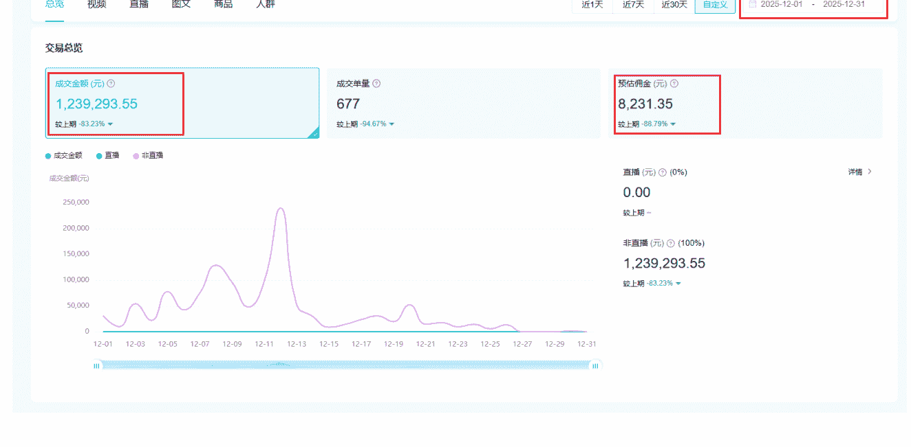
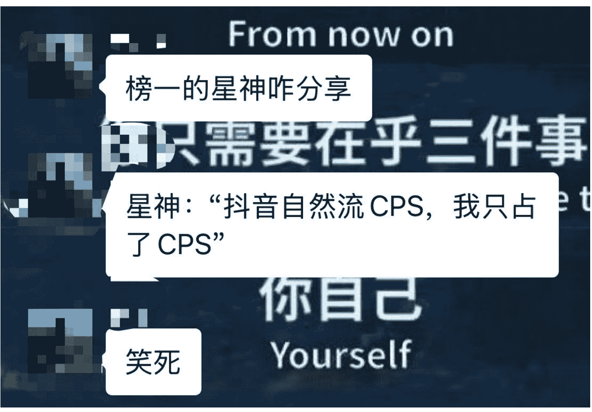
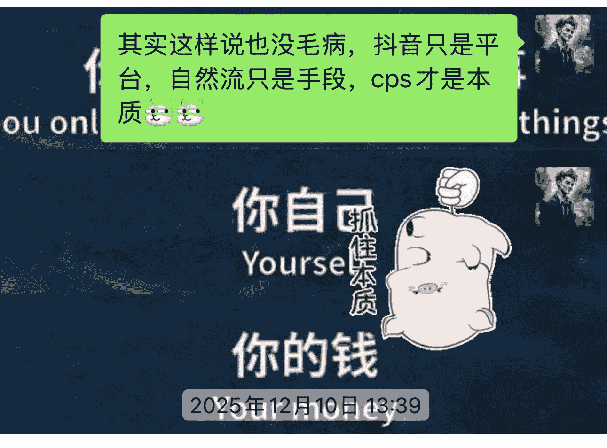
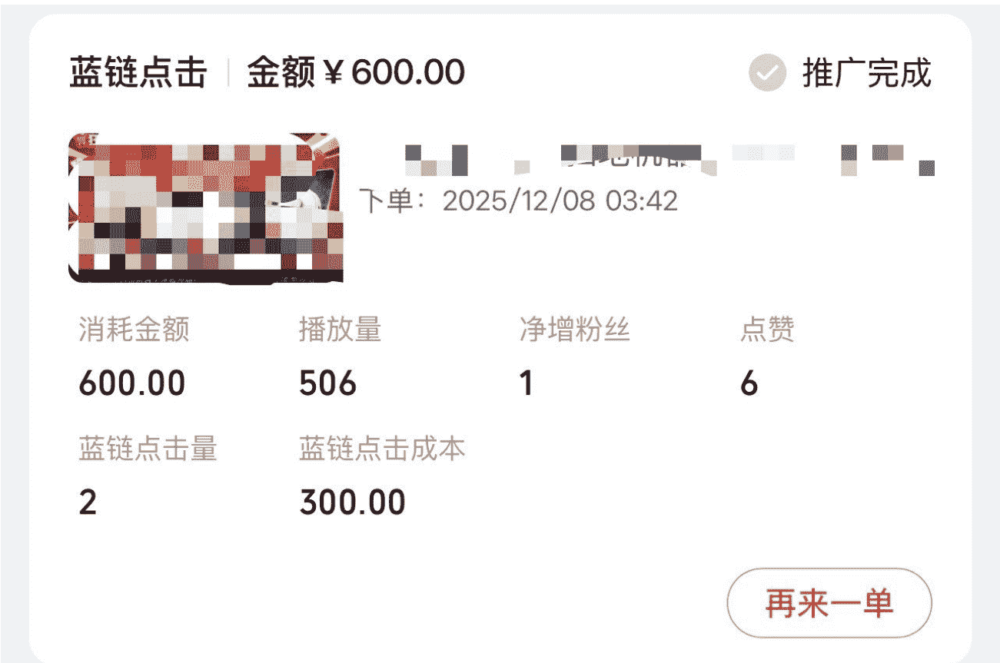
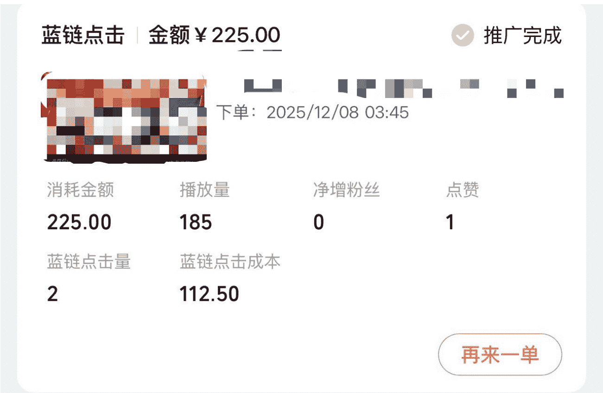
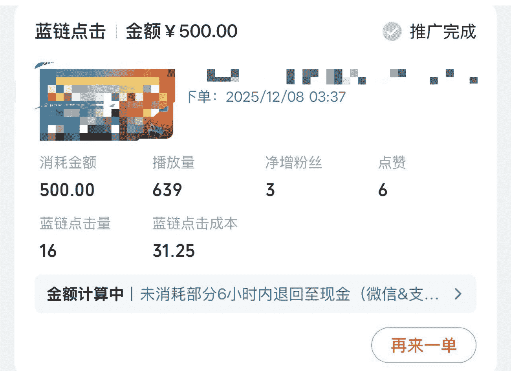
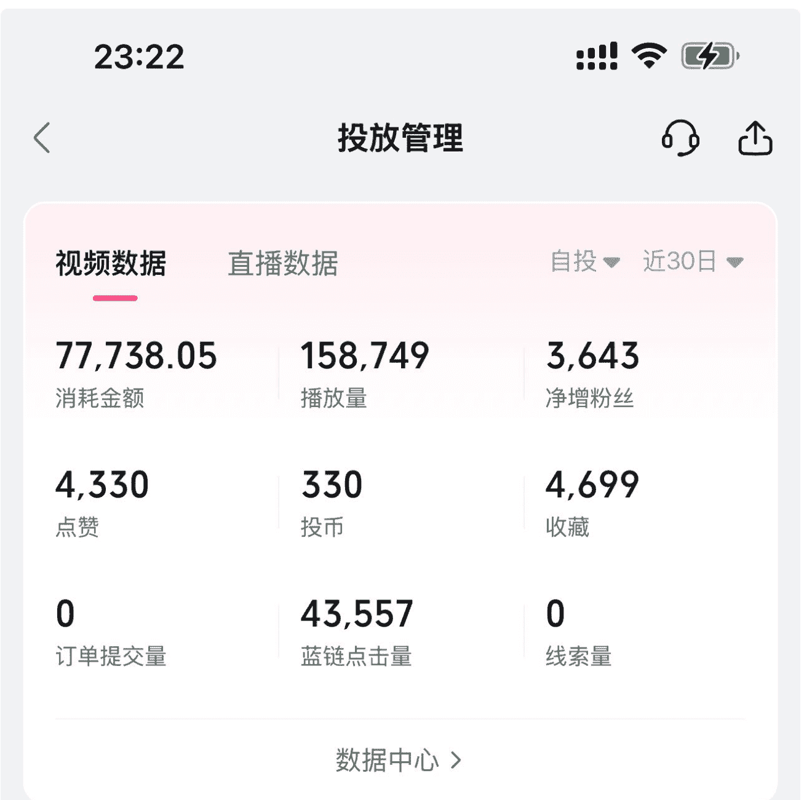
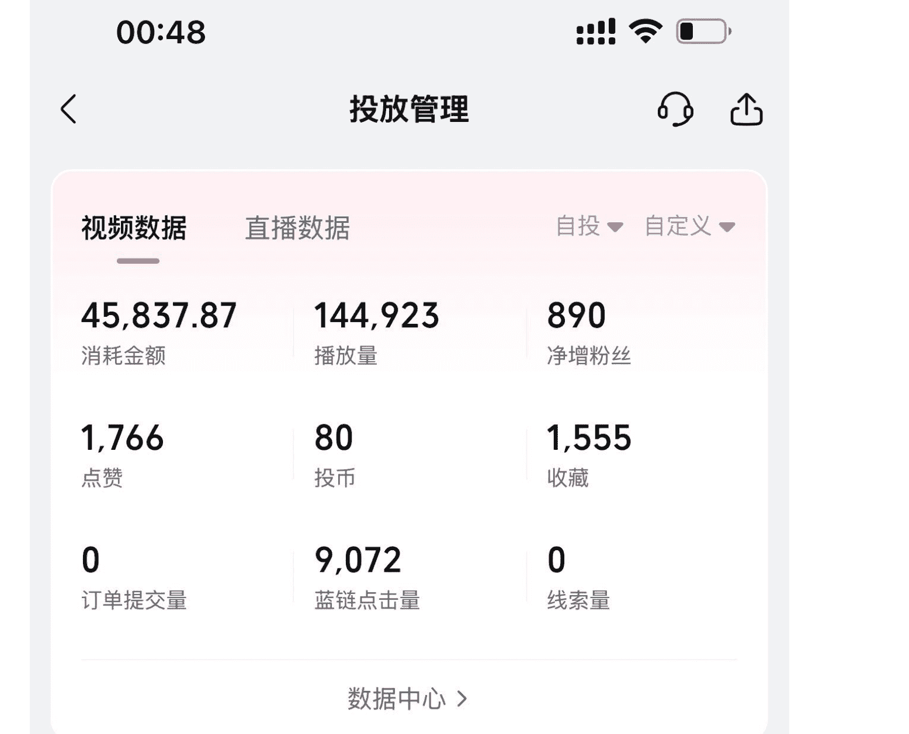
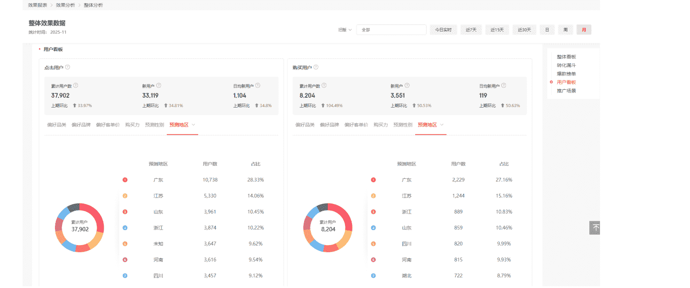

# 抖音自然流 CPS 与 B 站好物投流实战全解析：从 267 万 GMV 到长效增长的底层逻辑

👸号：懒人搜索  

大家好，我是龙哥。

2026年的第一次项目复盘，今天正式和大家见面。

先说说项目进展：2025年12月参与的第二期抖音自然流CPS项目已经结束，第三期目前也在准备中。

正式进入方法拆解前，先把结果摊开来看。这些数字不是包装出来的案例，而是后续经验和判断的实际依据。

## 一、先看结果：一场跨平台投放的成绩单

这次项目的定榜GMV位列第二，奖励佣金则拿到了第一。

具体数据如下：

- 抖音自然流CPS项目定榜GMV：约253万元；
- 12月万单宝密令成交金额：超过267万元；
- B站蓝链成交金额：约123万元；
- 两个平台合计，当月GMV约390万元。

收入方面，佣金和奖励合计47872元，扣除约3.5万元的投放支出后，最终净剩约1万元。

万单宝数据面板显示：

- 有效订单：3651笔；
- 有效订单金额：2676087.12元；
- 预估佣金：24159.08元；
- 已完成订单：3627笔；
- 已完成订单金额：2482789.14元；
- 已完成订单佣金：22222.93元；
- 预估激励：15482.74元；
- 预估总收益：39641.82元。

B站后台统计周期为2025年12月1日至12月31日：

- 成交金额：1239293.55元；
- 成交笔数：677笔；
- 预估佣金：8231.35元。

## 二、先把概念掰开：平台只是载体，成交才是终点

虽然项目名称里写的是“抖音自然流CPS”，但真正做的事情，是围绕CPS展开的一次跨平台付费获客实验。

之前有圈友开玩笑说：“这个项目里，抖音和自然流都只是名称，真正留下的只有CPS。”这句话其实说得很准。

抖音也好，B站也好，只是承接用户注意力的渠道；自然曝光或付费曝光，也只是获取访客的手段。真正决定商业结果的，是能不能稳定完成按成交结算。

因此，做项目时没必要被某个平台或某种流量形式限制住。只要最终目标是提高成交效率，就可以根据实际情况组合不同平台、不同获客方式。

这次我没有把希望放在自然曝光上，而是采用了付费方式获取流量。总投入约3.5万元，最后剩下约1万元利润。

单从财务结果看，这次并不算特别漂亮。双十二期间的优惠环境、红包力度，以及当时的投放安排，都对结果产生了影响。

不过，实战的价值不只体现在利润表上。钱花出去之后，哪些方式有效、哪些路径不成立、什么情况下必须及时切换，这些经验只有真正跑过一遍才会清楚。

项目刚开始的那几天，我还在排行榜前列，也有同学调侃说我“只拿到了CPS”。现在回头看，这个说法确实有几分道理：平台和流量只是工具，成交结算才是核心。

## 三、红包优惠叠加付费曝光：B站项目的主要打法

这次约390万元的GMV，主要来自B站。整体沿用了过去验证过的“红包优惠+付费曝光”思路，只是在双十二场景下进行了重新调整。

此前双十一期间，这套模式曾在23天内做到GMV超过1000万元，并取得约7万元利润。

### 1. 这套模式究竟怎么运转？

可以把它理解成两步：

第一步，用红包优惠降低用户决策门槛，让用户愿意点击、愿意继续了解；

第二步，用付费曝光扩大触达范围，把原本有限的自然访客，扩展到更大规模的潜在人群，最终完成购买。

红包负责制造行动理由，投放负责扩大覆盖面。两者叠加后，才有机会把注意力转成订单。

如果想进一步研究这套方式，可以参考此前整理的《B站好物红包+投流玩法操...-知识星球》。

### 2. 12月项目中遇到的几个变化

#### 红包吸引力有所减弱

双十一期间使用的是力度更大的超级红包，而12月这次的优惠强度明显下降。因此，用户响应和转化表现自然不如前一轮大促。

#### 密令与蓝链：操作路径不同，结果也不同

B站通常存在两条主要成交路径：

- 蓝链：点击后直接进入商品页面，操作较短；
- 密令：用户需要离开当前页面，再搜索并输入指定内容，步骤更多。

按常规理解，蓝链似乎更容易促成购买。但这次的数据并没有完全按照这种直觉发展：密令订单约占三分之二，蓝链约占三分之一。

关键不只在链路本身，还在于内容如何引导用户。

视频里的表达、评论区的说明、置顶内容和反复提醒，都可能改变用户最后采取的动作。用户并不是完全随机行动，内容创作者可以通过设计路径，让用户更倾向于某种操作。

流量定向也是同样的道理。想吸引家电消费人群，就应当在标题、正文、标签和使用场景中持续强化家电信息，让平台更容易识别并分发给相关用户。

#### 投放目标必须随着成本变化而切换

最初，我仍然选择了蓝链点击。

原因很简单：蓝链访客通常更接近购买环节，理论上转化质量更好。但实际运行后发现，这次红包玩法的盈利条件非常苛刻，单次蓝链点击需要低于1元才能维持利润，而真实成本长期超过2元。

继续烧下去，亏损几乎是确定的。所以只试了两天，我就停止了这条路径。

随后改为购买播放曝光。

这种方式单价更低，虽然访客的购买意图不如蓝链强，但总体成本更容易控制，综合下来仍有机会保住利润。

相较于纯自然曝光，付费播放带来的数码和家电人群仍然更集中，消费需求也更明确。这也是本次佣金比例相对较高的两个原因：

1. 密令成交能够获得额外的平台激励；
2. 付费定向带来的用户，比泛自然流量更接近目标消费人群。

这里还要特别说明：本次结果与复杂选品关系不大。主要依靠红包优惠绑定成交行为，选品差异被一定程度弱化，真正需要优化的是访客成本和成交效率。

### 3. 一个代价很高的案例

因为扫地机器人佣金较高，我曾专门制作相关内容，并尝试购买蓝链点击。

结果非常惨：花费600元，只获得2次点击，折算下来每次点击约300元。

如果每个订单都按照这种成本运行，无论预算多大都经不起消耗。

这件事说明，不能把一种投放经验机械套到所有商品上。高客单家电与红包类活动，在用户决策、点击价格和转化周期上完全不是同一套规律。

付费获客一定会经历摸索阶段。更稳妥的做法，是先用小金额测试多个方向，再根据实际数据决定是否扩大投入。

## 四、自然曝光到底有什么用：它是低成本验证工具

在讨论付费获客之前，必须先理解自然曝光的价值。

它不只是省钱，更重要的作用是帮助我们快速判断：哪个主题有人看、哪个表达能引发行动、哪类用户更可能产生购买。

做CPS的朋友，也可以找老胡那篇《没错，直播带货就是社交电商》看看。文章把CPS背后的商业关系讲得比较透，无论做私域还是公域，都有参考价值。

自然曝光和付费曝光，适合承担不同任务：

- 自然曝光：依靠内容获得平台分发，成本低，但波动明显，适合验证内容方向；
- 付费曝光：直接购买触达机会，规模更可控，但对素材质量和数据判断要求更高。

### 1. 短内容不能只负责“让人知道”

如果目标是拿到CPS成交，内容就不能停留在单纯种草。

一条内容需要在很短时间内完成三件事：

- 让用户愿意继续看；
- 让用户相信你说的内容；
- 让用户产生购买理由。

因此，结构更接近一条轻广告，而不是日常记录。

可以参考下面这套顺序：

1. 先抛出具体困扰；
2. 很快呈现解决方式或结果；
3. 用过程、数据、对照、细节或反馈增强可信度；
4. 补充价格、优惠、时效或稀缺理由；
5. 最后把操作路径说清楚，让用户知道下一步该做什么。

### 2. 真正影响传播的，是选题和开头

很多人把精力花在转场、滤镜和剪辑技巧上，但自然曝光能否起量，往往首先取决于以下三点：

#### 目标对象是否足够清晰

不要试图让所有人都感兴趣。比如租房人群的小家电、学生群体的高性价比数码产品，都比泛泛介绍更容易匹配需求。

#### 问题是否足够具体

用户只有在感受到“这正是我的麻烦”时，才会继续往下看。

例如：

- 冬天衣物不容易晾干，如何快速处理？
- 熬夜赶工作时，怎样提升输入效率？

#### 结果是否可被感知

“很好用”“效果不错”都太模糊。换成“3天看到变化”“10秒完成清洁”“续航48小时”这类明确描述，更容易建立预期。

常见的开头方向包括：

- 前后结果展示；
- 打破常规认知；
- 反向提醒和购买避雷；
- 同等效果下的省钱方案。

### 3. 不要押注单条内容

自然分发本身带有随机性，因此更可靠的方式是多做样本，再从数据里筛出有效方向。

同一个商品，至少可以围绕不同问题、不同人群、不同场景和不同呈现方式制作10至30个版本。

此外，还可以只替换封面和前几秒内容。很多时候，后半段并没有变化，结果差异却来自最初几秒的表达。

### 4. 判断内容是否值得继续加码

建议重点观察：

- 看完比例；
- 开头阶段的留存；
- 评论、收藏和转发情况；
- 评论里是否出现“链接在哪”“已经买了”“多少钱”“去哪买”等主动询问；
- 商品入口点击率；
- 引入访客数量；
- 最终是否真的产生订单。

最后一项永远最重要：有流量不等于有生意。

如果自然曝光阶段都无法产生成交，贸然增加预算，通常只会把损失扩大。

## 五、付费曝光：不是买运气，而是放大已验证的内容

付费的正确理解，不是随便找一条内容交给平台，而是把已经证明能够带来成交的内容，推向更多相似用户。

它能够带来相对可控的触达规模，但前提是内容本身已经具备转化能力。

### 1. 花钱前先做三项检查

**第一，先看是否有真实成交。**  
没有成交记录的内容，不适合直接大额投放。

**第二，先测盈利线。**  
用少量预算试出点击或访客成本，明确每种目标在什么价格范围内仍然能赚钱。

**第三，把售后风险算进去。**  
退款、退货和未完成订单都会影响最终收入，计算时必须预留空间。

### 2. 四个阶段的投放节奏

#### 探索阶段

预算不要太大，可以同时测试多个内容、多个定向和多种表达方式。这个阶段的任务是找出有效组合，而不是马上追求规模。

#### 验证阶段

筛出成本和成交都相对稳定的内容，将其作为主要投放对象，同时准备相近主题的新版本，避免过早出现疲劳。

#### 扩量阶段

预算要逐步增加。一次性大幅提高，可能干扰平台重新学习，导致原本稳定的数据波动。

真正需要放大的，是内容与受众之间的匹配关系，而不是单纯把整个账号的预算拉高。

#### 稳定阶段

持续更新内容是基本功。旧内容随着时间推移出现点击减少、成交变少、成本上涨，都属于衰退信号。

### 3. 把内容生产变成流水线

不要把投放素材完全寄托在临场灵感上。

围绕同一核心利益点，可以延展出：

- 前后效果展示；
- 实际体验测评；
- 具体使用场景；
- 购买提醒；
- 商品清单；
- 直接讲解。

同一主题也能更换人物设定、表达语气和镜头节拍。

这样做的目的，是让账号始终有新内容接替老内容，而不是等某条素材失效后才临时补救。

### 4. 三个容易忽略的投放规律

**投放反馈存在延迟。**  
通常需要等待约3天才能看出完整结果。如果连续几天都没有有效回报，就要检查内容或策略，而不是继续增加预算。

**老内容的获客价格往往会变高。**  
这是用户审美疲劳和受众消耗带来的正常变化。发现成本持续上升后，应及时换新内容。

**每次投放都要留下复盘记录。**  
把表现较好的内容拆开看：它的标题怎样写、开头如何处理、面向哪类人群、使用了什么场景。只有把这些因素记录下来，后续才能稳定复制。

## 六、小额付费与自然曝光，可以组成循环

比较理想的增长方式，并不是只依赖自然分发，也不是一开始就重金购买流量，而是让两者互相提供反馈。

完整流程可以这样理解：

1. 先用自然曝光寻找有效的主题、脚本和受众；
2. 再用少量预算把已出现信号的内容推给更多人；
3. 根据付费阶段的数据，反过来调整后续自然内容；
4. 把表现稳定的内容总结为可重复使用的表达框架。

这里最值得记住的一句话是：找到一个有效框架后，围绕它反复生产，而不是每次都从零创作。

在B站，优质内容的生命周期可能达到两个月甚至更长。等到投入产出开始明显下降，再去寻找下一套表达方式，形成“验证—复用—衰退—更新”的循环。

## 七、B站投放时，先根据目的选指标

最后说一下不同投放目标的选择。

### 如果目标是卖货并获取佣金

优先考虑蓝链点击。

按照B站必火的官方说明，这类投放会综合识别三种人：

- 对视频主题有兴趣的人；
- 对相关商品有兴趣的人；
- 本身更可能点击商品入口的人。

所以它的访客质量通常较高。只要点击价格能够压在可盈利范围内，适合直接追求成交。

### 如果目标是沉淀私域用户

可以考虑粉丝增长。

先用预算积累关注，再通过社群、内容和后续运营完成长期转化。

### 播放和互动适合做辅助验证

播放、点赞、评论等指标能够帮助观察内容反馈，但如果最终任务是成交，它们通常不如商品入口点击或粉丝增长直接。

所以，投放前一定要先问清楚：我现在要的是订单、粉丝，还是单纯的数据表现？目标不同，选择就不同。

这就是本次复盘的完整内容：从267万元级别的成交数据出发，拆解红包优惠、内容验证、付费放量和长期迭代之间的关系。

相关数据可以自行下载研究，也可以交给AI辅助整理。希望这份复盘能帮助大家少走弯路，把每一笔预算都花在更接近结果的地方。

👸号：懒人搜索  

B站的商业化流量，并不是简单地把内容展示给更多人。一次投放能否带来成交，关键在于系统会怎样理解你的目标。

据我向平台相关人士了解，如果推广目标指向蓝链，分发系统通常会综合判断三类信号：用户是否喜欢这类内容、是否可能对链接里的商品产生兴趣，以及是否具备进一步点击的倾向。换句话说，内容偏好、商品需求和行动意愿会被放在一起评估，因此蓝链推广往往比单纯追求播放量更接近成交结果。对于靠交易佣金盈利的人来说，只要把获客成本压在合理范围内，这通常是优先级较高的选择。至于播放、互动、涨粉等目标，也可以按照同样的思路去理解。

### 投放目标怎么选

如果最终目的是带来订单和佣金，建议先围绕“蓝链点击”展开测试。播放量、评论量、点赞量或粉丝增长，未必能直接对应收入；相比之下，用户主动触碰商品链接，距离成交更近。

具体操作可以分成两步：

第一步，用常规的蓝链点击方案测试一条内容，先得到这条视频的大致点击获客价。

第二步，如果测出来的价格仍有利润，就在“放心投”中设置一个略低的目标价，再逐步扩大消耗。这样做的好处是，预算边界在投放前基本就能估算出来，不必等整轮活动结束后才知道结果。

如果希望在促销节点迅速聚集访问量，也要提前安排预算。比如活动在晚上8点启动，可以在17点30分左右投放300元、持续6小时的蓝链点击计划。若预算在较短时间内快速消耗，就继续补充计划，让高峰时段保持流量供应。

### 人群设置：精准，但不要锁死

具备消费能力的用户，通常需要先排除18岁以下群体。地域方面，可以优先考虑经济活跃地区；性别选项则可先测试男性人群。这里有一套根据历史投放结果和京东联盟点击、成交数据整理出的参考组合：

- 年龄：18—24岁、25—30岁、31岁以上；
- 兴趣方向：游戏、知识、科技、生活、时尚、娱乐、付费内容、美食、汽车、运动；
- 行业潜在人群：初始阶段不做限制；
- 地域：广东、江苏、浙江、山东、四川、河南、湖北、北京、上海。

UP主粉丝定向可以从以下账号池中挑选：

老师好我叫何同学、极客湾Geekerwan、小白测评、科技美学、硬件茶谈、苏星河牛通、大狸子切切里、笔吧评测室、阿狸不是受、钟文泽、开箱嘤嘤怪、韭菜实验室、Mr迷瞪、Wilson学长、搞机所、超能搞机、大物是也、逆狱、影视飓风、野生的装机宅、家电侦探平雪、Super好价君、夏南去哪里呢、评测臻选、好屏如潮、远古时代装机猿、电锯爷、究极测试、大康评测、斤斤计较的包子、装机侠林BB、古一搞机研究所、单毅讲装修、船长总动员、幽灵高端电竞装机、至尊定制、谜之Helen、彪哥椅子评测、闲聊数码站、myimmortal（可用UID 917142检索）、陶阳家电实验室、先看评测、不寻常手机测评、蒙面it侠、大白讲数码、Flash闪电竞、短的发布会、歪设长、爱唱歌的信、超能测评Ultra。

职业和商品标签还可以继续试验，例如学生、白领、普通职员、个体经营或服务行业人员、教师、公务员、事业单位人员；品类则可观察电脑办公、手机、数码、外卖、家庭清洁及纸品、家电等方向。

需要注意的是，定向不是越窄越好。范围收得过紧，往往会推高获客价格。真正的优化目标，是在足够覆盖的基础上，让每次进入的用户更有可能完成购买。人群包应随着后续的投放和成交数据持续迭代，而不是一次设置后长期不动。

### 实战结果与平台阶段性机会

上面的三组资料分别对应双11投放、12月投放，以及京东联盟11月的点击与购买分析。

平台当时提供了按消耗返还的激励：完成规定金额后，部分费用会以券的形式返回。双11期间投放金额较高，因此拿到了较多返还；双12的实际折扣约为七折。也就是说，虽然报表显示支出约4.5万元，折算优惠后，真实投入大约在3.5万元左右。

这项活动目前仍在进行。按照现阶段的实操反馈，平台付费流量仍有窗口期。如果手里已经验证出转化能力较强的素材，可以考虑进一步增加预算，甚至进行更大范围的覆盖。

还有一点很重要：一条内容如果已经通过免费流量验证了盈利能力，就不要永远停留在自然分发阶段。免费流量的上限客观存在，而付费推广提供了把有效内容复制到更大规模的机会。前提当然是先算清利润和成本，而不是盲目花钱。

## 长期经营：先选赛道，再谈放大

CPS业务不能只看眼前的成交额。真正要建立长期收益，还需要同时考虑商品结构、内容方向和后续扩张方式。

### 品类怎么选

B站的数码家电用户相对集中，这是一个明显优势，但“数码”和“家电”不能混为一谈。

数码产品讨论热度高，潜在购买者也多，可是普遍存在分成偏低的问题。再受京东“0.01”相关情况影响，部分商品的收益进一步缩水。这个方向并非完全不能做，只是利润空间比较有限。

家电的分成水平通常更有吸引力。如果已经开通了部分定向佣金，同一笔家电成交可能抵得上多笔数码订单。从长期经营角度看，家电更适合作为重点方向。

还可以避开大而杂的竞争，转向更具体的商品线，例如扫地机器人、人体工学椅、电视、冰箱、空气净化器等。围绕某一个细分品类持续积累内容、选品和用户认知，更容易形成优势。

美妆则值得用较小预算进行探索。部分美妆商品的分成甚至高于家电，而平台上专门深耕这一方向的账号相对有限。它是否能成为真正的蓝海，还需要更多案例验证，但具备测试价值。

### 从小规模走向放大

当基础闭环已经跑通后，规模增长大致有几条路径：

1. **账号矩阵**：运营多个账号，覆盖不同内容主题和用户层；
2. **专业分工**：把脚本、拍摄、剪辑、推广、数据复核、客服售后等工作交给不同角色；
3. **工具辅助**：让智能工具参与选题、脚本整理、文案调整、剪辑提速、受众分析和结果复核，减少重复劳动；
4. **预算扩张**：把已经验证有效的内容持续复制，并根据收益情况逐步提高投入。

但如果还在从0到1的阶段，不建议一上来就追求矩阵、团队和大预算。更重要的任务是：

- 把内容方向打磨出来，找到稳定有效的表达方式；
- 将制作、测试、推广和复盘整理成可重复执行的流程；
- 把高表现脚本、有效商品、学习资料和推广经验保存下来，形成自己的资料库。

等完整链路已经能够稳定运转，再选择适合自己的扩张方式，成功率会更高。

## 2026年CPS仍值得做吗？

我的判断是：值得。

CPS按照实际成交结算，前期风险相对可控，收入路径也比较清楚。随着内容平台的分发机制不断成熟，免费流量和商业流量依然存在优化空间。真正的竞争，不只是“能不能做”，而是能否持续提高选品、内容、转化和投放效率。

没有清晰方向时，先保持规律更新。固定时间发布、持续积累内容，比频繁焦虑和反复换赛道更有价值。很多结果并不是一开始就看得见，而是在不断执行中逐渐形成。

- **保持节奏**：持续发布，积累账号信任与内容资产；
- **尊重周期**：不要把一天的产出看得过重，也不要低估长期坚持带来的复利；
- **坚持建设能力**：围绕商品、内容和推广持续优化，慢慢建立别人难以复制的优势。

最后，推荐一下小懒的付费群：

📖 这里是你对抗信息过载的护城河。

已稳定运行 7 年，累计拆解、研读3000+ 个互联网商业实战案例与行业前沿内参和时政/宏观文章。

我们不搬运垃圾，只做高价值信息的筛选器与放大镜。

