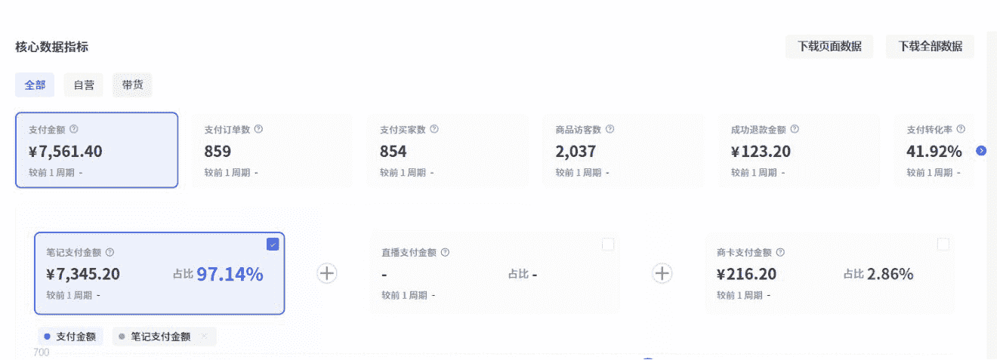
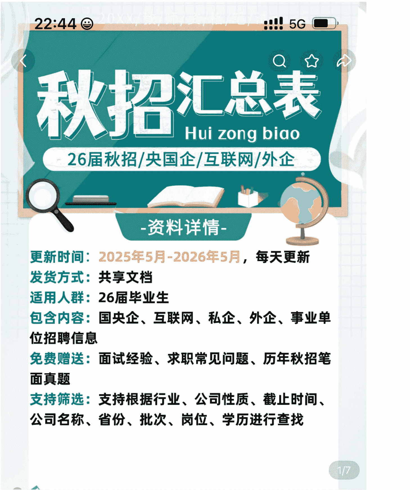

# 3个月跑出1万单：一个人做虚拟资料店铺的实战复盘

# 260120 副业 SC 精华

公众号懒人搜索，懒人专属群独享

懒人微信：lazyhelper1

大家好，我是小加里奥，目前是一名即将毕业的大四学生，加入赚钱大约一年半。过去一段时间，我主要尝试小红书电商和虚拟产品，累计成交约3万单。

这次受鱼丸和小武老师邀请，和大家聊聊我做虚拟资料店铺的一些经历。

我从大二开始接触小红书，中间断断续续做了一年多。直到今年9月进入虚拟电商领域，连续3个月做到1万单，GMV超过10万元。

这些成绩并不算多么耀眼，但一路走来踩过不少坑。临近毕业，我也正在经历从“学生状态”切换到“创业者状态”的过程。借着小红书航海家大会的机会，想把自己在虚拟资料垂直店铺中的实践、教训和思考完整整理出来。

下面是我两个账号单月的GMV表现。

| 核心数据指标 | 下载页面数据 | 下载全部数据 |
| :--- | :--- | :--- |
| 全部 | 自营 | 带货 |
| 支付金额 | 支付单数 | 支付 | 商品访客数 | 成功退款金额 | 支付转化率 |
| ￥57,108.20 | 较前1周期 +411.10% | 395.30% | 18,387 | ￥737.40 | 32.68% |
| 较前1周期 +343.39% | 较前1周期 +115.03% | 较前1周期 +80.38% | 较前1周期 +130 | | |

## 一、想把虚拟资料店铺做起来，最关键的是哪些动作？

### 1. 先选赛道：既要有想象空间，也要具备一定认知

所谓垂直赛道，就是账号长期围绕一个明确方向做产品。可以在这个方向里持续测试不同商品，跑出爆款后，再继续拓展相邻品类。

所以，赛道选得对不对，会直接影响后面的上限。

刚开始不知道做什么时，可以先“广泛搜索，再严格筛选”。在赚钱、小红书站内搜索，或者借助第三方数据工具，重点寻找近三个月销量较高、近期仍有加购表现的产品，再顺着这些产品去挖掘背后的细分领域。

当你筛出大约10个候选赛道后，可以从三个角度判断：

**第一，看用户是否匹配。**  
这个赛道里的热门商品，是否符合小红书的主要消费人群，尤其是年轻女性和追求效率、品质的用户。

**第二，看爆款是否有持续性。**  
不要只看某一个商品有没有爆过，更要判断这个赛道能不能在季度甚至每月持续出现高销量产品。哪怕是多个链接共同贡献，也要保证不同阶段都有商品承接需求。

**第三，看产品能不能做。**  
商品是从其他平台采购的，还是由AI辅助生成，或者来自垂直领域博主的原创？你是否有能力做出相近质量的产品？

新手可以优先选择自己较熟悉的方向，但“熟悉”不能成为唯一标准。赛道的利润空间和增长上限，应该放在更重要的位置。

### 2. 选品与测品：不要只等一个品，关键节点要集中突破

赛道确定后，就进入具体的选品和测试环节。

对新手来说，前期跟随已有市场验证的产品，通常更容易获得反馈。可以重点关注近24小时持续加购的商品，或者过去一两个月表现明显的品类。

同时，建议不要只押注一个商品。单品的流量很容易波动，而在同一垂直赛道内同时测试多个产品，并不会明显扰乱账号标签。

举个例子，如果做大学生相关资料，并且从8月份开始布局，我可能会这样搭配：

- 开学阶段急需的PPT模板；
- 两个月后会集中产生需求的四六级资料；
- 学期内持续存在需求的创新创业大赛计划书。

这种组合可以覆盖即时需求、阶段性需求和长期需求，提高整体跑通的概率。

下面是几类不太建议新手直接做的商品和账号模式：

- **第一，直接搬运大博主原创资料。**  
  几千粉、上万粉博主的原创内容，通常很容易被识别，后续还可能引发版权或纠纷问题。

- **第二，照搬低价红海产品。**  
  既没有明显差异，又缺乏利润空间，通常很难获得稳定流量。

- **第三，需要较强专业能力才能判断质量的商品。**  
  如果自己无法识别AI生成内容是否可靠，容易引发退款和差评。

- **第四，原样复制引流型笔记对应的商品。**  
  引流笔记和商品销售笔记往往处在不同流量环境中，吸引来的用户未必是真实购买人群。

- **第五，批量从淘宝搬几百个商品。**  
  直接用商品详情页首图做内容，既缺少信息增量，也容易给用户留下低质、敷衍的印象。随着平台红利减弱，这种模式越来越难获得流量。

账号基础状态稳定后，可以围绕每个商品每天发布约4篇笔记，尽量保持每小时一篇的节奏。内容上参考近期以及去年同期的爆款结构，但不要简单复制。

前10天不要频繁换品。一方面，虚拟资料的起量时间往往比想象中更长；另一方面，前人已经跑出来的内容模板需要经过充分测试，太早放弃，很容易错过后续反馈。

### 我的测品节奏，大致是这样的

**第一步：一个模板出单后，马上扩展相近版本。**  
如果某种内容结构产生订单，可以迅速制作3个相似但不完全相同的模板继续测试。

**第二步：提前15天左右有需求的商品，要给它足够时间。**  
如果一个预计15天后进入需求期的产品，连续测试约10天后已经成交10单以上，就不要轻易停掉。很多商品会在需求真正集中爆发的当天，甚至需求期结束前后突然放量。

如果持续发布后仍然没有明显点击，或者只零星成交一两单，则可以降低该商品的发布频率，换入其他产品测试，必要时直接停止。

**第三步：距离需求期30—60天的刚需产品，要看历史天花板。**  
这类商品可以持续埋关键词、测试不同爆款模板，但前提是往年GMV最好达到10万元以上。同时还要研究同行的产品结构，不断补齐自己的内容和服务。

当一篇笔记开始出现明显爆款迹象，已经成交几十单，或者小眼睛达到几百、上千，就要立即重点处理：

- 把评论区里有说服力的正向反馈补充到10条以上；
- 适时加入付费投流；
- 让其他账号同步批量制作相关内容；
- 尽可能提高发布速度，争取在竞争者反应之前吃到更多流量。

持续时间可以根据需求周期调整，直到需求期结束或整体流量明显下滑。

### 3. 做深垂直赛道：不要只吃一个爆款，要把相关机会全部挖出来

当账号经过一两个月跑出爆款，或者已经能够稳定产出爆款笔记时，就可以开始横向延展。

可以开新店、增加子账号，也可以围绕原赛道扩充更多相关产品，进一步放大利润。

一个实用的方法是，找出10个同赛道的优秀账号，仔细翻看他们过去的内容，重点寻找去年同期表现较好的商品，整理到备忘录里，再逐步上架和测试。

日常也要保持对赛道的观察，每天至少花1小时浏览相关笔记。看到新产品出现明显加购或讨论热度，尤其是距离需求期还有15天左右时，可以迅速跟进。

当然，现在很多商品涉及版权，或者本身由AI辅助制作，跟品时不能完全照搬。要么重新设计内容，要么用AI做出同类型但有差异的产品。

通过持续观察、及时跟进和矩阵化铺设，才能尽量不漏掉赛道中出现的机会，把一整年的利润空间吃得更完整。

## 二、我在过程中踩过的几个坑

### 1. 低价竞争，最后往往忙得多、赚得少

我认为，虚拟项目里最容易把人带偏的就是价格战。

我的第一个产品售价只有2.88元。因为当时主要依赖Word截图制作笔记，我连续手工做了一个月，每天都在重复操作，手机屏幕上全是手汗和油渍。总共发了200篇左右，最后利润刚过2000元。

投入的时间和精力，完全不匹配最终收益。

虚拟资料本身客单价就不高，常见价格大约在9.9元左右。经过反复降价，最后被压到2—3元，不仅会影响原本正常定价的商家，即使低价商品成功起量，利润也依然很薄。

更何况，如今单个商品稳定做到万单，并不是一件高概率事件。

想避开低价内卷，我认为可以从两个方面入手：

**一是提升内容质量。**  
通过更有差异化的图文内容，提高账号权重和爆文概率。

**二是打造产品差异。**  
利用AI、重新设计结构、优化使用体验等方式，让商品和同类产品拉开距离。很多时候，哪怕只是一个小改动，也足以让用户产生新鲜感，从而守住利润。

### 2. 三天两头换品，往往不是策略，而是没有耐心

很多人都会经历这个阶段：发了几篇笔记，看到小眼睛不多、没有订单，就马上更换商品，甚至直接换赛道。

我之前也经常这样做。结果一个月后发现，别人竟然把当初我放弃的相似产品做爆了，心里非常后悔。

小红书虚拟电商的起号周期，并不会因为商品是虚拟的就变得特别短。相较于实物内容，它同样需要时间积累和反复测试。

真正解决这个问题，首先要从筛品环节下功夫。

无论是自研产品还是跟随市场，前期都要认真判断，尤其要优先选择具备明确硬需求的商品。

什么叫硬需求？

就是每年都会固定发生，并且大量人都绕不开的事情，例如秋招、毕业答辩、四六级考试等。

先确认需求一定存在，再看往年数据。新手最好优先选择有商品链接、同行历史GMV超过10万元的品类。

不要被单纯的高赞引流笔记迷惑。它们可以用来参考产品结构，但不能直接代表商品具备销售潜力。

比如某些小学语文资料，笔记可能有上千点赞，评论区也挂了商品链接，但最终销量并不高。原因在于，这类内容并不是每个孩子都必须使用，学校也可能提供类似材料，很多家长甚至不清楚具体用途。

而秋招信息表、求职投递工具就不同了。秋招是大多数大学生都要经历的阶段，产品又能直接解决实际问题，因此更容易形成稳定购买需求。

### 四上最难的《语文园地》我强制我班学生全部吃透 考试没有丢分的

### 四上语文最难的《语文园地》吃透稳上90+

#家长收藏孩子受益 #四年级 #四年级上册语文 #小学语文怎么学 #语文知识点 #小学语文基础知识 #课文重点 #四年级语文 #知识点总结 #语文园地

文件 | 四年级语文上册...单元检测).pdf

¥19.9

已售6212

### 26届秋招信息表（赠历年校招题库）

400+人好评 1000+人加购 200+人收藏

- 平均2小时发货 | 承诺24小时内发货，晚发必赔 黑龙江哈尔滨 包邮

- 退货包运费 | 不支持无理由退换 | 晚发必赔

- 已选：26届秋招信息汇总表（一杯奶茶钱）

店铺 客服 购物车(39) 加入购物车 立即购买

### 网申投简历神器

还在为网申填简历崩溃吗？海投上百家，每家简历都要手动重填？格式五花八门，信息复制粘贴到手抽筋？担心手滑填错关键信息痛失机会？

一键解放双手！我的网申填表神器只需上传你的信息模板（我提供。）精准提取关键信息。一键填充需要填写的地方、告别复制粘贴噩梦！

兼容智联、前程无忧、BOSS直聘、实习僧、央国企及民企官网，覆盖10000家企业，求职快人一步！

支持苹果、win系统chrome or edge 浏览器使用

秋招在即，告别低效重复劳动，把时间留给重要的事

¥15.9到手价￥9.9

限时立减6元

秋招网申填写插件资料包4.0最新版（即将涨价）国企银行网申均可

300+人好评

付款后自动发货

不支持无理由退换

小熊你在干嘛呀

没开玩笑，直接2倍速秋招了好嘛都来买please中国人不骗中国人

巴啦啦能量

所以，选好商品之后，最重要的是坚持执行。可以同时测试多个品来分散风险，但不要因为短期没数据就轻易退出。

选品阶段多投入一些判断，后面的运营成本往往会下降很多。

### 3. 只顾发笔记，却忽略了商品和内容的细节

我前期最大的偏差，是把大量精力放在持续发布笔记上，却忽视了商品链接、评价和笔记互动等环节。

但在竞争激烈的环境里，细节往往就是转化差距。

商品确定后，可以根据实际情况完善基础销量和评价，例如将商品销量补到50—100单，竞争特别激烈的品类可以提高到1000单左右。同时准备4条左右带图好评，再配合6条左右文字评价，增强用户信任。

如果某篇笔记在24小时内的流速明显高于其他内容，可以适当增加5个点赞、3条左右评论，进一步提高互动数据。评论区也需要及时维护，处理负面内容和无效拼单信息。

如果爆款笔记的流量下降超过一半，可以根据情况补充数据，尝试延长内容生命周期。

新产生订单的笔记，也要及时加入投流计划，持续调整出价和投放方式。

这些动作看起来很小，却可能直接影响一篇内容的持续周期，甚至让整体GMV出现明显差异。

## 最后的一些想法

虽然我做小红书电商只有一年左右，但这一年里，平台已经发生了很大变化。

从早期混剪内容的快速爆发，到流量逐渐向高质量图文倾斜，我这个新手也曾经迷茫过。去年夏天，我有很长一段时间沉迷动漫和游戏，后来才重新回到业务上，靠虚拟垂直店铺找到突破口。

我很庆幸自己没有提前离场。

虚拟店铺的这段经历，也让我对未来重新做实物电商有了不少新的理解。它确实是一门值得研究的生意，但前提是要持续适应平台规则和用户变化。

对创业者来说，穿越周期、及时调整、不断寻找新的增长点，本身就是必须掌握的能力。

在几组账号跑通之后，我对选赛道、定产品和打爆款的底层逻辑有了更清晰的认识。但单兵作战的时间始终有限，再加上自己有熬夜习惯，即使每天都尽力提高效率，仍然很难继续放大规模。

所以我接下来的计划，是逐步释放一部分执行工作，适当招募店铺主理人，把更多精力放在赛道判断、产品规划和关键决策上。

最后送给大家一句话：

**想法永远只是起点，行动才会给出答案。不断突破当前的能力边界，你能看到的世界，也会越来越大。**

最后，安利小懒的付费群：

### 懒人专属群（介绍）

微信：lazyhelper1

> 📖 这里是你对抗信息过载的护城河。

已稳定运行 7 年，累计拆解、研读 3000+ 个互联网商业实战案例与行业前沿内参和时政/宏观文章。

### 我们不搬运垃圾，只做高价值信息的筛选器与放大镜。

### 懒人专属群更新记录：

https://hk57gvIx7u.feishu.cn/docx/H0kRdZbSbolBR0xkaXtcuVEOnTg

【免责声明】本资料归档于社群内部知识库，仅供成员课题研究与学术交流，请在查阅后 24 小时内删除。