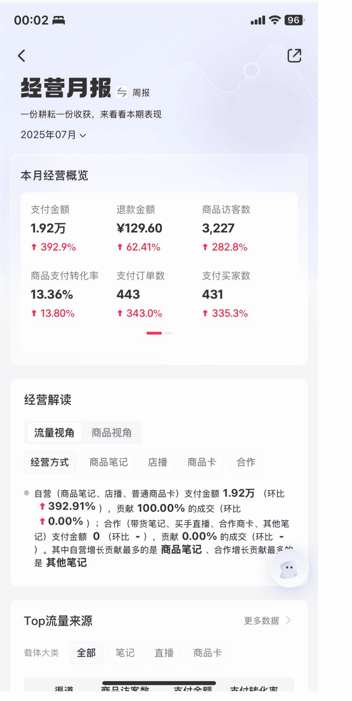
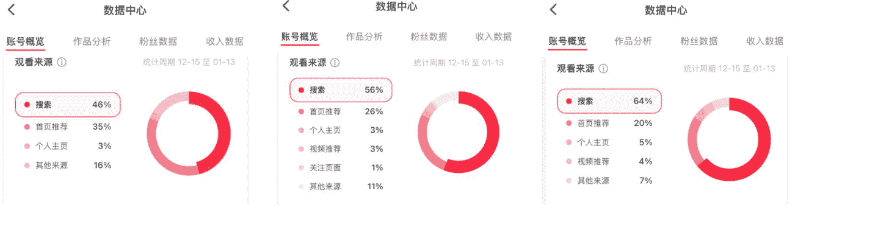
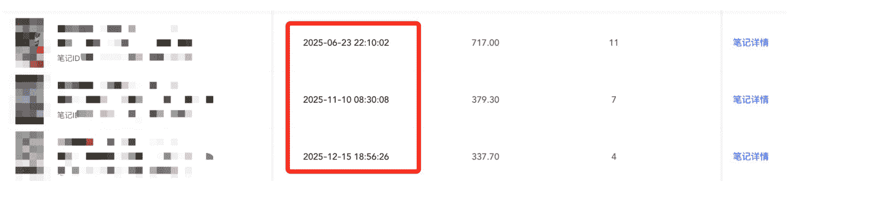
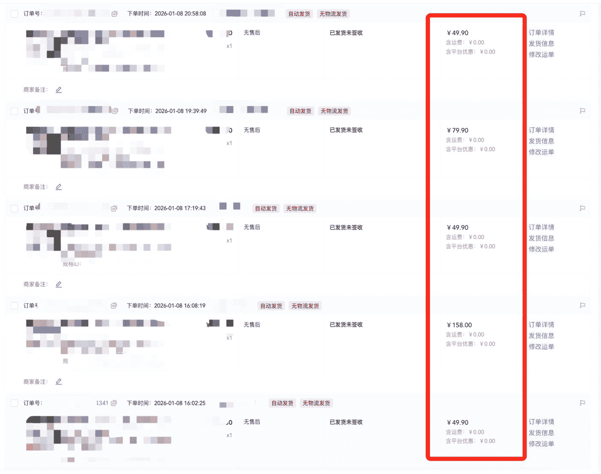
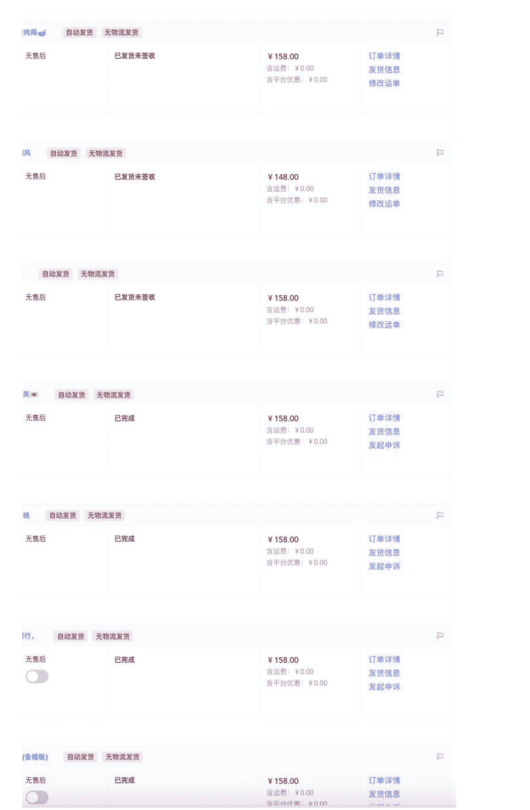
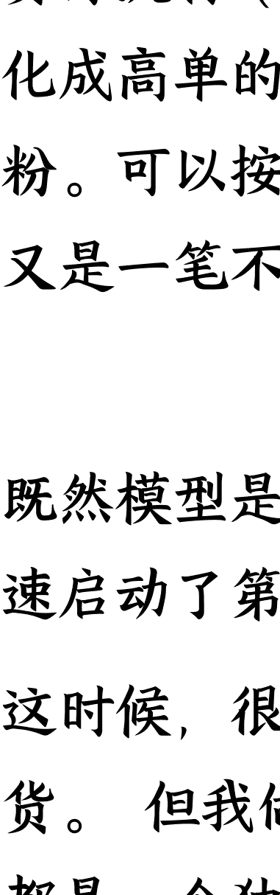
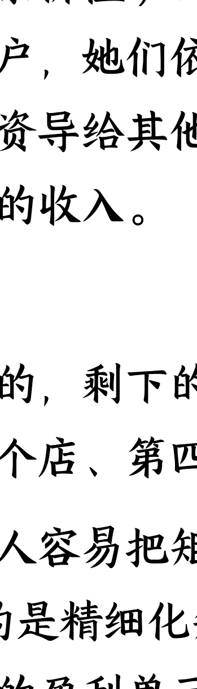
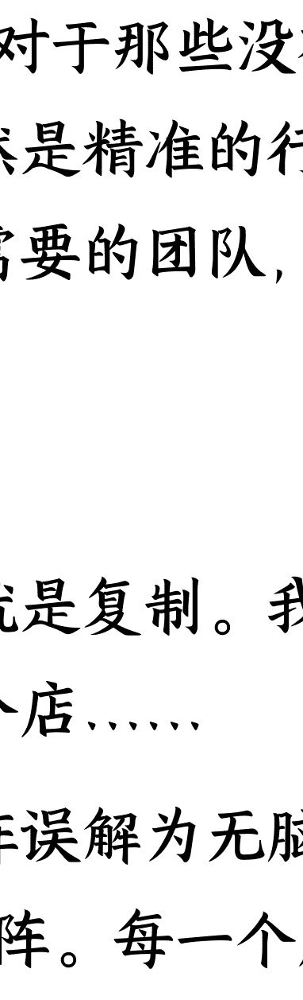
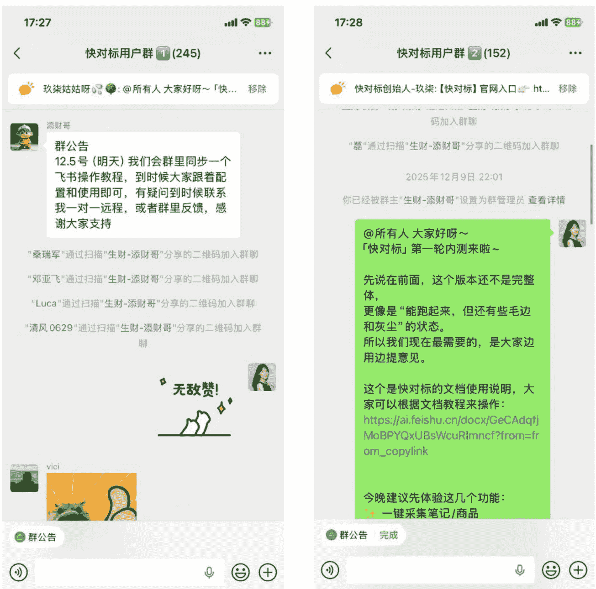

# 别再卷9.9！我用 AI 做原创高客单虚拟产品，复制出单店月利润过万的矩阵打法

260120 副业 SC 精华

👸号懒人搜索，懒人专属群独享

懒人微信：lazyhelperl

## 前言：环境切换，心力被点燃

看了一眼时间，23:58。

联合办公的灯还亮着，工位上还有几位同路人没走。键盘声和低声复盘的声音混在一起。

这是我入驻赚钱杭州联合办公的第77天。

若没过来，我大概还在深圳守着老摊子。也能赚点钱，日子平平，可绝对没有现在这种被推着往前冲的状态。

过去的状态与其说是卡住，不如说是憋着。像车陷进泥里，油门踩到底，发动机在吼，轮子空转，车身纹丝不动。力气都用上了，就是找不到发力的支点。

我从2025年6月中旬切入📕虚拟赛道。

和市面上铺量卖几块钱资料包不同，我走的是 AI 驱动、垂类原创、精细化运营。项目上线第一个月，靠纯自然流，单店净利润就做到2万左右。

对个体来说是体面的开局。可数字背后，是心力在一点点被掏空。

起盘容易，盘住难。重复的打磨、发帖、回聊把人磨钝；流量一波动，情绪跟着起伏。这种不稳让我清楚：单兵作战可以试水，走不远。我需要外部的推力。

为找解法我来了。回看这两个多月，不只是深圳到杭州的搬家，更是头脑的重启。

在此我治好了内耗，找回战斗节奏，同步操盘多个店铺，客单价提升了约3倍。更关键的是认识了技术合伙人@添财哥，跑通了自己的 AI 自动化工具闭环。在@许老师的点拨下，10倍增长的路径更清晰了。

这篇想把这两个月的真实体感摊开聊：环境与心力、流量变现、试错成本、合伙杠杆。

## 一、单兵困局：隐形天花板

在家独站，最大的消耗是心力。

6月起盘时我很兴奋。AI加行业经验做出第一款原创虚拟产品，成就感满满。首月利润2万，验证了方向。那时我以为复制很简单。

很快低估了长期单打的磨损。

原计划8月推新品开二店，结果二店进度整整停滞一个月多。每天做图写笔记回私信，没人交流，工作生活边界消失，进入高强度的孤独。

消耗是静默的，却致命：

早上 起床知道该推进新品，脑子清楚，身体却起不来。

白天 面对电脑，看似在忙，思维游离，断断续续。

晚上 看着不动的进度条，又焦虑又自责，掉进焦虑-拖延-更焦虑的循环。

手里握着赚钱的地图，就是迈不动步。

我意识到不是能力不行，是场不对。人是环境产物。在家对抗惰性要耗费极大意志，我需要一个能把意志省下来干事的气场。

看到赚钱杭州联合办公2期招募，我直接订了机票。现在看，这是2025年ROI最高的一次战略决策。

## 二、破圈：换个场，效率回来了

到第二天我就认定来对了。这里的人都在真干，吃饭聊天都是项目、流量、变现。氛围做不出来，旁边都在拼，你自然被带起来。

### 一颗定心丸

第二天我就找许老师聊了困惑。许老师给的建议很清晰：

> 模式已验证，核心是复制。多开店铺，把流程SOP化，用兼职团队剥离体力，用自动化工具提效。

瞬间松了口气。

我才明白内耗很多时候不是不知道，而是信不过。心里其实有答案，却缺参照和交流，不敢笃定。导师的价值不是画新地图，是帮你确认手上这张是通的。

确认感一到，就只剩执行。

### 效率起飞，二店验证高客单定价权

方向明确加环境加成，执行力回来了。

在家难产的二店，来这儿一周就把产品制作、主图详情、上架运营全跑通。

这次我没简单复制，而是做价格测试：在自然流下，高客单能否跑通？

一店：40-50元，自然流转化约13%。

二店：客单拉到99-200元区间，转化约5-8%。

跑一段时间后很有意思：转化下降，但轻运营下利润反而更高。

自然会问：翻倍的价格，产品是不是大变样？

实质没变。资料还是那些资料，逻辑还是那些逻辑。敢涨价且用户买单，核心是原创带来的定义权。

做贩卖资源，只能卷价，因为标准别人定。做原创，对痛点理解深，就能重新定义产品。

能按需求重包装概念，自己设计权益，把“干巴巴的资料包”升级为“解决焦虑的系统方案”。

坚持原创不是情怀，是拿回定价权，不去卷几块钱白菜价。

这次验证让我看到虚拟电商三个反常识点：

第一，别因怕转化低而不敢涨价。很多人盯着转化率，觉得13%比5%好。虚拟赛道利润说话。同样100个访客，卖40元13单约520元；卖158元5单约790元。转化降一半，产出更高。筛选客户、提升价值才是利润捷径。

第二，高客单带来轻运营。付费99元以上的人群痛点更痛、认知更高、麻烦更少。低价产品更容易遇到纠结几块钱的售后，耗客服精力。高客单是用价格过滤低效麻烦。

第三，好内容的溢价空间大。涨价仍能卖动，因为内容是AI+原创，有差异化，解决具体问题。📕里，只要提供确定价值，用户愿意为溢价买单。

二店跑通后，我从焦虑流量转去深耕单客价值。

## 实战拆解：📕虚拟产品怎么做高客单

市面误区：虚拟资料只能低价，几块钱就不错。这种认知浪费了📕流量。

在我这里，虚拟资料应叫虚拟产品。卖的不是资料，是解决方案。

我的店铺人群画像几乎都是中高消费。她们不缺几块钱，缺确定方案和审美/情绪价值。只要精准解决痛点，她们不仅付费，还愿为高价买单，因为贵=好=省筛选时间。

我的方法论分三步：

### 第一步：选赛道与选品

选品定生死。

思路一：基于过往经验内求，做降维打击。做擅长的领域，对痛点把握更准。如资深HR做人力资源实操知识库，远好于外行。

我后来也做过跨领域赛道并获利，但经验告诉我，有行业背景做内容更轻松，更容易抓住付费点。没经验需花更多时间学赛道与用户痛点。

思路二：基于市场数据外求，做信息差套利。没擅长就跟数据。跨平台对标，查淘宝闲鱼，同类产品在他平台爆但在📕稀缺的就是机会。结合📕聚光后台看关键词搜索量与热度趋势，有搜索就有需求，数据是最稳依据。

### 第二步：死磕搜索流量

我的账号超50%流量来自搜索。做产品不要大流量，要精准流量。搜索来的用户是来解决问题的主力买家。

做法：不蹭热点，盯下拉搜词和长尾词，找到用户最具体的问题进行布局。把这些词埋进笔记内容。结果：流量精准，生命周期长。

我6月、11月、12月的笔记至今仍在带来成交，这就是搜索的长尾复利。

### 第三步：价值阶梯，层层溢价

产品+流量后如何提利？我用一套价值阶梯。

第一级：产品组合。首店起盘时主推小而垂直的原创赛道，前两个月客单39-50元，单店利润约两万。这个价位是筛白嫖党，沉淀认可价值的精准粉。

后来发现用户买A后可能还要B，就做了组合套餐，定价提到79元。销量没掉，平均客单反而升，因为用户觉得省事。

第二级：概念升级。为突破百元，做第三次迭代。没堆内容，而是重包装：换更有质感的视觉，重新设计主图，赋予新概念，把“永久可看”改为限时，反而增值。

本质：从卖资料变为卖成体系解决方案。结果卖到99-158元仍跑得动。价值不只看内容，更看包装与定义能力。

第三级：私域升单。前端成交只是开始，私域是利润大头。把高净值客户沉到私域后做两件事：

后端升单：针对进阶需求对接外部机构提供高毛利后端服务，我只做流量导入，分润几百/单。

资源流转：未转化的精准行业粉可按客资导给有需求的团队，也是收益。

模型成立就复制。我很快启动第三、四家店。注意矩阵≠无脑铺货。我做精细化矩阵，每个店都是独立盈利单元，也是精准流量入口。

很多人只盯前端5元9.9元资源包费。我眼里前端几万单店利润只是覆盖成本维持现金流，真正的利润在后端价值挖掘。

把每个精准流量经产品组合和私域承接，LTV从几元拉到几百。

这就是为什么在高质量流量池里卷低价等于拿金饭碗要饭。有后端变现能力，利润不再是几万，而是倍数增长。

## 三、怎么放大？用杠杆别蛮干

同时操多个店，我像陀螺。AI辅助再强，我也只是一个人。原创虚拟电商品牌需要精细化，高峰期单账号日发5-10篇精细化笔记，工作量巨大。

此时高密度信息交流环境起了大作用。每周分享会、大咖分享。有次许老师说：

> 所有项目本质相似。若只做浅层环节，新人一入场我们就没戏。要想业务10倍增长的点是什么，每天想。一定要用好团队杠杆、技术杠杆。

“10倍增长”扎心。后来的决策都围绕找杠杆，不再拼体力。

## 四、试错：别用短板挑战别人的饭碗

遇到现合伙人前，我走过弯路。

为提效想上自动化，自己学。我报了《内容工厂》Mini航海，想啃技术。学了三天放弃，太痛苦。

让我一个做运营、流量、市场的人去啃代码写逻辑，简直折磨。看着字符脑袋炸。

那三天让我明白：精力有限，全能即全不能。我的强项是懂用户、懂流量、懂变现，为什么用短板去挑战别人的专业？

要实现10倍增长，不能硬扛，要找互补。

## 五、落地：AI自动化工具与神仙合伙人

很幸运在联合办公认识了技术合伙人@添财哥。

经圈友推荐认识，他咨询📕垂类店铺玩法，我刚好在找懂技术的人聊AI自动化。一聊很合拍。他多年产品开发沉淀，曾做过📕店群矩阵系统，技术扎实；我在这赛道摸爬滚打7年，对流量变现熟悉。

没刻意亮底牌，但同频感很强。我有实战打底：早年帮品牌从0做到📕350万+GMV，后来自运营📕抖音引流3万+私域变现200多万。体感让我判断他的技术可落地。

技术+业务天然互补，我们一拍即合，合伙做真正懂📕的AI自动化工具——快对标。

起因是我自己的痛点：找对标、整理素材、发布笔记，全是手动复制粘贴填表，效率低。调研后发现这是普遍刚需，大家都被找对标、跟踪销量、批量发布折磨。

于是基于真实业务场景开发了“快对标”。

现在体验：一键采集，电脑手机皆可，关键词、账号、笔记、热搜下拉词皆可采，直接同步飞书表格；全自动，笔记入库→自动仿写→自动生成新笔记；全功能，监控销量、自动生图、管理多店铺订单。每个功能都来自业务场景打磨。

内测期圈友反馈很多，我们持续迭代“听劝”，信任自然建立。

## 六、进阶：代理模式顺势而为

工具做好怎么卖？

回想10倍增长理论，要用杠杆。我自己几个店要管，靠个人卖有限。工具好用大家都有需求，为什么一个人卖？

换模式，让更多人共享工具红利。

短短 48 小时，我们的内测群就收纳了两百多位尝鲜用户。产品还在打磨期，咨询量已经爆表，甚至在定价表都没有出来的情况下，就不断有人来探口风：“这个我能拿来做分销吗？”

这股超出预期的热度，直接把我们推进了代理分销这条路：

- 佣金比例拉满：六成利润往外分，甚至还能更高。
- 分工极度简化：代理人专注把产品卖出去，研发、迭代、售后这些重活，全由我们这边扛。

从立意到上线再到产生现金流，整个闭环只花了 30 天。没有砸公域投放，第一个月净利润就已经破万。

金额本身不算夸张，但它证明了一件事：这套打法是成立的。10 倍增长从口号变成了正在发生的事实。

## 七、给同路人的 3 点实操建议

近两个月的试错，让我对变现有了新的体感。如果你现在也在迷茫，或者卡在增长上，这三条可能有点用：

### 关于精力：别拿意志力去硬刚环境

很多人把低效归咎于自律性差，其实根源不在你。

人会被环境塑造。

家办公效率上不去，别先骂自己懒，换个场域。去联合办公、付费自习室，找一个身边人都全神贯注在干事的地方就对了。环境自带能量，用钱买环境，买回来的其实是你的专注力和状态。

能花钱解决的效率问题，就别用心力去耗。

### 关于客单价：敢提价，本质是敢重新定义价值

做📕虚拟品，最怕掉进倒卖思维里。

卖资料，竞争的就是 3.9 元的标品博弈。卖解决方案，你就能谈 199 元。

客单怎么上去？

- 做原创：只有原创才有议价权。
- 做体系：把碎片资料整合成分步骤的 0-1 方法论。
- 做服务：一点关键的点拨，比几百 G 的资料库更有价值。

记住用户买单的不是文件，而是焦虑的解除和时间的节省。

### 关于放大：从 1 到 10 必须上杠杆

个人再强，时间天花板摆在那里。以前我的痛点就是想靠一己之力啃下系统复杂度。

要做 10 倍扩张，必须找到杠杆点：

- 技术杠杆：把可复制的动作交给 AI 和自动化系统，比如我用的📕自动化流程；
- 团队杠杆：找互补的伙伴，别做超人员工，要做系统搭建者。

## 八、写在最后

回头看这几个月，感慨很多。

实话说，我过去的项目基本都能快速跑通、快速赚钱。“从 0 到 1”的打法我烂熟于心，活下来的能力一直在线。

但我真正卡住的是心结：我不想永远停留在赚小钱的舒适区，我要的是能把 1 做到 100 的放大器。

今年五月我加入了赚钱。偶尔也会想，如果早两年进来，以我对流量和业务的理解，是不是早就起飞了。可人生没有如果，只有当下选择。我很庆幸在 2025 这个关键节点，做了 ROI 最高的一次决定——搬到杭州联合办公。

不是换张椅子就能赢，而是对我们这类“有能力缺杠杆”的独立创业者来说，这里补上了最后一块拼图。

在这里，我的运营优势对上了技术杠杆，感谢合伙人 @添财哥；我的商业判断得到了高维校验，感谢 @许老师 的指点。

环境不会拯救你，但会放大你。它让准备好的我跑得更快。

2026 年目标很明确：继续深耕📕虚拟赛道，靠精细化运营和流量打法结合 AI，做出更极致的产品。自己赚钱的同时，带一批人拿到真实结果。

当专业能力撞上技术杠杆和团队杠杆，10 倍以上的增长就是必然。

最后安利下小懒的付费群：

懒人专属群（介绍）

- 🕯 它是你对抗信息过载的护城河。

已稳定运营 7 年，累计拆解研读 3000+ 个互联网商业实战案例及行业前沿内参、时政宏观资料。

我们不做搬运，只做高价值信息的筛选器与放大器。

## 懒人专属群更新记录：

https://hk57gvIx7u.feishu.cn/docx/H0kRdZbSboIBR0xkaXtcuVE0nJg

【免责声明】 本资料归档于社群内部知识库，仅供成员课题研究与学术交流，请在查阅后 24 小时内删除。