# 从打工人到Top5：我做虚拟类目的这八个月，换了一套思路


去年秋天，我在生财有术发过一个帖子：副业做到月入四万，要不要辞职？那篇帖子引来了不少圈友关注，之后便不断有人来问后续。

后续是：班还上着，副业也没停。八个月时间，店铺排位从第二十名附近挪进前十，再挤进前三，最后出现在平台官方的Top5名单里。同一时期，有七十多篇内容的单篇成交额突破一千元，点赞量也稳得住，不是靠一两篇爆款拉平均，而是整体中位数就高。

这些成绩背后，没有烧过一分钱投流，没有批量开过十几家店铺，也没有几十个账号天天铺百篇笔记。更没报过什么课，所有认知都来自几期航海任务、无数篇帖子，以及自己一次次试错。那感觉像拼拼图，这里找一块，那里捡一块，最后拼出整套打法。

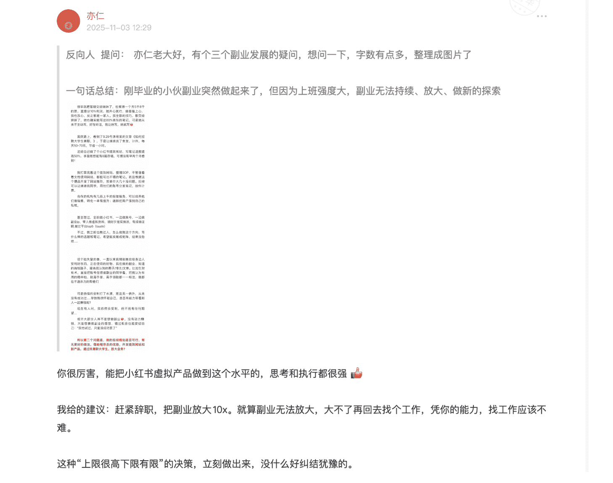

那时我本职是写代码的，脑力活，下班后经常累到不想说话。所有创作时间都是从牙缝里挤出来的：早晨通勤，地铁上开着热点写文案，午休写半篇，深夜回家再改另外半篇。周末偶尔能喘口气，就抱着电脑去图书馆泡一天，一篇篇翻过往数据、拆同行内容。

有一阵子加班凶猛，两天班换一天调休，选题在备忘录里躺了一周都没空碰。说不累是假的。但这种累和上班的累不一样——上班的累是消耗，而写自己想写的东西，是积累。

被关注之后，麻烦也来了：别人拆解我的内容、模仿我的标题、照搬我的文案，后来甚至有人组织专门的下单秒退。有个账号连着拍下三单，付完款立即退款，消息一律不回。售后申请里填的备注是：“根本没见到包裹，垃圾卖家，赶紧退。”有圈友私下提醒，说有人在群里喊，准备找人去我店里下单再退款。

被抄袭这件事，反而让我想通了一点：能抄走的是文案，抄不走的是文案背后的判断。

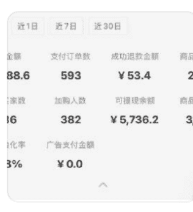

当初选这个方向，其实没什么激情故事。毕业时摆在我面前的是三个选项：小红书上卖虚拟类目、B站做数码好物、出海建站。三个都踩在我的能力圈里——我很早就用这个平台，知道用户喜欢看什么；数码是我老本行，同学买设备都来问我；建站更是老本行，我自己就是写程序的。

后来选了虚拟类目，做着做着就做到了Top5，入职之后时间更紧了，也就没有余力再去开新战场。

为什么不追蓝海？因为蓝海的门槛约等于零。今天你发现一个小众需求，明天就有一堆工作室带着矩阵账号进场，后天它就变成红海。那种一个月卖几百单的小项目，对个人玩家来说，既不够吃，也垒不起壁垒。

听过一句很扎心的话：“蓝海早晚会被踩成红海，最后拼的还是内功。”我把这句话贴在备忘录里当座右铭。所谓内功，不是会写文案、会选品、会开直通车，而是三个视角的切换。

**一、先看平台的脸色**

平台把流量分给谁，不看谁嗓门大，只看谁在替自己留人。无论小红书还是淘宝、抖音，命脉都是用户停留时长和交易体验。所以平台欢迎的从来不是搬运工，而是能提供优质笔记、满足用户需求、让用户满意而归的商家。

同样是卖PPT模板，A店评分4.8，B店评分4.1，在平台眼里就是两个物种。4.8意味着用户满意、愿意复购、能沉淀口碑；4.1意味着货不对板、售后不断。平台凭什么把流量给后者？

想通这一层，就不会再问“我搬个模板能不能卖”，而是问“我能不能做一篇平台愿意推、用户愿意看、看完还想买的原创笔记”。

**二、再看用户的欲望**

这是最反本能的一次视角切换。人总会习惯性先想自己：我要卖什么、成本多少、能赚多少。但买家根本不关心你卖什么，只关心自己能得到什么。

幼儿园老师要的PPT，是可爱、活泼、能抓住小朋友的眼睛；企业白领要的PPT，是结构清楚、显得专业、能让领导点头；大学生要的PPT，是拿去就能用、答辩能过、不用熬夜改。产品是同一份，用户不同，买点就完全不同。

找到用户是谁，然后找到他的痛点，最后给他一个理由买单。那个理由最好把问题推到外部——不是“你太懒总熬夜”，而是“窗帘挡不住光，影响你进入深度睡眠”。后者让人想行动，前者让人想辩解。

**三、最后看同行的短板**

用户会在货架前比较，凭啥买你的，不买隔壁的？

先去翻同行的笔记和评论区，看他承诺了什么，评论里又在抱怨什么。如果一家店评分只有4.1，大概率是承诺没兑现，那你的机会就藏在那些差评里。再找自己独有的经历。如果我是从PPT小白一路做到高手，那这段经历就是最好的信任状——正因为我也笨拙过，所以更懂小白卡在哪里。这种买点，别人想抄都无从下手。

最后，说到的必须做到。标题写“答辩直接用”，那文件拿过去就该真的能用；写“小白友好”，就不能让人打开以后一头雾水。买点是有保质期的：兑现一次，信任涨一分；食言一次，以前攒的信任全清零。

**顺序不能乱**

四个视角的先后顺序很关键：先站上平台的角度定方向，再站到用户的角度找买点，然后用买家的角度做出差异化，最后才轮到卖家视角，想怎么定价、怎么放大、怎么赚到钱。

大部分人把顺序弄反了，上来就想怎么找兼职、怎么批量发、怎么躺赚。结果呢？平台不推、用户不买、同行一对比就落下风，所谓规模化只是空中楼阁。

从“我有什么”到“你得到什么”，本质是一次心态转换。卖点是商家想说的话，买点是买家愿意听的话。平台需要讲买点的内容，用户会被买点打动，买家会比较谁的买点更真实、更独特、更可以兑现。

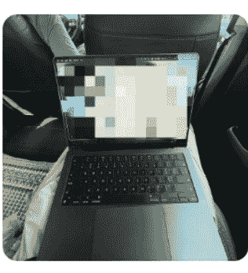

这三条线汇聚成一个点：持续输出买点清晰的内容，并且真的兑现它，生意就会自己转动起来。

这条路起步慢，但每一步都在垒墙。垒到最后，别人可以抄你的文案，但抄不走你的判断；可以模仿你的产品，但模仿不了你对人的理解。这些看不见的东西，才是在虚拟货架上谁也抢不走的竞争力。

真正让用户付款的，从来不是商家自认为厉害的功能，而是用户确认“这正好能解决我的问题”。前者属于卖方表达，后者才是用户愿意掏钱的理由。能不能捕捉到这个理由，决定了你做出的东西有没有市场。

很多人喜欢走捷径，但真正能拉开差距的，往往是那些不容易、却值得长期坚持的事：持续产出高品质内容，准确回应目标人群的困扰，把别人难以复制的理解力，慢慢变成自己的壁垒。

## 先弄清楚：小红书的流量并非只有一种

不少人给内容接上商品组件后，浏览量突然跌到几十，第一反应就是账号被处罚了。其实更常见的情况是：内容被平台放进了另一套分发体系，面对的人群和评估方式都发生了变化。

### 1. 内容社区：适合建立兴趣

普通内容主要在这里获得曝光。池子大、覆盖的人多，用户可能只是浏览经验、寻找灵感或学习方法，并不一定准备购买。

平台更在意的是内容能否留住用户，以及用户是否愿意点赞、收藏、留言、转发和关注。对这一类内容来说，互动表现越好，后续获得推荐的机会通常越多。

### 2. 成交场景：人少一些，但需求更明确

带有商品组件的内容，主要面对的是正在寻找方案、比较产品，甚至已经准备付款的人。

它的总曝光可能不如内容社区，但访客的购买倾向更强。社区里几百次浏览未必带来一笔订单，而在成交场景中，十来个精准访问者里出现一笔付款并不奇怪。

所以，浏览量下降不等于内容失效，可能只是流量从“随手看看”转成了“带着问题来找答案”。

### 3. 付费推广：用预算换取更可控的触达

通过聚光、千帆等工具购买曝光，属于商业投放体系。自然推荐往往在发布后的前两天达到高点，约一周后开始回落；推荐生命周期通常能延续一段时间，后续则更多依赖搜索承接。

如果想让推荐持续，要么不断创造新的优质内容，要么用预算补充曝光。

## 普通内容与带货内容，平台看重的不是同一张成绩单

普通内容主要考察：

- 点赞、收藏、评论、分享、关注
- 播放完成度、点击表现
- 题图和标题是否有吸引力
- 信息是否有用，能否激发兴趣

而带商品的内容，还会增加：

- 商品访问、加购、付款与成交规模
- 买家反馈、晒单和售后口碑
- CPC、CVR 等经营指标

平台最终想看到的，不只是“有人看”，还包括“有人买、买完满意”。

理想状态是两边同时做好：内容具备吸引力，交易链路也足够顺畅。只有购买信号而缺少阅读互动，往往显得像生硬的货架信息；如果既能让人停留，又能自然推动购买，才更容易在成交场景中取得优势。

## 接入商品后，曝光减少该怎么看？

原因通常很直接：分发人群换了。

系统不会继续把内容大量推给纯粹消磨时间的人，而是优先寻找可能有需求的访客。人数少了，但每次点击的商业价值提高了。

做虚拟资料，真正应该盯住的是：

- 商品访问率
- 付款转化表现
- 实际成交
- 买家反馈

如果正文不直接接商品，只在互动区域补充商品入口，内容仍有机会按照社区内容的逻辑获得更广泛的推荐。

可以把它理解为：

- 正文直接接入商品组件：更偏向成交分发，规模可能收窄，但人群更聚焦；
- 互动区补充商品入口：仍保留社区传播特征，曝光空间更大，也能承接一部分购买。

不过，这些只是分发层面的技巧。真正决定结果的，始终是产品和内容本身。

产品是否真的有用？是否对应真实需求？你是否了解它的使用场景？
内容能否让用户产生共鸣？是在替用户解决问题，还是只是在重复商家的自我介绍？

东西不行，文案不行，再多技巧也只是反复折腾。别把注意力放在枝节上。

## 怎样兼顾阅读表现与成交表现？

这要求创作者同时具备内容能力和经营意识。

### 第一，先从用户的问题出发

你需要知道：

- 对方正在困扰什么？
- 他会搜索哪些表达？
- 他最想得到的结果是什么？

不要把篇幅全部用来罗列参数，而要翻译成用户能获得的结果。先提供有价值的信息，建立可信度，再让商品成为解决方案的一部分。

### 第二，保留自己的表达和情绪

好的内容通常具备几个特征：

- 标题能触发情绪或经验共鸣
- 正文确实解决问题，而不是从头到尾推销
- 视觉呈现足以让用户停下来

人工智能可以帮助整理、扩写、提速，但不能代替创作者判断什么值得说、什么符合真实需求。真正的顺序应该是：先由你理解人群，再把清晰的需求交给工具处理。

工具像外接大脑，方向盘仍然要掌握在自己手里。

而且，提速的前提是你知道什么叫好内容。连成品是否自然、是否一眼带有机器痕迹都判断不了，模板再快，也只能更快地产出平庸内容。

## 发布节奏没有统一答案

我通常不会卡固定时间发布，有内容就发，活动范围大致从早晨醒来一直到深夜休息前。下面是不同发布时间对应的部分表现：

| 发布时间 | 笔记支付金额 | 笔记阅读数 |
| :--- | :--- | :--- |
| 00:17:37 | 33,125.40 | 159,204 |
| 11:27:31 | 26,937.90 | 64,636 |
| 10:35:11 | 19,930.68 | 116,370 |
| 22:42:21 | 18,225.90 | 79,708 |
| 14:01:07 | 17,780.40 | 109,933 |
| 10:07:12 | 14,421.78 | 99,116 |
| 14:31:15 | 11,867.91 | 57,083 |
| 16:29:00 | 8,316.00 | 46,635 |

这组数据说明不了“哪个时间必然最好”。不同账号、不同人群、不同选题，结果都可能不同，最终还是要以自己的反馈为准。

无论是内容型帖子还是成交型帖子，底层原则都一样：真诚地帮助别人。画面舒服、信息扎实、读者愿意参与，平台自然更愿意继续分发。

觉得没有曝光时，不妨先问一句：这条内容真的值得目标用户花时间吗？

## 选品不要只盯着别人正在卖什么

提到选品，很多人的动作是搜竞品、找爆款、照着复制。但更有价值的方向，是回到自己的优势和用户的真实反馈。

同行不会给你付款，真正贡献收入的是买家。与其长时间追着竞争者的动作，不如把精力用于理解愿意购买的人。

以虚拟店铺评分为例，品质与服务通常各占一半：

- 4.8—4.9 分：往往说明产品确实解决了问题，用户愿意给予认可；
- 4.1—4.4 分：常见于“先上线再说”的产品，退货和售后压力可能更大；
- 如果评分落到 4 分左右甚至更低，通常意味着用户体验存在明显缺口。

低评分不是只能接受的结果，而是一个调查入口。去询问买家：哪里没达到预期？哪一步使用不顺？哪些承诺没有兑现？然后据此改进产品，争取把品质推向更高水平。

距离用户越近，越容易发现机会，也越有可能长期经营下去。

刚起步时参考同类产品没有问题，但想真正超过别人，靠的不是永远跟随，而是比别人多理解一层用户。

### 选品也要看你自己

可以从以下方向寻找切入口：

- 你做过并积累了经验的领域
- 你长期关注、愿意钻研的主题
- 你已经是熟练使用者的场景
- 你有明显优势或故事可讲的方向
- 你有强烈表达冲动的内容

至少占中一项，就比盲目追热点更容易坚持。

如果自己连 AI 绘图都不了解，不清楚使用者的困难，也没有兴趣和经验，却因为别人赚钱就贸然进入，往往很难熬过没有反馈的阶段。

更理想的状态，是先把自己当成真正的爱好者：即使暂时没有成交，也愿意持续研究、分享和表达。交易只是结果，不是唯一动力。

要建立一个长期目标：不是追着别人做，而是让别人以后参考你的方法。

持续围绕真实问题创作图文、视频或文章，用户感受到内容确实有用，自然会主动靠近。每次输出都在训练独立思考、稳定生产和洞察需求的能力。

如果暂时找不到方向，可以去看小红书官方账号「生活研究所」。


生活研究所在 2025 年 4 月以前，曾分享过虚拟商家的月度成交规模。虽然距离现在已有一段时间，但仍然可以据此大致判断行业的经营状况。


## 内容才是最接近变现的环节

很多人把时间花在研究技巧，却没有认真打磨内容。事实上，优质内容本身就具备传播和成交能力，也会提升后续广告投放的效率。

广告竞争力=内容质量×点击竞争力×出价竞争力×转化率

如果内容底子薄，即使提高预算，整体竞争表现也未必理想。用户之所以点赞、收藏、评论、关注，乃至付款，首先是因为内容让他觉得值得。

我一直警惕批量生产高度相似的 AI 内容。平台规则会变化，用户也会越来越容易识别套路。每次发布前，我都会检查两件事：

- 这条信息真的有帮助吗？
- 目标读者会愿意看下去吗？

我不会依赖一套模板解决所有选题，也不会追求“输入一次、自动生成、直接发布”。那种做法看似省力，实际上很容易停止成长。

内容风格、指令写法和创作判断，都应该持续迭代。我会定期查看表现，重新调整工作方法，让下一轮内容比上一轮更贴近用户。

不要只发布，不分析。

很多人内容发了不少，却从未认真查看经营后台，也不了解其中的工具。没有订单时才问原因，往往已经错过了定位问题的机会。

至少要关注：

- 商品访问表现
- 付款转化水平
- 退款和退货情况
- 不同内容带来的成交差异
- 推荐与主动搜索各自贡献了什么

## 搜索入口，往往藏着更稳定的需求

推荐流量依赖平台分发，搜索流量则来自用户主动提出问题。后者通常拥有更清晰的目标，因此更适合承接解决方案型内容。

有一次查看后台时，我发现搜索带来的访问占整体流量的一半，而搜索渠道贡献了约六成成交额。部分围绕搜索需求制作的内容，商品访问率达到 25%，付款转化甚至达到 40%；单条内容带来的成交额也达到 1.9 万、1.2 万。

这说明人群足够精准，并且内容成功把访客带到了商品页面。

后台还会提供相关搜索表达。过去我没有特别注意标题和正文是否覆盖这些词，后来才发现，所谓“关键搜索词”，通常是搜索结果里商品曝光靠前，或已经产生过成交的词。

因此，后续创作可以把这些表达自然融入标题、正文和场景描述中，但不要机械堆砌，核心仍然是内容与需求的匹配。

## 一条内容的搜索成交数据

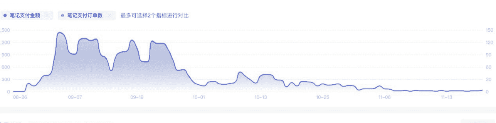

| 渠道名称 | 支付金额 | 支付订单数 | 支付转化率 (PV) |
| :--- | :--- | :--- | :--- |
| 综合搜索页 | 25,542.00 | 2,580 | 27.12% |
| 发现页 | 7,563.60 | 764 | 17.38% |
| 个人主页 | 2,296.80 | 232 | 32.04% |
| 消息页 | 148.50 | 15 | 21.13% |
| 其他 | 128.70 | 13 | 23.21% |

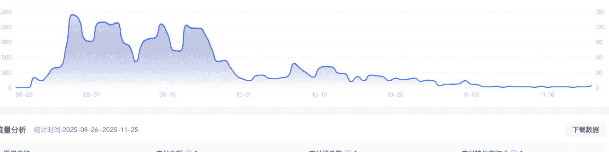

| 渠道名称 | 支付金额 | 支付订单数 | 支付转化率 (PV) |
| :--- | :--- | :--- | :--- |
| 综合搜索页 | 25,542.00 | 2,580 | 27.12% |
| 发现页 | 7,563.60 | 764 | 17.38% |
| 个人主页 | 2,296.80 | 232 | 32.04% |
| 消息页 | 148.50 | 15 | 21.13% |
| 其他 | 128.70 | 13 | 23.21% |

## 做好搜索承接后，成交可以持续发生

当内容准确对应用户的查询，商品访问和付款效率都有机会提升。

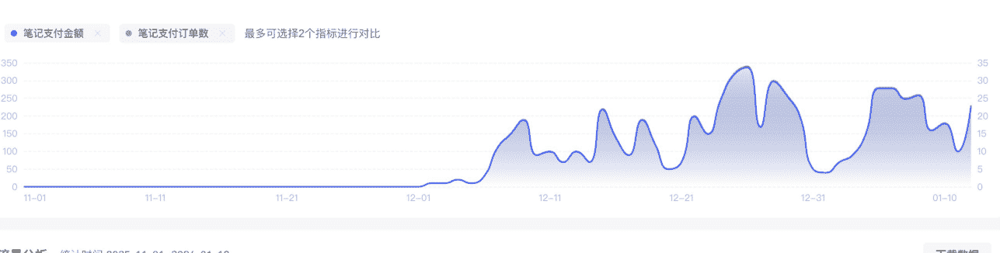

| 渠道名称 | 支付金额 | 支付订单数 | 支付转化率 (PV) |
| :--- | :--- | :--- | :--- |
| 综合搜索页 | 4,781.70 | 483 | 29.45% |
| 发现页 | 999.90 | 101 | 21.17% |
| 个人主页 | 287.10 | 29 | 50.88% |

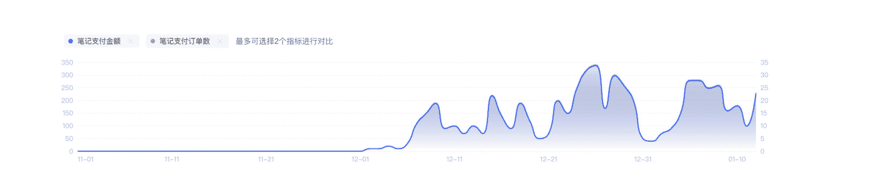

| 渠道名称 | 支付金额 | 支付订单数 | 支付转化率 (PV) |
| :--- | :--- | :--- | :--- |
| 综合搜索页 | 4,781.70 | 483 | 29.45% |
| 发现页 | 999.90 | 101 | 21.17% |
| 个人主页 | 287.10 | 29 | 50.88% |

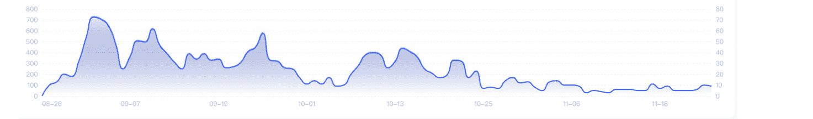

| 渠道名称 | 支付金额 | 支付订单数 | 支付转化率 (PV) |
| :--- | :--- | :--- | :--- |
| 综合搜索页 | 18,235.80 | 1,842 | 28.33% |
| 发现页 | 1,900.80 | 192 | 17.34% |
| 个人主页 | 1,138.50 | 115 | 36.62% |
| 消息页 | 118.80 | 12 | 35.29% |
| 其他 | 69.30 | 7 | 31.82% |

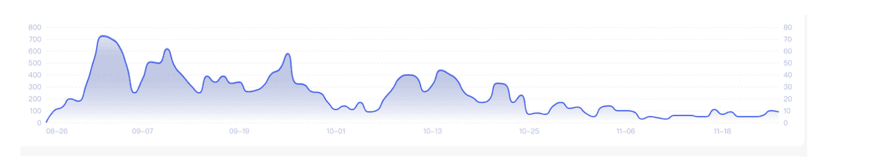

| 渠道名称 | 支付金额 | 支付订单数 | 支付转化率 (PV) |
| :--- | :--- | :--- | :--- |
| 综合搜索页 | 18,235.80 | 1,842 | 28.33% |
| 发现页 | 1,900.80 | 192 | 17.34% |
| 个人主页 | 1,138.50 | 115 | 36.62% |
| 消息页 | 118.80 | 12 | 35.29% |
| 其他 | 69.30 | 7 | 31.82% |

道理并不复杂：主动搜索的人，通常已经意识到自己有某种需求。只要把用户使用的表达、内容中的解决方案和商品承诺准确连接起来，就有机会获得持续而且更具购买价值的访问。

单纯依赖系统分发的笔记，热度通常只能维持三十天上下，之后就会明显走下坡。

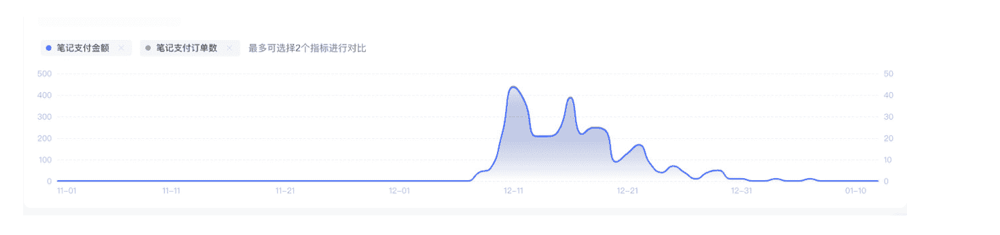

这类曝光是平台直接推到用户眼前的，刷到的人未必正带着明确的购买意图，更多是随手划过。所以它的优点是起量快、爆发猛，缺点是续航不太行。

### 真正稳的，是搜索和推荐大致各占一半的流量结构

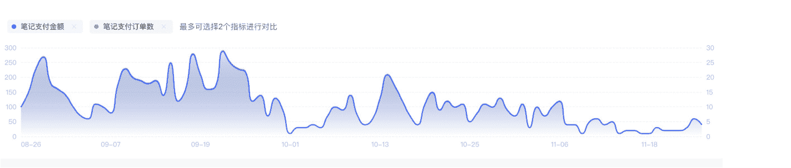

| 渠道名称 | 支付金额 | 支付订单数 | 支付转化率 (PV) |

| :--- | :--- | :--- | :--- |

| 发现页 | 4,880.70 | 493 | 20.37% |

| 综合搜索页 | 4,068.90 | 411 | 27.40% |

| 个人主页 | 722.70 | 73 | 45.91% |

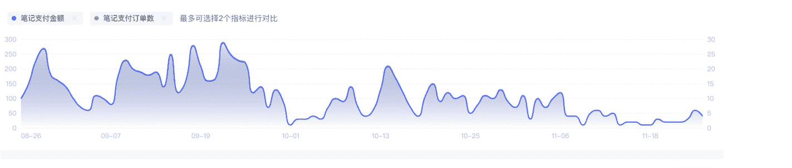

| 渠道名称 | 支付金额 | 支付订单数 | 支付转化率 (PV) |

| :--- | :--- | :--- | :--- |

| 发现页 | 4,880.70 | 493 | 20.37% |

| 综合搜索页 | 4,068.90 | 411 | 27.40% |

| 个人主页 | 722.70 | 73 | 45.91% |

这种结构好在哪？相当于同时拿到了推荐带来的瞬时爆发和搜索带来的长线成交。帖子往往质量过硬，平台愿意推，访客也搜得到，两条腿走路自然更稳。

所以一定要回头翻后台数字，发布之后就当甩手掌柜肯定不行。我的习惯是每隔一段时间就盯一下数据，琢磨每个数字背后的成因。

搜索表现突出的帖子，是词根埋得准，还是正文和用户需求足够贴合？

被算法推到首页的帖子，靠的是标题抓人，还是封面更有冲击力？

点击不错、成交却很惨的帖子，到底是商品和内容对不上，还是定价本身就劝退？

## 这些疑问，就是我持续迭代的起点

数字不会说谎。读者买不买账，后台都会老老实实给答案。

再聊聊交易完成之后的服务环节。

如果一个分享者从头到尾不提这茬，我很难相信他的成绩是真实的。

服务成本被太多人低估。很多帖子公开写着“不处理退换”，可你去翻晒单数据，这类占比基本在 10% 上下。

尤其一旦爆单，这部分只会让你更头疼。所谓“东西便宜，没人愿意退”根本不成立。以后再看到这种论调，基本可以直接当成对方自爆。

服务问题少的原因其实很朴素：东西足够好，买家觉得值，自然没有后续麻烦。比如那种评分只有 4.1 的店铺，退换比例往往在 10% 到 20%。说虚拟商品零退换，显然脱离现实。

要是产品本身不够硬，等平台哪天真把用户体验当作重点来抓，日子就不会太好过。

## 小结

说到底，核心就八个字：高频输出，持续调优。

帖子要一直发，方向要一直改，后台要一直看，做到这三点就够了。

现在回看早期的打卡记录，还挺感慨，都是一步步走出来的。

2025年7月16日 · 发布自 iPhone

### 进度记录 Day 2

这是第二条记录，7月14日做到 787.8，离八百差了口气。

坏消息：7月15日还是没到 800。

好消息：直接破 1100 了。

今天目标：2500 稳稳守住。

十天前完全想不到，日入 2500 竟然会变成保底线。

刚起号那阵，觉得每天 1000 访问、150 单就该偷笑了😂

2025年8月9日 · 发布自 iPhone

### 进度记录 Day 25

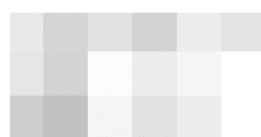

今天差点又刷新纪录，都怪自己太懒，大号只发两篇，小号三篇。

今天大概率要凉，实时曲线已经差了 200。

接着上次的话：人还是得有个目标吊着，才能推着自己往前走。

先立个简单 flag：8月15日之前再冲一次新高，做到日入 5000。

2025年8月16日 · 发布自 iPhone

### 进度记录 Day 32


GMV：4567

今天数字很顺，只是昨天少了两百多。看实时曲线，8月16日还有希望回到 5000。

我的天，我在说什么，期望值已经被抬高了。

十天前觉得偶尔到 4000 就挺好；现在想的却是保底 4000、常态 5000。

可以优化的点：休息日要安排一次系统性的整理和学习。

小号的第二篇发了一晚上，居然只有 1 个浏览量，内容看着也正常，到底怎么回事？

### 进度记录 Day 35


GMV：6258

今天目标：又破纪录了！离月底线还差 700。

调整点：发布排期得重新规划，否则一忙起来，一天只能更两篇。

再把标准抬高：

整个八月守住日均 3500。

目标既然完成，就继续定下一个：

8月31日前，单日冲到 7000 的新纪录。

2025年9月1日 · 发布自 iPhone

### 进度记录 Day 46 / 47 / 48


GMV：4328、3904、4918

今天：连着休了两天打卡，更新频率也慢了，确实轻松。

晚上终于把卡了很久的大难题解决了！

灵感果然爱在洗澡的时候冒出来💡

还谈成了一条新的业务合作。

算上今天，八月收入 15，加上主业工资，月入 20。

刚上班那会儿，一天 2500 就幸福得不行，破 4000 那天，空气都是甜的。

现在到了 4000 反而不满足😂。

人的预期、阈值，真是奇奇怪怪。

2025年9月2日 · 发布自 iPhone

### 进度记录 Day 49


GMV：8390

今天：九月第一天就把目标干完了。

之前计划 9月15日破 7000，结果直接破 8000。

很夸张。

再加上工资，是不是已经日入一万了🤔

2025年9月3日 · 发布自 iPhone

### 进度记录 Day 50


GMV：9580

今天：九月第二天，又破 9000。

下周想体验日入过万，求求了🙏

别的没啥可说，安心享受这波热度就好，单日浏览量已经过 5 万。

2025年9月5日 · 发布自 iPhone

### 进度记录 Day 52


GMV：10859

今天：目标达成，都快赶上半个多月工资了😯忙到截图都没存。

历史纪录再次刷新。

周五下班可以准备新合作，卖高单价产品了。

检验个人 IP、社群运营和用户信任的时刻到了。

真诚永远是王炸。搬运、抄袭、歪门邪道、花哨技巧，统统不如直接解决真实问题、提供超过预期的服务。

2025年9月7日 · 发布自 iPhone

### 进度记录 Day 54


GMV：7247

今天：典型的周末回落，干脆当作周六日休息。

顺手做了一轮内容筛选：从千帆后台切到自己的内容页，把单篇收益 400 元以上的全部挑出来。

我定了三条硬标准：单篇 GMV 超 1000、单个赞的价值超过 5 元、每 10 次浏览能带来 1 元收益。

三条全满足，就是头部爆款；满足两条，算准头部；满足一条，属于小火。

然后把这些帖子的标题、正文拉出来二次分析，看共性在哪、赢在哪些地方。

之后重点发头部和准头部内容。

另外，千帆押金从 500 跳到 5000 是怎么回事？

2025年9月10日 · 发布自 iPhone

### 进度记录 Day 57

GMV：10953

今天：原本以为能破纪录，白天一直压着昨天走。

结果晚上回落了，夜晚的流量会惩罚每一个没更新的人。

持续输出就完了。我会回去看发布后的效果，不停微调。这个过程考验的正是创作力、内容生产力和整体机制。

别总拿着一套模板反复写同样的内容。如果发出去只有几个赞、没人看，就必须立刻调整、立刻优化。

#### 正向反馈循环

- 如果内容没人看，说明输出质量可能还不够，方向或选题需要改。

- 如果大家爱看，点赞就会涌过来，正向反馈会推着你一直写。同时读者的互动也会变成源源不断的选题库，灵感不会枯竭。

学习资源方面，可以翻一翻生财里的小红书爆款合集，21 年、22 年、23 年的精华帖都值得刷一遍。

师傅领进门，修行在个人。想进榜单、成为 Top，没有捷径，只能持续做、持续优化、持续总结。

再次强调，没有绝对的对错，只有选择不同。我只是提供一个经过验证的可行思路，不一定适合所有人，但值得参考。

## 做难而正确的事

尊重读者，不把别人当傻子；提供真正有用的产品，坚持原创，持续总结，不断提升内容能力。

最后用罗永浩和何同学在博客里说过的一句话收尾，真心想踏实做内容的话，强烈建议去听听。

> 「一旦你放弃这种可有可无的坚持之后，就慢慢的没有任何坚持了」

祝大家都能稳定爆单。

这篇主要分享小红书虚拟商品的打法。不知道大家是不是对具体执行更感兴趣，比如我这几个月做了哪些调整、怎么写好正文、怎么做针对性回顾和优化。

最后还是那句话，以上只是一家之言，是我跑通的一条路，大家可以按自己的情况选择不同打法。

最后，安利一下小懒的付费社群：

懒人专属群（介绍）


🕯这里是你对抗信息过载的护城河。

已稳定运行 7 年，累计拆解、研读 3000+ 个互联网商业实战案例与行业前沿内参和时政/宏观文章。

我们不搬运垃圾，只做高价值信息的筛选器与放大镜。

### 懒人专属群更新记录

```
https://hk57gvlx7u.feishu.cn/docx/H0kRdZbSbolBR0xkaXtcuVE0nTg
```

【免责声明】本资料归档于社群内部知识库，仅供成员课题研究与学术交流，请在查阅后 24 小时内删除。