# 参与 SCBI 内容 AI 动漫化：📕 30 天涨粉两万+，完整实操复盘

## 260122 副业 SC 精华


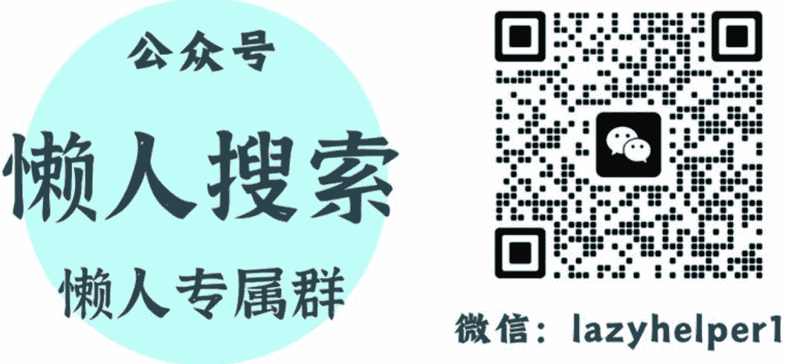

# 前言：我在 AI 漫画赛道跑出的结果

大家好，我是龙哥，目前有 6 篇精华帖，累计 40 多次中标。

我最近投入 AI 漫画内容创作，用不到一个月的时间，在📕新增粉丝 2 万以上，并陆续跑通了商单、买手计划以及虚拟资料等变现方式。

抖音端累计播放量达到数百万，👸号也有多篇文章突破 1000 阅读。

这篇文章不讲空泛趋势，主要分享我如何选题、制作、批量生产、优化数据，以及后续如何把内容做成稳定系统。

# 为什么我看好漫画内容

## 漫画是信息的另一种表达方式

漫画不只是“画出来的内容”，更像是一套独立的信息表达系统。

文字可以讲知识，视频可以制造现场感，音频适合陪伴，而漫画则擅长把复杂信息压缩成直观画面。

养生建议、知识科普、情绪故事、商品介绍、个人经验，都可以换成漫画表达。核心并不是重新发明内容，而是给原内容换一套包装：

- 把长段文字拆成连续画面；
- 把复杂逻辑转成角色对白；
- 把抽象情绪变成表情和动作；
- 把需要耐心阅读的内容，变成更容易滑完的视觉信息。

因此，漫画的价值并不局限于娱乐，它同样适合知识传播、情绪共鸣和产品种草。

## 漫画阅读成本低，覆盖人群广

漫画的消费门槛很低。

用户不需要打开声音，也不必持续投入大量注意力，浏览几秒就能接收到画面中的情绪和信息。无论年龄、职业还是使用场景不同，只要具备基本的手机阅读习惯，通常都能快速理解。

这种内容有几个天然优势：

- 不依赖声音；
- 单页信息容易扫读；
- 情绪传达速度快；
- 对专业背景要求较低；
- 更容易形成连续阅读。

从平台推荐机制来看，用户理解得快、停留时间短、阅读完成度高，往往更有机会获得进一步分发。

所以，前期可以先用漫画切入更大的大众范围，再根据数据慢慢明确细分方向，而不是一开始就把自己限制在特别窄的圈层里。

## 工具更新，让个人创作成为可能

以前想持续做漫画，通常需要专业画师、设计师，甚至多人协同完成。成本高不说，沟通与修改也会拖慢进度。

现在，图像生成工具已经把流程大幅压缩。

我目前会用 nano banana pro 负责主要画面，再借助 Lovart 这类智能设计工具处理布局、整理和细节调整。过去需要多人完成的工作，如今个人也可以独立完成。

这并不意味着完全不需要审美和判断，而是把大量重复劳动交给工具，让创作者把精力放在选题、剧情和内容结构上。

# AI 漫画常见风格

## 画风参考

### 1. Q 版治愈日常

日系二次元方向，人物比例可爱，头部偏大、身体偏小，搭配圆脸、大眼和柔软配色。背景保持简洁，线条不要过度复杂，整体呈现温暖、轻松的生活感。

### 2. 动物拟人故事

将小动物设计成人类角色，使用圆润比例、简单表情和轻松场景，适合表达日常趣事、友情互动和治愈故事。

### 3. 少女漫与情绪插画

画面保持清爽，光线偏暖，人物表情细腻，背景适当虚化或弱化，更适合表达关系、情绪、成长和内心独白。

### 4. 轻 3D 与潮玩风

采用立体卡通质感，人物造型圆润，光线柔和，背景干净，适合展示固定 IP、角色周边和产品形象。

# 两个实用的生图方法

## 方法一：让参考图承担描述工作

很多细节很难仅靠文字说清楚，例如人物比例、线条粗细、色彩关系、构图节奏和光影方向。

与其写一长串容易产生歧义的描述，不如直接上传目标图片，再补充人物和剧情要求。

例如：

> image 参考这张图片的整体视觉风格，人物替换为一个小男孩，画面内容是：我似乎一直不擅长表达自己的想法。

这种方式的好处是，模型可以直接读取画面中的视觉关系，生成结果通常比纯文字描述更接近目标。

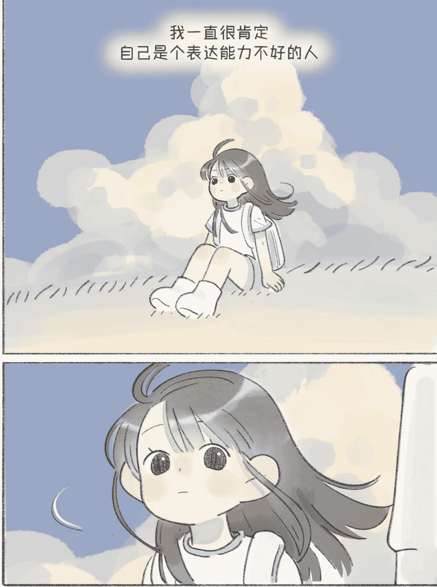


## 方法二：让模型拆解图片

如果你更习惯自己编写指令，可以先让 AI 分析图片，再把分析结果整理成新的生成指令。

可直接使用：

> 我是一名漫画创作者。请分析这张图片可能使用的生成指令，并从画面风格、材质、构图、排版、光影和故事氛围等方面进行拆分。

例如，这张图可以判断为清新治愈的叙事类漫画，采用纵向阅读结构，重点信息包括：

- 风格：水彩肌理、手绘线条、轻柔阴影、简约审美；
- 载体：数字插画、漫画分镜、移动端纵向阅读；
- 光线：自然光、柔和日照、低对比度阴影；
- 叙事：通过人物动作和短对白推动情节；
- 画面：主体突出，背景适度留白，方便手机浏览。

# 常见排版方式

## 纵向上下结构


上小学的时候忘戴红领巾


## 经典四格


## 纵向四格


## 单幅画面

#### 我活得很轻松，因为我 #

妈对我没有任何期待。

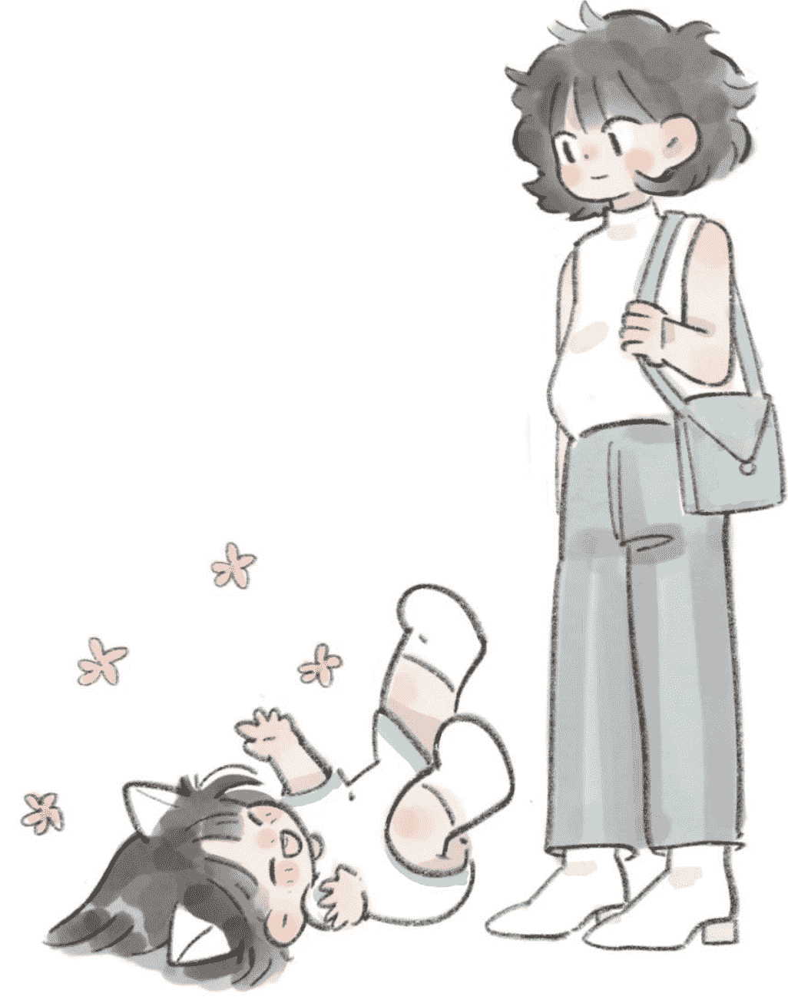

## 三格结构

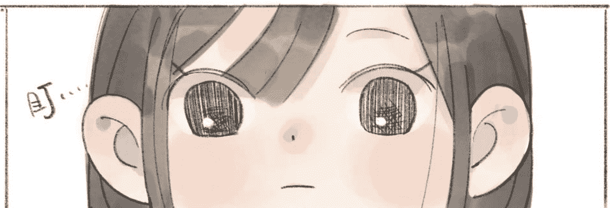

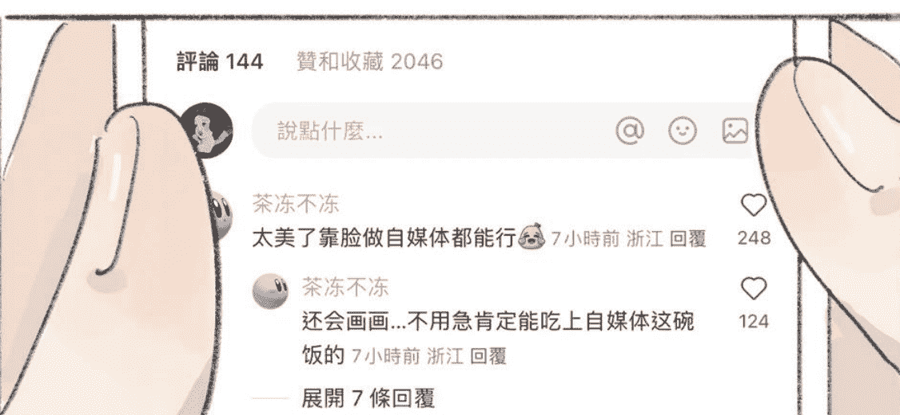

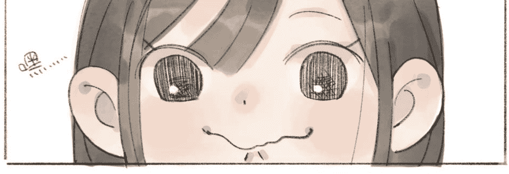

## 生活片段式

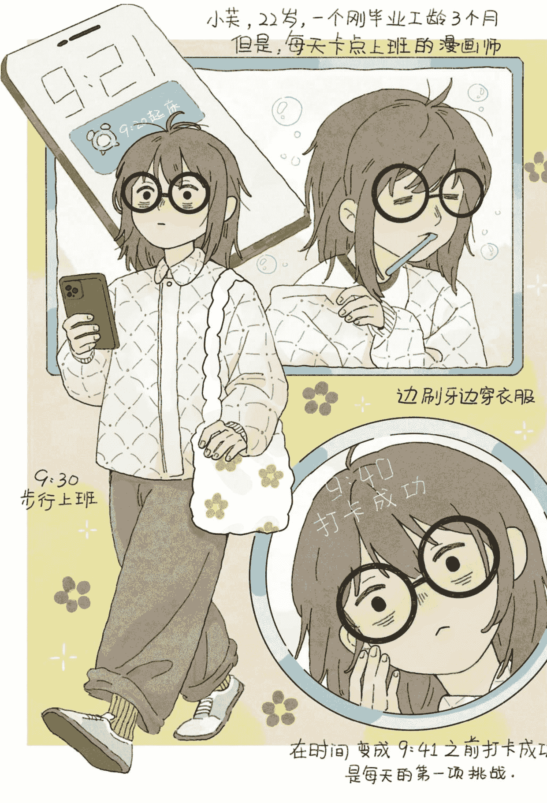

## 斜线分镜、无对白


## 多画格组合


不同排版适合不同内容：

- 单幅更适合一句话情绪；
- 三格适合铺垫、转折和结果；
- 四格适合短故事；
- 生活片段适合记录日常；
- 斜向分镜适合制造节奏感；
- 多格组合适合信息量较大的主题。

# 如何把漫画生产效率提上去

## Lovart：适合集中生成素材

刚开始时，我会做完一条内容再做下一条，一次只生成几张图。这样虽然简单，但很容易被“今天发什么”拖住。

后来我改成批量准备素材。

一次围绕同一主题生成几十张，再统一整理、筛选和发布。这样做之后，创作就从每天临时想内容，变成了定期从素材库里取内容。

我的常用方式是：

- 每组准备 20 张图；
- 每 5 张组成一条漫画；
- 一次可以整理出 4 条📕笔记。

批量化的意义不是单纯追求数量，而是减少频繁切换，让选题、绘图、筛选和发布各自成为独立环节。

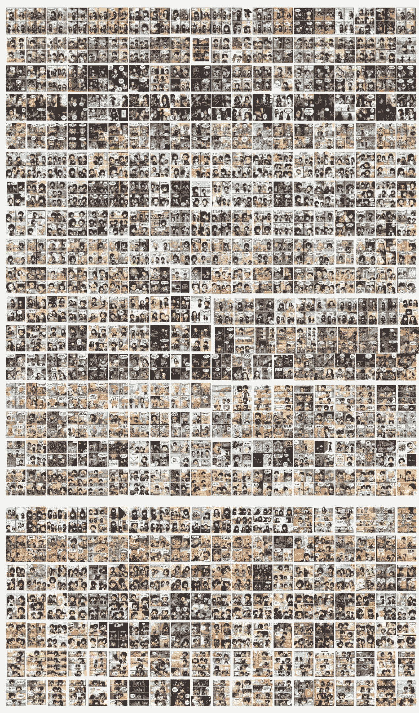

提示词：

二十话，Q 版彩色漫画，四宫格，不加标题，漫画当中的文字不可以出现英文，全部中文，图片比例 3:4，参考图片「把你的参考图发给他」

## Gemini：先把剧情脚本做成库存

我现在不会每天临时寻找灵感，而是先规划主题，再批量生产剧情。

操作步骤如下：

1. 先确定故事背景和角色关系；
2. 规定每一话的结构；
3. 让 Gemini 一次生成 10 话或 20 话；
4. 每话包含画面动作、人物状态和简短对白；
5. 再把完整脚本交给绘图工具处理；
6. 最后统一检查并安排发布。

这样一来，创作重点从“每次重新开始”变成“维护一套持续出稿的内容仓库”。

下面是我常用的四格脚本示例。

## ☕ 主题：除草后的午后——乌萨奇与小八的奇妙日常

## ☑ 第一话：硬饼干到底该怎么吃

- ● 第 1 格：小八费力掰着一块特别坚硬的饼干，额头冒汗。
- • 第 2 格：乌萨奇突然冲进来，手中挥着一根来历不明的树枝，对着饼干喊：“哈？！”（Haa?!）
- • 第 3 格：乌萨奇一脚把饼干踢碎。小八捡起一小片尝试，惊讶地说：“这样碎开以后，反而刚刚好入口。”
- • 第 4 格：乌萨奇叉腰高喊“呜拉——！”（Ura!），小八则露出满足的笑容。

## 第二话：任务结束后的检查工作

- • 第 1 格：除草结束，小八认真拍掉身上的灰尘。
- • 第 2 格：乌萨奇闭着眼睛，在小八周围来回跳动，像是在做全面扫描。
- • 第 3 格：它忽然停下来，指向小八耳后的一根杂草，发出“噗噜噜噜噜！”的声音。
- • 第 4 格：小八连忙鞠躬道歉：“对不起，我没发现那里！”远处的吉伊无奈地看着这一幕。

## 第三话：刘海失控之后

- • 第 1 格：训练时小八跑得太快，额前的蓝色刘海被吹得东倒西歪，几乎遮住双眼。
- • 第 2 格：乌萨奇从口袋中拿出一把粉色小梳子，神情严肃地靠近。
- • 第 3 格：它用非常认真、却略显粗暴的动作替小八整理头发。
- • 第 4 格：刘海最终被梳得整整齐齐。小八说：“谢谢你，乌萨奇！”而乌萨奇早已翻着跟头离开。

## 第四话：暴雨夜的拉面杯

- • 第 1 格：森林突然下起大雨，两只小伙伴躲入一只废弃的拉面杯中。
- • 第 2 格：小八抱住膝盖，听着雷声，身体轻轻发抖。
- • 第 3 格：乌萨奇从身后拿出一直藏着的烤红薯，递过去时仍保持着那副得意表情。
- • 第 4 格：小八接过热乎乎的红薯，眼眶泛红：“乌萨奇，真的好温暖。”乌萨奇已经靠在旁边睡着了。

# 我的运营方法：把经验变成系统

## 建立自己的记录框架

我参考 V 先生的内容，将项目拆成几个部分：

- 《一页纸战略》：明确目标、方向和重点；
- 《最小阻力流程图》：梳理从选题到发布的完整路径；
- 《运营日记》：记录每天执行情况；
- 《成就事件》：保存阶段性成果；
- 《项目问答手册》：沉淀遇到问题后的解决方案。

## 每天只记关键内容

《运营日记》不用写成流水账，重点记录：

- 今天完成了什么；
- 哪个环节花费时间最多；
- 数据表现如何；
- 出现了什么问题；
- 下一步准备怎么调整。

这些内容可以成为周总结和团队会议的依据，避免过几天后只能凭印象回忆。

## 定期复盘，而不是漫无目的聊天

自己操作时，可以每周写一次总结；有搭档或团队时，则可以安排固定会议。

会议最好提前准备问题清单，把开放式讨论转换成具体选择。例如，不要只问“封面应该怎么改”，而是准备三种方案，对比点击率、停留和互动数据，再决定下一步。

## 把问题答案整理起来

遇到问题时，可以向 AI、搜索引擎或有经验的人请教。解决问题之后，不要让答案停留在聊天记录里，而要归档到《项目问答手册》。

随着项目推进，这本手册会不断积累：

- 常见问题；
- 操作步骤；
- 工具用法；
- 数据判断标准；
- 已验证的经验。

它本质上是一份属于自己的知识资产。

## 用流程图减少无效动作

把从选题、写脚本、生图、筛选、排版到发布的步骤画出来，然后逐一检查：

- 哪些步骤可以取消；
- 哪些工具重复；
- 哪些动作没有带来结果；
- 哪些部分可以交给自动化工具。

我的原则是：先明确目的，再确定功能，最后决定形式。流程越短，执行越稳定；环节越多，出错概率越高。

我目前用得最多的是运营日记、成就事件和项目问答手册，确实能帮助自己减少重复思考。

以下为当时的记录截图文字，信息已做处理，内容比较零散，主要用于展示真实复盘状态。

## 12 月 23 日

一个是将之前发过的笔记进行一下重复，差不多一个月以上吧

一个号可以打一字需 4 片放入，比如片片宅，放在一个文件夹当中，那这里面可以上传配图

今天有 Inc 的脚本 App 15.1 原，然后有了一台苹果手机，更可以

把这个单子放下

打码文件就帮我写一下内容，下笔了一下分，

然后有点击后到粘贴板这里先是出现，用语言放入商品

提取只只各三个参数取到一上，这里的字体要写的比较黑，不

算是一个好的文案逻辑但是三句也是没有人写这么比

有好多会取这糊了

打算将时造光假和台保数主起之试

小景：有是三个取拍了，此好小建文成看，好个人小回二

人了了直接还是更新火灭灭

App 一个资源，和长公头，比排物品次取的看料于 1. 可以接📕接单

## 12 月 24 日

可以添加普通，20 几个字的版本，您厂用改入。

加代人后，我可以自己碎东西，及 1888 大范。

那就是这九了了个人要素极简设计具公买风一，家之实现。

对于《通用及 F 增长》，可以用此的思考结构，让本地人看到

## 成就事件

开通了付费功能，默认输入支付

'2H73E8￥路三干了

'7 月 20 日 起 接 五了 发布了 龙 录书世 能后，105 即将就是

我 次出土

于二我*了，有原 u 水拆了，没想要小 大百天时间

几年了，.小串’，一 x 我 g-‘有一二 i

入「我坐了.

不 Incixr 代了」月黑

## 做的一张最小阻力流程图

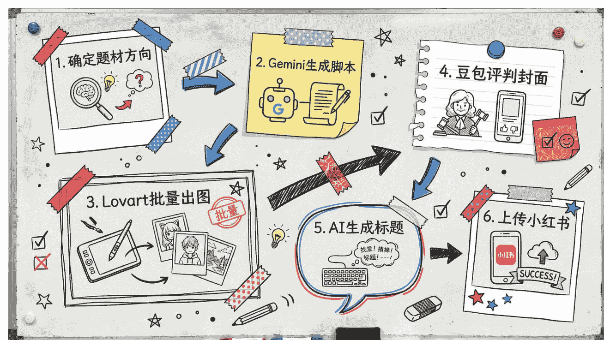

# 如何提高关注转化

一条漫画结束时，不要让内容突然停止。最后可以安排一张专门承担转化任务的画面。

这张图不需要复杂设计，重点是让用户知道下一步该做什么：

- 画面保持清爽；
- 文案尽量短；
- 账号名称放在醒目位置；
- 用箭头提示关注入口；
- 下方展示几条表现较好的内容。

用户刚看完故事，注意力仍在内容上，此时给出明确提示，比单纯期待用户主动搜索账号更有效。

我参考类似样式重新做过一版：

顶部放账号名称，右上角添加箭头，下方陈列 6 个数据表现较好的作品。

## -欢迎阅读-

微光的养生日常

把自己重新养一遍

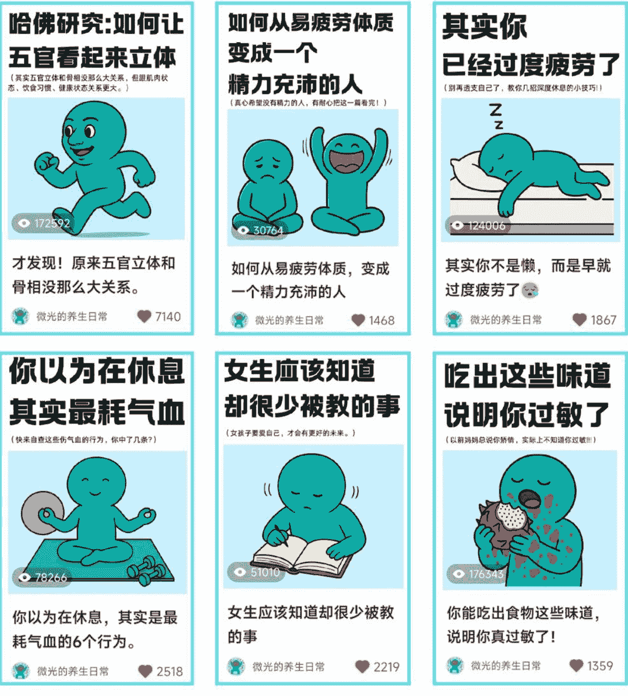

# 如何提升封面点击

封面可以从当次生成的几张图里挑选，也可以把候选图交给 AI，让它从小图展示效果、画面冲击和受众兴趣等方面做判断。

## AI 封面筛选提示词

你是一名拥有多年📕动漫内容运营经验的封面分析师。现在有 4—5 张候选封面，请结合平台缩略图展示特点，从画面识别度、文字信息、情绪吸引力和目标用户兴趣等角度进行比较，只保留最可能获得点击的那一张，并简短说明选择依据。

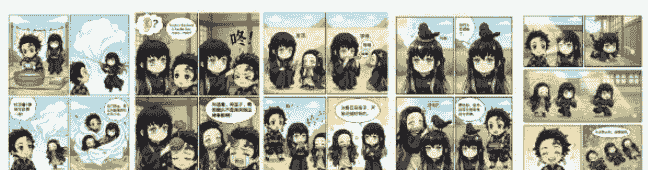

```
你是 5 年📕动漫同人运营经验的资深封面优化师，针对 4-5 张动漫同人封面，结合📕正方形、小图预览特性，从视觉、卖点、文字、受众吸引力维度评测，**仅选出点击率最高的最优封面**，并简要说明核心选中理由。
```

我会选择 **第二张图（左上起第二格）** 作为最优封面✅

## 选择依据

- **第一，缩略图识别度高**：时透无一郎的近景表情十分醒目，与炭治郎的惊讶神态形成对照，即使画面被缩小，也能迅速认出人物和情绪。
- **第二，画面存在悬念**：对话框、英文台词以及“咚！”的拟声效果，制造了突发事件感，容易引起动漫用户继续点击。
- **第三，受众匹配准确**：可爱化角色组合、鲜明配色和熟悉人物，都符合📕动漫兴趣人群的观看偏好。

# 已经验证有效的形式，不要频繁推翻

如果某种封面组合和标题写法已经多次获得较好数据，就应该把它当作可复用模板，而不是每次重新设计。

许多账号起步时容易不停改变：

- 今天换一种画风；
- 明天重做版式；
- 后天又换标题结构。

结果账号始终处在试错初期，平台也难以识别你的内容特征。

更稳妥的方式是，先用数据找出一套可以持续运行的外部结构。确认后，保持基本框架不动，再围绕内容做变化。

可以持续调整的部分包括：

- 题材细分；
- 故事情绪；
- 角色关系；
- 剧情入口；
- 对白表达。

尽量不要频繁改动：

- 封面布局；
- 画面结构；
- 标题句式；
- 账号整体视觉识别。

也就是说，用相对稳定的包装承载不同内容。这样既能保持用户认知，也有利于平台持续判断账号标签。

你会发现，很多成熟账号看上去始终使用相似的外部结构，只是不断更换内部故事。

# 多账号并行测试

只运营一个账号，容易把结果归因于运气；同时跑几个账号，样本数量更多，也更容易找到适合自己的方向。

平台分发存在不确定性。同一套内容方法，在不同账号上可能出现完全不同的结果。有时不是内容质量不够，而是账号基础、发布时间或初始人群不同。

因此，与其长期把所有精力压在单号上，不如用相同方法同时测试多个账号：

- 账号 A 测试题材；
- 账号 B 测试画风；
- 账号 C 测试标题和封面。

当某个账号跑出稳定反馈后，再把有效经验复制到其他账号。

几个账号之间还可以互相连接：

- 在个人简介中关联其他主页；
- 让成熟账号为新账号提供基础曝光；
- 将已经验证的内容结构扩展到不同主题；
- 形成彼此导流的小型账号矩阵。

这样做的核心不是盲目铺号，而是用更多测试样本降低偶然性，让账号运营从“等待某条内容爆发”，转变为“持续运行一套可复用机制”。

# 如何把商品自然放进漫画

我会先在📕带货市集中挑选适合内容调性的商品，再用 AI 为商品制作更有画面感的展示素材。

关键不是把商品硬塞进故事，而是让产品成为剧情的一部分，例如：

- 角色正在使用它；
- 商品解决了故事中的某个问题；
- 产品自然出现在生活场景里；
- 通过角色体验带出功能和使用感受。

这样既能完成商品展示，又不会破坏漫画的阅读体验，种草会更加自然。

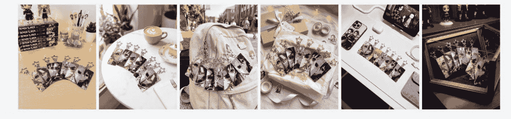

## 提示词

请为一款产品绘制6幅场景图，每幅都要有强烈代入感，让人看到就忍不住想下单。具体画面如下：

5. 舒适治愈的居家画面：产品放在北欧风格、阳光明亮的客厅茶几上，周边配上香薰和软靠垫，整体氛围慵懒又松弛；
6. 惬意的户外野餐画面：草坪铺好餐垫，产品成为其中一员，周围有鲜花、起泡酒和朋友们灿烂的笑脸，流露出轻松愉快的社交气息；
7. 热闹的节日聚会画面：产品是圣诞/新年派对上的视觉主角，旁边环绕彩灯、礼物和亲友们的笑容，把仪式感与幸福感直接拉满；
8. 精致的闺蜜下午茶画面：在法式甜品店里，产品摆在大理石桌面，配上马卡龙与手冲咖啡，处处显示着讲究与格调；

# 关于变现

SCBI列出的那些变现办法，我就不一一展开了。

## 👸号嵌入小程序或小游戏

我认识一位📕上的创作者，他看到我的漫画内容数据不错，便照着这种思路做了个属于他自己的版本。跟我不同的是，他不仅发📕，还同步更新👸号。更关键的妙招，是在👸号图文里塞了一个自己写的小程序。这样一来，同一套内容就被他做成了双层收入结构：一层来自小绿书的分成收益，另一层来自👸号里小游戏/工具型小程序带来的广告收入——只要用户在内容里点击、使用，新的广告展示就会不断出现。利用人工智能辅助开发一个简单的动漫小游戏，难度并不高，具体操作可以参考之前的编程航海资料。

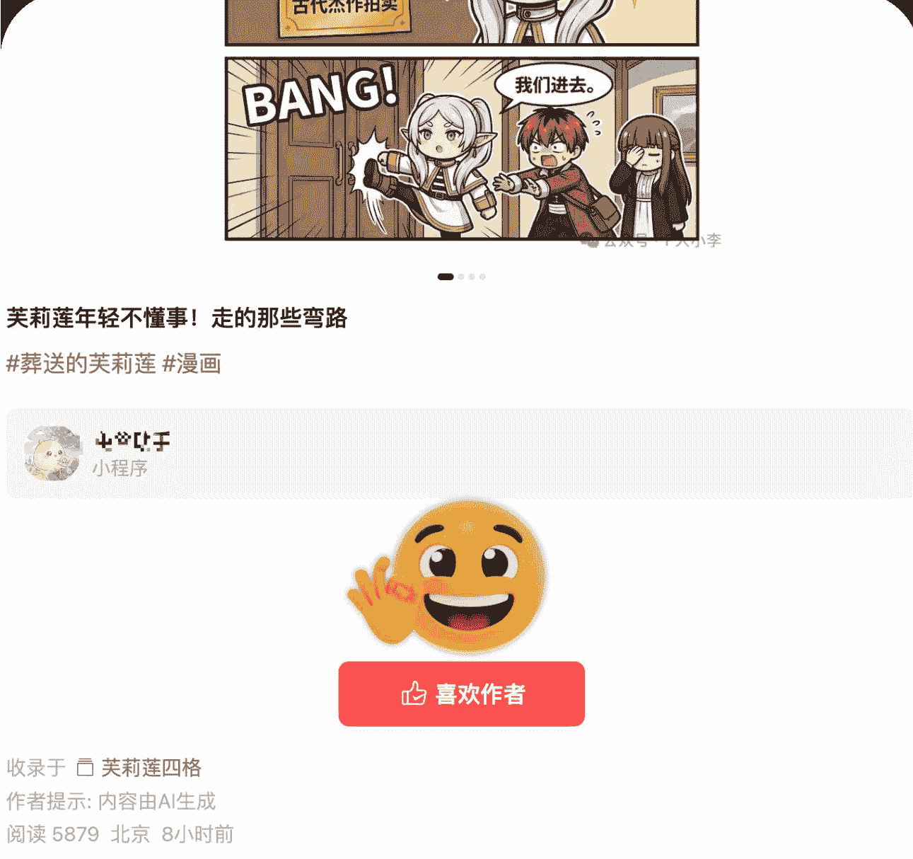

# 📕上的养生漫画

先看平台土壤。在📕，养生早已是一个体量巨大且相当成熟的内容大类，平台还专门开设了“养生薯”官方账号。这已经清楚表明：它属于长期存在、会被持续扶持的方向。

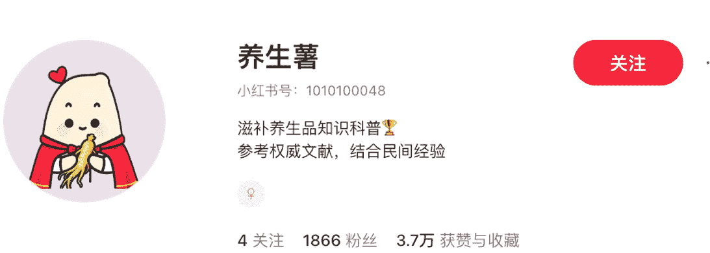

再看受众变化。以前大家普遍认为养生是中老年人的事，可如今的主力消费者偏偏是年轻人。熬夜、久坐、焦虑、亚健康，几乎成了许多人的常态；“如何让自己活得更健康、更舒适”也由此成为日常的、高频的内容需求。

从商业角度看，养生还有个天然好处：它能和极多商品产生关联。说到底，几乎所有跟生活相关的东西，都可以套上“健康”“调理”“状态管理”的外壳重新包装。吃的、喝的、用的、睡的、运动的、情绪的，本质上都能往养生概念上靠。这意味着，这个赛道不光能做内容，变现出口也很多、很顺。

我自己观察平台时，已经见过不止一个以漫画形式做养生的账号，短短一两个月就涨粉过万。它们同样是用人工智能来绘制漫画，用轻松易读、几乎没有负担的漫画语言，把健康知识、生活方式和情绪抚慰装进日常小故事里。

## 需求客观存在，内容形态也正在被验证。


用人工智能生成的漫画形式，完全可以把养生内容重新做一遍。

# 几点感触

## 没有一步路会白走

把时间轴拉长，我并不是在做漫画项目时才第一次认真接触人工智能出图。早在生成式人工智能刚开始火的时候，我就陆陆续续试过各种类型的图像：不同风格的插画、壁纸、表情包、头像，凡是图像能够承载的形式，我都尝试用人工智能做一遍。

后来，我又转向做“信息型图片”，比如PPT、可视化总结图之类。那段时期基本就是放空头脑去构想，做点好玩的对别人也有用的东西。

当时看来零零散散的尝试，后来却很有价值。等我真正进入漫画领域，完全不用从零研究怎么生图，因为我早已对人工智能生成图像十分熟悉。可以说，早期大量甚至不成体系的练习，为后面账号能做出成绩悄悄铺了路。这些练习没有直接带来流量，却让我的试错成本低了很多，切换内容载体也异常顺滑。所以这个项目并不是突然冒出来的机会，而是长期积累到一定程度后，自然长出的方向。


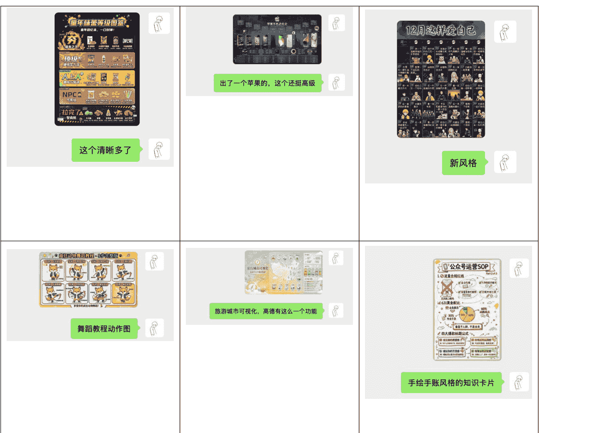

# 公开学习

学人工智能这件事，很重要的一点是公开表达。我进入这个方向的最初理由很简单：我正在学人工智能图像应用，不能只在自己的小圈子里自嗨，必须走出去，把学习过程公开表达出来。我自己的评价不一定可靠——我喜欢的，市场可能不买账；我不看好的，市场也可能接受。某种图片风格到底行不行，只要发到社交平台上的量足够大，它的价值自然会显现。做事需要反馈，发在📕也一样，没有反馈本身就是一种反馈。

# 给准备入场者的行动建议

## 别多想，先发一条

别想太复杂，第一件事就是先发出一个笔记。太多人是“林黛玉的身体，施瓦辛格的心”，整天患得患失。这是我压箱底的几句打气话，分享给你们。

## 先完成，再打磨

先解决“有没有”，再考虑“好不好”；先动起来，才能听到世界的回音。

罗振宇在“知行小酒馆”播客里的几句话，我特别认同。他说，中年人想把路走好，最关键的方法就是“遇事解决事”。什么意思？就是不要沉浸在抽象、宏大的思虑里。我发现很多人总爱琢磨“我到底要不要做📕博主”“这条路能不能走”之类的问题。想那么多干嘛？先做了再说。模仿任何人，最终也成不了那个人；只有真正去做，你才会慢慢成为你自己，这是自然而然的。所以，重点永远是解决问题，而不是不断做判断题。

现在很多人的毛病就是：想得太多，动得太少。想多了会带来两种局面：一种是自我攻击，整天嫌弃自己，觉得别人都厉害、自己不行；另一种是过度防御，觉得所有分享都是套路、都想割韭菜，于是不听、不看、不上当。结果就是一边难受，一边抱怨，一边原地踏步。

我始终相信，如果真想在某件事上变得出色，最好的办法就是直接去做这件事——这是一条被严重低估的人生建议。很多人想进入某个方向时，会先去学一堆所谓的基础技能，觉得以后总能用上；但更明智的选择，其实是尽快投入到那件真正想做的事里。 ——Sam Altman

## 行动大于一切

想通了就干，别被脑中的念头左右。大家的内耗，多半是因为太把想法当回事。可那些念头再重要，也比不上一次实打实的行动。

## 数量先行

先让数量跑起来。现在人工智能生图非常方便，几分钟就能出一批；起步阶段，多发总是好的。我之前在讲用lovart生成图片时也说过，随手一次就能生成二十张，一天弄出一百张图也不稀奇。我个人的疯狂纪录是单日发布五十篇笔记，只要有流量就一直发。

# 写在最后

希望大家立刻行动，在实操中不断进步。可以从👸号入手，等平台的流量变现功能开通后，正反馈来得很快，有阅读就有收益。一边实践，一边沉淀自己的项目方法论、运营笔记；多发布、多测试，把收到的正反馈记入“高光时刻”清单，给自己打气。

加油！


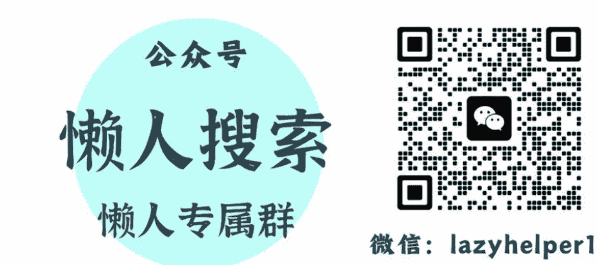

这里是你对抗信息过载的护城河。社群稳定运营7年，累计拆解、精读3000+互联网商业实战案例，也包含行业前沿内参与时政/宏观文章。我们不搬运低质信息，只做高价值内容的筛选器与放大器。


