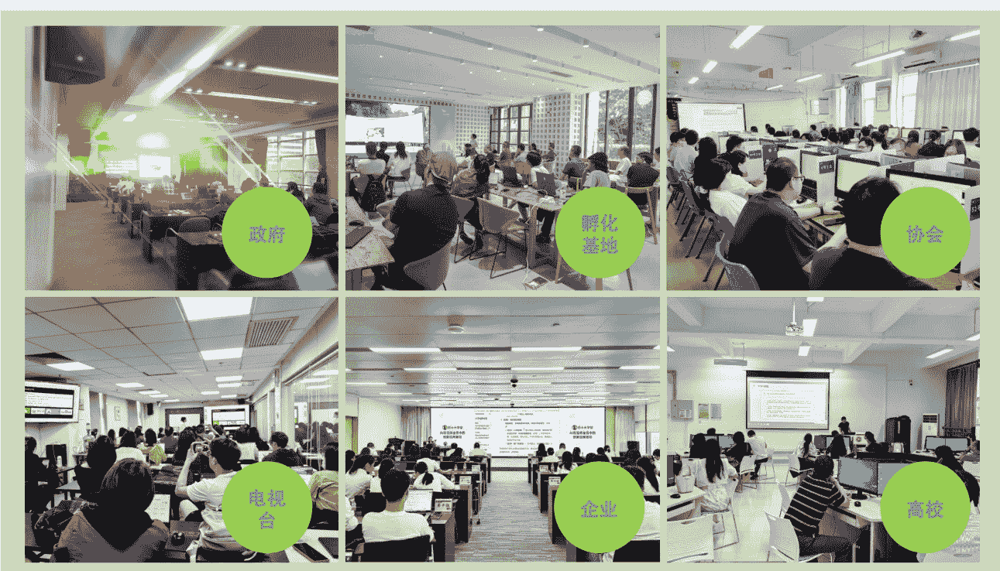
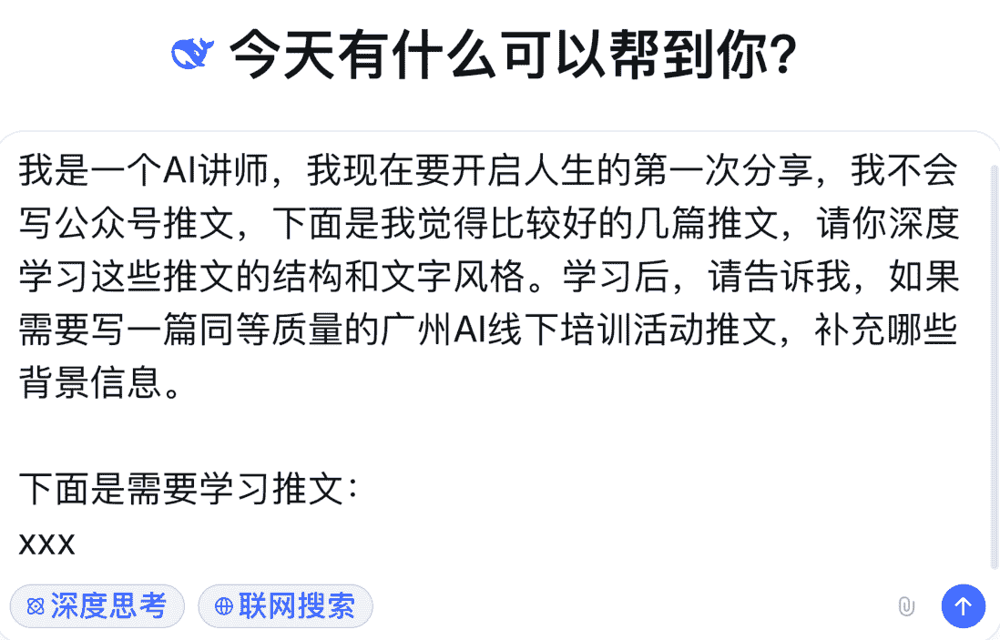
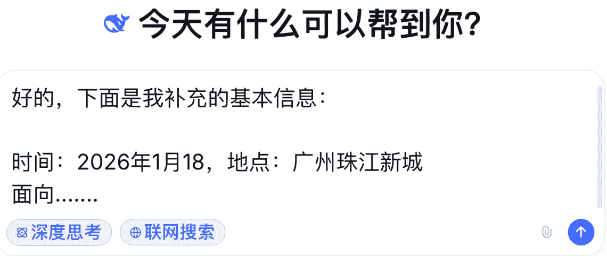
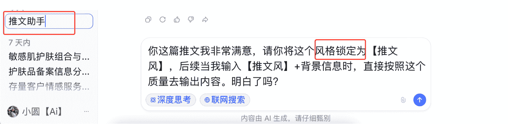
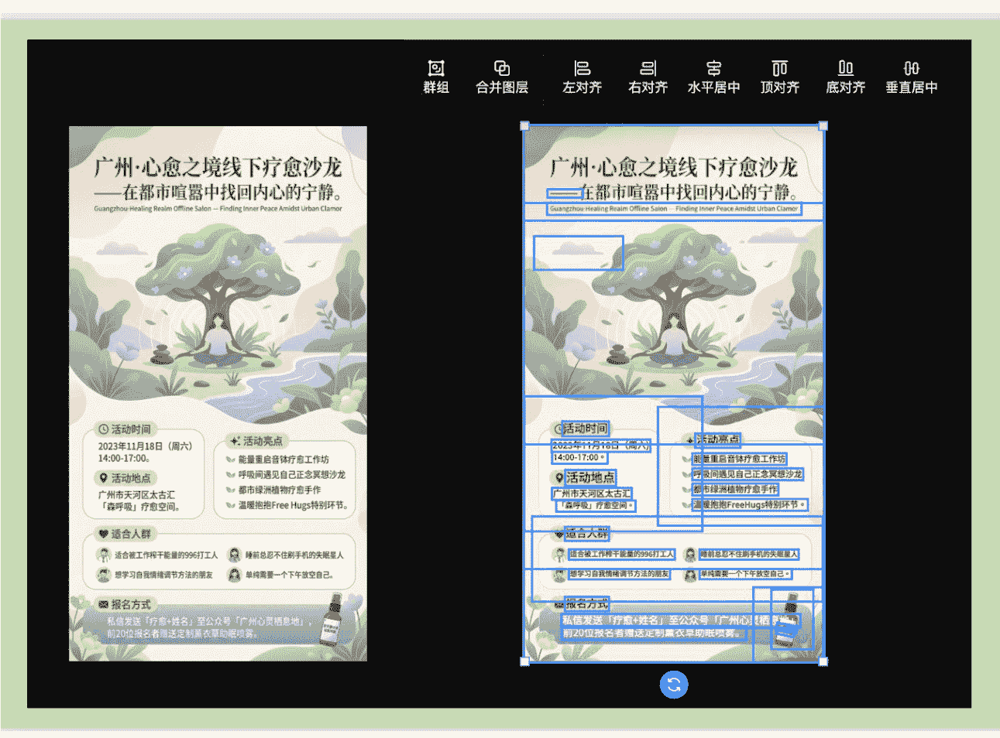
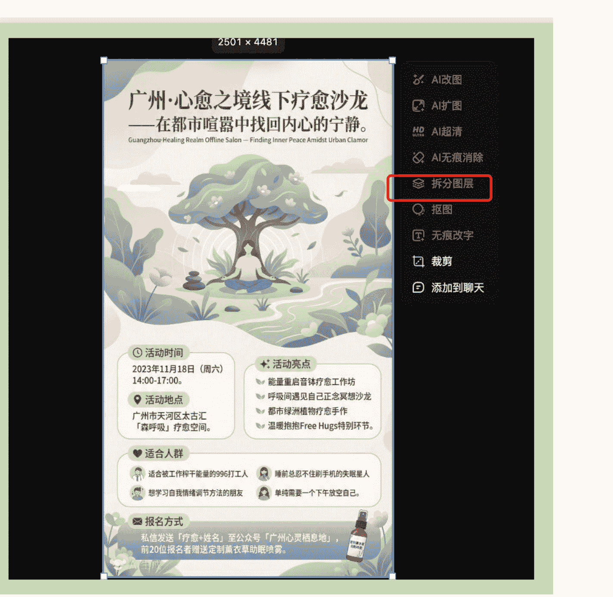
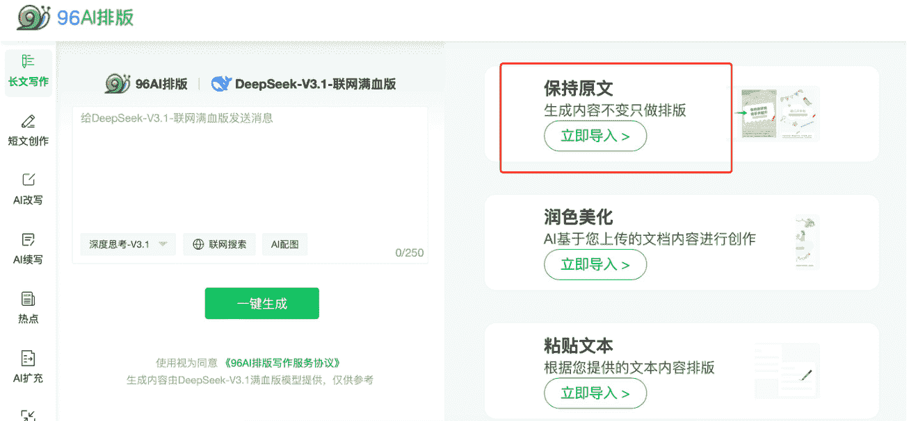
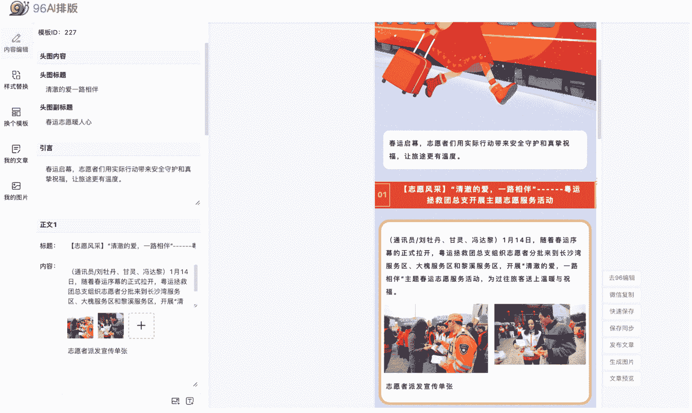
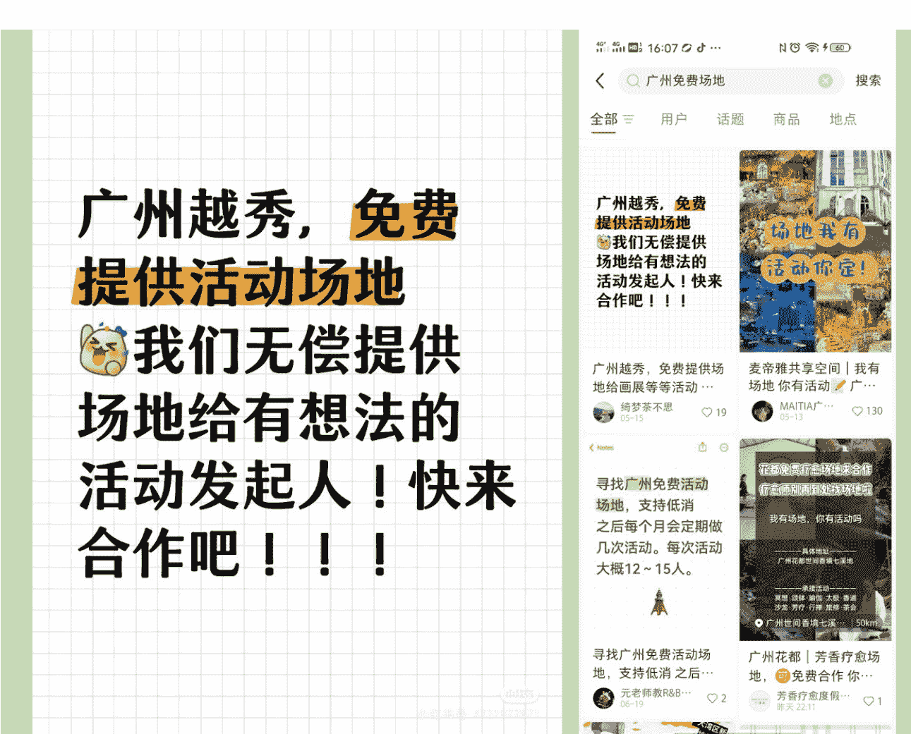
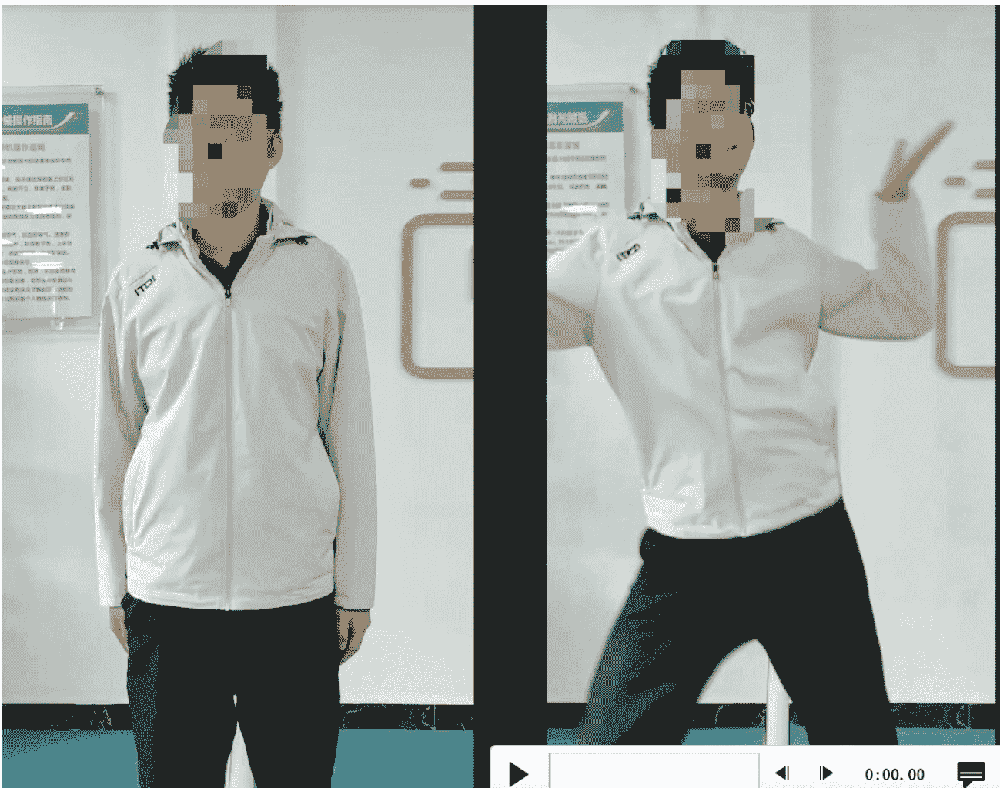

# 【实战复盘】一个人做 AI 培训师，如何从 0 粉，靠借势把个人经验成功变现？

圈友小圆，刚进圈子一个月的新人，掏出了一份相当硬核的实战答卷。她给自己的定位很朴素：不是AI大神，不过是比普通人早几个月用上AI工具的人。但就是这样一个“半路出家”的选手，从零粉丝、零成本的起点出发，20天跑通了第一场线下共学营，累计手把手教了1000多位学员，好评率98%以上；课酬从最初几百块一场，一路涨到每小时上千元，半天就能顶回过去一个月的工资。

这篇文章几乎是一份“个人能力变现”的完整操作手册，从0到1的每个环节——渠道怎么谈、工具怎么选、课程怎么讲——都拆得很细，适合所有想靠经验或技能做知识变现、线下沙龙、企业培训的朋友。

一、先看清钱从哪来

小圆的路径总结起来就是两句话：先用C端积累手感，再去B端放大收入。

C端是“夜校+训练营”的组合，定价亲民，主打职场刚需。99-199元的夜校讲办公提效，覆盖文稿、PPT、Excel这些高频场景；798元的训练营在办公基础上加了副业玩法，比如📕爆款、智能体工作流。这个阶段的主要目的不是赚钱，而是攒案例、攒口碑。

B端则是定制化内训，也是后段真正的收入主力。拿交通行业客户举例，她会围绕对方日常工作来设计教案：AI写新闻稿、AI做PPT、AI剪宣传视频，全程跟练。客单价高，备课反而比C端更省力。

她的判断是：AI培训不必讲得多深，真正的机会在信息差，尤其二三线城市的企业员工，大量人群“知道AI但不会用”，这就是市场空间。

二、零成本起步：她靠的是一个“借”字

为什么不从📕、抖音做起？小圆的回答非常诚实：太慢了，要学的东西太多，反馈周期太长，她怕自己中途放弃。她需要快节奏的正反馈，于是换了一条路——借。

第一，借别人的流量。

最简单的一招：找同城活动类👸号合作。对方手里有流量，你手里有内容，天然互补。她在分成上相当大方，门票直接给合作方30%（常见区间是15%-30%）。话术模板也替你想好了，大意是：主理人你好，我是AI讲师，咱们粉丝画像很契合，我有一套线下共学课程，专门针对职场小白。你出招募，我出交付，学费你拿三成，看行不行？

如果嫌👸号合作不够快，还有一个“大力出奇迹”的群发玩法。花几十块钱在“群脉联盟”这类平台上买100个同城群，注意必须是同城群，精准度才有保证。不想自己动手，就去闲鱼搜“代发”，相当于雇一个“人形群发机”。这个方式反馈极快，适合客单价低、门槛低的引流活动。

当然也有避坑点：这类群质量参差不齐，不适合高端产品；怕封号的话，可以准备一些“无限微信号”当敢死队冲锋，保护主力账号不被波及。这套打法不只用于培训招生，卖虚拟资料、招募兼职、测试小项目都能通用。小圆还提到，有人靠这种群发打法做兼职粉，一天能加1000多人。

群脉联盟入口：https://www.qmlm2022.com 注册需要邀请码，可以填她的STGS35，也可以自己百度搜一个。闲鱼代发的参考价格我放在下面了。

如果想要更精准，就和那些已经拥有大把目标客户的人合作。做同城就找活动👸号，做社区就找社区团购，甚至跨界找实体店——比如你掌握AI写真技能，去找旅拍店合作是不是很顺？一个几千人的活跃社群，只要产品匹配，一场宣传最差也能筛出几个用户。小圆的最高纪录是一个社群单场帮她招了40个人。多合作几个社群，再加上“两人同行打折”这类裂变设计，报名量很快就上来了。

第二，借AI的力。

办活动最烦的就是物料制作，小圆用三件套解决问题。

写推文交给DeepSeek，核心技巧只有一个：投喂。找几篇你自己欣赏的对标文案，直接喂给大模型，让它深度学习，80%的写作问题当场解决。她公开了三个提示词模板，前面两个用来快速起步，最后一个尤其精华，相当于把你的训练流程固化成了一个小型智能体，以后反复用，越用越顺手。

做海报用roboneo，网址：https://www.roboneo.com/。这个工具厉害在哪？市面上很多AI生图工具有两大硬伤：放不了大量内文、改图必须重新抽卡。roboneo把这两个问题都解决了——字多不乱码，图层还可以像PS一样拆分改字改元素。做活动海报简直太方便。有个细节注意：直接生成的图片默认不支持拆图层，需要先下载下来，再重新添加进去；同样，你在外部软件做的图片，也支持导入后拆分处理，自由度非常高。

排版交给96AI👸号排版工具，网址：https://bj.96weixin.com。Word和图片可以同时导进去，一键成型，模板随意更换，还送不少免费次数。很多👸号主理人本来就不帮你排版，用这个工具，3分钟就能产出一篇像样的推文。

课程设计同样让DeepSeek出大纲，很快就能开始招募。小圆提到一本书叫《单干》，里面的“纸盒模型”对她启发很大：别追求完美，先做一个粗糙的“纸盒”丢进市场，有人愿意买单，再回来把它精修成“金盒子”。

第三，借场地。

📕搜“免费场地”，会蹦出一堆答案——很多咖啡馆需要人流。合作逻辑也很简单：不给场租，按人头给咖啡钱，比如每人20元，直接算进门票里。或者干脆跟老板说清楚：人来就会消费，咖啡馆自然愿意支持。如果自己懒得找，直接问帮你推广的同城👸号，他们手里的场地资源多得很。

三、从C端到B端：一场协会培训带来的转机

做C端很辛苦，但它的价值不只是学费。小圆说，C端是最好的练兵场：从最开始面对15个人手忙脚乱，到后来一个人控100人的场子也游刃有余。更重要的是，她最早的B端客户，几乎全是C端学员转介绍来的。

真正的转折点是一场行业协会培训——公共交通协会邀请她为广东省内的交通系统员工做AI培训。一场活动下来，她一次性触达了多家交通企业。从那以后，转介绍就没断过：从协会讲到公交公司，从公交公司讲到高速公司，短短几个月，广州周边的城市几乎跑了个遍。课酬也顺势涨到每小时上千元，半天就是别人一个月的工资。

复盘下来，协会分享一场大约能产生3个企业客户，同行企业内训一场也能带来1个新客户。核心就三件事：认准一个行业，反复触达，做好交付。

这里有两个“野路子”可以抄：

一是行业协会切入。主动联系行业协会，提出做一场“公益分享”。有协会背书，台下坐的就是精准人群，一场讲完，潜在B端客户都在这了。小圆因为主要是转介绍，所以走的是付费合作路线。

二是闲鱼“人型HR”。在闲鱼上找兼职，让他们帮你搜集特定行业的企业联系方式，再安排人去逐一邀约。联系方式去哪找？很多企业👸号后台就能找到。

如果不想做B端，也有轻量路线。小圆一个做跨境的朋友，前期做了一两场C端沙龙后，跟一个陪跑社群合作，直接做起了客单价上万的陪跑项目。

四、压轴干货：怎么讲，学员才不走神？

几乎所有B端客户都是转介绍来的，学员们反馈说，听过不少AI课，很多让人昏昏欲睡，但小圆的课不会。她复盘了三个原则：

原则一：说人话。

在广告公司积累的最大认知是：广告语是“说”出来的，不是“写”出来的。再高深的内容，讲得让人听不懂等于白讲。如果不确定自己讲得够不够通俗，可以用AI验证：开讲前自己录音讲一遍，然后把文稿发给大模型，让它扮演一个学历不高、完全零基础的小白，找出听不懂的地方；再让它切换成一个爱挑刺的听众，指出逻辑不顺、容易让人困惑的地方。附上提示词大致是：我是分享老师，这是我的讲稿，请你以小白的视角评判是否通俗易懂，再以挑刺者的身份指出逻辑断点，讲稿如下。

原则二：让内容与听众“有关系”。

没人想听和自己无关的事，只有听到与自己有关的内容，人才会兴奋。小圆参加过一场沙龙，要求大家为在场的人准备明信片，一个安安静静的小伙伴，把大家的微信朋友圈封面打印出来贴在明信片上，再用各自的标签语写祝福——那一刻全场都被打动了，这就是“与我有关”的力量。

她也把这种设计带进了课堂：课前尽量收集学员自己日常工作的材料，让学习内容即学即用；课上还埋“情绪高潮”，比如把某位学员的照片做成数字人跳舞视频，每次演示都全场爆笑，课的好评就这么来的。

原则三：真正解决学员的问题。

除了特殊要求，她坚持实操跟练。很多人学AI，就是卡在一两个操作细节上，跟练的效果最好。虽然她知道这种方式很难批量复制、很难快速扩张，但它是正确且辛苦的笨办法。恰恰是这条路，让她绕开了线上卖课最卷的赛道，反而做了起来。

五、写在最后：72小时内启动

小圆进圈不到一个月，最大的感触是：这里最不缺项目，最缺执行力。任何想做的事，72小时内必须启动——冲劲过了，可能永远不会再动；如果能24小时内动手更好。先扔一个粗糙的纸盒出去，再慢慢打磨成金盒子。

她这次发帖的动机也很真实——听说申请加入深圳联合办公需要多发言、多贡献，于是火速产出了这篇复盘。她说如果反馈不错，后续还会继续分享AI实操，以及她“旅居搞钱”的经历。

最后顺便安利一下小懒的付费社群：这是一个对抗信息过载的护城河，稳定运行7年，累计拆解研读了3000多个互联网商业案例与前沿内参，不搬运垃圾，只做高价值信息的筛选器。更新记录在这里：https://hk57gvlx7u.feishu.cn/docx/H0kRdZbSboIBR0xkaXtcuVE0nTg

（本文资料来自社群内部知识库，仅供成员课题研究与学术交流，请在查阅后24小时内删除。）