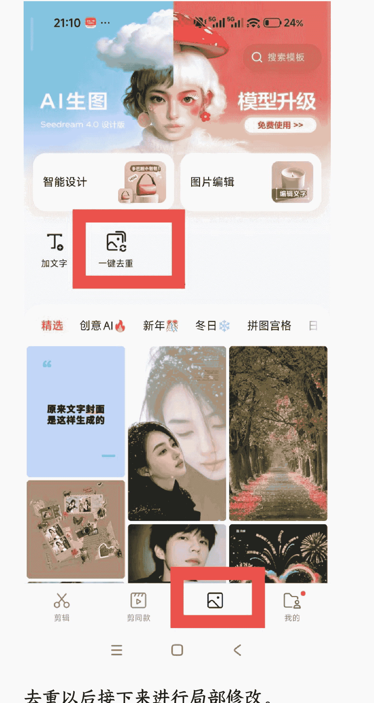
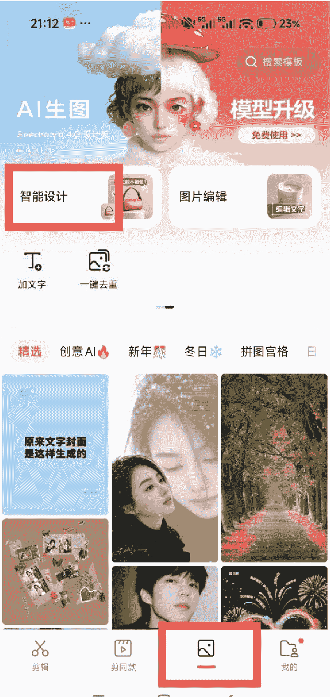
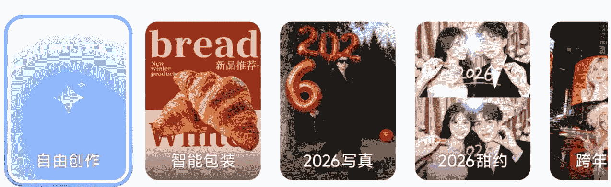
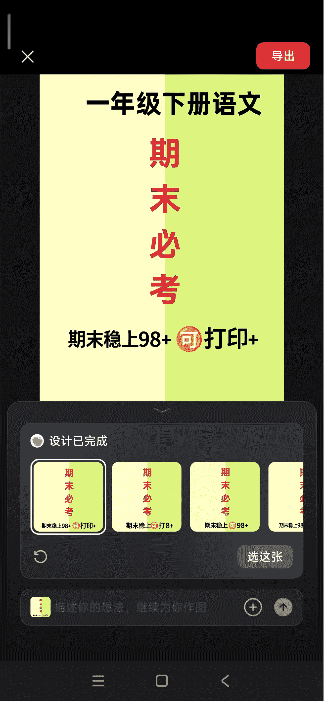
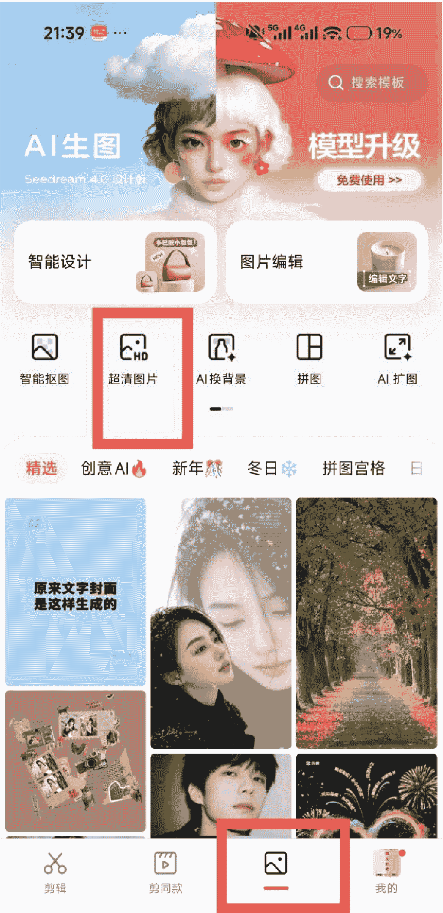
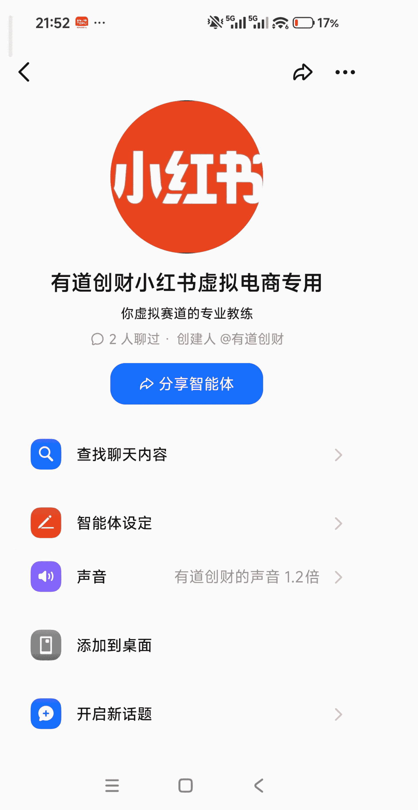
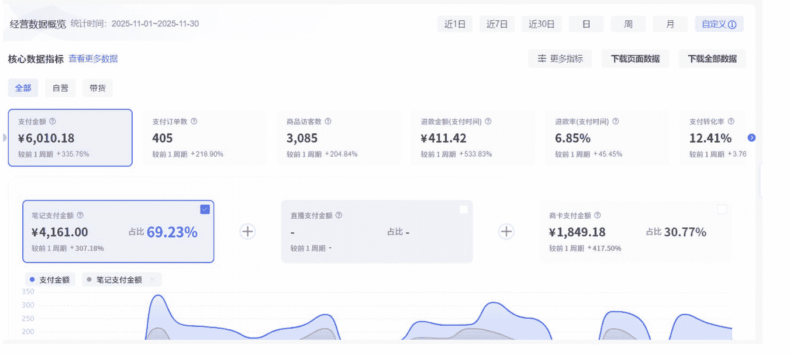

公众号懒人搜索，懒人专属群分享

# 从闲鱼到红书：虚拟商品第二个自然月单店冲到6000的复盘拆解

260130 副业 SC 精华

公众号懒人搜索，懒人专属群独享

懒人微信：lazyhelper1


我是喻清，2019年之前在线下做实体生意，2019年以后全面转到互联网。这6年我只经营一件事：找到值得做的项目，自己先跑通，再去带人跑通。选项目的标准也始终没有变过——必须能创造长期价值。靠着这个标准，我积累了一批长期信任我的学员，也在2024年拿到了互联网职业生涯里的第一个200万。

这是我第二次进生财。第一次来的时候认知有限，没看懂这里的核心价值。今年重新回归，感觉这个圈子已经发展得越来越强，它不只是一个有机会的地方，更可以结识很多同频的创业者。以前我很少主动分享，现在想明白了，走出来才能被人看见。后面我会尽量多在圈子里做输出，也祝大家一路向好。

7月份我开始试点闲鱼虚拟商品，持续操作了两个多月。表现最好的阶段是8月底的开学季，一个人管4个号，单日出货冲到500+。开学季热度退掉以后，日均收益稳定在两三百，但麻烦也随之而来——频繁违规、商品下架，账号权重被打得很低，流量明显受限。正好那段时间我在公众号上看到了红书虚拟方向的内容，判断下来它和闲鱼的底层逻辑应该差别不大，无非是平台不一样，于是决定转场测试。

刚起步做红书虚拟的时候，我的生财会员其实已经过期了。当时是看到一个公众号在推荐，花了1900多学费进去的。因为我自己也在做项目培训，对付费并不排斥，但付完费后只拿到一份飞书手册和一个答疑群，以我的交付标准来评价，这个老师只能打50分，交付感太弱了。

后面在生财的公众号上看到很多关于红书虚拟的干货拆解，这才重新续费，去认真翻阅生财的知识手册。看完以后只有一个感慨：当初就直接在生财学就好了，那1900多学费真的能省下来。

## 一、先用MVP验证项目能不能做

### 1. 让新人来做最小测试

说实话，开始的时候我并不确定红书能不能做起来。我之前做过不少自媒体，从体感来说，红书是几个平台里门槛最高的，同一条内容发抖音、快手、视频号的反馈都比红书来得好。有这个先入为主的印象，我很担心红书虚拟做不起来。所以为了不付出太高的试错成本，我特意没有让正在做闲鱼的团队成员直接切入红书，而是让一位公众号运营同事来当探路人。

当时她的工作内容正好在调整期，用这个项目来测试再合适不过。如果跑通了，她就顺势转到这个新业务上。我买完课、做好对接，把她拉进答疑群，之后就基本放手了，大约10天时间我没怎么去检查进度。

### 2. 我惯用的项目验证方法

我做项目测试，一向是安排专人来做，很少自己上手。因为我始终信一条：专注的人做测试，效率要远高于我自己有一搭没一搭地搞。所以即便要给专人开工资，我也心甘情愿。

我们团队有一条文化：谁做项目，谁就是第一责任人。这是我前期不盯执行的原因。我的角色只是提供支持——把参考手册、老师资源、操作方法都备齐，让她自己去消化、摸索、成长。我的管理方式就是：眼睛盯紧，手放开。

那十来天里，我没有硬性规定她每天要发多少篇笔记，完全按她自己的节奏走。后来我才知道，她保持了一天1篇笔记、1个商品的量。在这个基础上，居然十天左右就陆续出了零散几单。这个信号让我信心大涨——一天就发一条内容、挂一个品就能开单，全职投入干起来问题基本不大。

### 3. 转全职，放大量

看到有稳定出单的迹象后，我私下和带教老师沟通了很多细节。之前在闲鱼也一直用搜索流量，但交流完以后我才意识到，红书才是把搜索流量做到极致的平台。

我一开始对关键词布局这个概念并不清楚，但我非常认一个道理，这是我做销售时大量验证过的——销售是有成功率的。抛开技巧不谈，纯靠碰运气，100个客户里也能碰上1个成交；概率不够，就把基数放大到1000、10000，总量上去了，自然池子里有鱼。

红书搜索流量这么强，那重点就该放在扩大“能被搜到的入口”上。一篇笔记里能埋进3个关键词，发100篇就是300个入口，发1000篇就是3000个。3000个入口和3个入口相比，概率完全不一样。这就是我的笨办法。

思路清晰后，10月8号我让她转为全职操作。具体配置是：每天上架10个商品，每个商品对应2条笔记，配合4个账号来分发，一天就是20条笔记。产量拉上去之后，没几天就见效了，账号很快突破节点，进入稳定出单的状态。

4个账号同步运作时，我注意到其中1个号的表现明显更好，笔记收益高出不少，其他账号收益平平，有的甚至还没开单。我立刻调整策略，不做平均主义，开始强调主次：出单好的主号只发那些已经被验证过的笔记；出单弱的账号专心测试新商品。

后面逐渐形成了1个精铺号+3个粗铺号的格局。三个粗铺号负责测新品，哪个品一旦开单，第二天精铺号就上传同款笔记，持续更新；粗铺号也会跟着这个品不断产新笔记。精铺号权重越来越高，出单效率也高，连带着把店铺整体权重都带上来了。

这里有个认知必须说透：商品笔记的推流机制跟普通笔记完全不同。商品笔记不看互动数，看的是转化。只要转化稳定，系统就会持续给这篇笔记加推，曝光变多以后转化又继续涨，正循环就这么滚出来了。

大概跑到第20天左右，店铺日收益就要摸到200了。我回看后台数据发现，那100多的销售额里，贡献最大的居然只是2个商品搭配的三四条笔记。


之前在闲鱼做虚拟商品，客单价太低，平均一单就3块出头。要做到日收170左右，得开单40多次。但也就在红书上，同样的营收只要12单就能达成。一样的人力成本和时间投入，人效完全是天上地下，这一刻我才真正理解了“红书人群”四个字的含义。

另一个感受也很深：做闲鱼那阵子，一天大几十单进线，咨询多、回复多、售后多，团队累得不行，收益还一般。红书的节奏就舒服多了——消息少、杂事少，收益反而更高。这也直接验证了红书就是精准人群+高质量成交的场子。

之前我们一直是粗放打法，封面、标题都没花心思研究，全凭一股蛮力堆量。看到收益爬得这么快，我知道下一步必须转到精细化运营上面。

## 二、精细化拆解平台玩法

### 1. 先把底层逻辑吃透

这次收益跑出来以后，我彻底认定红书可以做，并且有很强的积累效应。为了把搜索流量琢磨透，我还专门买了一本《长尾理论》回来逐章研究。

这本书把搜索电商的底层机制已经讲得很透彻，核心结论就是：头部爆款和冷门长尾产品都有机会，只要细分做得够深，都容易跑出来。读完以后，我不仅对红书虚拟项目信心更足，对其他细分赛道也更有底气了。

### 2. 商品笔记三要素逐一拆解

#### 一、封面

当时我让同一个商品发两篇笔记，核心目的就是想验证两种封面打法——大字报风格 vs 实拍/截图风格，到底哪一种更好用。跑下来结论是：两者都能打。

先聊大字报。这种封面在红书上属于经典爆款形态。最好的做法是先把同类目里已经爆过的大字报封面保存下来，再在剪映图片设计里做去重处理，整张图的版式、底色、风格都保持不变，只把文字内容替换成自己的产品信息。

操作路径：保存目标封面 → 进入剪映图片设计 → 拉到最右端点击一键去重 → 打开智能设计 → 把目标图放到参考图位置。



将目标图放在参考图位置。



# Hi, 你想设计什么？


输入修改指令（大家不知道怎么输入指令可以直接用我图中的方式）

# Hi，你想设计什么？



将图中的“预习必备”改为“期末必考”，将“共 15 页”改为“期末稳上 98+”，并保持其他所有元素不发生任何变化。


直接让进行下一步，这时候剪映就根据我们要求重新修改图片。



导出这张图片就可以直接使用。

为什么非要用别人已经跑爆过的封面来改？因为能被数据验证过的封面，成功率本身就会更高。对新人而言，前期不建议头铁去做封面原创，那是自己给自己加难度。

再聊实拍或截图类封面。这类封面同样有效，比如做教育资料的，直接截一张练习题的页面截图，或者做一张模拟拍照效果的图，都能当封面用。处理逻辑跟大字报一模一样——找到别人跑出效果的爆品，保留原封面不动，先做去重，再做二次编辑。

二次编辑非常关键，我多说几句。一篇笔记其实包含两个标题：第一个是发布时填的标题，给算法看的；第二个是封面上的标题文字，给用户看的。截图做完去重后，要立刻在图上加文字，用来刺激用户下单。

文字内容不知道怎么写的，可以套这个逻辑：你是什么人群、解决什么问题、达到什么效果。比如上面那个每日一练的截图封面，就可以标上：

六年级学生
易错题避坑提分
做完稳过期末！

字体颜色要挑和原图底色反差大的，整体观感要舒服。字体就别用太夸张的了，干净耐看就行，运营拼的就是细节。这个编辑动作，剪映图片设计和美图都能完成，我更推荐美图，可选的文字模板更丰富。如果不小心存下来的封面有点模糊，剪映的超清图片功能可以直接拉高清。



以上全部功能——去重、智能修图、加文字、超清修复，剪映目前都是免费的，不需要开会员。

#### 二、标题

标题部分就讲三点：

第一，字数压到17个字以内。超过17个字，在信息流里就会被折叠。

第二，标题结构。新人最省力的是借AI帮你拆解爆款标题，再照着仿写。直接把目标标题发给豆包，让它分析结构。

# 1 年级一课一练期末考试必备

帮我分析以上小红书标题结构，并告诉我这个标题能爆的原因

这个标题“1 年级一课一练期末考试必备”是典型的“精准定位 + 强需求匹配”结构，符合小红书虚拟资料赛道的爆款逻辑，能爆的核心原因在于“精准踩中用户痛点 + 信息传递高效”，具体拆解如下：

# 一、标题结构拆解（3 要素黄金组合）

# 1. 精准定位层：“1 年级”

- 直接锁定最细分的用户群体（一年级学生家长/老师），排除非目标人群，让系统精准推流给有需求的人。

- 小红书用户搜索习惯中，“年级 + 学科”是高频组合（如“一年级数学”“三年级语文”），自带搜索流量。

拿到结构拆解以后，再套用你自己的商品去生成标题。

我现在是做 5 年级数学知识点汇总的，请根据以上结构帮我仿写几个标题，要求在 17 个字以内

- 1. 五年级数学知识点｜期末复习必备

2. 5 年级数学汇总｜升学衔接必看

3. 五年级数学知识点｜同步教材考点

4. 5 年级数学汇总｜寒假预习必备

5. 五年级数学考点｜期末冲刺必背

6. 5 年级数学知识点｜查漏补缺清单

每个标题都包含“五年级数学”（精准定位）、“知识点汇总”（产品属性，用“汇总”“考点”替代，保持简洁）、“期末/寒假/衔接”（场景驱动），符合 17 字内要求，适配搜索流量和家长对“针对性、即时用”的需求。

我自己搭了红书智能体，每天都在往里投喂项目实操经验和运营心得，所以给AI下指令的时候，我没有刻意设定身份。但大家如果用AI来做仿写，提示词一定要写好，明确身份以后再让它输出，效果才会好。对这块感兴趣的圈友可以直接找我，我们训练了一个专门针对这个项目的智能体，可以直接给大家用。



#### 三、标题关键词布局

前面我提到，标题是给算法看的。你想让哪类搜索词命中你的笔记，就得把这些词直接放进标题里，才有机会被算法识别。

我的布局思路是：核心词打底，再加一个热门选题词，两者结合着用，既能吃到搜索流量，又能蹭上内容热度。

做虚拟教辅资料时，很多人只盯着“资料名称”，却忽略了时间节点带来的搜索需求。

以考前阶段为例，标题里可以加入“期末冲刺”这类场景词，再把具体商品放进去。比如，资料本身是“一年级错题分析”，就能组合成：

**一年级错题分析｜期末冲刺精选108题**

这样既交代了适用对象，也传达了使用场景和资料用途，家长浏览时更容易迅速判断是否符合需求。

#### 4. 笔记内容怎么搭

笔记创作主要看以下几个方向。

### 1. 先搭好内容骨架

刚开始不会写时，可以把同领域表现较好的笔记交给 AI，让它提炼开头、展开、展示和收尾的组织方式，再据此重新构思。重点不是复制原文，而是借鉴表达路径。

更重要的一点，是整篇内容必须符合账号身份。

不少人以为垂直就是只做某个年级或某门学科。实际上，垂直更接近“持续服务同一类人”。只要你的表达始终围绕相对稳定的受众，账号就具备清晰定位。

因此，创作前先明确三件事：

- 你以什么身份分享；
- 你主要帮助哪类家长或学生；
- 你提供的资料解决什么问题。

你可以是经历过备考的学长学姐，也可以是每天陪孩子学习的家长，或者是一线教师。身份不同，语言、案例和关注重点都会不同，也会影响受众对你的信任。

例如，许多家长会优先选择同为家长的卖家，本质上是因为对方更容易理解自己的真实困扰。初稿完成后，最好让 AI 按你的身份重新调整语气、案例和叙述角度，而不是停留在通用模板层面。

还可以进一步让 AI 结合账号定位，判断更适合你的内容方向。比如，“带娃家长 + 虚拟教辅资料”这一组合，通常适合以下几种笔记：

### 1. 家长困扰切入，给出资料方案

这是最容易促成购买的一类。

先描述日常中真实存在的学习难题，再展示资料如何帮助解决。比如：

**标题：孩子计算题反复出错？我用这张归类表找到了原因**

正文可以写陪孩子练习时发现，他在小数除法中总把小数点位置弄错，反复讲解仍然容易犯同样的问题。随后展示资料中按错误类型整理的几个模块，并说明每一类旁边都配有提醒和纠错方法，最后自然带出这份资料的整理过程与使用方式。

它的关键在于：先让读者产生“这不就是我家孩子吗”的代入感，再证明资料确实有针对性。

### 2. 展示资料细节，补充使用记录

这一类内容要让读者看清资料到底长什么样、怎么用、用了之后有什么变化。

可以拍摄页面细节，例如颜色区分的公式页、带步骤讲解的应用题页面，再配合孩子的实际反馈。比如，过去孩子容易混淆公式，于是把教材中的内容按图形、计算等维度重新整理，每页补充一道示例题。经过一段时间练习后，孩子做小测时的正确率有所提升。

相比只说“很好用”，具体页面、使用过程和反馈更有说服力，也更适合介绍内容较丰富的资料合集。

### 3. 融入日常陪学场景

不要每篇都像商品介绍。可以记录陪孩子学习时的片段，让资料以道具或工具的形式自然出现。

例如分享假期预习过程：过去孩子总要催促才肯开始，后来使用按天拆分的预习清单，每天只完成几项并自行勾选，慢慢形成了主动查看任务的习惯。配图可以呈现清单页面、桌面使用场景或完成后的标记。

这种写法更像生活分享，商业痕迹较弱，同时能持续塑造真实、用心的家长形象。

### 4. 做选择建议与横向比较

还可以从家长容易踩坑的地方切入，比如比较不同类型资料的适用人群、编排方式、难度和使用成本，帮助读者做判断。只要比较标准清晰、结论客观，就能逐步建立专业印象。

## 2. 正文里的搜索词怎么安排

标题只是入口，正文同样承担着承接搜索需求的作用。因此，发布商品笔记时，不能只凭感觉随意塞词，而要先理解平台的检索和分发机制。

商品笔记的搜索优化，归根结底是让内容更贴近用户输入的需求，同时让平台准确识别笔记主题。对于 K12、考证、公考等虚拟资料，可以从两个流量来源理解：

### 搜索流量

用户主动输入“某年级数学复习”“教师资格面试真题”等词时，平台会结合文本相关性、账号表现和笔记权重进行展示。词语是否贴合真实需求，比单纯堆砌数量更重要。

### 推荐流量

平台还会依据用户兴趣、身份标签以及内容互动表现，将笔记推送给可能感兴趣的人群。也就是说，文案主题、关键词和实际内容必须保持一致，读者的收藏、评论、停留等反馈也会影响后续扩散。

完成初稿后，建议再做一次发布前检查。可以让 AI 按照社区规则审阅全文，重点查看夸张承诺、敏感表述、违规营销和可能触发限制的词语，发现问题后及时替换。

在 AI 普及之后，工具不只是用来生成文字，也能辅助判断选题、受众和发布风险。真正有效的做法，是把它当成分析助手，而不是单纯的写作机器。

## 3. 话题怎么选

话题功能经常被忽视，但它不仅关系到额外曝光，也能帮助平台理解内容属于哪个领域。我们在判断选品方向时，也会参考相关话题的热度变化。

给笔记配置话题时，可以采用“核心—细分—场景”的组合方式。

### 第一层：核心标签

选择一到两个最贴近资料和需求的标签，通常由适用对象、学习阶段和资料用途组成，让用户一眼明白内容服务谁。

例如：

- 五年级数学复习资料：#五年级数学 #数学复习
- 幼小衔接拼音练习：#幼小衔接 #拼音启蒙
- 教资面试结构化题库：#教师资格证 #教资面试

### 第二层：细分标签

继续补充具体问题或使用目的，例如计算训练、错题整理、假期预习、面试备考等，让内容定位更加清楚。

### 第三层：场景标签

根据发布节点和读者状态添加场景词，例如考前复盘、寒假学习、家庭辅导、每日打卡等。这样既能覆盖更多相关需求，也能让推荐人群更准确。

标签不宜堆得过多，最重要的是与正文真正对应。标题、封面、正文和话题保持同一主题，整体效果通常比单独优化某一个位置更好。

当这些环节都处理好后，就可以进入发布阶段。如果觉得步骤太多，可以把选题、结构、关键词、话题和风险检查整理成一套自动化流程。我自己的做法，是把多组提示语串联起来，让 AI 按顺序完成分析和修改，执行起来会轻松不少。

## 11 月整月，店铺营业额刚好超过 6000 元



不过，10 月时我们的首个账号已经出现过单日销售额超过 200 元的成绩。于是到了 11 月，我又把原本负责闲鱼业务的一位运营调到小红书，相当于重新启动了一个账号。到目前为止，新账号的月销售额也已经超过 5000 元。

今天先聊到这里。后续准备继续整理投放、搜索词占位以及账号起量方面的经验。12 月我们还同时推进了两家新店，这些实操内容后面会更值得分享。感兴趣的话，可以在留言区告诉我，我再继续整理。

## 最后，推荐一下小懒的付费社群

### 懒人专属群（简介）


这里更像是一道过滤噪音的防线。

社群已经持续运营 7 年，累计整理、拆读 3000 多个互联网商业案例，以及行业内参、时政和宏观类文章。

我们不追求堆满链接，而是帮助成员从大量信息中筛出真正值得关注的内容，并进一步放大其中有价值的线索。

### 懒人专属群更新记录

```
https://hk57gvIx7u.feishu.cn/docx/H0kRdZbSbolBR0xkaXtcuVE0nTg
```

【免责声明】本资料归档于社群内部知识库，仅供成员课题研究与学术交流，请在查阅后 24 小时内删除。