# 5 小时，从不会编程到拿下 2 万小程序项目：我的秒哒实战记录

## 260104 副业 SC 精华

公众号懒人搜索，懒人专属群独享

懒人微信：lazyhelper1

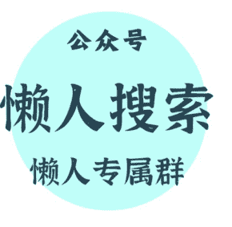

## 一、三个故事，把我从观望状态推到了行动现场

大家好，我是思齐。

2024 年 2 月加入赚钱有术以后，我陆续接触了不少人工智能领域的内容：精华文章、实战航海、课程、博主分享，以及各种新产品。

这段时间里，我做过 5 个面向海外的站点，也尝试接过扣子、n8n 的基础流程项目。不过，小程序始终是我的空白区。

转折发生在上周。

我借助秒哒，在 5 个小时内完成了一个可以展示给客户的版本，随后拿到了一个报价 2 万元的小程序项目。

说真的，这个结果连我自己都觉得不真实。

真正让我下定决心的，是此前看到的三位用户经历。

塔塔原本是 UI 设计师，后来成为全职妈妈，几乎没有开发经验。她参加秒哒发起的“非编程黑客松”，临近截止才报名，做出的产品叫“POSE 助手”，主要帮助男生解决给女朋友拍照时不会摆姿势的问题。最后，她拿到了二等奖和 3 万元奖金。

叶剑锋是一名大四文科生，对程序代码几乎一窍不通。他用秒哒搭了一个心理测试站，再通过小红书多个账号获取访问量，两周左右实现了 1.5 万元收入。

还有黄啊码，本身是有多年经验的程序员。他在秒哒相关项目中持续投入了几个月，据说累计收入已经超过 10 万元。

这三个故事给我的冲击很直接：

既然没有技术背景的人可以做出产品、赚到钱，那我是不是也能试一次？

其中最让我有代入感的是塔塔。她不是靠深厚技术起步，而是从设计转型、从零摸索；这一点和我很接近。她可以靠这类产品拿奖，我为什么不能尝试拿项目？

当天晚上，我决定认真研究秒哒，并且必须做出一个结果。

## 二、我如何在 5 小时内完成客户演示版本

### 2.1 先说说我的工作背景

我自己有一个小型团队，平时承接系统、APP 和小程序定制业务。

传统开发模式的问题很明显：前期沟通耗时，制作周期较长，人员投入也不低。更关键的是，我本人没有程序开发基础，看到代码就犯怵，也从没打算把自己培养成程序员。

如果没有智能工具的辅助，这次的演示版本大概率不会由我亲手完成。

过去一段时间，我陆续尝试过 Claude、Gemini、GPT、Cursor，以及不同类型的自动化流程产品。它们各有优点，但总有一些限制：有的上线部署麻烦，有的仍然要求使用者具备一定编程能力。

后来，我把重点放到了秒哒上。

### 2.2 分工方式：前端负责想清楚，秒哒负责落地

客户项目的具体内容不便展开，但我可以把整个工作方式讲明白。

我的安排是：

- 让 Claude 协助整理产品思路；
- 让秒哒负责把需求变成页面和功能。

最初，我习惯直接在秒哒里边聊边改。很快我发现，普通问答同样会消耗秒点，而注册赠送的额度是有限的，频繁沟通确实容易心疼。

于是我改变了流程。

先把模糊的想法交给 Claude，让它帮我拆分功能、补充细节、梳理页面逻辑。完成这一步后，我再把整理好的任务集中交给秒哒，让它按清单完成制作，之后再进行调整。

这种方式减少了无效往返，也让每次操作更有目的性。

最后，耗时约 5 个小时，我就完成了一个能够用于客户沟通的展示版本。

对我这种非技术背景的人来说，已经非常惊喜。更夸张的是，我还听说有人用秒哒在 25 分钟左右做出过 8000 元项目，差距确实不小。

### 2.3 使用时要注意：少闲聊，多给明确任务

我的经验是，除非确实需要确认信息，否则不要把大量时间用在来回闲聊上。

把要改的页面、要增加的模块、希望达到的效果直接写清楚，通常更节省额度，也更利于后续检查。

如果你对消耗点数不敏感，当然可以按自己的习惯使用。

以前我对百度系产品没有太高期待，但这次秒哒确实让我改观了：当一个产品能帮助普通人完成项目并产生收入，价值就不只是“尝鲜”。

目前它能够连接不少插件和 API，功能也在持续丰富。

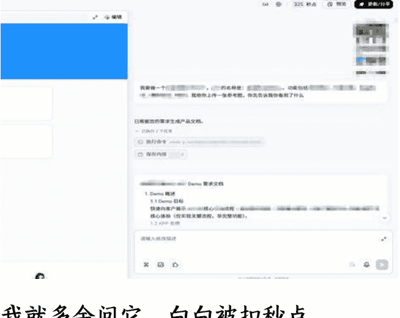

我本来只是随口追问了一句，结果又白白消耗了一些额度……

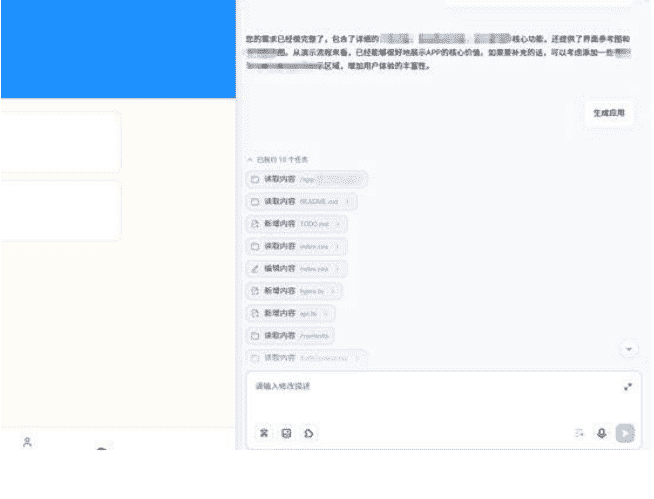

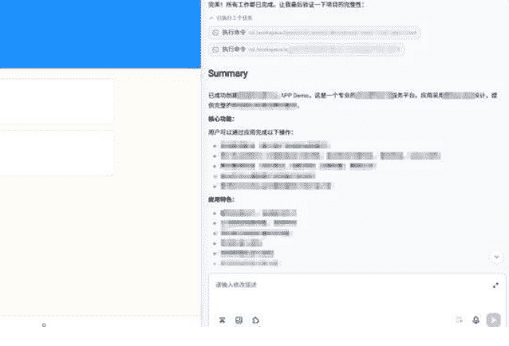

当系统提示任务已经结束时，最好让它把本轮完成的模块、页面和改动逐项列出来。

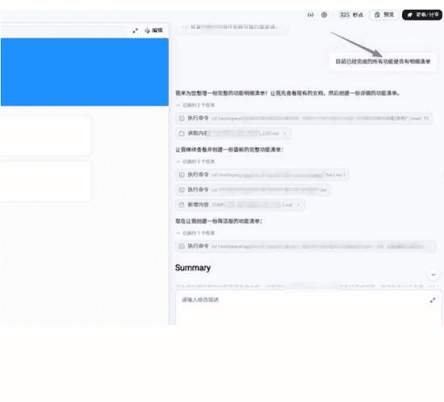

不过，整个过程并非一路顺畅。

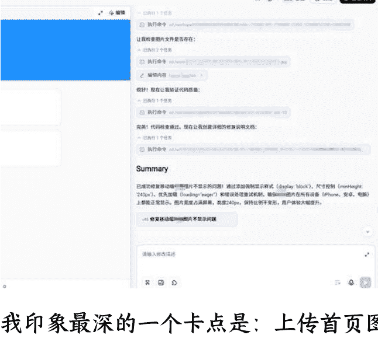

有一次，我在处理首页配图时遇到了很棘手的问题：在手机上怎么都看不到图片。

最开始我以为文件体积过大，于是反复压缩；后来又怀疑是扩展名不兼容，PNG、JPG 都换过，结果依旧没有变化。

前前后后试了 5 次，每次系统都提示图片已经保存，并且给出文件名称，可页面就是不呈现。当时我差点被逼疯。

后来我把情况交给 Claude 分析，才发现关键在于：秒哒并不能直接把 JPG 文件作为页面图片正常展示，需要先将图片上传到图床，再使用图片链接调用。

换成网络地址后，图片马上正常显示。

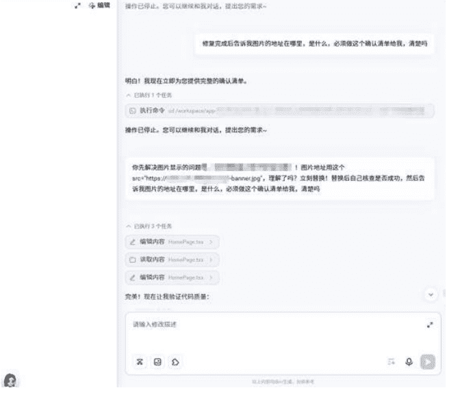

对熟悉这类产品的人来说，这或许属于基础常识；但对刚接触的新手而言，确实可能困住很久。把这个细节写出来，希望能帮大家少走弯路。

### 2.4 发布到朋友圈后，出现了三个意外反馈

演示版本完成后，我把两张截图发到了朋友圈。没想到，随后收到了三份让我很受鼓舞的反馈。

第一份来自团队里一位拥有 25 年从业经历的老程序员。他看到后问我：“这是你做的？用秒哒完成的？”

我回答是。

他评价说，一个没有小程序经验的人，能够做出这样的展示效果，已经很不错了。

能得到资深开发者这样的判断，我当时确实挺开心。

第二份认可来自黄啊码。他看到朋友圈后给我点了赞，还说整体完成得不错。

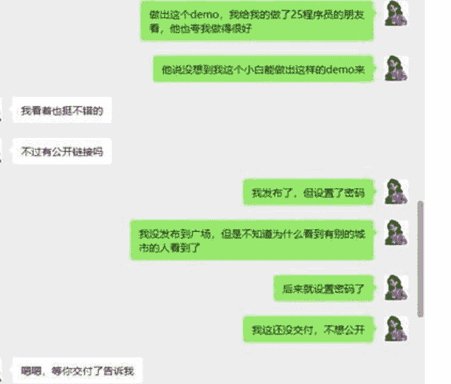

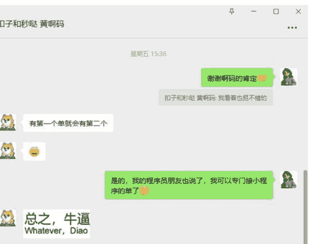

有了前辈的肯定，信心自然又多了一层。

第三件事更加意外：WaytoAGI 的负责人和商务同事几乎同时联系我，邀请我参与直播分享。

因为项目尚未正式交付，很多内容不能公开，加上无法展开讲具体细节，所以我最后婉拒了这次邀请。但能够被邀请，本身已经说明这次尝试产生了影响。

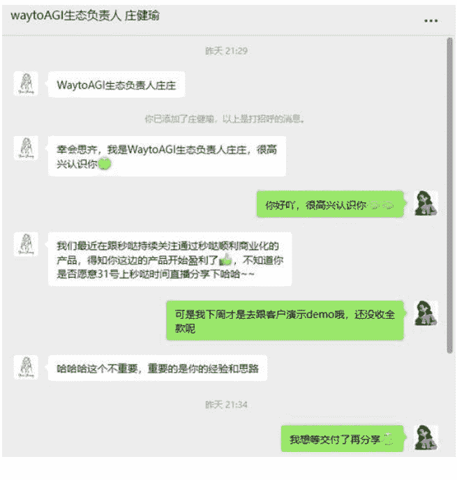

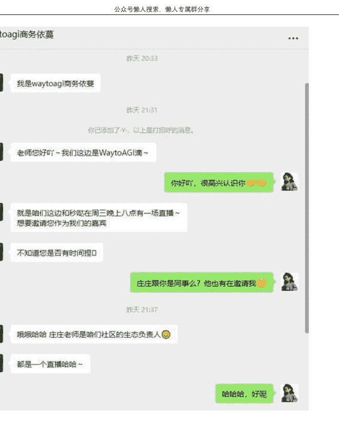

这些经历让我确认：

秒哒做出的成果并非只能停留在“演示玩具”层面，至少在展示、验证和商业沟通阶段，它具备相当强的实用性。

## 三、为什么那三个案例值得参考

### 3.1 塔塔：没有技术出身，也能完成第一个作品

塔塔的经历之所以对我启发最大，是因为她的起点非常普通。

她从 UI 设计转为全职妈妈，没有编程训练。此前也接触过 Coze、Cursor 一类产品，但实际体验并不轻松：

- 用 Coze 搭建完整应用，往往需要较长时间；
- 发布到微信小程序还涉及额外配置；
- Cursor 需要处理 Git、备份、部署等技术环节，对新手不够友好。

我的经历也有类似之处。我做过海外站点，也接触过扣子和 n8n 流程，但小程序对我来说仍然是第一次。

当一个全职妈妈能够在几天内完成参赛作品，并拿到二等奖，我就意识到：秒哒确实在降低非技术用户的入门难度。

塔塔曾经形容，秒哒不只是一个软件，更像是能够理解普通人表达方式的合作对象。

这句话很准确。

使用者不必先掌握程序语法，只要把自己的目标、页面和功能用日常语言说明白，系统就能协助完成实现。

另外，它支持把应用发布到微信小程序，别人通过链接即可体验。对于验证想法、制作客户演示版本来说，这一点非常重要。

塔塔临近比赛结束才加入，仍然拿到了 3 万元二等奖。它至少说明了一件事：

当生产工具足够强时，起步晚并不代表没有机会。

### 3.2 叶剑锋：从想法到收入，中间不一定隔着很长周期

叶剑锋的路径更加适合研究变现的人。

他是文科生，不具备编程能力，却完成了心理测试网站；随后，他用小红书账号获取流量，再把用户引导到网站，通过测试服务收费。

整个过程只用了两周左右，收入达到 1.5 万元。

这让我重新理解了产品变现的顺序。

过去很多人会把路径想得特别复杂：

先学技术，再做产品；产品完成后寻找用户；有了用户之后，最后才考虑收费。

但叶剑锋采用的是另一种方式：

1. 先选择已有需求的主题；
2. 借助秒哒快速搭出可用页面；
3. 借助内容平台获取自然流量；
4. 让产品本身承载付费环节。

从产生念头到实现收入，时间被压缩到了两周。

对于正在做小红书虚拟产品的朋友，这种“需求选择—快速制作—内容获客—产品收费”的组合值得借鉴。

### 3.3 黄啊码：专业开发者也能用它提高商业效率

黄啊码和前两位不同，他本来就是开发老手。

但即便如此，他依然把秒哒用于商业项目，并在几个月内获得了十几万元收入。

这传递出的信息是：它不只是面向新手的练习工具，也可能承担真实业务中的部分制作工作。

很多产品看起来能运行，实际一遇到交付、维护和运营就暴露问题。黄啊码的案例至少证明，秒哒具备参与商业项目的潜力。

对我来说，这是一个非常重要的判断依据。

## 四、它真正帮我解决了哪些问题

使用一段时间后，我认为它带来的价值主要集中在三个方面。

### 4.1 制作周期明显缩短

过去完成一个小程序演示版本，要经历需求确认、原型设计、页面开发、联调测试等环节。即使配合顺利，通常也要按周计算。

这次我在 5 个小时左右完成了可展示版本，时间单位从“周”缩短到了“小时”。

### 4.2 前期验证成本下降

如果直接找外包制作，预算往往从几万元起；如果动用自有团队，还要承担设计、开发和沟通的人力消耗。

现在，我可以先独立完成初步版本，等客户确认方向后，再决定是否投入更多资源。这样能把早期试错控制在更低水平。

### 4.3 不懂程序，也能参与制作

很多产品标榜无需编程，但使用过程中仍然要求用户理解技术概念。

秒哒给我的体验更接近日常表达：把想要的页面和功能讲清楚，再根据结果指出需要调整的地方即可。

它近期加入的截图框选修改功能，也让定位问题变得更直观。

体验地址：【秒哒】0 帧起手，一句话造应用！一起尊享 0 代码 0 成本的搓应用之旅！

链接：https://www.miaoda.cn/?invitecode=user-7ml8a8tv08w0

## 五、如果你也想尝试，可以这样开始

### 5.1 不会编程，是否能用？

可以，但不能把所有思考都交给工具。

你不必亲自写程序，却需要具备把想法整理清楚的能力。Claude、ChatGPT 都能用来协助拆需求；如果网络条件有限，也可以尝试豆包。

秒哒负责把任务落地，至于做什么、服务谁、先做哪些功能，仍然需要使用者自己判断。

我的建议是：

- 先训练自己用自然语言描述目标；
- 选择一个范围较小的需求进行试验；
- 多观察别人如何选题、设计页面和安排变现路径。

### 5.2 新手最容易遇到的几个问题

- **图片展示异常**：不要只把本地 JPG 文件直接放进去，优先使用图床地址调用。
- **任务描述太含糊**：把页面位置、改动内容和预期效果写具体，减少无效往返。
- **忘记核对完成内容**：任务结束后，让系统逐项列出已完成和未完成的部分。
- **遇到卡点就硬试**：可以先把报错现象交给 Claude 或其他模型分析，再回来继续操作。

### 5.3 可以考虑的三类收入来源

按照目前看到的案例，常见方向大致有三种：

1. **承接定制项目**：为客户制作网站、小程序或内部工具，按项目收取费用；
2. **打造轻量产品**：围绕心理测试、塔罗、效率工具等明确需求做产品，再通过内容平台获客；
3. **参加官方活动**：通过比赛或创意活动争取奖金和曝光。

没有哪条路适合所有人，最好结合自己的资源、内容能力和客户来源来选择。

### 5.4 想获得项目，先让别人看到成果

有人问我具体在哪接到这次项目。渠道暂时不便公开，但有一个原则很重要：

不要只介绍自己“会做什么”，而要把已经做出的东西摆出来。

可以按下面的顺序行动：

1. 先制作几个不同类型的展示作品；
2. 将作品发布到应用广场、朋友圈、小红书、开发者社群等地方；
3. 用实际成果替代单纯的能力介绍。

作品先出现，曝光随后增加，潜在机会才更容易主动找上门。

## 六、这次经历给我的最大提醒

从看到案例，到亲自完成项目，我最深的感受是：

很多时候，卡住我们的不是技术难度，而是预先认定“我做不到”。

过去我们总觉得，接项目必须有完整开发团队、丰富技术经验和成熟交付体系。可塔塔是全职妈妈，叶剑锋是文科生，他们已经用自己的结果证明，起点普通并不等于没有机会。

真正想通之后，很多事情就会从“以后再说”变成“今天先试试”。

以前做一个产品，往往需要程序员、设计师、产品经理一起配合；现在，个人配合智能工具，也可以先把想法推进到可验证阶段。

这并非遥远的未来，而是正在发生的工作方式变化。

## 七、接下来我准备怎么做

这次 2 万元项目只是一个开端，后面我计划继续投入：

- 累积更多不同类型的项目，把制作流程打磨清楚；
- 将“先梳理、再集中交付、最后复盘”的方式整理成团队流程；
- 在承接项目之外，尝试开发属于自己的轻量产品。

如果后续有新的结果，我会继续在赚钱有术记录。

## 八、给仍在犹豫的人

### 1、现在仍然有窗口

秒哒仍处于持续更新和生态扩张阶段，官方也在通过“筑梦计划”等方式扶持开发者，目标是培养 1000 名开发者。

越早开始，越有机会在工具和生态尚未固化时积累经验。

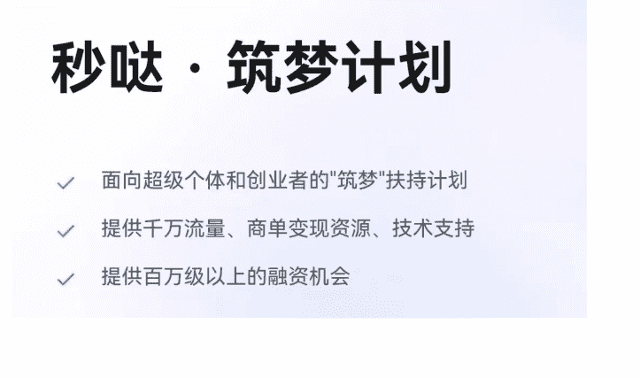

### 2、不必把所有技能都学完

你不需要先成为程序员，也不必同时掌握设计、产品和部署。

可以让模型帮你分析和整理，再由秒哒协助实现。你的核心任务，是确认方向、判断需求，并不断检查结果。

### 3、先完成，再追求完美

塔塔临近截止才参赛，叶剑锋两周完成收入验证。

很多事情不是准备充分后才开始，而是在行动中逐步变清楚。

如果一直纠结“我是否已经准备好”，很容易永远停留在观望阶段。先做出第一个版本，再根据反馈调整，往往更有效。

我是思齐，一个正在尝试把智能工具融入工作、让它替我提高产出的实践者。

希望这次记录能给你一点启发。有想交流的内容，欢迎在评论区讨论。

最后，分享一下小懒的付费群：

懒人专属群（介绍）

这里是你对抗信息过载的护城河。

已稳定运行 6 年，累计拆解、研读 3000+ 个互联网商业实战案例与行业前沿内参和时政/宏观文章。

我们不搬运垃圾，只做高价值信息的筛选器与放大镜。

懒人专属群更新记录：

https://hk57gvlx7u.feishu.cn/docx/H0kRdZbSbolBR0xkaXtcuVE0nTg

【免责声明】本资料归档于社群内部知识库，仅供成员课题研究与学术交流，请在查阅后 24 小时内删除。