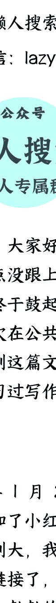
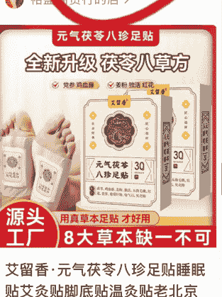

# 上班上不动，就自己开店：一个病人靠小红书小店慢慢找回主动权的实录



你们可以叫我Lydia。我很少在公开场合说话，更别说写这么长的东西。今天把它写出来，是因为那场线下活动，给我留下了一记很深的震动。

2024年1月下旬，我咬咬牙坐上了去上海的列车，去参加平台的年度交流会。现场有几百人，大多数人都在笑，眼睛里有光。我坐在台下，已经很久没有过这种“被一群鲜活的人围着”的感受了。

回家后，我把那天拍的照片翻出来，一张一张看，越看越心慌。我看到了人群里的自己，灰扑扑的，像一团影子。原来我这几年，一直是这样出现在世界面前的。

我沉默了很久。以前的我并不是这个样子的……为什么短短几年，一个人可以黯淡成这样？

## 那些年，身体一直在跟我作对

我的底子从小就差，小时候动过三次刀，上过手术台。大学之后运气转好，毕业后去了上海。头一份工，我在平安做交通事故的伤情理赔评估，一干就是两年多；后来跳进一家头部管理培训公司，给企业客户做咨询，一直待到2024年初。

真正的急转弯，发生在2021年7月9日晚上。我站在凳子上理衣柜，忽然看不懂眼前的字，人一下就没了意识。醒过来时，人已经躺在地上，邻居守在门口，老公带着急救人员冲了进来。检查做了一堆，医生却什么都没定论。

两个多月后的一个阴天下午，我在客户那边布置完培训教室，出来打车，接着就认不出对面银行招牌上的字。再醒来，已经摔倒在路边，手和脚都磨破了，银行的工作人员守着我，旁边停着刚赶到的救护车。这一次，医生给了明确诊断：癫痫。

后来我在社群里看到郭安润老师发过一段话：先接受，再和解，然后找到合适的机会走出来。我反反复复看了很久，才终于试着把那两个字讲出口。

确诊之后，我开始长期吃药。发作基本都是小症状，控制得也算稳定，可我心里从来没松过的那根弦一直绷着：我害怕自己什么时候又会突然断片，害怕脑子一天天变钝，害怕亲戚朋友看我的眼神里装着同情，害怕被人嫌弃。药也在悄悄改变我的情绪，我一天比一天更不爱讲话。

2022年上海解封后的第一周，我坐在家里玩手机，左眼忽然就糊了，稍远一点的东西全是重影。跑去医院一轮一轮地查，说是眼底视网膜半脱落，但病因找不到，只能靠身体自己修复。后来确实慢慢好了，但我真的后怕——差一点，我就只能靠一只眼睛看这个世界。

再往后，身体的毛病开始遍布各处：膝、指、肋、肠胃、扁桃体、鼻，轮着发炎，感冒变得频繁。有专家说这可能是新冠攻击神经和免疫系统留下的后果，我无从验证，但难受是真真切切的。到2024年初，我的情绪也彻底跌进谷底，好多次半夜冒出“要不就这样算了”的念头。

那年年初，我辞了职。身体到了极限，我实在撑不动了。

## 一通直播，把我引向了另一条路

老公刷到一个叫“生财有术”的直播间，顺手帮我报了名。2024年3月底，我进了社群。新手资料还没读完，就碰上了训练营。我不方便露脸，也不肯开镜头，就在几个方向里选了小红书小店。

第一场教练直播是刀姐。她在镜头前的那种冲劲和生命力，隔着屏幕都能打到人，我当下就加了她的微信。一个人闷头研究效率太低，4月我付费进了她的陪跑群。按助教给的计划一步步来，六月下旬有一款品突然就爆了，净利润过了十万。

那时我单纯地以为这是一个副业，没想过要认真在这条路上走下去。

2024年7月，我离开上海回成都弄房子。妈妈查出皮肤癌需要照顾，表哥又拉着我合伙做事，小红书这边就搁下了。后来我在成都找过一份工作，但习惯了上海公司的管理方式，实在受不了这里的通勤、氛围和老板做派，年底又辞了。2025年初，我决定把小红书小店重新捡起来。

命运还是没放过我。开年不久，我摔了一下，轻微脑震荡。当时没当回事，延误了就医，休息也没跟上，从此落下神经性偏头痛、耳鸣、严重失眠。一整年，我几乎每天都被头痛和耳朵里的嗡嗡声折磨，大医院小医院都去过，中西药轮着喝，病情一反复，人就特别丧，甚至觉得活着没意思。

好在我老公一直守着我。他2025年3月辞掉工作，专门回成都照顾我。那段时间我把自己关得更紧，不出门，不见人，连群里的续费都差点放弃。

但只要身体允许，我还是会打开后台，一件一件处理货品和内容。就这么断断续续地做着，2025年居然也小爆了几个品，累计利润二十多万。

这次再来参会，看到身边一个个连名字都不知道的陌生人都在认真地活，我坐在回程的飞机上一直掉眼泪，头痛、反胃全顾不上了。不是难过，是积压了几年的委屈终于找到一个出口。那一刻，我决定把这些年的事和做店的经验都写出来，给自己一个交代，也给正在低谷的人一点参考。

## 先想清楚：自己不能做什么

我的方法，是先从“放弃”开始。

我的体力撑不住长期高强度的输出，所以追热点、蹭流量、批量混剪、疯狂堆笔记数这种打法，试过一小段时间就果断停了。我不懂穿搭，不爱化妆，审美拼不过别人，所有吃颜值、看款式的品类直接跳过。我几乎没有拍摄能力，需要布景、打光、凹氛围感的品不做。我也不爱出门，凡是要跑到户外去拍的品，一律放弃。

最后只留下一个方向：在家就能拍、对画面要求不高、需求够硬的产品。恰好，平台上的搜索流量足够撑起这个选择。

## 怎么找品：顺着用户的搜索词去找“解药”

小红书上每天有大量的人带着问题来搜。我的任务，是卖一个能回应他们问题的东西。

拿失眠举例：你输入“失眠”，推荐页立刻排满褪黑素、睡眠贴、安神片、镁粉、助眠软糖……再把这些词挨个放回搜索框，又能拖出一整批新面孔。用户哪里不舒服，我就去寻那个对应的“解药”。


顺着“睡眠贴”再挖下去，商品池子更杂。有人专攻学生备考，有人打中老年调理，有人往草本方向靠，怎么细分都有人买账。只要有人受苦，就会有人卖希望。

判断一个品能不能碰，我给自己定了五条硬标准：

- 它已经在这片土壤里被验证过：至少能找到若干条点赞过百的带货内容，商品总销量过千，说明确实有人买；
- 热度要够新：点赞高的内容离现在越近越好，我按24小时、3天、7天、15天、30天排优先级，超过一个月没有新爆款，基本放弃观察；同时，把近一天加购人数和总销量翻出来比一比，比值越接近1比1，越像刚冒头的货；
- 做出这个品的账号粉丝越少越好：粉丝量低代表权重低，越容易被模仿，从100粉以内到5000粉以内依次排序；
- 货源要轻：1688上有货、支持一件直发，不用囤货压资金；
- 拍摄要省事：在家找块地方就能拍，直接怼着商品拍，后期也不太用修图。

## 怎么抓机会：盯住同行突然的动作

我长期深耕同一类需求，用一个马甲号潜伏了一批同行。有一回，我发现一个平时很稳的同行突然上了新货，赶紧去站内搜了一圈：带热度的内容几乎都是最近一周发的，24小时内加购的商家只有两三家，明显还没人反应过来。我立刻把那个号主页的爆款素材扒下来重新创作，铺笔记，出了单就买样品自己拍。大约一周，这个品也爆了。可惜后来内容被同行反复举报，没能爆到最大。

## 怎么找“能做第一”的蓝海品

2025年6月，我在一期小红书电商实战课里听到一个观点，印象很深：要做就做能争第一的品。教练现场演示了判断蓝海的方法：

- 近一天加购数量过百，说明情绪已经起来了；
- 在售的商家只有一两家，说明竞争很薄；
- 爆款内容刚刚出现，说明还没到红海；
- 看这个品从第一条笔记到第一条爆款间隔了多久，可以粗略判断自己起量大概要多长时间；
- 看对标账号每天更几条，如果我至少要更到它的1.5倍，而身体吃不消，这种重消耗的品就直接让开。

我用这套方法找到过一个只有一家对手的品，对方一天才更新两三条，跟起来很轻松，也是差不多一周跑出来了。不巧的是，正在冲量的时候被同行举报下架，后续多次重新上架失败，平台还给了警告。

## 工具和圈子，要真的用起来

刀姐的陪跑营有内部知识星球，助教隔段时间就会分享他们盯上的潜力类目。我注意到一个品连续两年都被不同助教提到，就提前做了布局，后来果然出了单。

至于生财，我起初的利用率低得可怜，偶尔开航海，平时不怎么看，只有教练直播才点进去。直到这次大会我才发现，自己错过了多少东西。如果给新人几条建议，大概是：多看中标、超级标、超级术这些栏目，培养对机会的敏感度；航海手册要认真读，精华全在里面；多参加线下活动，真实接触能带来行动力；以及善用搜索，想找什么直接查。

## 怎么测品：先把同行的底摸透

选定一个品后，我不急着发内容，而是把所有做这个品的账号都翻一遍，先存资料。我会挑每个号数据最好的那5到20条内容，摆在一起找共同点。

封面基本就那几类：痛点直接怼脸、问题解决后的状态、前后强烈对比、用了之后效果明显的画面。中间图大多是包装、实物、开盖、成分表、正在使用的拍法。标题和正文，第一轮先参考同行的写法，等自己跑出数据更好的内容后，再用AI来仿自己的。关键词方面，我进千帆后台，打开推广-搜索广告，把目标词的数据导出来，过滤月搜索指数高于两万的词，再混入对标账号在用的词，排列成五六组，每组二十个左右，发布时循环安排。评论区的话也有讲究，一边借鉴同行的热门留言，一边自己站在用户角度问AI，把使用场景写透，埋在评论区做二次宣传。

## 测品节奏：一个品至少养两周

我给自己定了死规矩：一个品连续测试满两周，没有稳定出单，也没有持续新增的点赞或收藏，才考虑放弃。

以前我常常测一周没动静就丢掉，后来回头看，很多晚入局的人反倒做起来了。所以现在我哪怕心里打鼓，也会逼自己发满十四天再决定去留。

有些品没做起来，原因大概有几种：

- 放弃太早，热度还没来得及轮到你就走了；
- 入局太晚，品已经大爆，进去只能给同行当陪跑；
- 账号标签跑偏，如果你的号在某个类目爆过，平台已经给你打了标记，继续留在同一条需求线上找品更容易出结果，换赛道相当于从零开始；
- 平台有随机性，有时候品选对了、内容也认真测了，可它就是不爆。这种情况没什么办法，接受它，去看下一个。

## 我的账号设置和时间安排

我的身体支撑不了矩阵，只能做做停停。结构很简单：一个主账号管上架，三个分号管发内容。状态好的时候，一个号一天顶多发十条；状态差就停更，或者优先更新数据更好的那个号。这套安排是我个人的妥协，大家不一定照搬，关键是找到自己能一直保持的节奏。

日常的话，上午九点到十一点，处理订单、物流、售后、评价，跟供应商对账结算，看数据，顺便维护评论区。下午两三点到六点，集中拍素材、二创、编辑、发布、挑新品。晚上如果精力还行，再额外选选品。

## 数据起来后，认真经营评论区

当一条内容24小时跑过200次查看，或者能持续出单，我就会开始布局评论区。

第一招是给福利：送试用名额也好，安排暗号也行，目标是让人多多互动，把热度顶上去。送试用之前我会说清楚条件，抽中的人要配合五星好评、晒图、配文，用户为了免费拿到东西，基本都愿意。

第二招是“等反馈”：用一个没那么显眼的号留言“已买，等用完了来反馈”，很快就有人跟着“蹲”。过几天再用这个号回来晒图、说感受，顺便回复之前蹲着的人，转化就自然发生了。

第三招是收集同行的热门评论。调研时把高赞评论存下来，等自己有内容跑起来，改一改放上去。

遇到差评也要快。定期去评价管理里转一圈，发现一星评价，先小额打款把补偿给到用户，然后用转账记录截图向平台申诉。我的话术大概是：客户全程没有联系客服，也没有任何售后沟通，直接给出差评。我们愿意按承诺履行售后，支持无理由退货，且已完成全额打款、无需退回商品，请官方重新审核这条评价。多数情况下，半天内差评就会被移除。

## 写在最后

我并不想把这篇东西写成逆袭故事。病还在，痛也还在，夜里依然有睡不着的时刻。但至少，我重新拥有了一件自己能掌控的事：不用看老板脸色，不用通勤打卡，按身体节奏安排工作，赚到的每一分钱都来自自己的判断。

更重要的是，我在人群里重新看见了自己。那场活动像一面镜子，照出了灰扑扑的我，也让我想起，原来我也有过精神饱满的时候。

如果我能对两年前的自己说一句话，我想说：别急着振作，允许自己暂时走不动，但别从此停在原地。先接纳现在的状况，再找一件力所能及的小事，开始做，慢慢做，持续做。路就是这样，一点一点重新长出来的。

我也曾看到不少人吐槽，找买家删差评有多费劲、买家有多难搞。坦白说，我一条差评都没去谈过。原因很简单：一来没那个精力，二来情绪上不想被牵着走。与其耗在拉扯上，我更倾向于用更省心、成本可控的方式直接把问题平掉。

### 五、供应商协同与客服机制

- 1、提前把对接话术固化好，直接甩给供应商，让对方自行回复，减少来回扯皮：

  - 1-自我介绍是小红书店铺商家，主攻品类是什么，过去跑过怎样的结果；先把身份和过往战绩亮出来，让对方上点心。
  - 2-能不能一件代发？默认走哪些快递？
  - 3-每天的打单时间节点是几点？最后截单几点？
  - 4-能否对接店管家、聚水潭或其他类系统？
  - 5-系统打通后是否能正常出小红书面单？个人经验是只要不留痕就基本可用。
  - 6-是否多仓发货？有的供应商仓库分散，但店铺只能填一个发货地址，极易被平台判定无货源而封号，务必提前厘清。
  - 7-产品的实际发货地址和退货地址分别是什么？后续要在店铺里准确填上。

- 2、把高频问答固化成话术放进 AI 客服里自动回复，AI 处理不掉的再转人工：

常见会出现的提问，比如走什么快递、发货后能否改地址、怎么用/使用步骤、颜色款式怎么选等个性化问题，都需要在实操里不断沉淀，定期更新到问答库里。

### 六、踩坑记录

#### 1、别轻易换供应商

这个教训是刚在小红书大会之前撞上的。有个新品笔记突然爆了，因为对老供应商有点小不满意，产品有色差、沟通风格强势，在没把新家摸透前就直接换掉。结果几天后退货率飙升，账号开始限流，最后销量一塌糊涂。

选供应商时，可以把上面对接的确认清单作为考察表，同时留意对方的响应速度和配合度。除非货源真的极难找，否则 1688 上带牛头标志的我基本直接过滤。最后强调三遍：先拿样品！先拿样品！先拿样品！

总结下来，后续对现有供应商不满时，先下单试新家的实物再做决定。除非像刀姐团队这种长期稳定靠谱的货源，几乎零失误。

#### 2、拉黑同行！拉黑同行！拉黑同行！！

小红书开了搜同款功能后，同行卖什么、发什么笔记基本一目了然。以前我觉得拉黑没用，反正搜得到。结果同行恶意举报频繁，搞得一个链接卖不起来，另一个直接被下架，真是教训血淋淋。

## 小红书大会现场的收获

### 一、干货收获

#### 1、比高：IP 营销专家

- 选赛道要看天花板：迁移到实物电商就是，同样的本事放到不同品上，产出天差地别。
- 流量打法模板：定身份-拉流量-讲困扰-求帮助-做种草。回头看，我的店铺其实已经在用类似逻辑，针对同一类人群，先点出共性痛点，再给出种草式解法。
- SOP 化：很适合带团队，把动作变成说明书，让新人快速上手，把个人能力沉淀成团队能力。

#### 2、花爷：素人矩阵专家

- 素人也能做 IP，层级是 活人感 IP、人设感 IP、价值感 IP、专业感 IP、顶流 IP。
- 素人做到价值感层级就够用了。
- 具体打法：大号负责品牌背书和保障，素人号负责引流和信任。把一个号的工作拆成 N 号分工。
- 品牌授权+素人种草，吃明星直播间流出未转化的尾流。

#### 3、郭安润：红海找蓝海专家

- 渠道侧翼：开辟新的可触达市场。
- 产品侧翼：创造新的细分品类。
- 流量侧翼：获取更精准的新流量。
内容比较深，我暂时还没法拆解出来分享，有兴趣的可以去平台看圈友转述。

#### 4、蔡汶川：摄影圈知识付费专家

- “吐槽点”理论：抓住用户痛点，用一句话戳中共鸣，引发讨论。
- “高效引流术”：圈人-打标签-收割。先引发讨论，系统打上精准标签，再把爆款帖改成产品推荐。
- “交付即营销”：把服务过程本身做成广告，而不是单独拍产品。
- 高效引流笔记要素：选题要讨论性强或用户关心、封面大字报对比密集、标题预埋关键词、 正文干货种草人设故事兼具、导流钩子匹配度高且稀缺可控。

#### 5、富贵：小红书线索获客专家

- 先锁定人群画像，才能把痛点说到刀刃上。过去我从需求出发找痛点，但对人群的标签、兴趣、生活方式、决策因子缺乏归纳。
- 文案三层：讲参数-讲体验-讲情绪。让用户脑中有画面、有向往。我的种草文案以前主要在体验层，现在会刻意挖掘使用后的场景满足感和情绪价值。

#### 6、申铭：直播电商操盘专家

- 垂直小店模式：从高频真实场景切入，长期服务同一类人，围绕场景延展需求，持续复购。
- 核心问题：为谁服务、在什么场景、解决什么问题。
- 三个垂直：品类垂直、人群垂直、模式垂直，追求长期复利而非一次爆发。
- 路线：选品定场景-笔记精准引流-直播做信任场-粉丝群沉淀高价值用户。
- 进阶：扩场景、提复购、出自有品牌，店铺从爆款驱动进化为 IP 驱动。

#### 7、V 小刀：普通人做小红书电商多类目头部专家

- 虚拟资料有平台扶持、低门槛、AI 加持的优势。
- 思路：定赛道-定产品-定策略。
- 做超级个体选个性化高客单，做团队选标准化易复制。
- 内容驱动型：追爆款，主打推荐流，单账号连发同一痛点。
- 产品驱动型：追需求，主打搜索流，多账号占词。
- AI 降本增效在图文、文案、排版上都很明显。
- 打法：选品-拆内容模板-找爆点-AI 重构-AI 生图生文批量生成-人工微调测试。

### 二、人脉收获

线下大会其实链接的人有限，见到人不敢打招呼，回头挺后悔的。不过还是认识了一些优秀的圈友：

- 刀姐：线上就很被真诚和内核打动，线下收到手写 TO 签，暖到不行。
- 绿子：拼房室友，成都同城、相似人生阶段和 I 人属性，共鸣很强。
- 叁斤：同为 AI 人，选品思路契合，后续重点学习其虚拟产品项目打法。
- 戴巍：茶话会短聊“利他”理念，促成 1 月 31 日在成都的线下复盘分享。
- 源源：成都圈友，AI 代写业务做得好，逐字稿帮助很大。
- 刘同学：热心志愿者，帮我抽到《爆款 - 小红书从起号到表现》。
- 勤学：表达欲强，教我后续如何用好生财。

未深聊但想继续交流的：浩然、武一、小辉、千木、一只仙、小茗、Zoe、薇薇。

特别感谢 iuena 和汐然。iuena 像太阳，2024 年认识至今一直传递正能量，促我续费生财并来大会。汐然 2025 年 3 月裸辞去杭州联合办公，分享大量付费信息，裸辞勇气和利他心值得学习。

## ✔ 写在最后

对新圈友想说：生财有术汇聚了大量实战高手和赚钱信息，好好用平台，保持信心，多投入精力研究感兴趣的项目，耐心试错，总能找到适合自己的赛道。

对生财官方想说：希望平台能一直留存，它帮了大量无法去企业上班的普通人通过互联网养活自己，承担了不少社会责任。未来有能力时我也想反哺更多人。

对自己说：决策遵循第一性原理，健康第一，其他其次。为爱你的人和你爱的人好好活，照顾好自己，等医学进步，多感受世界精彩。

借刀姐一句话：流水不争先，争的是滔滔不绝；来得及，没问题，你可以！

2026 年我和老公计划主做小红书虚拟产品项目，他刚加入生财不久，AI 出海网站已跑通。有在做/准备做小红书虚拟产品、AI 出海或需要 AI 提效工具的圈友，欢迎交流共创。

最后安利小懒的付费群：

懒人专属群 (介绍)


> 📑 这里是你对抗信息过载的护城河。

已稳定运行 7 年，累计拆解、研读 3000+ 个互联网商业实战案例与行业前沿内参和时政/宏观文章。

我们不搬运垃圾，只做高价值信息的筛选器与放大镜。

懒人专属群更新记录:

```
https://hk57gvix7u.feishu.cn/docx/H0kRdZbSbolBR0xkaXtcuVE0nJg
```

【免责声明】本资料归档于社群内部知识库，仅供成员课题研究与学术交流，请在查阅后 24 小时内删除。