# 垂直小号如何突围：75%爆文命中率与单季23倍增长背后的方法

## 260205 副业 SC 精华

👸号懒人搜索，懒人专属群独享

懒人微信：lazyhelper1

# 开篇：为什么此刻仍值得做👸号？

很多人把👸号看成一个“写完文章、等待读者发现”的旧渠道。但微信生态正在发生变化，内容分发、账号发现和投放能力，都在向中小创作者倾斜。

龙哥近期讨论“垂直小号”时提到：账号规模并不是唯一标准，内容只要足够有价值，即使粉丝不多，也可能获得平台推荐。

这条路径可以概括为：

**聚焦细分领域 + 建立专业身份 + 持续输出高相关内容 = 小体量账号也能获得大曝光。**

从产品变化来看，趋势已经非常明显：

- 用户在评论区点击头像后，可以更快进入作者主页；
- 投放能力逐渐向小号开放，精准获客不再只是大账号的玩法；
- 页面浏览路径越来越接近内容社区，陌生账号更容易被发现；
- 朋友圈同步、划线转发等新能力仍在测试和扩展。

所以，👸号正在从单纯的文章发布工具，变成微信生态中的个人品牌入口与私域成交枢纽。

只要你的业务依赖微信获客，就很难绕开👸号。

# 我们亲自验证过的结果

2022年末开始运营时，外界普遍认为👸号已经没有机会，我当时也并不乐观。

但一个没有留言权限、没有推荐流的新账号，第二篇文章就拿到了10万+阅读。

后来，我们为多个垂直行业提供内容运营服务，又反复验证了同一件事：

**真正被淘汰的不是👸号，而是缺少明确方向、什么内容都发的泛账号。**

只要内容足够聚焦、专业，并且能解决真实问题，小账号依然可以拿到不错的自然流量。

不过，我们关注的从来不是单纯的阅读数字。相比流量主收益，更重要的是把真正有需求的人沉淀到私域，完成后续转化。

流量大，不代表商业价值高；人群精准，才有意义。

# 本文会拆什么

接下来会从两条线展开：

1. 垂直账号获得流量的底层机制；
2. 如何借助AI提高生产效率，而不是批量制造普通内容。

每个部分都会结合实际运营案例说明。

# 一、先看真实成绩

### 1.1 自有账号：爆文出现概率约75%

我们的账号主要做人物访谈和个人成长故事。

账号在2022年末注册，既没有企业认证，也没有留言功能，长时间缺少推荐流支持。换句话说，文章能被读到，主要靠用户主动点击。

即便是在这样的条件下，第二篇内容就突破10万阅读，之后高阅读逐渐成为稳定表现。

👸号懒人搜索，懒人专属群分享

- **二本到北大博士，“上岸”大学教师 | 第一学历，真能“洗白”吗？**

  阅读 10 万+ 赞 557 1 个朋友分享

  

- **9 个月营收破千万，全女创业团队杀疯了！｜98 年沪漂 MCN 女老板王 YY**

  阅读 10 万+ 赞 243 3 个朋友分享

  

- **DeepSeek 只是开始：冲上 Cursor 造 App，登顶苹果榜 Top1:文科生，1 小时，一个人**

  阅读 10 万+ 赞 1164 1 个朋友分享

  

- **离职新东方，我赚了 5000 万!| 能力高到顶，工作鬼才愁**

  阅读 10 万+ 赞 439 2 个朋友分享

  

- **双非 00 后震撼面试官，字节 offer 竟靠微信“拍一拍”拿下!?**

  阅读 10 万+ 赞 1188

  

- **大三追星女，7 年狂赚一千万!| 追星的真谛？当然是卷自己!**

  阅读 10 万+ 赞 376

  

- **双非到年入百万，千亿校园市场|1000 个校园墙，背后的男人都是我**

  阅读 10 万+ 赞 451

  

- **1000 个校园墙，背后的男人都是我|年入 200 万的校园私域项目，究竟有多香？**

  阅读 10 万+ 赞 241

  

- **毕业不考研不打工｜这么香的第三条路，你竟然不知道！**

  阅读 10 万+ 赞 206

  

- **年少遇贵人｜双非到吸贵人体质**

  阅读 10 万+ 赞 548 2 个朋友读过

  

- **野心已竟，即是雄心｜双非到牛津大学**

  阅读 10 万+ 赞 1383

  

- **一年周游 20 国，美美挣了五套房！｜打工上班？给姐闪开！**

  阅读 9.7 万 赞 436 1 个朋友分享

  

- **从高考三次失利，到全网 200 万粉丝｜学历，失败，根本毁不掉人生啊！**

  阅读 9.5 万 赞 774 2 个朋友分享

  

- **谁说初中毕业不能身价千万？｜小镇女生 0 成本创业，信用卡倒腾起家！**

  阅读 9.2 万 赞 285

  

- **从双非英专到世界第一咨询公司麦肯锡｜弃保研的专业第一、弃全奖 gap 去实习、SSE...**

  阅读 8.7 万 赞 185

  

- **普本在读手握两家公司，创业拿千万融资，获世界前十名校 Offer，勇战躁郁症与网暴...**

  阅读 8.2 万 赞 135

  

> 在赚钱的风向标也多次刷到我们的账号～

#风向标# 发现一个账号，采访类型，这个账号纯视频的采访内容在抖音 b 站📕数据都非常差，但通过把视频转成文字放到👸号，篇篇都是爆款，这种思路可以参考，最后再通过引流到私域进行卖课

#👸号#

最后编辑：2025/2/26 11:58

### 分享赚 ¥673.00

👍 dddd，白茶清欢，希阳，雨轩，忌廉，流尘，ljy.s，执笔，一生何求，晓添 等 12 人觉得很赞

最近一次是花生那篇。

花生是赚钱的航海家，我们和新周刊同时采访了他。

新周刊的标题：“大厂裸辞靠 AI 赚钱，年入近百万”——3.4 万阅读。

我们的标题：“DeepSeek 只是开始，冲上 Cursor 造 App，登顶苹果榜 Top1：文科生，1 小时，一个人”——10 万+。

同一个人，同一个故事，阅读量差了 3 倍。

评论 (4)

黄小鱼：啊哈哈，“双非青年”是咱们圈友@贝拉的账号

LIN/林林/小林 回复 黄小鱼：笑死

贝拉 回复 黄小鱼：😂😂😂一刷风向标看见自己啦!

贝拉：💗💗💗哈哈是我的号，一个极其专业的个人 IP 推文写手！大家想知道如何写出爆款，可以移步赚钱航海手册，我是微信👸号 IP 向的航海教练，在手册里详细写明了如何写出爆款✨

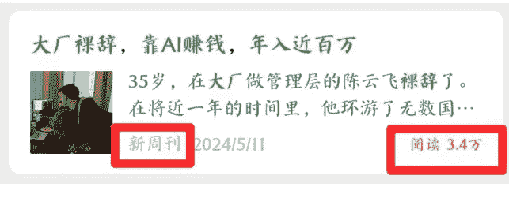

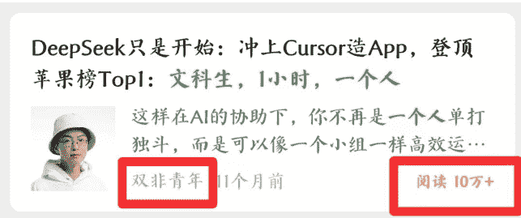

文章发布第二天，后台新增微信好友1200人，两个客服号都因为添加过于频繁而被限制。

为什么这个标题能产生如此强的点击，后文会继续拆解。

## 1.2 案例一：出海与AI账号，平均阅读从56升到2.3万

客户“鱼总聊 AI”聚焦出海和人工智能。

合作前，他的内容并非没有价值，恰恰相反，信息密度很高，只是表达方式更像给同行看的行业简报。

当时的标题包括：

- 《微软王牌不断！让我们来快速了解 Microsoft Ignite 2023 王牌内容！》——56 阅读

- 《全球震撼！超强 AI 芯片 H200 发布，性能飙升》——54 阅读

- 《让 GPTs 带你快速破局！为 2024 开辟财富之路！》——110 阅读

2023 年 12 月 5 日

ChatGPT：一年风云再起，移动应用全球市场收益突破过 1.1 亿!

阅读 73 赞 1

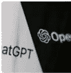

2023 年 11 月 20 日

微软王牌不断！让我们来快速了解 Microsoft Ignite 2023 王牌内容!

阅读 56

### 服务前数据

2023 年 11 月 19 日

全球震撼！超强 AI 芯片 H200 发布，性能飙升，Llama 2 速度翻倍，超...

阅读 54

2023 年 11 月 15 日

让 GPTs 带你快速破局！为 2024 开辟财富之路!

阅读 110 赞 1

这是典型的行业资讯写法：专业人士能够理解，但大众用户看见标题就失去了继续阅读的动力。

我们重新调整定位，不再把账号包装成“人工智能新闻号”，而是改成“普通人出海赚美金的真实经历”。

### 新标题更强调人物、结果与冲突：

- 《靠 688 块启动，我赚到第一笔美元》——1.9 万阅读

- 《从搞 IT 到赚美金 | 我只是顺手把产品经理干明白了而已》——2.3 万阅读

- 《月薪 7800，但我把公司当跳板，顺路赚美金》——2.3 万阅读

👸号懒人搜索，懒人专属群分享

- **出海小工具掘金：两年半赚了 11 万美金，从“捡漏”外包开始**

  阅读 2.2 万 赞 106

  

2025 年 5 月 2 日

从 0 到出海赚美金：我如何靠“找对人”，打赢第一场创业仗

阅读 3055 赞 36

2025 年 4 月 30 日

靠 688 块启动，我赚到第一笔美元

阅读 1.9 万 赞 92

### 服务后数据 23 倍拉高

2025 年 4 月 26 日

从搞 UI 到赚美金｜我只是顺手把产品经理干明白了而已

阅读 2.8 万 赞 355

2025 年 4 月 24 日

月薪 7800，但我把公司当跳板，顺路赚美金

阅读 2.4 万 赞 51

单篇平均阅读由56提升到2.3万，单季度总流量增长超过23倍。

## 1.3 案例二：女性商业访谈号，停更两年后首月重回10万+

“搞钱学姐说”专注女性商业人物访谈，曾经连续停更两年。

合作前的数据并不理想：

- 《谢无敌：女孩子要果断，不要武断》——770 阅读

- 《小狼女：我在上海当团长，谈谈非授权的领导力》——640 阅读

### 《楠哥：认识世界的真相，并且仍然热爱它》——512 阅读

问题不在采访对象，而在标题表达得过于正式，像一段人生格言。

例如“女孩子要果断，不要武断”，读者很难从中看到与自己有关的具体利益，也就缺少点击理由。

接手之后，我们将内容重心从抽象观点转向真实人物、收入数字和人生转折。

标题改为：

- 《9 个月营收破千万，全女创业团队杀疯了！|98 年沪漂 MCN 女老板王 YY》——10 万+

- 《宝妈从 0 到 1 勇闯跨境电商，年销量 300 万+》——1.6 万阅读

- 《边带娃边做自媒体，素面朝天也能年入百万》——3885 阅读

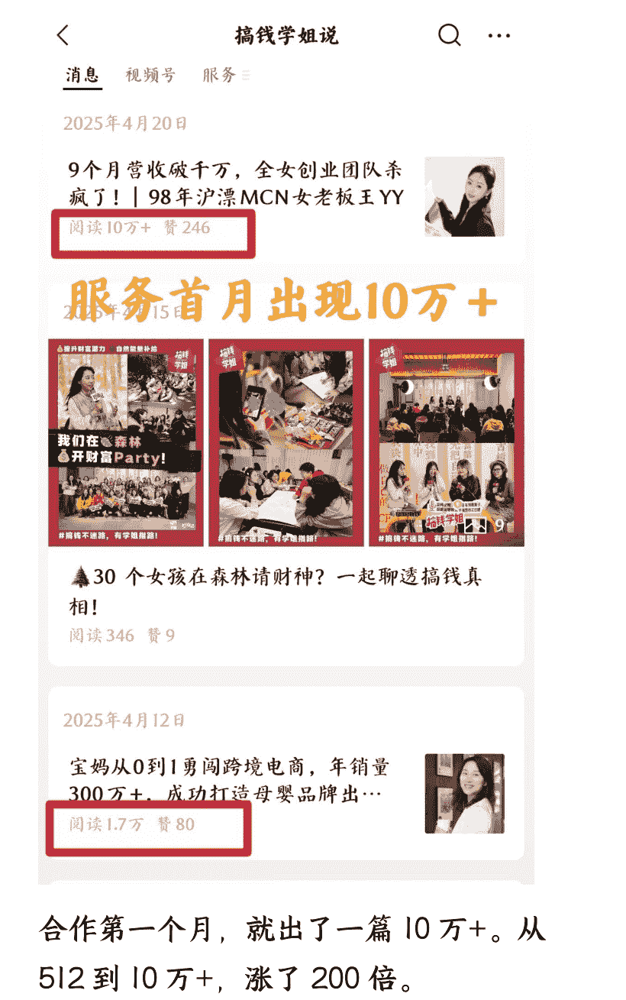

合作首月便出现10万+文章，单篇从512提升到10万+，增长约200倍。

## 1.4 案例三：香港地产账号，平均阅读由300提升至7000+，搜索排名进入前三

客户“纪老板”所在领域是香港房产。

原先的标题大多是活动通知：

- 《0615 纪老板财富分享沙龙暨老客户答谢会圆满举办！》——382 阅读

- 《518 纪老板创业沙龙成功举办：招操盘手很容易踩坑》——418 阅读

- 《511 纪老板创业沙龙成功举办：私域运营核心是升级关系！》——289 阅读

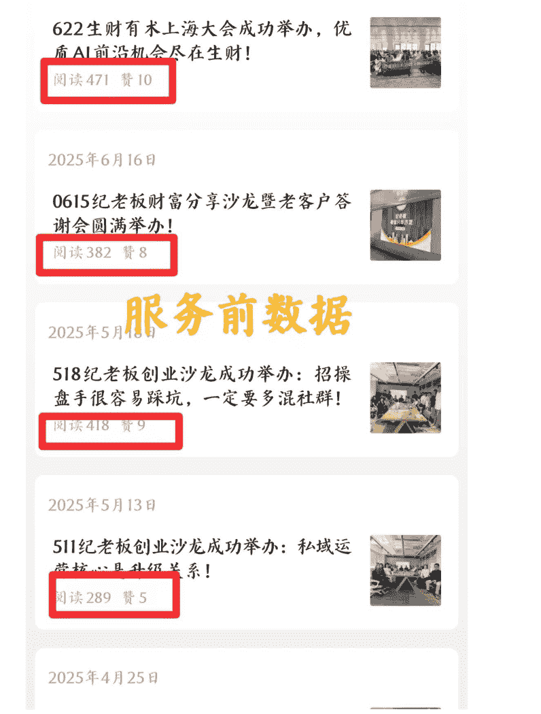

“成功举办”“圆满结束”这类措辞，本质上是写给参与活动的人看的。对陌生用户而言，既没有利益点，也没有好奇心。

我们取消活动通稿，将账号从企业公告栏改造成有明确观点和人物特色的IP账号。

结果如下：

- 单季度流量提升23倍；
- 平均阅读从300多升到7000+；
- 3个月产出9篇过万阅读内容；
- 最高单篇超过4万；
- “香港房产”搜索结果进入全网第二；
- “香港楼市”进入全网第三，超过财经大V香港S叔。

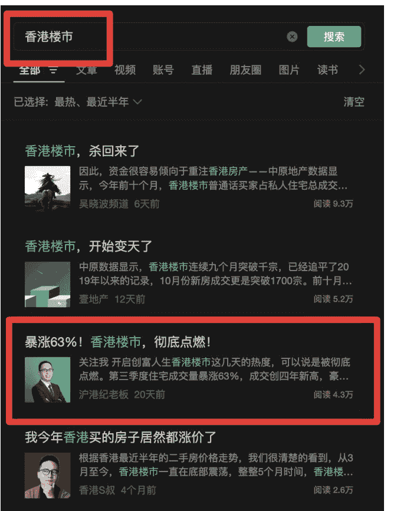

前面的数字说明了结果。接下来进入更重要的部分：这些结果究竟是怎样被做出来的？

# 二、内容增长的底层机制

在讨论工具之前，必须先明确一件事：

**先有判断标准，再谈AI。**

很多人一开始就让AI代写文章，但如果创作者自己无法判断什么内容值得写、什么表达能打动用户，工具只会让平庸内容产出得更快。

AI适合提高效率，却无法替你完成定位、用户理解和价值判断。方向错了，效率越高，偏得越远。

## 2.1 第一步：明确你要服务的人

如今，中小账号获得曝光的机会比过去更多，平台也在持续增加推荐。

可另一面是，阅读增长并不必然带来成交。

经常有人遇到这样的情况：文章看的人变多了，愿意加微信的人却不精准，后续也没有购买意愿。

根本原因通常不是转化话术，而是最初吸引来的受众就偏了。

你想服务的人，和实际被内容吸引来的人，并不是同一群人。

### 2.1.1 不要只记录兴趣，还要观察生活处境

常见的用户画像，往往停留在这些问题：

- 喜欢哪些主题？
- 经常关注什么账号？
- 对哪类内容有兴趣？

这些信息当然有用，但只能说明用户“愿意看什么”，不能说明她“为什么需要买”。

我们更关注另一层画像：用户现实中正在经历什么。

例如：

- 年龄处于哪个阶段？
- 收入和职业状态如何？
- 是否已婚、有无孩子？
- 当前最担心、最难解决的事情是什么？

兴趣只是内容消费倾向，现实处境才更接近购买动机。

举个例子。

一位情感博主曾经找到我们，说自己的商业转化很弱。她的内容主要围绕明星分手、婚变和渣男故事展开，文章数据并不差。

但阅读娱乐八卦的人，并不等于正在寻找情感咨询的人。

大家都可能对明星婚姻感到好奇，却不会因此立刻付费寻找咨询服务。

她当时获得的是“围观八卦的人”，而不是“正在遭遇亲密关系困境、愿意寻求解决方案的人”。

前者有兴趣，后者才有需求。

### 2.1.2 给用户痛点排优先级

当你知道用户的现实处境后，还要继续判断：哪些问题值得投入内容资源？

我们的做法是把痛点按紧迫程度划分为四层：

以“女性增加收入”为例，同一个大主题，可以对应完全不同的焦虑强度。

判断一篇内容处在哪一层，可以连续问自己三个问题：

1. 用户是否会主动搜索它？
2. 用户是否会把它当成烦恼向朋友倾诉？
3. 如果问题长期不解决，她是否会因此失眠或持续不安？

判断方式可以简单归纳为：

- 三个问题都符合：生存型压力；
- 前两个符合：关系型压力；
- 只有第一个符合：改善型需求；
- 三个都不符合：更接近娱乐消费。

内容发布后，还可以通过留言区反馈判断用户是否真正被击中。

### 2.1.3 把泛主题改造成高紧迫需求

不少选题看起来很大众，天然容易停留在轻松阅读或自我提升层面。

但只要换一个切口，就可能直接对应用户的现实任务。

关键不是围绕“大主题”泛泛而谈，而是把它落到具体处境和明确结果上。

例如，“考公”只是一个方向，用户不会因为看到“竞争很激烈”就立即付费。

但“距离省考只剩两个月，怎样把申论从50分提升到70分”，已经变成了清晰、紧迫、可行动的问题。

前者是概念，后者是任务；前者适合围观，后者更接近付费。

再看“去商场买衣服”这个主题：

如果你只讨论折扣，吸引来的多半是价格敏感型用户，商业价值有限。

如果内容进一步触及“为什么总觉得自己不配拥有更好的生活”，吸引的就是另一类人群。只要你能真正帮助她改变状态，服务价值和客单空间都会更高。

主题只是入口，切口决定最终吸引谁。

### 寻找高紧迫切口的三个渠道

1. 翻看留言：用户反复抱怨什么，持续追问什么；
2. 观察搜索词：大家具体输入了哪些问题；
3. 做深度交流：用户是在什么场景下意识到自己必须解决它。

### 2.1.4 用已付费用户建立真实画像

最有效的研究对象，不是泛泛的粉丝，而是已经购买过你产品的人。

不建议只发问卷。更好的方式是进行一对一访谈：选择10位高价值客户，每位至少沟通20分钟。

#### 访谈重点：

第三个问题尤其重要，不要停留在抽象回答，要继续追问当时发生了什么。

真正有写作价值的，往往不是“我想变好”这种概括，而是“某一天发生了某件事，于是我决定寻找解决方案”。

#### 把访谈结果结构化记录

整理之后你会发现：即使这些人购买的是同一款产品，她们的触发场景、担忧重点和决策原因也可能完全不同。

这些差异，就是进一步拆分用户类型、设计内容入口的依据。

完整顺序应该是：

**现实画像 → 核心焦虑 → 痛点优先级 → 内容切口。**

如果把顺序倒过来，往往只能换来阅读量，无法带来有效成交。

## 2.2 内容结构：60—30—10的组合方式

明确服务对象后，下一步是安排内容结构。

我们长期采用60%、30%、10%的内容比例。它并非理论推演，而是多年运营实践后的经验总结。

### 2.2.1 这个比例分别代表什么

可以先把内容分成三类，再理解它们之间的配合关系：

三类内容承担的任务不同：

- 一部分负责扩大触达；
- 一部分负责建立信任；
- 一部分负责承接转化。

### 2.2.2 60%的内容怎么做，才不会沦为八卦账号

占比最高的内容可以拥有较宽的选题范围，例如情感、职场、婚恋和社会热点都能覆盖。

但无论从哪个热点切入，最终都要回到目标用户的现实处境与核心需求。

也就是说，内容可以借势大众话题，却不能失去自己的服务对象。

下面用一个对比来说明。

7. 同一个明星离婚热点，为什么有人涨粉，有人只收获一群看客？

#### 8. 只做娱乐八卦，会发生什么？

比如写：

**标题：**《XX 与 XX 宣布离婚，男方净身出户，女方长文耐人寻味》

正文围绕离婚原因、财产分配、感情经历以及网友态度展开，最后再感慨一句：

**“娱乐圈的爱情，果然经不起考验。”**

这类内容可能有人看，但大多数读者看完就离开了。

原因很简单：你只是替大家搬运了一场热闹，却没有提供任何明确立场。用户看完以后，记不住你，也无法借助你的内容表达自己的态度，自然不会长期关注。

#### 9. 面向女性副业 IP，更有效的写法

如果你的定位是帮助女性做副业，那么同样的热点，可以这样切入：

**标题：**《她离婚后拿到 2 亿：女人手里有钱，人生才有退路》

正文不必把全部篇幅都耗在明星身上，热点只负责把读者吸引进来，真正重要的是你自己的判断：

> “你会发现，同样是离婚，有经济能力的女性，往往被称为重新启程；没有收入来源的女性，却更容易被贴上晚年凄凉的标签。不是鼓励大家走向离婚，而是想提醒每个女生：无论感情最终如何，都要保留自己的赚钱能力。能自己承担，就尽量不要把人生交到别人手里。”

结尾可以引导关注，也可以留下一个悬念：

**“我当初是怎么一步步建立收入来源的，后面会详细讲。”**

这样的文章，读者得到的不只是一个明星八卦，还会记住你的核心主张：女性要拥有自己的收入能力。

当她认可这句话，关注你就是顺理成章的事。未来她看到你的服务或产品，也会觉得前后的逻辑是一致的。

### 10. 两种写法的根本区别

纯八卦内容，用户消费的是事件本身；有效的内容，则借助事件建立认知和立场。

前者只能带来短暂阅读，后者才有机会沉淀关注、信任以及后续转化。

### 11. 如何判断“60%内容”是否写对？

不要只盯着阅读量，更要观察评论区和转发情况：

- 评论里有没有人表达认同或反对？
- 用户有没有围绕你的观点展开讨论？
- 转发时，用户是否在借你的内容表达自己的态度？

如果大家只讨论明星，而没人提到你的观点，说明热点压过了你，内容还没有真正完成转移。

---

## 2.2.3 30% 内容：不能一上来就变成广告

30% 内容的任务，是让用户逐渐明白两件事：

1. 你究竟在做什么；
2. 你能帮她解决哪类问题。

不少人不愿意写这一部分，担心内容太商业，会让用户反感。

其实，关键并不在于能不能提产品，而在于你是不是仍然在提供价值。

### 12. 直接推销与有效植入的差别

真正自然的30%内容，同样应该先解决问题、提供判断或方法，只是在文章最后把解决方案落到自己的产品上。

### 13. 案例：高中英语提分服务

#### 14. 典型硬广写法

**标题：**《XX 英语提分课程，帮助孩子高考多拿 30 分》

正文开始介绍课程体系、名师背景、学员数量和过往成绩，结尾再补一句：

**“现在报名享受限时优惠。”**

用户看到这里，大概率只会产生一个反应：

**“又来了一个广告。”**

然后直接划走。

#### 15. 更自然的30%写法

**标题：**《高二下半学期，英语成绩还有机会拉上来吗？》

正文可以按这样的顺序展开：

- 先还原家长的焦虑：不少家长到了这个阶段，看到孩子成绩不理想，就觉得时间已经不够了。
- 再给出判断：实际上，高二下学期仍然是非常关键的提分窗口，很多基础问题在这个阶段调整，效率反而更高。
- 接着提供方法：此时应该优先补哪些板块、每天怎样安排时间、哪些内容不值得继续平均用力。

最后再自然补充：

**“如果你希望拿到一套更完整、更系统的执行方案，可以进一步了解我们的提分课程。”**

读者此时的感受就不一样了：

**“前面的分析确实有帮助，这个课程或许值得看看。”**

---

## 16. 60%、30%和10%的协同关系

以“鱼总聊 AI”的内容为例：

- 用户看到60%的内容，会因为观点和价值认同而关注你；
- 看到30%的内容，会意识到你似乎真的能帮助自己；
- 看到10%的内容，会因为案例和结果产生行动冲动：别人可以做到，我也许同样可以。

三者缺一不可：

- 60%负责吸引并筛选人群；
- 30%负责建立产品认知；
- 10%负责降低行动门槛。

### 17. 怎样快速分辨一篇内容属于60%还是30%？

最简单的方法，就是分别看标题和结尾：

- 标题和正文主要承担观点、认知与关注价值，通常属于60%；
- 文章最终把问题引向产品、服务或解决方案，通常属于30%。

---

## 2.2.4 发文频率与内容节奏

发文量没有统一标准，最终取决于你的行业特征、团队配置和实际产能。

但有一条底线始终成立：

**宁可少发，也不要为了完成数量而发布低质量内容。**

通常来说，每周更新3到5篇，是相对稳定且可持续的节奏。

随着账号阶段变化，60%、30%、10%的比例也可以灵活调整。关键不是机械执行比例，而是保证账号既能持续吸引精准用户，又能让用户逐步理解你、信任你并采取行动。

---

# 2.3 标题怎么写：用户需求没变，表达必须更新

很多人问，爆款标题是不是存在一套固定公式？

公式当然有参考价值，但它并不是最核心的东西。

真正重要的是：用户长期在意的，本质问题其实变化不大，变化的是你用什么方式重新说出来。

## 2.3.1 为什么以前有效的标题，现在越来越难用？

过去几年，👸号里流行过很多词：

- 杠杆
- 一人公司
- 合伙人
- 轻创业
- 被动收入

这些词虽然不同，背后指向的其实都是同一个愿望：

**能不能用更少的时间和精力，获得更多收入？**

问题在于，这些表达被反复使用以后，用户已经产生了免疫。

他们看到“杠杆”，很可能马上划走，因为类似的说法已经出现太多次，无法再带来新鲜感。

所以需要记住：

**需求不会轻易过时，但表达需求的词会疲劳。**

去年能带来点击的说法，今年可能已经失效。

因此，标题创作的重点不是死记模板，而是完成两件事：

- 找到用户真正关心的痛点；
- 为这个痛点找到一个尚未被过度消费的表达。

## 2.3.2 一个词还有没有效果，不能只看使用人数

### 18. 常见判断误区

很多人会这样判断：

**“现在还有很多人用，所以这个词应该还能用。”**

这恰恰可能是错误的。

一个词被大量使用，往往只是因为它曾经制造过爆款，大家不断模仿。可当用户反复看到同样的词，他们已经失去新鲜感，内容数据也会随之下降。

所以：

> 仍然有人使用，不代表它依然有效。

### 19. 更可靠的判断方式

不要统计“有多少人在用”，而要看“最近使用它的人，效果还好吗”。

可以按以下步骤操作：

1. 搜索目标词或表达；
2. 找到大约三个月前使用它的高表现内容；
3. 再找最近一个月的相关内容；
4. 对比阅读、互动、关注等数据；
5. 如果近期数据明显弱于三个月前，说明这个表达正在衰退；
6. 再观察评论区，看最近的留言是否真实、具体、有讨论价值。

### 20. 一个表达从流行到失效，通常会经历三个阶段

不同类型的词，生命周期并不一样。

**越容易形成热点的词，通常衰退越快：**

- 现象级热点，例如 DeepSeek，可能一两个月就被大量复制；
- 概念型词汇，例如“一人公司”，可能维持三到六个月；
- 泛化表达，例如“搞钱”，由于含义宽泛，通常不容易迅速过时。

---

## 2.3.3 词过时之后，应该怎样替换？

核心并不是改变原本想表达的内容，而是换一种用户没有反复见过的说法。

### 三种换表达的思路

以花生那篇文章为例，我们真正想传达的是：

**一个人，也能借助工具，以更高效率、更低成本完成一件事。**

如果直接使用“一人公司”“杠杆”“轻创业”，读者很容易产生疲劳感。

后来我们换成：

**“文科生，1小时，一个人。”**

意思没有变，但画面感更强，也更少见。读者看到后，不会立刻觉得这是又一篇熟悉的“创业概念文”。

---

## 2.3.4 什么时候借热点，什么时候设置认知门槛？

标题创作中，热点和认知门槛都是常见工具，但并不是每篇文章都必须使用。

### 什么时候适合借热点？

关键判断标准是：

**读者看完正文后，不能觉得你只是拿热点做噱头。**

热点可以负责带来点击，但正文必须兑现标题中的承诺，并且自然转入你的专业领域或核心观点。

### 什么时候适合设门槛？

认知门槛不是为了减少所有流量，而是为了主动过滤不匹配的人。

不是每一个看到文章的人，都适合成为你的用户。门槛越明确，留下来的人通常越精准。

---

## 2.3.5 案例：同一个人、同一个故事，标题不同，阅读量相差三倍

花生是赚钱的航海家。我们和《新周刊》都采访过他，素材对象相同，故事也相近，但最终阅读数据拉开了明显差距。

### 《新周刊》的标题：3.4万阅读

> “大厂裸辞，靠 AI 赚钱，年入近百万”

这个标题没有事实错误，但问题是太平稳、太普通。

“大厂裸辞”“靠AI赚钱”“年入近百万”都属于正确信息，却没有制造足够强的点击理由。读者知道你要讲什么，却不觉得自己非点进去不可。

### 我们的标题：10万+阅读

**“DeepSeek 只是开始：冲上 Cursor 造 App，登顶苹果榜 Top1：文科生，1 小时，一个人”**

它的优势在于：

- 有具体热点；
- 有明显反差；
- 有结果证明；
- 有人物身份差异；
- 有时间和行动成本的压缩；
- 让读者产生“这到底是怎么做到的”的好奇。

### 对比

| 维度 | 《新周刊》标题 | 我们的标题 |
| :--- | :--- | :--- |
| 阅读量 | 3.4万 | 10万+ |
| 主要表达 | 大厂离职、利用AI赚钱、年入近百万 | DeepSeek、Cursor、登顶榜单、文科生、1小时、独自完成 |
| 整体效果 | 信息准确，但缺乏强刺激点 | 具体、反差明显，能够推动点击 |

同样的人物，同样的故事，结果可能差出几倍。真正的差距，往往就藏在标题的表达方式里。

---

## 2.3.6 标题完成后的自检

标题写完后，可以逐项检查：

- 读者一眼能看懂吗？
- 是否击中了真实需求，而不是自嗨？
- 有没有使用已经被过度消费的词？
- 是否具备一个明确的点击理由？
- 标题承诺的内容，正文能否兑现？
- 热点是否服务于主题，而不是喧宾夺主？
- 门槛是否会筛掉不精准的人，同时保留目标用户？

### 2.3.7 一个高质量标题，可能需要多久？

花生那篇文章的标题，我们前后打磨了整整一周。

期间不断与 AI 讨论、生成、淘汰和重组。

例如，先让 AI 提供3个方向，每个方向生成10个版本；再从30个里面筛成15个，接着缩到6个，最后确定1个。

但每一轮都不是机械筛选，而是依赖人的判断：

- 这个词是不是已经被写烂？
- 用户是否见过类似表达？
- 设置的认知门槛，会不会把真正的目标用户挡在外面？

AI 可以提供大量候选项，却无法替你完成最终取舍。

最后选哪个，考验的是你对用户、行业和内容的理解。

---

# 2.4 文章结构，决定最终能不能转化

前面讲60%内容，解决的是如何吸引正确的人进入账号。

这一部分要解决的是：

**人来了以后，怎样让她记住你、关注你，并在未来愿意购买。**

很多人认为标题决定了70%的效果，这句话不能说错，但要先看你的目标。

如果只追求阅读量，标题确实非常重要。

但如果目标是成交，文章结构往往比标题更关键。

标题只能把人带进来，真正让用户愿意付费的，是正文里持续建立的信任和价值感。

## 2.4.1 核心原则：最终写到哪里，决定用户记住什么

同一个素材，交给不同的人来写，转化结果可能完全不同。

差异通常不在于选题，而在于文章最后把注意力落在哪里。

所谓“落脚点”，就是：

- 你想让用户记住什么；
- 你想让她产生什么感受；
- 你希望她下一步做什么。

不要担心某个热点已经被别人写过，也不要担心某个标题别人用过。

很多爆款标题本来就会被大量复用，真正决定差异的，是你如何组织内容，以及最后把读者带向哪里。

### 如何判断落脚点是否正确？

问自己：

**读者读完后，记住的是那条新闻，还是记住了你？**

如果她只记得明星、电影或热点人物，说明内容仍然停留在借势层面；如果她能说出你的观点、能力和解决方案，才算完成了内容转化。

---

## 2.4.2 一篇转化型文章的四个步骤

完整路径可以概括为：

**热点或痛点 → 与自身建立联系 → 输出价值观或方法 → 引导下一步行动**

每一步都承担不同任务，缺少任何一环，效果都会打折。

### 21. 案例：《新闻女王》

《新闻女王》热播期间，佘诗曼饰演的角色频繁出现在社交平台。

如果你运营的是女性副业 IP，可以这样组织内容：

#### 第一步：用热点带来点击

标题中出现“新闻女王”或“佘诗曼”，开头先解释这个角色为何引发讨论。

#### 第二步：把角色连接到自己

接着写：

**“我之所以喜欢她，是因为我在她身上看到了某种熟悉感。”**

然后讲自己的经历、选择和成长过程。

#### 第三步：提出你的核心观点

比如：

**“真正让女性拥有底气的，不是某个男人，而是自己的能力和收入。”**

这样的表达有明确立场，读者可以借助转发来表达自己对女性独立的认同。

#### 第四步：给出行动方向

文章最后，可以引导用户关注账号，也可以引导她进一步了解产品或进入小店。

读者最初是因为明星角色点击，但看完之后，她的注意力已经从角色转移到了你身上。

---

## 2.4.3 什么样的观点，才值得用户转发？

四步结构里，第三步往往最关键。

观点清晰，读者会记住你，甚至愿意主动传播；观点模糊，用户看完就离开，什么也不会留下。

有人说过一句很重要的话：

**没有观点的文章很难传播，因为用户无法借助它表达自己。**

很多时候，用户转发一篇文章，其实是在向别人说：

**“我认同这篇文章，我也是这样想的。”**

所以你的观点不能只有“道理”，还要能让用户借此完成一次态度表达。

### 判断方法

问自己：

**用户转发这篇内容时，实际上是在表达什么？**

- 如果你无法回答，说明观点还不够鲜明；
- 如果你能明确说出“她是在表达女性应该拥有经济独立”，说明方向基本正确。

---

## 2.4.4 评论区也属于内容的一部分

很多人发布后只看正文，不经营评论区。

但从转化角度看，评论区并不是附属区域，而是正文之后的第二表达现场。

原因包括：

- 有些用户会先查看评论，再决定是否认真阅读；
- 评论区的真实互动会影响账号可信度；
- 你可以借助回复再次补充观点、方法和立场；
- 用户提出的问题，往往会暴露下一批内容需求。

### 评论区的三个价值

1. **补充正文没有讲完的信息；**
2. **加深用户对你的信任和认知；**
3. **为后续选题提供真实素材。**

### 如何从评论区找到新选题？

重点关注这些内容：

- 用户反复追问的问题；
- 高赞但尚未解决的困惑；
- 用户对某个观点的质疑；
- 用户主动分享的真实经历；
- 评论中出现的具体场景和情绪。

很多时候，下一篇文章的方向，不在你的选题表里，而在评论区里。

---

## 2.4.5 不要只看阅读量，要建立数据意识

不少人发完内容后，只做一件事：刷新阅读量。

数据高了就兴奋，数据低了就焦虑。

但单看阅读量，无法判断内容是否真的有效。

### 22. 这些读者，是不是你真正想要的用户？

👸号后台可以看到用户的年龄、性别、城市等画像信息。

你需要定期检查：

**那些带来大量新增关注的文章，吸引来的用户，是否符合你的目标人群？**

有些文章阅读量非常高，但吸引来的主要是围观热点的人群，既不会咨询，也不会购买。

这种爆款，对获客业务而言，价值并不高。

### 23. 是否出现了异常数据？

除了看绝对数，还要关注数据之间是否存在异常：

- 阅读量高，但新增关注很少；
- 新增关注多，但咨询质量很低；
- 评论热闹，但没有任何有效行动；
- 引流突然增长，却与目标用户画像不匹配。

异常数据往往提示你：内容某一环节虽然有表现，但整体链路可能没有跑通。

### 24. 运营人员能否随时讲清楚账号状况？

我和团队开会时，经常会直接问负责人：

**“这个账号最近一周表现怎么样？”**

对方需要在几秒内，不打开后台，也能快速回答。

至少要清楚：

- 用户整体的年龄、性别和城市分布；
- 本周每篇文章的阅读数据；
- 哪篇内容表现最好；
- 爆款带来的用户是否出现偏移；
- 当前引流率是多少；
- 与上一周相比是增长还是下降。

如果这些问题都答不上来，往往说明运营缺少系统性，更多是在凭感觉做内容。

真正专业的运营者，会把账号的关键数据记在脑中，而不是每次都临时查询。

### 2.4.6 数据检查清单

你不观察这些指标，就无法知道下一篇文章应该继续什么、停止什么、调整什么。

很多人以为内容没有做好，实际上问题可能不是写作能力，而是根本没有建立反馈机制。

归纳起来，就是两句话：

- 标题决定哪些人进入；
- 结构决定进入的人是否留下并完成转化。

两者都不能忽略，但如果你的目标是成交，文章结构通常比单纯追求标题点击更重要。

---

# 三、AI 实操篇

前面的内容方法，如果完全依靠人工执行，确实会比较耗时。

AI 可以帮助你提高效率，但它绝不是自动生产优质内容的机器。

很多人使用 AI 的方式是：

把产品资料、用户反馈、旧文章全部扔给 AI，让它自己阅读、总结，再让它写一篇👸号文章。

最终产出的文字可能语法通顺、结构完整，却没有人愿意看，更无法带来转化。

### 问题并不在于 AI 不够强，而是输入不够准确

AI 更像一个放大器，而不是凭空创造判断的工具。

你输入的是普通素材，它就会更快地生成普通内容；你输入的是明确的判断、标准和案例，它才有可能放大你的内容能力。

所以我们使用 AI 的方式，不是让它随意“学习所有资料”，而是人工建立一套专属知识库，把经过筛选的判断喂给它。

---

## 3.1 为什么要手动建立专属知识库？

### 3.1.1 只堆资料，AI 学到的只是信息，不是判断

很多人的知识库建设方式，是把产品说明、用户评价、历史文章一股脑上传。

但 AI 无法自动知道：

- 哪些内容真的有效；
- 哪些内容只是表面数据好看；
- 哪篇文章真正打动了用户；
- 哪篇文章带来的只是无效流量；
- 用户说出来的需求，与内心真正想解决的问题是否一致。

你给它100篇文章，它通常只能学到：

**“这些文章大概是什么形式。”**

可你真正需要它学会的是：

**“100篇里，哪10篇最值得复用？为什么有效？其他文章为什么不行？”**

后一个问题，依赖的是判断，而不是信息整理。

### 3.1.2 整理知识库的过程，本质是在提炼判断

手工整理不是简单搬运资料，而是在不断追问：

- 这篇文章为什么数据好？
- 是标题吸引人，还是切入角度准确？
- 它最终有没有带来关注和成交？
- 那篇文章没人看，是选题错了，还是表达方式错了？
- 用户说的这句话，是明确需求，还是情绪表述？

这些问题的答案，才是知识库最有价值的部分。

也就是说，真正应该喂给 AI 的不是原始材料，而是你对材料的判断。

### 3.1.3 搭建知识库的人，内容能力必须过关

知识库的核心不是“收集了多少”，而是“判断得准不准”。

如果负责整理的人自己都分辨不出好内容和差内容，那么最后得到的只是一堆资料，不是一套有效标准。

AI 按照这堆资料学习后，产出的自然也只能是平庸内容。

因此，AI最终能做到什么程度，很大程度上取决于知识库搭建者的内容能力。

我们的建议是：

- 如果你是老板，最好亲自完成第一版知识库；
- 如果交给团队，负责人必须具备较强的内容判断力；
- AI工具能力固然重要，但内容判断能力才是底层基础。

---

## 3.1.4 以👸号获客为目标，知识库的重点会发生变化

普通内容账号，常把目标设为阅读量、传播量和涨粉。

但👸号获客的核心，是转化：

- 进来的人是否精准；
- 用户是否信任你；
- 最终能否成为客户。

因此，知识库不能只收集看起来热门的内容。

比如：

- 一篇文章获得10万阅读，却带来大量无关围观者，最终一个客户都没有；
- 另一篇文章只有5000阅读，却吸引了精准用户，并成交50人。

如果你的目标是获客，显然第二篇更有价值。

所以知识库应该优先沉淀那些能够带来精准关注和真实成交的内容，而不是单纯追逐阅读数字。

---

## 3.1.5 👸号获客知识库的四大模块

一套完整的获客知识库，至少需要包含：

1. 产品；
2. 用户；
3. 内容；
4. 风格。

### 25. 产品模块：从用户角度理解产品

### 26. 常见错误：直接上传产品说明书

### 27. 产品说明书写的是企业视角，而不是用户视角。

它通常会介绍功能、配置、流程和优势，但用户真正关心的是：

**“它是否能解决我的问题？”**

### 28. 更有效的整理方式

把产品转译成用户能理解的语言，包括：

- 客户与销售的聊天记录；
- 客户真实评价；
- 使用前后的变化；
- 老板亲自访谈客户得到的反馈；
- 用户最终为什么决定购买。

这些内容比一份标准化产品手册，更能帮助 AI 写出有转化力的文章。

### 29. 用户模块：重点记录处境和触发点

### 30. 常见错误：只记录年龄、职业和收入

### 31. “25到35岁、女性、中等收入”这样的标签，几乎无法直接帮助你完成内容创作。

### 32. 更有效的做法，是记录用户的真实处境

例如：

- 她正面临什么问题；
- 她在什么时间节点最焦虑；
- 哪件事促使她开始寻找解决方案；
- 她尝试过什么，又为什么失败；
- 她在决策时最担心什么。

### 33. 这些信息可以从哪里获得？

- 用户访谈；
- 评论区高赞留言；
- 销售反馈；
- 客户首次咨询时的具体原因；
- 用户购买前后的真实表达。

前面提到的“生存画像”，就应该沉淀在这个模块中。

### 34. 内容模块：记录有效与无效的原因

### 35. 常见错误：只收藏大量爆款

### 36. 收藏100篇爆款，并不等于建立了有效知识库。

AI可能只学到“爆款通常长什么样”。

### 37. 但爆款不一定等于有效

一篇文章阅读量很高，却完全没有转化，对获客业务来说未必有价值。

### 38. 正确做法：为每篇内容补充判断

需要明确记录：

**为什么这篇内容有效？为什么另一篇没有效果？**

判断标准不能只看阅读量，还要综合：

- 引流率：阅读量与新增关注的比例；
- 客资质量：咨询者是否属于目标用户；
- 转化率：咨询用户最终有多少成交。

只有这些指标都比较健康，才值得被视为可复用的有效内容。

### 39. 风格模块：把人设落实到具体表达中

### 40. 常见错误：只写“专业、亲切、有温度”

### 41. 这些形容词过于抽象，AI无法据此稳定模仿。

### 42. 正确方法：把抽象风格拆成具体写法

比如，“专业”可以通过不同方式呈现：

- 用数据：**“根据我们连续3年跟踪的500个案例……”**
- 用案例：**“上周有位学员，她当时遇到的情况是……”**
- 用步骤：**“我把这个问题拆成三步，第一步是……”**

你要告诉 AI 的不是“写得专业”，而是：

**专业具体表现为哪些句式、案例、数据和叙述动作。**

---

## 3.1.6 案例：一位小升初数学老师，如何从“专业”走向“有效”

我们曾经帮助一位小升初数学老师运营👸号。

他在一线教学了十几年，专业水平毋庸置疑。

### 原来的内容风格

过去他的文章主要是典型的老师型干货：

- 《小升初数学必考知识点整理》
- 《六年级数学高频错题汇总》
- 《培养孩子数学思维的有效方法》

这些内容有没有价值？

有。

够不够专业？

也够。

但结果却不理想：阅读量不高，咨询数量少，报名转化更低。

### 真正的问题在哪里？

我们为他整理知识库时，先做了一轮家长访谈，重点问已经报名的家长：

**“当时发生了什么，让你最终决定报名？”**

答案其实早就存在于客户的真实经历里，只是老师此前从未把这些经历当成内容素材，也没有意识到它们对塑造账号人设和建立信任有多重要。

比如有位家长说：

**“我女儿上六年级，数学成绩突然从90分跌到了70分，我当时特别着急。”**

你以为把资料堆进知识库，AI就能替你把内容做起来？其实真正有价值的不是资料本身，而是你对资料的判断。

先看一个真实的转变。

有位客户做小升初数学辅导，最初的反馈总是这样：“老师说我孩子数学随堂测跟不上了，之前上学期明明还挺好的。”“暑假是该先预习初一知识点，还是去打网上说的数学思维基础？”

家长要的从来不是一份知识点罗列，而是一类会聚集的场景化难题。其中最扎眼的一个细分就是：六年级的女孩数学成绩断崖式下跌。不少妈妈说，女儿五年级还能稳在90分，到了六年级直接滑到70分左右。

我们做了三处换法。

第一处是人设的换法。原本是“权威数学老师”，换成“家有二宝、自己也走过小升初的数学老师”。身份不再只是讲师，而是跟家长走同一段路的同行者。那句“我懂你的焦虑，因为我大女儿当年也在这里卡过”比任何专业背书都更能建立信任。

第二处是内容方向的换法。过去是纯知识点干货。现在的配比是：60%直接回应家长的现场困惑，比如《为什么很多女生在六年级数学上突然失速？》《六年级分数掉到70分，还来得及吗？》《一进初中数学就断层，根源在哪？》；30%与业务相关，比如《结合XX初中入学要求，六年级暑假必须补上的三件事》《小升初暑假数学预习清单，开学不掉队》；10%是软性转化，课程介绍、真实学员进展。

第三处是开口方式的换法。原来开头是：“今天讲讲六年级数学的重点。”现在开头是：“上周一位妈妈来问我，她女儿五年级还能考90分，六年级忽然掉到70分，是不是没救了？我特别能理解，因为我自己的大女儿当年也经历过这个阶段。”

结果发生了明显变化：阅读量拉升了约4倍，月度咨询线索提升30%，而且来的家长更精准，都是带着真实需求来询课的人，而不是只收藏不行动的围观者。

这个案例想说明的是：知识库的本质不是资料库，而是判断库。

你需要整理进去的是：用户真正关心的是什么——不是知识点，是“我孩子掉分怎么办”；什么人设能让用户卸防——不是高高在上的专家，而是“跟你一样焦虑的家长”；什么内容角度才有效——不是堆干货，而是解焦虑。

这些判断必须由人来做。AI能做的，是学会你的判断，然后按你的判断批量生产符合逻辑的内容。

### 用AI做痛点分析，为什么合适又必须加限制

用户真实的反馈都沉在评论区。那里是金矿，但手动开采很费劲。爆款文章的评论区动辄几百上千条，看完要花好几个小时；人眼还会带偏见，只挑自己想看的；看完也很难提炼出核心，只会说“好像都关心这个那个”。

AI在归纳和对比上更快。但如果只丢一篇文章给它，输出的只是通用结论。它会告诉你“用户关心A、B、C”，但不知道这些痛点是否跟你的产品有关、能不能转化。

于是就有了两种做法的差别。

场景一：只给文章。AI的回答通常是：“这篇文章用户主要关心xxx，评论区高赞反映了xxx痛点，建议从xxx切入。”听起来合理，却是泛泛而谈。AI不知道你卖什么、要谁、想把人往哪里引。

场景二：给文章+知识库。同时告诉AI：我卖什么、目标用户是谁、我想吸引哪类人。AI的结论就会变具体：“评论区有三类声音，A类、B类、C类，其中B类最匹配你的目标人群，他们的核心痛点是xxx，写作时建议从xxx切入，落点可以落在xxx。”

前者告诉你用户在聊什么，后者告诉你对你有用的是什么、怎么用。

要让AI做有效的痛点分析，需要给它两类信息。

关于文章本身。发文时间是否仍在产生长尾评论，说明选题是否踩中长期痛点或结构是否利于传播，值得深挖。

关于你的业务。产品是什么、目标用户画像是什么。这些信息来自你之前搭建的知识库。没有知识库时，至少用一段话把产品和目标人群说清楚。

AI的输出要明确约束，不要让它自由发挥。我们习惯让它输出四件事。

第一，判断文章属于哪种情况。爆款要学方法，失败但有讨论的要学评论区给出的真实答案，平庸的直接放弃。

第二，提取高赞评论并归纳痛点。把高赞逐条列出，然后提炼背后的用户焦虑。需要区分哪些是表层讨论，哪些是深层需求。

第三，对比作者意图与用户实际讨论，判断是否“写跑”。作者写的是A，用户在聊B，就是写跑了。写跑的文章往往更值钱，因为评论区替你指出了正确答案。

第四，基于你的产品给出可执行的选题建议。应该从什么角度写、落点放在哪里、哪些痛点该打、哪些该避开。

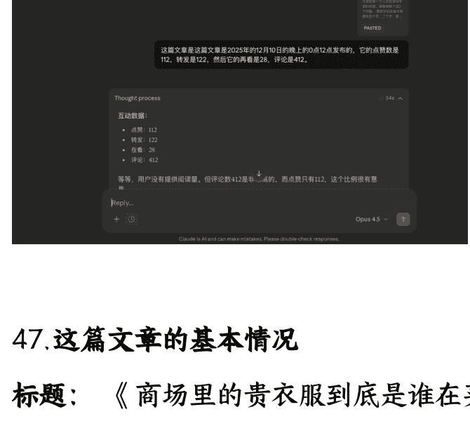
### 商场贵衣服案例

标题：《商场里的贵衣服到底是谁在买》
数据：阅读量4.9万，点赞58，评论288。
这个组合很说明问题：阅读不错，点赞率仅0.12%，评论却很高。
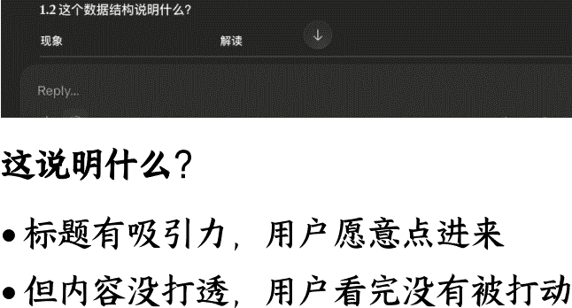
说明标题有钩子，内容没打动人，话题有争议性。
结论：失败但有价值。

作者的核心观点是“我买不起商场贵衣服”。通篇都在描述买不起的感受，最后抛一个问题：到底是谁在买？现象有，观点空。读者看完只剩一句“贵，然后呢？”

评论区在说什么？AI分析高赞后发现：
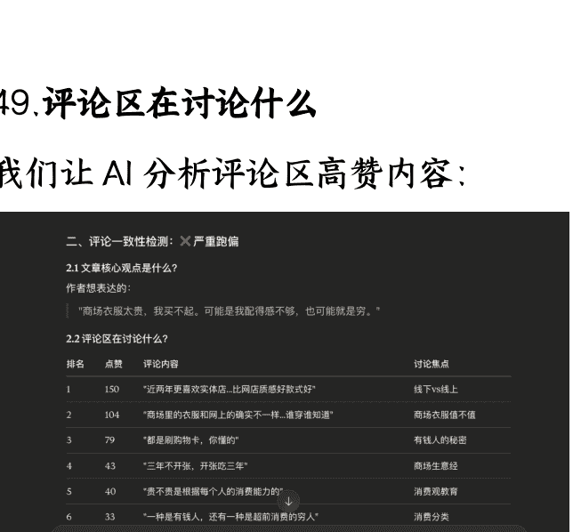
最高赞在聊网购vs实体店的体验。用户说现在网购方便，谁还去商场，商场贵且质量不一定好。
这和作者想表达的不一致。作者以为痛点是“买不起”，用户实际讨论的是购物渠道的选择。

继续往下看，还有别的高赞：
“我愿意给孩子、伴侣买贵一点的衣服，就是不舍得给自己。”
“长期亏欠自己，心里会不自觉有怨气。”
“二十岁不舍得买的衣服，三十岁还是舍不得，可能不是钱的问题。”
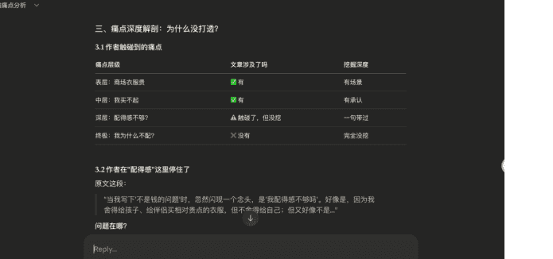
这些评论指向的痛点是：钱都花在别人身上，自己被长期后置；缺乏对自己的配得感。

如果没有知识库，通用分析会说：评论区有消费习惯变化、家庭付出排序、配得感缺失等痛点，建议从这几个角度写。对不对？对。但对你有用吗？不一定。

加入知识库后，假设产品是女性副业培训，目标用户是25-35岁想经济独立的女性。AI的指向就变了：
“最值得关注的是‘我赚的钱都不花在自己身上’、‘没有配得感’这类声音。核心焦虑是：没有属于自己的钱，所以没有底气为自己花钱。落点可以是：女性要有为自己花钱的底气，底气来自有属于自己的钱，有自己的事业/副业，从而自然衔接到你的产品。”

区别很明显：一种是罗列评论区有什么，一种是告诉你对你有用的是什么以及怎么衔接。

最后，AI还能把评论区的高价值原话整理出来直接用。
可以直接当金句用的：
“我舍得给孩子、给伴侣买相对贵点的衣服，但不舍得给自己。”
“成年人长期对自己亏欠，心里是会不自觉产生怨言的。”
“二十岁出头不舍得买的衣服，到了三十岁还是舍不得，或许不是钱的问题。”
可以化用的观点：女性习惯把家人排在自己前面；对自己缺乏配得感；消费习惯受原生家庭影响。
这些是用户自己的语言，共鸣度远高于自己编的话。

### 如何判断AI分析是否靠谱

AI给的是可能性，不是定论。最终的筛选要靠人。

三个自检问题：这个痛点是否你的目标用户真正在意？这个方向做出来能带来转化吗？有没有AI不知道的行业背景、竞品动态、你之前试过失败的经验？

一个简单验证法：按这个方向写，吸引来的人是什么样的人？是你想要的吗？是，才用。

### 用AI写内容的正确分工：AI出选项，人做判断

很多人犯的错是让AI直接写一篇，然后就发。这样等于把判断权交出去了。

更稳的协作是：AI负责生成可能性，你负责做选择。
AI出10个标题，你挑；AI出3个角度，你定；AI扩写一段，你改。判断永远在你手里。

标题环节，关键是给约束。不要只说“帮我起10个标题”。要说明目标用户是谁、痛点是什么、风格参考什么、禁忌词是什么。约束越具体，选项越可用。

给完约束让AI一次出5-10个，不要只求一个“最好”。你需要的是选项池。判断标题是否可用，看它是否点中具体场景、是否让目标用户有代入感、是否能自然衔接到你的落点。

选定方向后可以迭代：“第3个标题不错，但‘急速下滑’太书面，换成家长口语，再给5个变体。”2-3轮迭代基本能定。

正文环节，不要让AI从零到尾写。正确做法是你定结构，AI负责扩写。

结构通常是：用痛点/热点引流→把自己嫁进去建立信任→输出核心观点→引导行动。你要先想清楚落点要放在哪里，落点决定了来的是什么人、能不能转化。

把结构和风格给AI：
“按这个结构写：开头200字，用XX场景引入；中间500字，输出XX观点，用XX角度展开；结尾200字，落点是XX。风格参考我之前的这段话。”

AI扩写后先检查落点对不对。用户读完会记住什么、想做什么？跑偏了就让它改。

然后加入只有你才有的东西：真实经历、客户案例、真实对话、你的独特判断。没有这些，内容就只有表面光鲜，缺少真实感。

最后通读一遍。逻辑是否顺畅、表达是否自然、风格是否像你、有没有事实错误。

总结下来，用AI写内容有三件事必须人来做：定落脚点、加真实素材、做最终把关。AI是放大器，不是作者。

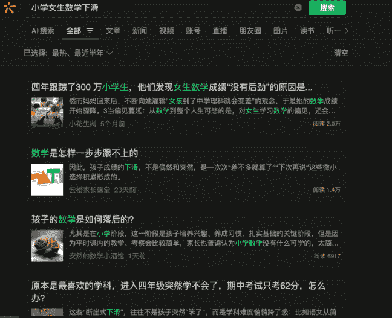
### 一次从0到1的完整协作

背景：小升初数学辅导，目标用户是六年级孩子的家长。痛点分析显示高频问题是“六年级女生数学急速下滑”。

第一步，定选题和落点。选题：六年级女生数学突然掉分。落点：不是孩子不努力，是六年级有一个隐形坎，坎是什么、怎么过，搞不定可以找专业支持。

第二步，给AI约束出标题。目标用户：小学六年级女孩家长；痛点：女儿数学从90掉到70；风格参考：《五年级数学突然下滑家长怎么办》《为什么很多孩子到了六年级就开窍了》；避开标题党词汇。AI给出的选项包括：《六年级女生数学下滑，真的是女生学不好理科吗？》《女儿数学从90分掉到70分，我才发现六年级有个隐形的坎》《为什么很多女孩五年级还不错，六年级就突然跟不上了？》《六年级数学急速下滑？先别急着报班，搞清楚这个问题》……

第三步，用快速三问筛选。最终选《女儿数学从90分掉到70分，我才发现六年级有个隐形的坎》，因为场景最具体。

第四步，定正文结构：开头用家长真实提问引入共鸣，中间拆解六年级的隐形坎和跨越方法，结尾落在“自己搞不定可以找专业的人”。

整个流程下来，内容既有用户语言的共鸣，又有清晰的转化路径。这正是判断库的价值：AI学会你的判断，然后帮你规模化生产，而不是替你做判断。

上周，一位妈妈把我拉住，声音里带着点急：“老师，求你帮我想想办法，我女儿五年级数学稳定在九十多分，刚上六年级第一次月考直接掉到七十出头了，我现在整个人都慌了。”

我能懂这种慌。孩子明明没掉链子，学习态度也没变，分数却像坐滑梯一样往下走，换谁都会一晚上睡不着。

先说结论，这个滑坡不是个例，六年级数学本就有个明显的转折点。五年级的题，大多靠熟练度——计算准、公式对得上，就能拿分。到了六年级，考点悄悄变了味。数量关系更复杂，应用题开始玩套路，题目不再是“给公式套进去”，而是“先想清楚这题在说什么”。简单说，要求从“会算”升级到“会想”。

会算靠练习，会想靠理解。很多孩子在这一步卡住，不是笨，也不是不上心，而是大脑还没跟上命题的变化。课堂上老师讲的时候感觉懂了，一到卷子上自己独立解题，就不知道从哪下手。

家长的真实反馈我听过很多次。其中一位妈妈原话是这样的：“老师，我女儿五年级期末还考了92分，六年级第一次月考就掉到71分，我都懵了。我问她是不是上课没认真听，她说听了啊，就是做题的时候不会。”

我带了十几年数学课，这种对话太熟悉了。六年级难的不是知识点变多了，是思维方式变了。五年级是计算和套路的游戏，六年级是逻辑和建模的游戏。孩子缺的不是刷题量，是把文字转成数学模型的训练。

其实我太理解这种心情了，因为我自己的大女儿当年也正好卡在这个坎上。眼看着分数掉，孩子也开始怀疑自己，家长更焦虑，三个人情绪都绷着。那次经历让我明白，关键不是责怪，而是及时把“想”的能力补上来。

好在，这个坎来得早，补起来也快。现在介入完全来得及。核心不在于多做几套卷子，而在于找对方法：先把思维的缺口补上，再把解题的路径梳理清楚。思路通了，分数自然会回升。

如果你家孩子也出现了类似的“五年级还行，六年级掉线”的情况，欢迎来聊聊。我会根据孩子的具体错题，帮你判断是思维转换的问题，还是方法习惯的问题，先把方向定准，再谈提分。

下面是我这几年帮团队做内容时，验证过的一套提效方法，也分享给你。

第一步，我先把骨架定死。开头用真实场景破局，中间给出解释和共鸣，结尾落到可执行的行动。结构定了，再让AI去扩写，效率会高很多。

第二步，扩写后必须注入真实感。我会把家长的原话、课堂上的真实观察、自己带娃的经历，一块块拼进去。比如老师的观察是这样的：“我教了十几年数学，这种情况见得太多了。六年级数学不是难，是‘变了’。五年级主要考计算和套公式，会做就能对。六年级开始考应用题、考逻辑，光会算不够，得会‘想’。很多孩子卡在这个‘想’上。”

第三步，上线前自检三件事：开头家长会不会觉得“这就是我”，中间有没有把疑惑讲清，结尾有没有自然引导到咨询。只要这三点对了，转化才会来。

这篇按照上述方法打磨的文章，发出去后阅读量是同类篇目的三倍，评论区一堆家长在说“说的就是我家孩子”，当天就有五位家长主动咨询。

这里也提醒一下，用AI写内容的四个坑：

第一坑是直接让AI从零写整篇。结果往往结构散、落点歪、没有温度。正确做法是你定结构，AI只负责扩写。

第二坑是给AI放空自由发挥。没有用户画像、痛点、风格约束，产出就是行业通用文。必须喂给它知识库、目标人群、参考语气。

第三坑是AI写完就直接发。缺少你的故事、你的客户案例、你的独到判断，和别人用AI写的没区别。真实素材才是差异点。

第四坑是把AI当作者。你是主理人，AI是助手。AI出稿子，你来判断、把关、增添灵魂。

做内容这几年我最大的体会是，方法论不缺，缺的是能把方法论快速落地的效率。以前我坚持纯原创，一篇文章要磨一整天，团队里也很难复制我的节奏。后来我开始研究怎么把方法放大。

AI不是来取代我的，它是来放大我的判断和经验的。今天分享的这套思路，就是我们反复试出来的。

很多朋友和我当年一样，不是不会写，是写不动、写不快。脑子里有东西，落地太慢。

如果你在实操中卡住了，随时可以交流。希望你也能找到属于自己的节奏，把想法变成结果。

做内容需要耐心，但不该是件苦差事。用对方法、用对工具，这件事会越做越顺。

一起加油，一起龙哥盟！