# 回顾 2025,我如何实现在📕电商上多次爆单的成功路径分享

## 2025 年📕电商实战复盘：从 0 到 25 万，我是怎么靠混剪和实拍连续卖爆的

## 260206 副业 SC 精华

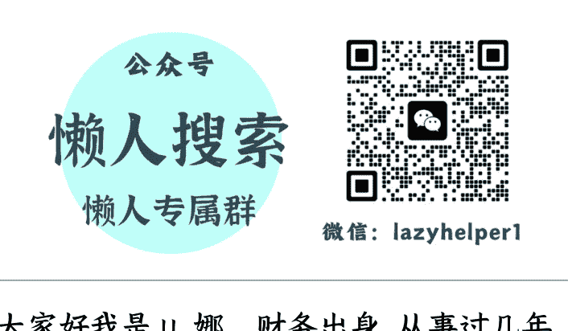

各位好，我是 U 娜。以前做过财务，也干过好几年互联网运营，2024 年裸辞进了赚钱。刚加入时报的第一个航海项目恰好是📕电商百货，没想到还在训练营里就把从零到一跑通了，当初的门票成本也挣了回来。拿到结果的速度让我更加确信要扎根这个方向，之后又找刀姐做了系统化的付费进修。再后来混剪和实拍都陆续爆过，2025 年全年店铺利润定格在 25 万。今天主要来聊聊这一年攒下的实操心得。

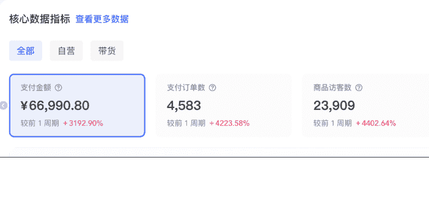

## 一、我的爆单经历

### 1、视频混剪玩法

第一个跑出量的品，是在 2025 年春节那阵子从抖音创意中心刷到的。我一看就觉得有戏，赶紧跑到📕查了查站内情况，果然有账号正在起量，立马跟进。但问题是，当时平台上能打的对标视频全是真人出镜、一句话拍到底的类型，剪不了几秒一切换的混剪模式。没办法，我只能走极限去重路线——抽帧、叠画中画、加滤镜和贴纸，能用的招全用了，但同质化的问题还是没解决。

接着我换了个省力的法子——把抖音上在卖这个货的博主挨个关注了一圈，只要他们更新视频，我立刻搬过来。这个办法确实让订单稳定了些，但始终没等来爆发。直到有一天我蹭了波《哪吒》的热度，把当时大热的 IP 和这个产品绑在一起发了一条。那时候哪吒正是全网顶流，视频跑到了 4 万多的曝光，实际成交只有几十单，来的多是看热闹的泛粉，转化不行。不过意外之喜是账号权重被带起来了，后面再发内容，初始流量肉眼可见地不一样。

真正的引爆点出现在抖音。有个刚刚爆火的视频，点赞量相当惊人，我去📕搜了一圈，居然还没人搬。二话不说，拿来做二次去重后立刻发出。这条内容最后拿下了 150 万浏览、2.6 万点赞。既然这个脚本已经被市场验证过了，我后面就不断一比一复制，再做细节优化，配合评论区运营，这款总共走了 5000 单。

这个品我用的人工干预策略很简单：把自己爆款视频下面的高赞评论，还有同行爆文里的高赞评论，全都采集下来，看到有单子进来就安排小号去回复。那些能引发共鸣的评论会自动吸引更多人来讨论，一来二去楼层越叠越高，内容热度很快就被拱上去了。这招我用了很多次，每次都管用。

| 笔记阅读数 | 笔记支付金额 | 笔记支付订单数 |
|---|---|---|
| 1,583,952 | 19,385.40 | 1,396 |

想学混剪的话，推荐去看圈友奇杰老师在 2023 年发的精华帖，步骤写得很细。另外我私藏了一个 App 叫混剪蜂，担心原创度不够就拿它二次创作。用它会消耗数字蜂蜜，做做任务就能免费攒，每天给的量对个人玩家来说绰绰有余，实在不够就多注册几个号。

#### 混剪蜂

做任务，得蜂蜜 | 106

VIP 每月领 3000 蜂蜜 >>

##### 大师二创接入

DeepSeek

全新模型 一键智能生成

大师二创

AI 智创自动成片

原创魔法

一键提升视频原创度

智能混剪

支持多素材混剪

##### 创作必备工具

视频翻译

视频出海·一键翻译

网感剪辑

AI 识别·综艺感剪辑

智能分镜

智能分镜·多维度拆分

智能抽帧

独家算法·一键抽取

去字幕

多种方式·随心消除

文案提取

精准识别·快速高效

视频下载

智能检测·一键下载

扫码进群

##### 蜂蜜中心

规则

我的蜂蜜

116

查看明细>

充值

升级 VIP 开通 VIP 月领 3000 蜂蜜

前往

##### 日常任务

+   看视频得蜂蜜

+   看 1 条视频得 20

+   去观看

+   签到得蜂蜜

+   第 7 天最高可领 25

+   明日再来

##### 限时福利

+   邀请好友得蜂蜜

+   每邀请 1 名新用户可获得 200

+   去邀请

5/26

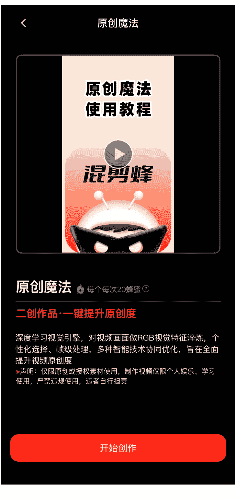

真正让收益上一个台阶的是第二个品，全店累计卖出 1.1 万单。

+   1、怎么挖到这个品的
选到这个品纯属在千帆后台的笔记排行里撞上的。当时看到好几篇内容、好几个账号都在发这个货，而且都已经有了爆款苗头，但销量才几百单，24 小时加购热度还挂在上面。我又跑到抖音创意中心验证了一下，那边 24 小时热度同样在线。回头去 1688 查货源，不仅有货，利润空间还很大。这还犹豫什么，直接上。

### 2、差异化定价打法

当时站内卖这个货的商家，最低标价也是 19.9，虽然加购数据不差，但订单涨幅跟不上，我琢磨着用户多半是嫌贵，或者打算去别家比比价再回来。于是我把单件价格直接拉低到 9.9，同时设计了阶梯规格：买得越多折扣越大。结果就是，九成的人下单都不止买一件，单价低了但客单量上去了，利润反而更可观。

因为我是这个平台上第一个敢把价格打到9.9的人，第一条内容发出去就有人付款了。不过那时候整个平台上所有爆款的封面都相当潦草，清一色是从视频里直接截出来的静帧，粗糙得很。神奇的是，就算封面这么随意，还是不断有账号靠这些内容卖出爆款。我既没有设计封面的审美，也没有制作能力，干脆就跟着对标的套路用视频截图当封面，这样也陆陆续续出了一些单。

转机出现在我刷到一个新冒出来的同行身上——他没有用现成的截图，而是自己做了封面，虽然没出现 100 赞以上的内容，但几十赞的已经有了。看着似乎可行，我也跟着模仿。结果从 6 月下旬开始，我接连爆了好几篇内容，全部是靠这个封面的思路带火的。可惜好状态没维持多久，没过几天就吃了平台违规的警告，热度戛然而止，同时一大批同行也看到了商机，冲进来分蛋糕，竞争一下子激烈了不少。

观察了一下，冲进来的这些同行几乎没人玩人工干预，全靠内容自然流量带评论。于是我在这块花的心思反而更多了，设计了一套评论区引导话术，还搞了个每日抽免单的活动——真的抽，不弄虚作假，我每天都会抽真实用户送产品，并把当天的抽奖名额和时间置顶在评论区。大家看到天天都在实打实地送人东西，参与评论的积极性一下子就上来了。另外这个产品本身就有话题性，评论区骂的人不少，我一条都不删。骂战也是流量，吵得越凶，曝光越高，何乐而不为。就这么熬到了 7 月中旬，新一波爆单如约而至。

### 3、爆单之后 - 账号被封

可惜好景不长，这个账号在两天后因为违规被永久收回了商业权益和流量权限。不幸中的万幸是店铺保住了，客服确认店铺权益和子账号都没受牵连。那阵子心情像坐过山车，我给自己放了半天假缓了缓。因为我手上有好几个备用小号，第二天就绑了个新的子账号继续干。结果没过几天，这个子账号也被封了。到这儿我也想通了：账号说到底就是个工具，它完成使命赚到钱就够了，号没了再开便是。反正该品的玩法我已经吃透了，新号上来发不了几条就能进爆款池。

具体违规原因是平台认定我用了 AI 技术伪造事件。其实平台对违规的打击方向是分阶段变化的，那段时间恰好撞上了严打 AI 的风口。坦白讲，封号之前官方已经给过多篇内容发了警告，但我觉得没那么严重，就没当回事，结果直接喜提封号。在这里也提醒各位：如果你发现同个时间段里内容接连收到违规提醒，一定要第一时间去修改、申诉，万一申诉也没过，就果断删掉。

### 2、实拍玩法

转做实拍之后，我把自己的拍摄水平掂量了一下：难度太高的品类，凭我现在的技术玩不转。正好赶上秋冬换季，便挑了一个应季的需求品进场。

#### 1、两条选品标准

+   1.1 这个品本身是刚需，而且同品类里其他不同类型的产品，早就在📕上被证明了有强需求和热度。
+   1.2 它得符合我目前的实拍能力——不需要多高级的审美，也不需要复杂的拍摄技巧，只要拍清楚手持实物、展示使用效果就够了。拿下面这款黑头毳毛夹来说，首图放使用前后的对比就能打动人，后面的内页只需要拍镊子夹出毳毛的画面，顺便放一张跟市面同类产品的横向对比图就完事。这类品对刚入门实拍的新手来说特别友好。还留红印子！凑近镜子才看清，原来黑头里还裹着小毳毛！

换了精密去黑头镊子才把这难题解决！薄刃夹口精准咬住，对着镜子轻轻一夹，小毳毛黑头直接连根拔

##### 黑头夹镊子

专夹黑头粉刺

绒毛/硬毛轻松拔

##### 黑头夹正确使用

+   NO1.

每次使用夹子前建议先用酒精棉片消毒

+   NO2.

热敷 2～3 分钟，或洗完热水澡后，毛孔打

+   NO3.

找准目标：只处理可见「毳毛」和“冒

藏在皮肤下面的黑头无法拔出，需要手

黑头：夹住黑头顶端，垂直轻松拔出。

毳毛：夹住根部，顺着毛发生长方向轻轻

控制力度：动作轻柔稳定，避免过度刺激

+   NO4.

清理

建议一周操作 2～3 次，不要太频繁，做好

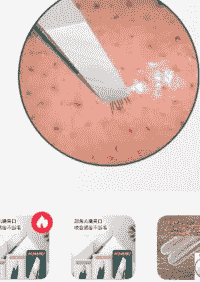

共 3 款 >

¥19.9

补贴价 ¥13.9

已售 1.6 万 +

平台券 立减 3 元

商家券 满 19 减 3

##### 友好市集 > 【前 2 万单特惠 16.9】黑头夹毳毛夹高精密夹子超薄无缝级拔毛夹黑

7 天无理由

店铺新品销量 TOP1

24 小时销量飙升

近 30 天

平均 24 小时发货 承诺 48 小时内发货，晚发必赔

广东佛山 包邮

7 天无理由退货 | 极速退款 | 晚发必赔

店铺

客服

购物车

加入购物车

领券购买

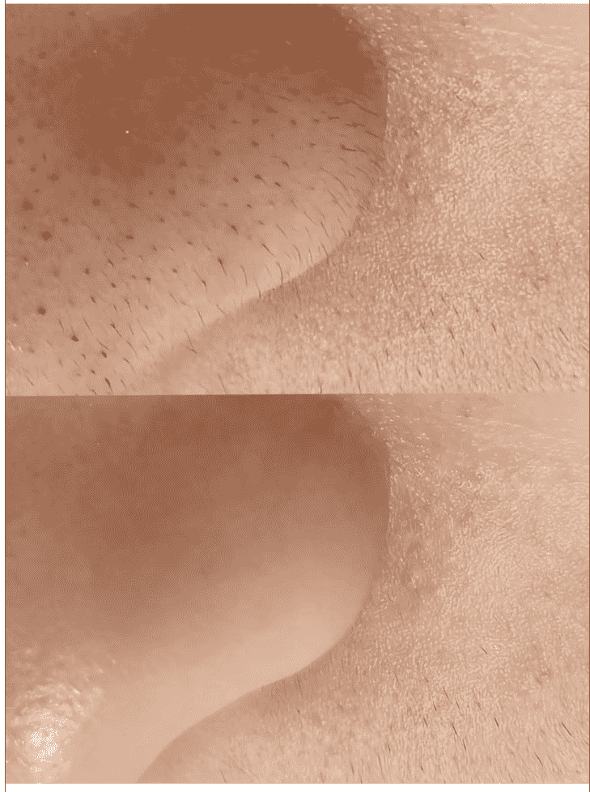

啊啊啊，这玩意才是毳毛黑头的终结者😎

有没有姐妹懂啊!鼻子上的黑头就像长在毛孔里一样!洗脸搓到泛红，泥膜敷到刺痛都没辙，手欠抠完还留红印子!凑近镜子才看清，原来黑头里还裹着小

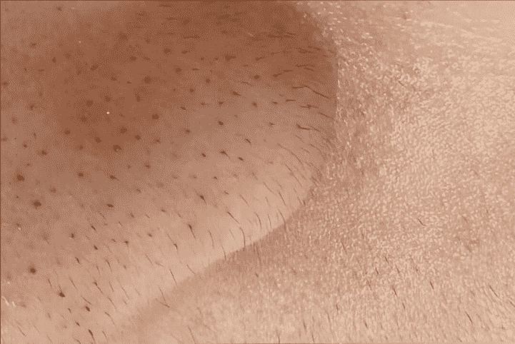

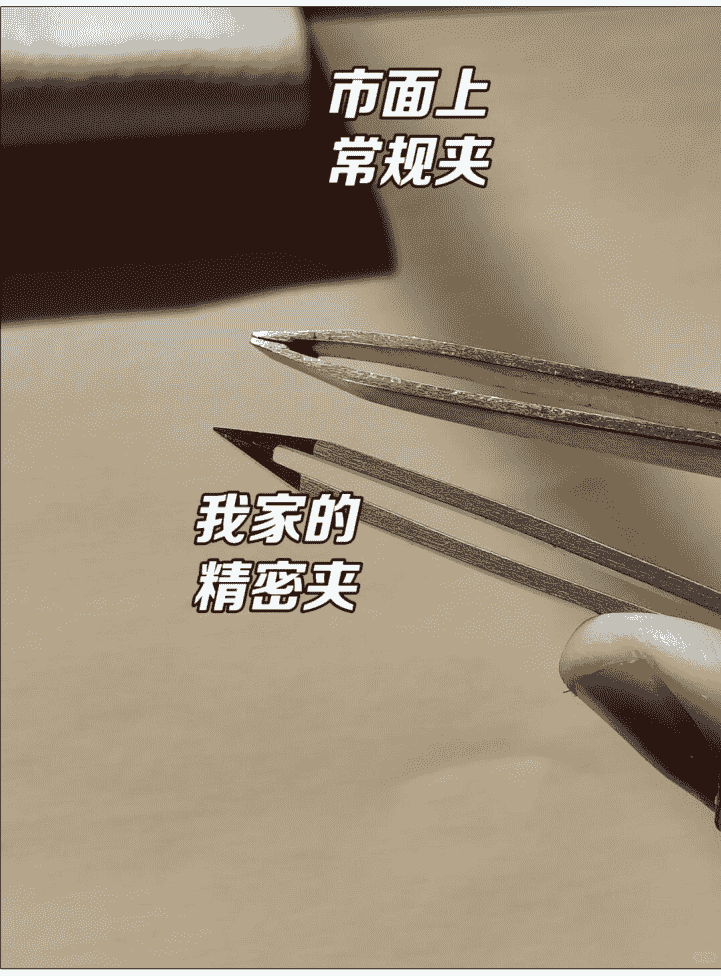

比这种尖嘴夹好用太多

安全性高夹口咬合更好

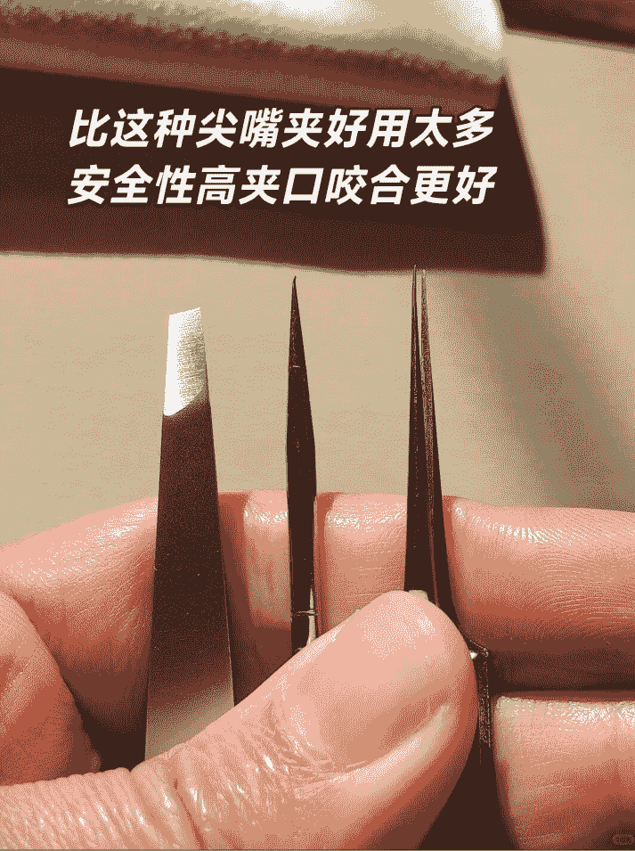

细毛、小毳毛一夹一个准

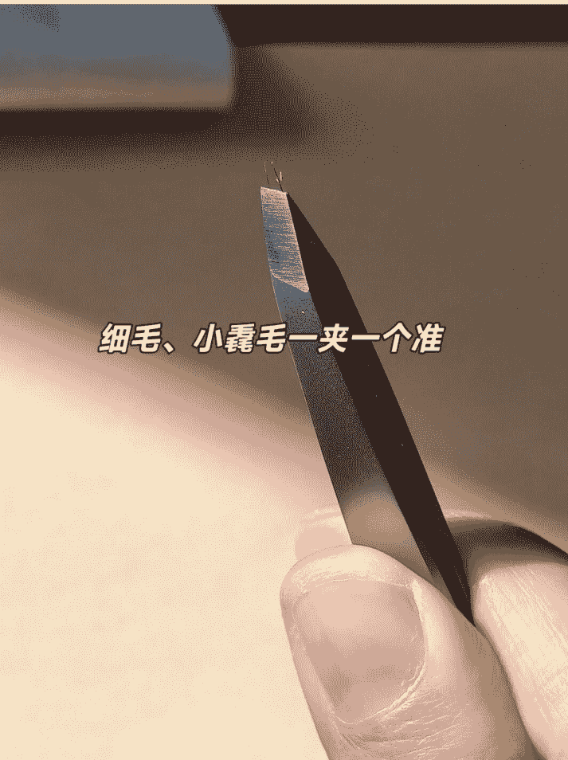

+   1.3 抖音那边这个品已经卖得热火朝天了，但📕上还找不出第二个卖同款的人，这时候入局，基本没什么竞争压力。

#### 2、没有对标怎么做内容

2.1 我在📕上卖这个品的时候，整个平台都找不到第二个卖家，自然也没有同行可以参照。不过我记得去年有个账号卖的是同需求类的产品，就把它当作参考对象，借用了它当初的爆款标题和文案框架，再根据自己的产品特点做了调整。

2.2 抖音那边卖货靠的是视频，而我的计划是做图文内容。所以我把抖音上这个品爆款视频的口播文案扒了下来，直接丢给 AI，让它帮我归纳产品的卖点和用户痛点，顺便让它建议图片应该怎么拍、文案应该怎么写。

#### 3、怎么把它卖爆

3.1 早早进场抢到了关键词红利。我是 10 月份开始布局这个品的，真正迎来爆发是在 11 月。

3.2 刚起步时流量惨淡，发出去的内容小眼睛只有个位数，说实话心里也没底，所以只发了内容，没动商品评论。后来我拿小号自己写了几条带图的好评挂上去，结果当天就有人下单了。这件事让我彻底意识到，基础销量和评价对转化有多么关键。

3.3 接着就是人工干预，恰好当时平台的惊喜回归券正是流量最大的时候，我就引导大家在评论区刷券，内容权重一下子就被抬上去了。

3.4 另外还有一点很值得说——情绪价值。直到我去上海参加📕大会，听了富贵老师的分享才恍然大悟：这款内容转化率高，很大程度上是因为标题和正文里带着强烈的情绪，精准戳中了用户的痛点。

## 二、经验沉淀

### 1、选品

我一直觉得选品决定生死，这句话一点不夸张，所以选品上投入再多时间都是值得的。

#### 1.1 抖音创意中心选品法

我把这个方法当作每天的例行功课：花十来分钟翻一遍抖音创意中心，看最近什么类型的产品势头正猛，再切到📕上观察站内有没有人跟进。要提醒的是，2025 年下半年起，📕明显把流量往图文内容上倾斜，特别是 live 图这种形态，新出的爆款几乎都是实拍 live 图或者 AI 图的图文内容。相比之下，抖音还是视频卖货的天下，靠创意中心选品来复制爆款的概率已经没有以前那么高了，但拿它来拓宽选品视野还是很有价值的。

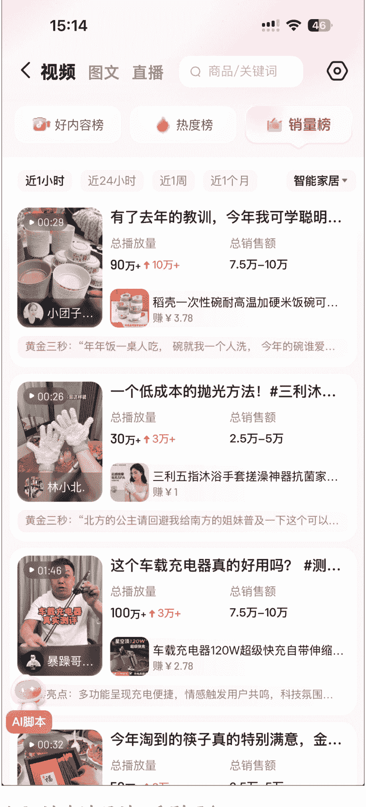

#### 1.2 站内手刷同行

这个思路的关键是拿一个小号专门用来刷内容，刷得越久，你越要多去给那些低粉但跑出爆款的同行点赞关注。只要你的行为数据够明确，平台就会源源不断地把同类账号推给你。久而久之，这就成了一个自动运转的选品库。我一直觉得，同行是这个行业里最好的老师，所以到目前为止，这也是我最依赖的一种选品方法。

#### 1.3 爬虫抓取 24 小时爆款

还有一种思路是用爬虫把 24 小时内站内的爆款数据抓下来，看平台上最近哪些东西卖得最火。不过说句实话，我见到的那些爬取出来的加购榜单，上榜的基本都已经红透半边天了，不是那种低粉新号带起来的潜力款，这个时候再冲进去跟品，打爆的概率已经很低。对于没什么经验的新手来说就更不友好了，顶多拿来看看趋势，拓展一下选品的想象力。

#### 1.4 千帆后台的笔记排行榜

进入路径是：千帆后台 - 笔记中心 - 同行 - 笔记排行。这里有个机制值得留意：只要你开始发带商品的笔记，平台就会按照你最近推广的商品自动把你分到对应的类目里去，比如美妆工具、年货礼盒之类的。这样一来，系统推送给你的优秀内容和头部账号，全都是跟你卖的东西高度相关的，参考价值非常直接。

##### 市场

##### 直播排行

##### 笔记排行

##### 话题排行

阅读榜

引流榜

热卖榜

成交榜

优秀内容

优秀账号

内容类型

每日 10 点更新近 7 日累计数据，上榜笔记为同行近 90 天新发

1 新年醒狮玻璃贴 | 贴上以后连房间都亮...

Xmoon Design

发布时间：2026-01-21

成交金额 (元) 阅读数 商品点击率

5 万 -10 万 7 万 -10 万 15%-25%

2 我的天爷呀，今年的玻璃贴每一张都好...

Xmoon Design

发布时间：2026-01-30

成交金额 (元) 阅读数 商品点击率

1 万 -5 万 3 万 -5 万 25%-50%

3 门神“下岗”再就业!我家冰箱成了新年...

潮玩派对

发布时间：2026-01-15

成交金额 (元) 阅读数 商品点击率

1 万 -5 万 3 万 -5 万 15%-25%

4 过年贴窗花别踩雷!

Xmoon Design

发布时间：2026-01-19

### 2、测品

#### 2.1 找到对标然后一比一复制

定好品之后要做的第一件事，就是把平台上所有近期跑出来的爆款内容都收集起来，按照热度窗口排优先级：24 小时内的热度最高，优先级最大，其次是 7 天、15 天、30 天。热度离现在越近，你照着模板一比一复刻然后打爆的概率就越高。

换成视频内容的玩法，就是把爆款内容的封面、脚本和标题逐一拆解，全部按一比一的比例去模仿，再互相组合交叉测试。如果说这一套流程全部走完，还是没有订单进来，就别死磕了，果断换品。

图文内容天然吃亏，小眼睛基数本身就比视频低一大截，很多时候发了 24 小时还是个位数，这种时候千万别慌，也别疑心自己是不是被限流了。你要做的还是那套动作：把爆款封面、标题、正文全部按一比一复制下来，再做交叉组合测试。我给自己定的及格线是这样的——图文内容发够 100 条，如果小眼睛持续低迷、几乎没有订单，或者只是偶尔蹦出来一两单，那就果断换品，当然前提是内容质量本身要过关。也可以同时上几个新品轮着测，因为不同产品在不同账号上的数据表现差异很大。说实话，有时候你跟对标已经模仿得几乎一模一样了，但小眼睛就是上不去，订单就是不来。这种时候没有别的办法，只能靠持续不断选品、测品来循环，直到找到那个跟你账号天然契合的爆款。

#### 2.2 人工干预

接下来的内容请划重点：人工干预真的太太太重要了。回头看看我的每一次爆单，人工干预都在里面扮演了决定性的角色。

##### 2.2.1 商品详情页的干预

你可以代入一下消费者的视角：平时买东西，是不是都会先点开商品页看看卖了多少、评价怎么说？反过来，如果你是个卖家，是不是该琢磨着给自己的商品补上基础销量和带图的好评？我通常的操作是，给商品垫上几十单的基础销量，再配上 5 条带图好评。现在的平台机制对带图好评特别友好，它会直接把这类评价挂到你的商品笔记评论区，转化率的提升是肉眼可见的。

这里特别提醒一句：以前大家冲销量都靠刷退款单，但这套玩法已经过时了——平台规则改了之后，退款单的销量会被直接清空。现在必须走真实的购买流程才有效。我是直接找了专业的刷单团队来处理，在 1688 上选同发货地的低价小商品寄出去，对方确认收货后我再提供对应的图片和文字评价，这样操作下来稳妥得多。

##### 2.2.2 评论区的干预

什么时候需要介入评论区？看三个信号：

+   第一，视频内容开始出单了，或者小眼睛数超过了 500；
+   第二，图文内容出了单，或者小眼睛突破了 200；
+   第三，你发现某篇内容的小眼睛明显高于你自己的其他内容，而且还在往上走。

介入的方式有以下几种：

+   第一招，直接去扒同行的爆款评论区，把那些热度最高的评论拿过来用。
+   第二招，评论区抽送。在评论里告诉大家会抽人免费送产品，用户一看有便宜可占，自然会主动留言互动。具体是真抽还是用小号演戏，取决于你产品客单价高不高。我的情况是客单价不高，所以每次都真金白银地送，还会把每天的抽奖截图置顶在评论区，用户看到你确实在送，不是画大饼，参与度自然就上去了。
+   第三招，利用平台的惊喜回归券。前几个月靠这个方法催生了一大批爆款账号，做法就是在评论区引导大家打出“惊喜回归券”四个字，他们就能领到大额优惠券，像 9.9 的产品用券可能 0.1 就到手了。用户当然愿意在评论区疯狂刷屏。其实这个券是平台给新客和老用户发的福利，跟笔记下方的评论没有任何关系，但你的内容热度是真实地涨上来了。

##### 2.2.3 内容掉量时的紧急干预

就算做到这一步，也不能掉以轻心——爆款内容的热度是会被消耗的。当一篇爆款的流量持续下滑但还在出单时，或者一篇潜力内容突然断流的时候，说明你需要马上出手做补救动作了，核心就两件事：补评论、补转化。

先说说补评论。这一步的核心逻辑是抬高内容的 CES 分数，把互动数据做上去。新发的内容和处于上升期的潜力内容，补评论的效果最明显，老内容的效果就打了折扣。评论内容别整那些干巴巴的摆设，最好是能勾起别人回复欲的互动型评论，我一般一次安排 5 到 10 条左右。

再谈补单。这招是救流量的核心手段，但有个前提条件千万不能搞错——必须通过商品关键词或者半标题搜索的方式，从搜索入口进入笔记再去下单，直接甩链接让人下单是没用的，一点都不见效。这一步没办法偷懒。

至于补多少，最简单的算法是预估当天自然成交量和昨天成交量的差距。举个例子：这篇内容昨天走了 100 单，今天时间过半但只出了 30 单，按这个节奏推算当天最多 60 单，那你就需要补上 40 单，才能追平昨天的数字。

最后再强调一句，补单一定要找专业团队来操作，千万别自己上手，一个操作失误就很容易触发平台的风控系统。

最后一个补救手段是内容的二次编辑。你可以试着改一改标题、换一下封面、动一动部分文案和关键词，改完之后再发布。这个方法不保证有效，但试错的成本很低。我经常把二次编辑和投流放在一起用，组合起来往往比单用哪个都管用。

#### 2.3 关键词的布局和优化

关键词这块，我的起步操作是直接把对标账号们正在用的词拿过来，等基础布局完成后再慢慢去挖掘新的词组。

那么关键词要去哪里找？

+   1、先在后台开通乘风工具，进入推广模块，新建一个计划，然后在搜索关键词的框里输入你要卖的产品。这时候平台会按算法自动推荐一批词包，你当然也可以根据自己的想法手动搜索添加。

关键词池的搭建和分批投放

我先把平台的词包全部导出来，整理成表格进行管理。

| 关键词词包 | 关键词举例 | 关键词数量 | 词包来源 | 操作 |
|---|---|---|---|---|
| Final_... | 私密、私处... | 902 个 | 平台 | 下载 添加 删除 |
| Final_... | 卫生棉条、... | 561 个 | 平台 | 下载 添加 删除 |
| Final_... | 洗衣液双十二... | 803 个 | 平台 | 下载 添加 删除 |
| Final_... | 呋虫胺、内... | 975 个 | 平台 | 下载 添加 删除 |
| Final_... | 纸巾双十一... | 789 个 | 平台 | 下载 添加 删除 |
| Final_... | 洗脸巾推荐... | 458 个 | 平台 | 下载 添加 删除 |
| Final_... | 卫生巾双 11、... | 574 个 | 平台 | 下载 添加 删除 |

下载完成后，我会按月均搜索指数排序，只保留搜索量破1万的词根，再把它们拆成多个小组，发布笔记时轮流上阵，避免撞车。

## 2、千帆后台 - 数据中心 - 搜索

这里能清晰看到笔记的引流词到底是哪些，以及哪些搜索词最终转化出了订单，对后续选词很有参考价值。

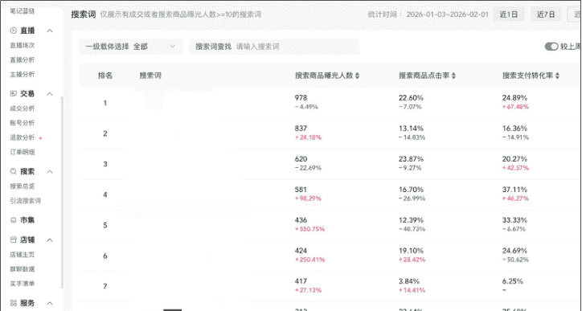

## 3、关于供应商发货的实操

选品测试期一定要多找几家供应商，先下单拿样对比手感和做工，最后只留下2-3家表现稳定的。千万别把鸡蛋放在一个篮子里，给自己留好备选方案。

市面上像店管家、聚水潭这类专业ERP功能很强，但我个人更常用1688自带的逸淘一件代发。现如今绝大多数1688商家都已接入，流程上手很快，上手门槛低。更适合客单价不高、成本不高的品类，先付款后发货，平台也支持申请先用后付。

用逸淘最大的额外收益是等级累积。所有采购都在平台内完成，累计金额越多专业买家等级越高，之后去谈新供应商，对方能看到你的身份，配合度和信任度会明显提升。操作方法可以参考逸淘—新用户入门教程。

## 4、复盘与反思

#### 4.1 心态是基础

我本身性格比较乐观，也许正因如此，我在做📕的1年半里一直坚信：动作标准化、不变形，持续复盘迭代，爆单是必然结果。期间确实陆续出了几个爆品。📕上，单品出单不难，难的是能稳定复现、持续打出多个爆品。心态一旦崩了，很难坚持下来。

#### 4.2 该花钱就花钱

- 1、产品质量出问题，补就补，退就退。遇到特别难缠的客户直接全额退款，不要因为一两个人消耗自己的情绪，划不来。
- 2、收到差评别浪费时间去沟通，直接申请全款退款，配合后台申诉基本都能过。
- 3、能提升效率的工具和服务一定要舍得投钱，卡在某个环节时也别自己死磕，花钱请人带路。你的时间成本远比你想的高，省下来的时间去做能赚钱的事。

#### 4.3 目前的短板

这次参加个体到工作室的mini航海，我才意识到过去一年我做的多是维持性工作，不敢放量，怕波动亏钱。直到听了许老师的期望值决策模型，才豁然开朗：赢的概率×赢的收益 - 输的概率×输的亏损，只要结果为正就值得去做。今年我会刻意压缩维持性工作，学会用人，把人力杠杆用起来，把精力集中在优化和突破上。

## 最后

借用条形码老师的一句话：只要你一直接牌、一直出牌，总能攒出一手好牌。

这就是你面对信息爆炸时的护城河。

我们不做低质搬运，只做优质信息的筛选器与放大器。

