# 从模仿爆款到设计爆款：5 个月 8 亿 + 播放量 YouTube 视频复盘

标题：5个月，8.7亿播放：从“抄爆款”到“造爆款”，我的YouTube AI视频复盘


我是明媚。以前靠UI设计讨生活，AI视频只是业余折腾；现在反过来了，全职在YouTube做AI故事视频。这篇算是我过去这半年多的一份总结：怎么一步步从只会“给猫换层皮”的初级模仿者，变成能拆内核、批量设计爆款的创作者。

先把成绩摆出来：目前我有4个频道在跑，其中2个已经拿到高级YPP。从9月份开通收益到现在，AI Shorts、短视频带长视频、带货佣金和各种奖励加起来，差不多2.2万美元。另外还拿了两个银牌，总订阅48万，累计播放8.7亿。2025年两个账号的年度观看量分别是5.35亿和3.26亿次：


复盘一下我的来时路，应该会对一些朋友有参考价值。

2023年9月我失业了，之后一直在找方向。加入赚钱后，我跟着参加了10次航海，📕电商、闲鱼高客单、👸号爆文、AI视频制作……能试的基本都试了一遍。但电商这种项目，一个人单打独斗太吃力，既要资金又要人力，还要天天应付买家的各种售后轰炸，时间被切得稀碎。对喜欢安静做事的i人来说，这简直是一种折磨。

24年11月，我在鱼丸的朋友圈看到油管陪伴群的消息，才知道原来YouTube上也能靠AI视频赚钱。而等到12月航海报名时，我恰好碰上家人生病需要陪护，定了闹钟还是没抢上，900个名额瞬间就没了。无奈之下，我决定自己照着手册先干起来：建账号、找对标，2月10日信心满满发出第一条视频。结果播放量多半是几十、几百，偶尔才能破千。那时我甚至不知道频道新开可以解决“0播放”的问题。

3月总算赶上了第二次YouTube航海。可当时的我完全不懂什么叫“微创新”，只会做一些类似猫换狗、苹果换梨的“找不同”操作，这种换汤不换药的复制，怎么可能爆？后来看到深海圈的宣传，也翻过曹教练和波妮教练的帖子，看到他们帮很多圈友拿到了YPP，说不动心是假的。但5000块报名费还是让我犹豫了——那会儿我已经大半年没有收入，纠结到深夜，最后还是放弃了。


放弃之后我给自己定了个期限：再试一个月，不行就去付费学。结果一个月过去，依然没有爆款。我意识到光靠自己闷头做，永远补不上信息差，于是7月正式加入了深海圈。

进圈后先看手册，信息量巨大，直接把我砸懵了。7月20日，我约了六只猫教练做第一次咨询，问的还是“做什么赛道”“要不要做4K”这种基础问题；到了8月11日第二次咨询，问的问题就进阶多了——比如具体分析一个故事，爆点在哪里，哪个脚本适合拿来复刻。教练特别耐心，甚至能敏锐察觉到我焦虑的情绪，给了很多鼓励。

真正的转折是在8月的深圳、广州聚会。曹教练点评作业时说了一句话：把脚本的内核提炼出来，再在上面叠加爆款元素、冲突和反转。我就是顺着这个点去改脚本，很快做出了第一个千万播放爆款。

下面具体拆一下这个爆款脚本。

原片讲的是一个小女孩因为家里穷，偷了一只烧鸡，被厨师一路追赶。她躲回家后，厨师顺着跟过来，发现她还有弟弟妹妹要养活，心一软，给他们送了很多食物，大团圆收场。原版节奏舒缓，情绪起伏不大，比较符合印度观众的观看习惯。

我在分镜上动了大刀：


原视频用了21个分镜，每个将近2秒，节奏拖沓，前面铺垫太多，寻找的过程很长，情绪曲线太平，结尾也平淡。改编版压到15个分镜，砍掉了前面展示困境的段落，缩短追逐过程，结尾的赠予方式也重新设计了。


情绪曲线是最重要的部分。开场就是砸破玻璃抢烧鸡，不铺垫女主角有多惨，先把悬念砸给观众；两场追逐戏从慢到快，节奏层层递进；等她跑回家，镜头才揭示偷鸡的原因——瘦弱的妹妹正开心地啃鸡腿；接着厨师破门而入，姐妹俩惊恐，他大声怒骂；姐姐跪在地上痛哭，说出两人的艰难；最后厨师没有继续发火，反而给钱，姐姐跪谢。整个冲突从对抗转向怜悯。这些设计其实是从苦情剧里来的：不得已作恶——被揭穿——下跪——和解，百试百灵。

人物特点我也做了强化。主角必须看起来瘦弱、邋遢、居住环境很差，这样“偷”这个行为才显得合理，观众也更容易同情。

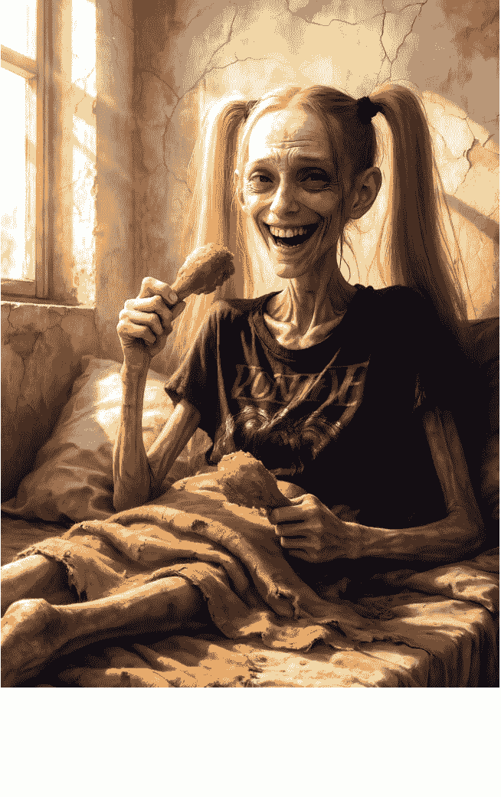


另外，AI生成的人物表情远没有真人那么生动，所以在没有台词的前提下，想把人物意图传递清楚，表情和情绪就必须画得更外放、更准确。

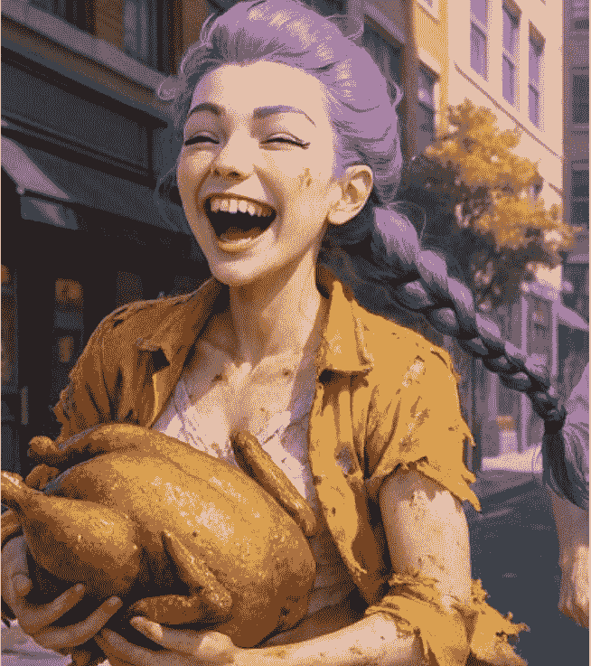
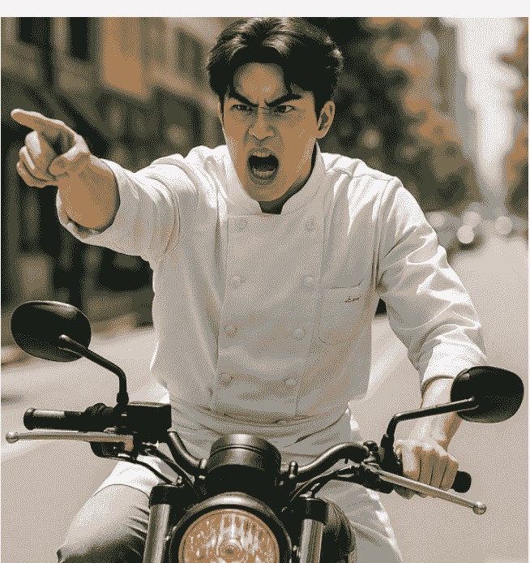
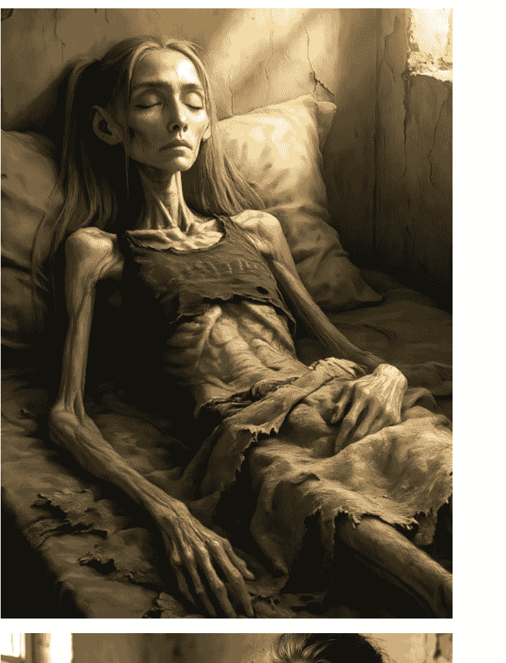
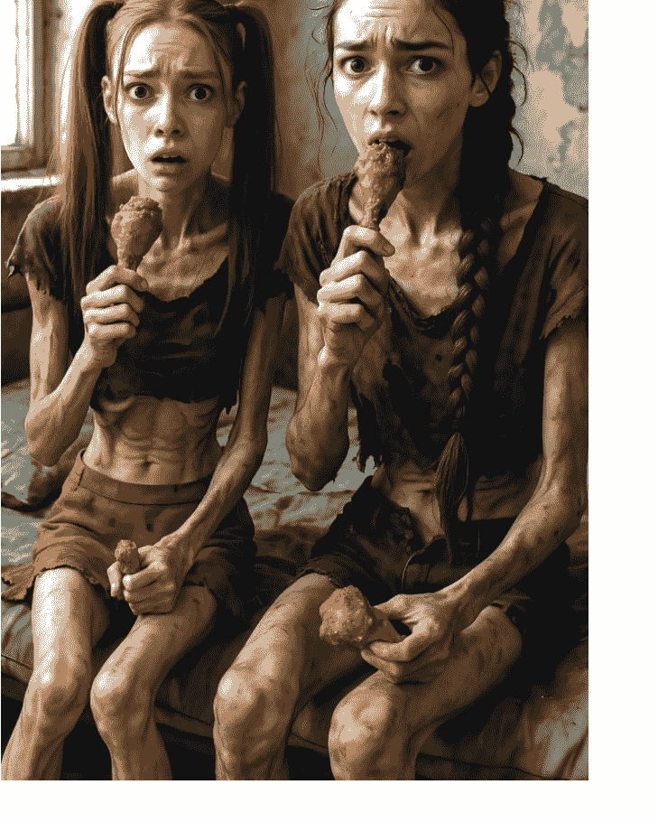


这个视频拿到了1000多万播放。之后我又在同一个脚本上做了好几版衍生改编。

角色互换版：把主角性别、身份对调，提示词基本沿用。这里还发生了一个小插曲——同一套提示词里，鸡腿忘了换成披萨。我出图后发现这个问题，但特意保留了这个分镜没改，想着看看这种刻意的错误能不能带来评论互动。结果证明，不必事事完美，这个分镜反而成为评论区热议的焦点，最终带来5600万播放量。


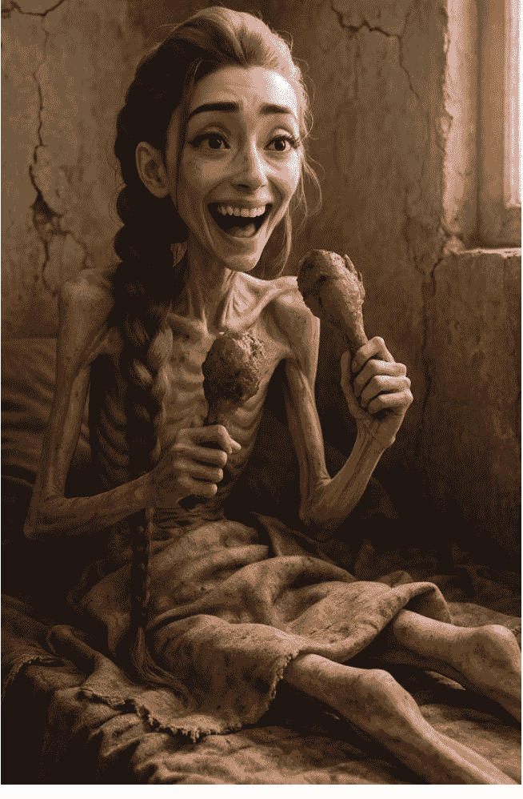


主题改编版：把“偷烧鸡”替换成偷衣服、偷手机（礼物）、偷首饰、偷泡面……只要核心逻辑不变，偷什么东西都能成立。

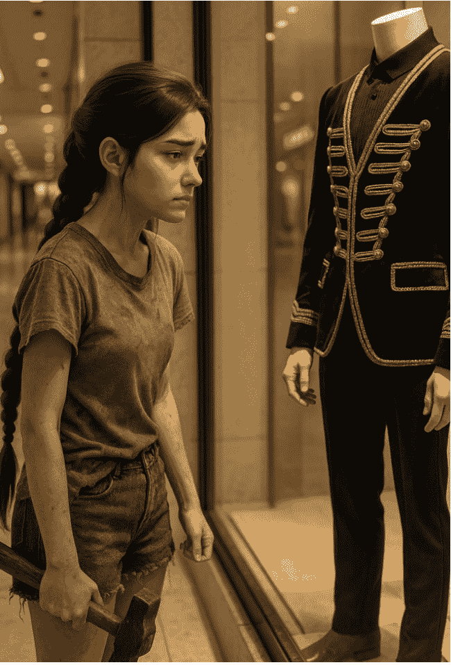
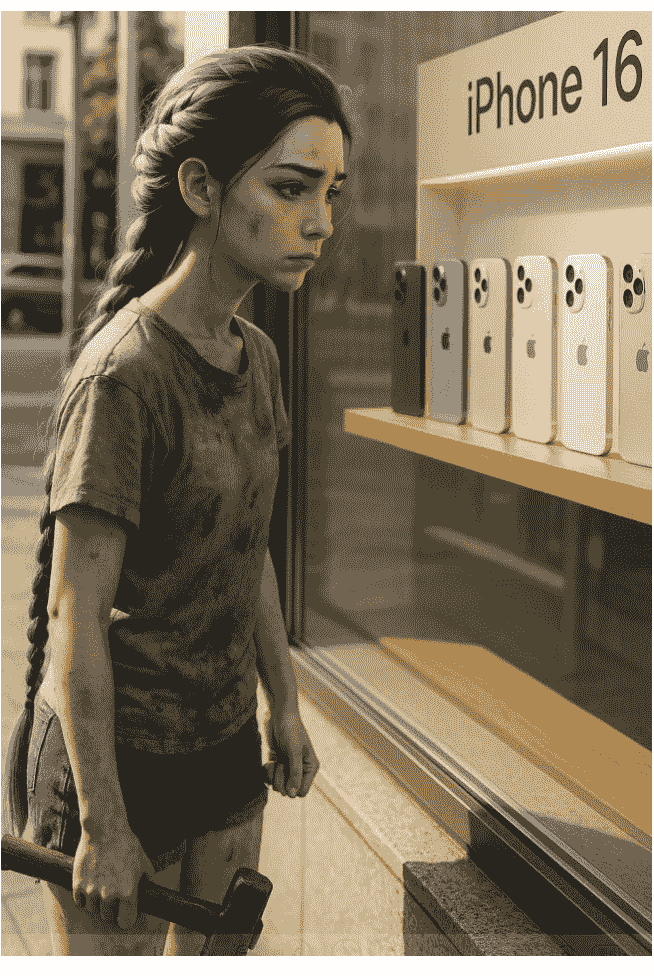
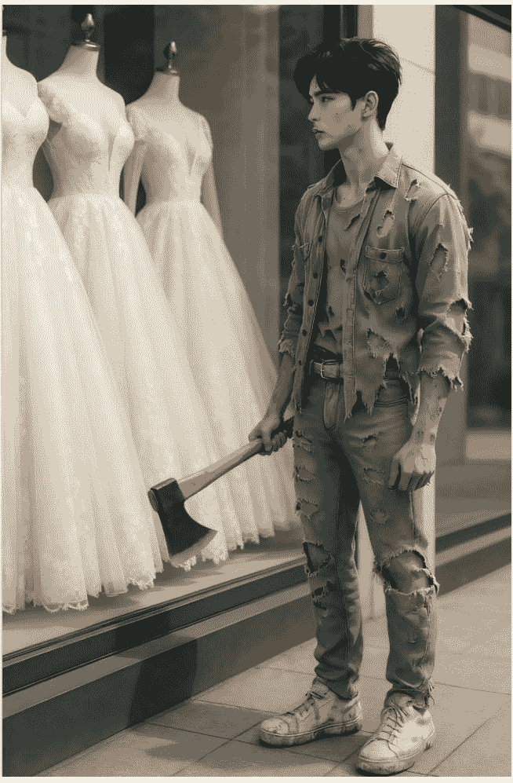
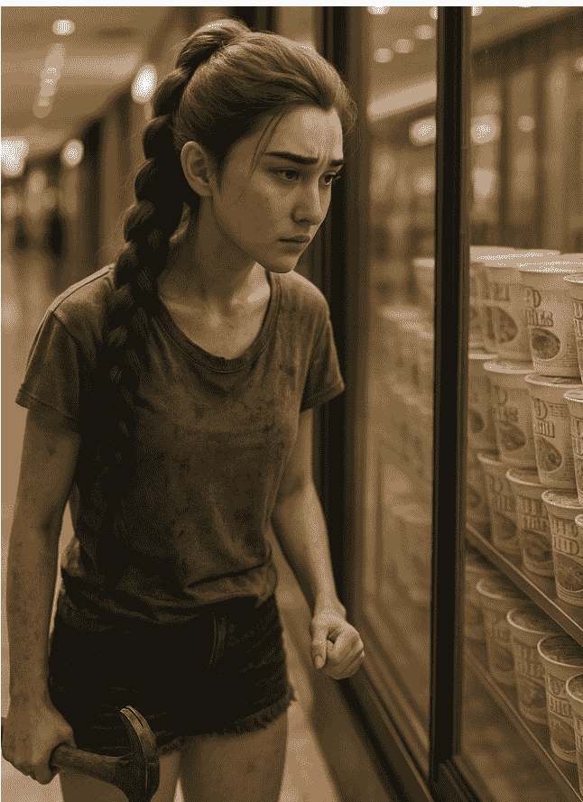

结局改编版：从喜剧变悲剧。主人公不得已做了坏事，却依然得不到好结果，每次快要成功的时候，就被车撞、被广告牌砸、被地铁撞、被警察抓，最后只能抱着遗物痛哭。我还参考了一个真人博主给孩子买手机的结尾，让悲剧情绪更浓。


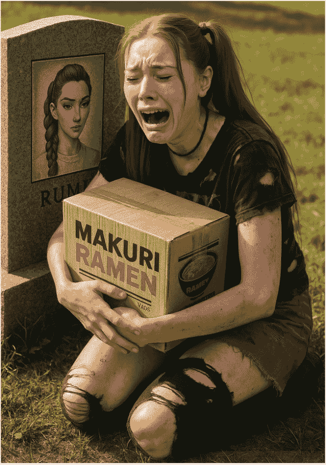


整个系列一共拿下1.5亿播放，其中两条视频单条分别达到4600多万和5700万：


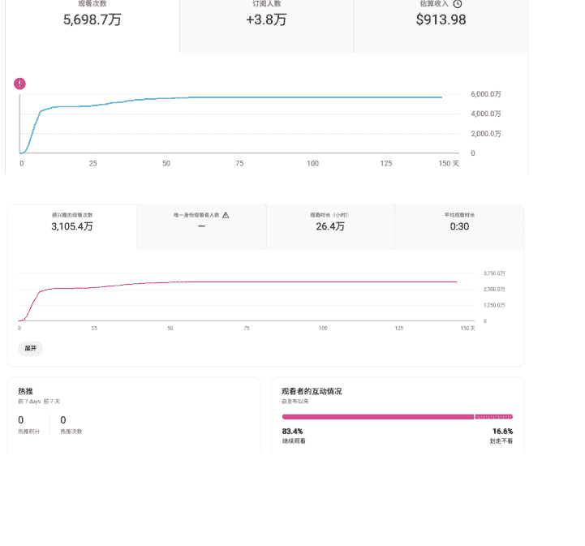

再往后，我开始尝试更抽象的改法——把脚本的内核完全抽离出来，再放到一个新的故事里重新生长。比如“一个人为了隐藏本来面目而改造自己，改造前后反差极大”这个内核，可以变成丑女变美女，也可以变成矮胖秃的男主角费尽心思打扮成高富帅，结果被自己扔的香蕉皮滑倒、假发脱落；还可以变成男扮女装，没有开门杀，也没有跌倒，而是因为饮食习惯露馅：真正的主角爱吃辣拉面，冒牌货却怕辣，最后打斗时又砸了玻璃。

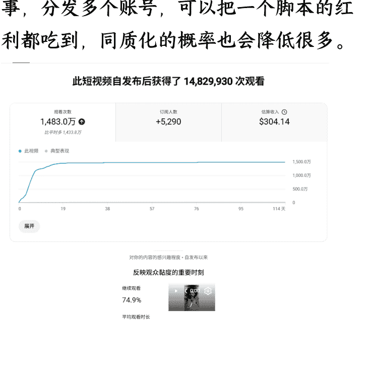
总结来说，内核可以支撑无数个剧情。把同一个内核分发到不同账号，既能吃透一个爆款的流量红利，又能在很大程度上降低同质化风险。改造方向可以是男变女、女变男、丑变美、机器人变真人，甚至老人变青年；爆点可以是贫困下的偷盗、顶替他人享受荣华富贵、做好事不留名等欲望驱动；拆穿方式则可以是无意间的举动、习惯改变，或者记忆无法共享。

几条视频的数据也放出来参考：一条2804万播放，平均观看时长78.1%；一条1232万播放，平均观看时长82.0%；还有一条2952万播放，平均观看时长81.6%。

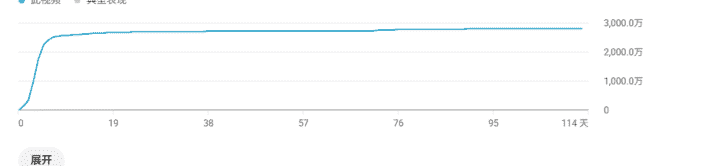

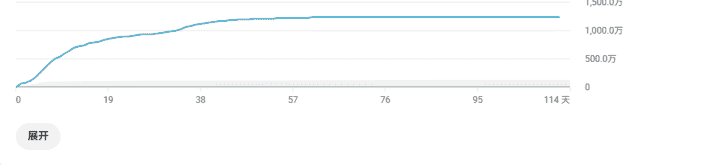

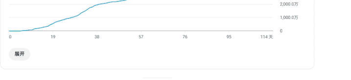


最后聊聊实操层面的方法。

想避开同质化，又不想捡别人做烂的脚本，最好的办法就是跨IP、跨平台收集素材：印度真人视频、影视剧切片、生活趣事、📕热门内容都可以。日常刷视频时，看到让你会心一笑或者大跌眼镜的桥段，马上放进自己的素材库。这个动作一定要坚持。

选脚本我有四个标准：
第一，播放量高。油管千万级、📕十万级、抖音几十万级的视频，说明已经被市场验证过。
第二，画面一看就懂，方便AI复刻。真人视频里那些靠眼神、微表情传递心理活动的画面，AI目前是劣势，播放再高也很难复刻。
第三，情绪曲线清晰。温馨感人、悲伤凄凉、搞笑反转、抽象猎奇都可以——毕竟AI还没有人类那么抽象。
第四，主题触及人性。贫富差距、道德抉择、猎奇、贪婪，这些题材天生自带传播力。

不用局限于平台，国内很多视频，改造一下发到油管依然有量。爆款视频的底层逻辑，在哪儿都是相通的。

希望我的这些经历能给你一些启发，也祝你能做出属于自己的爆款。

把国内博主的成片脚本搬运到油管做二次创作，单条冲到了3200w播放量，遗憾的是接连被限流，否则数据还会更高。

| 原片 📕 10w，抖音 59w | 改造后 油管 3200w |

| --- | --- |

| | |

### 去挖爆款要素

只盯本赛道的对标会受限，得经常跨圈逛一逛，主动跳出信息茧房。把其他赛道火过的点子拆开，融进自己的脚本里，有时就成了下一个爆点。


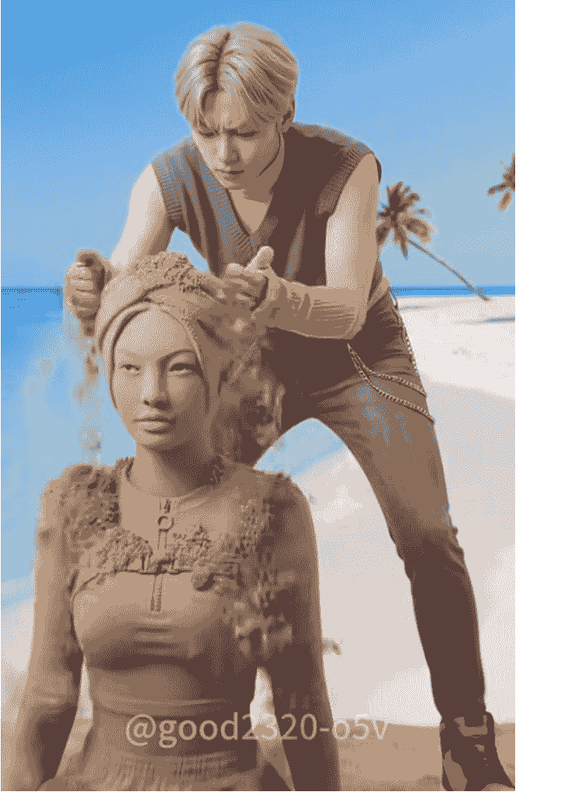


### 跨赛道的沙雕梗

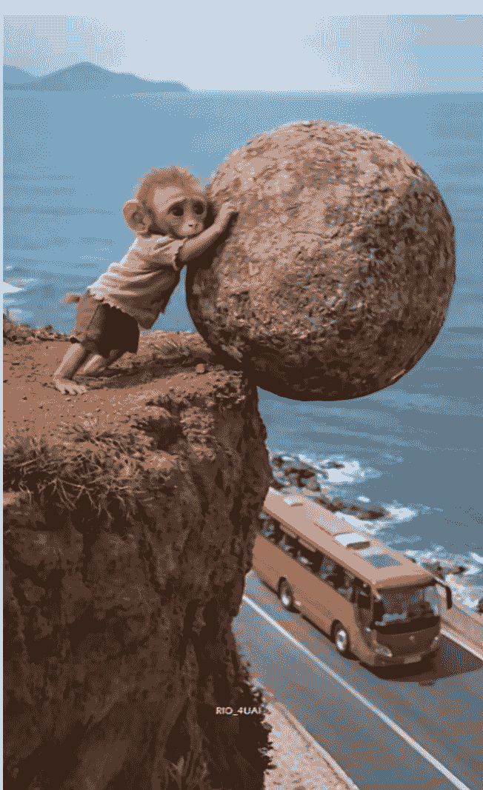

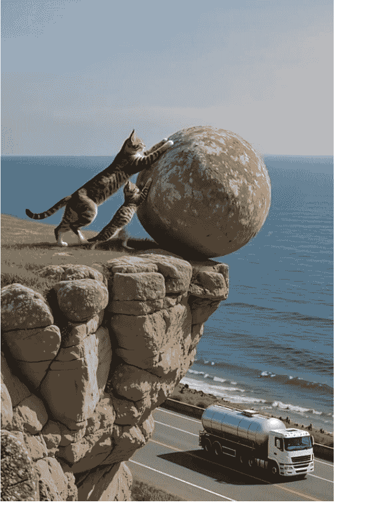

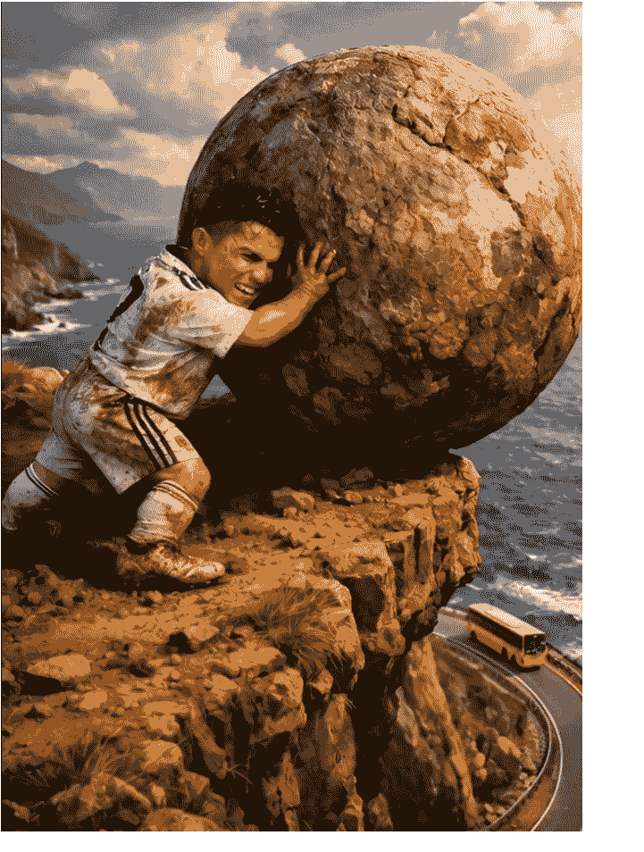

### 跨赛道的推石梗

乍一看是不是很眼熟，换个皮就发了？

### 脚本改造怎么玩

直接抄爆款翻车概率极大。刚发布时出现异常波动，可以立刻做小幅跟进。

如果爆款已经出来好几天，热度已经起来了，这时候再微调，出圈的概率就很低了。

这时要把脚本抽丝剥茧，把故事线抽象成骨架，去理解它、提炼它。

> 曹教练说过，一旦你能把脚本内核提炼出来并且成功做出爆款，你就拥有了无限改写这条脚本的能力！

比如近期很火的海难剧本，内核其实是灾难来临时的人性选择题。

最早来源于动物报警、动物救人这条赛道。结合近期鳌太线登山失事的新闻，改成雪山遇难救援，又是一个新故事。

大地震里两人被困废墟，该救谁？

灾难也能泛化成困境，破产、生病算不算？

梳理完内核，再有意识地植入爆点因子：嘲讽、地面画陷阱、丧尸、抢夺、人鱼、格斗、探险、天堂地狱、耶稣、身体异变、佛学宗教等。

同一内核换IP套用，日更压力会小一些，流量也能吃得更满。

多练改稿的手感，一直抄只能吃到尾流，还会同质化。

提升改编能力，这项能力可以迁移到AI短剧、AI广告、漫改剧等。

所以我一直觉得，练好脚本改造能力才是核心。

### 分镜怎么把控

完播是生死线。真人还原难就难在时长与故事完整度的平衡：叙事要成立，节奏不能拖。

每个分镜都要问自己是否必要，AI复刻难度有多高。

本质上考验对AI工具的熟悉程度——知道什么会加分，什么会减分。

#### 抢被子故事:


#### 原视频分镜


#### 改编后分镜

- 核心线：被子第1次被抢----花盆压被子----被子第2次被抢----床头柜压被子----被子第3次被抢----椅子压被子----被子第4次被抢----椅子+床头柜+花盆压被子----被子第5次被抢----女子醒来----反转

- 好笑点：男生喝可乐憋气、走路姿态、放气时的面部表情、重量递增 花盆、床头柜、椅子、最后三件一起压

选它原因：太日常，共鸣强，一看就想转发给朋友。

AI还原难度：喝可乐憋气的表情、走路捂屁股的动作、精准掀开被子一角放气。

改编后：只保留重量递增、冻醒与熟睡对比、正反打对比 一个打呼噜一个把被子钉死、重量升级。

### 工具链

#### 5.1 提示词撰写

提示词先自己搭框架，用GPT补全场景，再自行微调后出图。

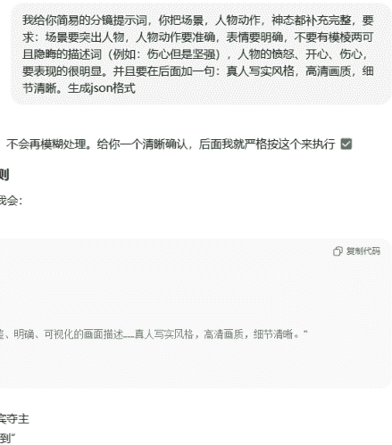

##### 1.给GPT下指令

##### 3. 人物动作要求 精准

- 写正在做什么 + 怎么做 + 动作结果

- 有明确的身体状态、姿态、方向、力度

- 不用模糊词：

  - ❌「似乎」「仿佛」「好像」「带着某种感觉」

##### 4. 人物表情与情绪 强烈表达

- 情绪必须一眼能读懂

- 用五官+细节呈现:

  - 愤怒 → 咬牙、瞪眼、眉头拧紧、肌肉绷紧

  - 开心 → 笑到露齿、眼睛弯起、身体放松

  - 伤心 → 大哭、眼泪流下、嘴角下压、抽泣

- 绝对不用：

  - ❌「伤心但是坚强」

  - ❌「复杂的情绪」

  - ❌「情绪低落却克制」

##### 5. 结尾固定一句 逐条写

> 真人写实风格，高清画质，细节清晰。

##### 6. 其他之前强调过的点全部继续遵守

- 角色名严格保留 rum i / jinu 等，不改名

- shot_id 顺序清晰、不跳号

- 不合并、不省略、不自作主张改剧情

##### 2.GPT 明确你的要求

- 1、中景，秃头，500 斤的肥胖 jinu 正坐在木地板上吃香蕉，背景是现代家居

- 2、近景，秃头，500 斤的肥胖 jinu 正坐在木地板上吃惊地看着镜头，背景是现代家居

- 3、特写，香蕉皮正在从空中坠落，呈现动感

- 4、近景，秃头，500 斤的肥胖 jinu 背对镜头，趴在原木色门上的猫眼向外看

- 5、特写，猫眼视角，rumi 笑着拿着 psp 游戏机打招呼，背景是公寓走廊

- 6、特写，秃头，500 斤的肥胖 jinu 对着镜头大叫，表情十分惊慌，背景是现代家居

- 7、特写，秃头，500 斤的肥胖 jinu 对着镜头正在戴假牙，他原本的牙齿缺失，表情认真，背景是白色浴室

- 8、近景，秃头，500 斤的肥胖 jinu 站在浴室镜子前，一只手拿着假发，一只手挠头，眉头紧皱，背景是现代浴室

- 9、近景，500 斤的肥胖 jinu 站在厨房，正在喝一瓶绿色液体，他眉头紧皱，背景是现代厨房

- 10、近景，jinu 站在厨房，手持一个空的玻璃瓶看着镜头笑，背景是现代厨房

- 11、近景，jinu 开心地朝着镜头走来，一只手拨弄着头发，表情十分得意，背景是现代家居

- 12、近景，jinu 背对镜头，正准备打开原木色房门，背景是白色墙壁

- 13、特写，rumi 面对镜头笑着打招呼，手里拿着一个 psp 游戏机，站在打开的门外，背景是公寓走廊

- 14、全景，镜头平视，jinu 和 rumi 笑着走在客厅内，jinu 前面的地板上有个香蕉皮，背景是现代家居

- 15、全景，动态镜头，jinu 踩到地板上的香蕉皮，身体倾斜快要滑倒，动态模糊效果，背景是现代家居

- 16、特写，rumi 手里拿着一个男人假发，镜头聚焦 rumi 手部，背景是现代家居

- 17、近景，光头 jinu 坐在木地板上，双手捂着头大叫，表情极度惊恐，背景是现代家居

- 18、特写，rumi 拿着一顶男士假发吃惊地看着镜头，背景是现代家居

##### 3.整理分镜，丢给 GPT

```json
[
  {
    "shot_id": "shot_001",
    "image_prompt": "中景，秃头、体重约 500 斤的肥胖 jinu 盘腿坐在木地板上，身体占据画面中央。他一只手拿着剥..."
  },
  {
    "shot_id": "shot_002",
    "image_prompt": "近景，秃头、500 斤的肥胖 jinu 仍坐在木地板上，突然停下吃香蕉的动作，猛地抬头看向镜头。..."
  },
  {
    "shot_id": "shot_003",
    "image_prompt": "特写，一片黄色香蕉皮从空中快速坠落，香蕉皮在空中翻转，边缘模糊呈现明显动感。背景虚化..."
  },
  {
    "shot_id": "shot_004",
    "image_prompt": "近景，秃头、500 斤的肥胖 jinu 背对镜头，整个人贴在原木色房门上。他弯着腰，脸紧贴门板，..."
  },
  {
    "shot_id": "shot_005",
    "image_prompt": "特写，猫眼视角画面，画面边缘呈圆形畸变。rumi 站在公寓走廊中央，正对猫眼微笑，她嘴角上..."
  },
  {
    "shot_id": "shot_006",
    "image_prompt": "特写，秃头、500 斤的肥胖 jinu 正对镜头张大嘴巴大叫，嘴张到极限，喉咙清晰可见，眼睛瞪圆..."
  },
  {
    "shot_id": "shot_007",
    "image_prompt": "特写，秃头、500 斤的肥胖 jinu 在白色浴室内，对着镜头小心翼翼地戴假牙。他原本牙齿明显..."
  }
]
```

##### 4.GPT 输出符合格式的提示词

#### 5.2 文生图

生图工具大同小异，模型我用 Nano banana pro，批量工具用 will 大佬的。


1. 如果对人物形象有特定要求，可以先生成符合要求的形象，再拿来垫图


男扮女装，需要观众看出是男人扮女人，所以要先固定形象


从秃顶戴假发、再到变身完成


工人 rumi.png 换装 rumi.png 老年 rumi.png

女扮男装的 rumi，女人特征、男人装扮

##### 2.敏感词规避

- 血液 = 红色液体、红色污渍 伤口 = 裂口

- 窒息 = 双手捂着脖子，脸部轻微泛红

- 惊恐 = 眼睛瞪大、嘴巴张大 怒骂 = 眉头紧皱地交谈

- 嘲讽 = 眉毛上挑地大笑

- 皮肤细节 = 肉粉色带纹理平面 身体内部 = 粉红色带褶皱管道

总体上，描述词尽量去情绪化，只描述状态。

#### 5.3 图生视频工具

视频模型我用 grok、hailuo、flow。

grok 便宜大碗，基本需求都能满足，不会像 vidu 那样老审核，但自带背景音。

hailuo 我用来做打斗、首尾帧变身。

flow 是做带语言视频时需要音画同出的场景，但 veo3.1 经常脸崩。

所以有时候用 grok 出画面，再把 veo 那条脸崩视频的音频拆出来拼回去。

配音用 veo3 直出或 elevenlabs，音效都是剪映自带。

注意：生成视频时镜头语言要丰富点。

- 镜头轻微抖动、剧烈抖动、镜头推进、镜头拉远、镜头环绕主体旋转、镜头跟随

- 人物动作幅度大，表情丰富

工具刚出来我一般不会第一时间冲去试，不用焦虑。真正好用的工具一定会在深海圈群里被反复提到，到时候再集中练就行了。

AI 时代百家争鸣，工具差距会缩小，使用门槛会越来越低，别花太多时间折腾，把基本功打扎实就行。

### 日更

#### 慢即是快

做视频是为了日更，还是为了变现？

把一条视频做好，比着急赶日更节奏重要，不用逼自己日更，保持规律更新即可，长期主义，别下牌桌。

## 六、日拱一卒的进步

- 1、逐帧学习对标视频，对比差距，列出需要优化的点。

- 2、定一个阶段性计划，不必每天进步，只要在一定周期内有进步。

- 3、多和自己比，哪怕一点点进步，也比昨天的自己强。

- 4、打破常规，做个不一样的自己，别给自己设限。

- 5、我也从来没想过能靠发视频做自由职业赚钱，但当我打破常规，不再对自己说不行，才发现外面的世界没那么难。当我开始多社交、多参加线下活动，信息差才被拉平，才拿到关键信息。

## 七、思考总结

- 1、爆款内容都有迹可循，一定满足了某种需求，多总结规律、尝试新内容，才能持续进步，跟上平台。

- 2、账号有生命周期，内容越多质量越高，对后续要求只会更高。同样脚本，老号 800w，新号能到 1.3 亿。该开新号就开，别在老号恋战。

- 3、kpop 赛道被卷出花，从能轻松出爆款到现在要十八般武艺齐上，从图到视频到配音到背景音到运镜，每个环节都要完美。放在别的赛道，可能只用 50% 的力气就能爆。值得研究的赛道很多，没必要卷死。

- 4、国内平台迭代比国外快很多，抖音、📕从内容平台慢慢延展到电商。如果能借油管发展电商带货，收益会放大很多倍。

- 5、那天看娜娜教练发的油管博主卖网课，订阅制付费，很适合长期发展，油管也鼓励这类内容，同时也是延伸技能变现的好方式，多渠道变现。

- 6、这是我加入赚钱的第四年，从加入深海圈开始，我体会到赚钱的氛围。不断实战、链接、分享，我感受到那股蓬勃向上的动力来自持续行动、彼此连接、同路人理解与认同。这种动力源源不断地推动我向前。

## 八、写在最后

从 2 月份摸索，到 7 月加入深海圈，到 9 月开始有收益，大半年一晃而过，如果问我做了什么？

就是坚持，坚持，再坚持！把每一步能做好的都做好！

然后，等风来！

## 最后，安利小懒的付费群：

### 懒人专属群 介绍


> 这里是你对抗信息过载的护城河。

已稳定运行 7 年，累计拆解、研读 3000+ 个互联网商业实战案例与行业前沿内参和时政/宏观文章。

我们不搬运垃圾，只做高价值信息的筛选器与放大镜。

### 懒人专属群更新记录：

```
https://hk57gvlx7u.feishu.cn/docx/H0kRdZbSbolBR0xkaXtcuVE0nTg
```

> 【免责声明】本资料归档于社群内部知识库，仅供成员课题研究与学术交流，请在查阅后 24 小时内删除。