# 从反复焦虑要不要回职场，到月入稳定五万，我把创业做成了可复制的流程

260210 副业 SC 精华

公众号懒人搜索，懒人专属群独享

懒人微信:lazyhelper1

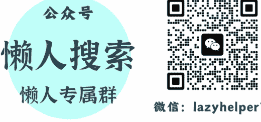

大家好，我是枕棠，04年生人，在生财已经待了三年。

19岁就开始做知识付费创业。过去两年多，我几乎活在焦虑里，每天盯着数据发慌，担心公域拉不到人，担心变现掉链子，总在想下一笔钱什么时候来，是不是该收拾东西回去打工。

转折点来自我把重心放到垂直号的精耕上。现在每天能稳定加到5到10个精准微信，流量端终于有了安全感。

收入轨迹是10万+到20万+再到今年的30万+，年均增速约75%。2026年拿下人生第一个百万，已经有了底气。


ps: 下面贴了部分截图，方便大家对号入座。

今天把我梳理出来的底层思路和垂直号的一整套操作流程原原本本分享出来。

全文分三块讲：

### 第一块
先聊创业为什么总不踏实，我怎么在知识付费的定位和产品上先拿到确定性，再用群发售把转化做成SOP实现月入3到5万，接着怎么搭建垂直号SOP做到日均引流5到10人。顺带解释SOP是什么，项目要做大为什么必须沉淀SOP。

### 第二块
讲垂直号的认知。我一度看不上公众号，到意外跑通引流，再到形成稳定获客的心智模型。为什么阅读10万+不赚钱，阅读500却能带来大额成交，关键是精准度。垂直号垂直的不是赛道，是人群。

### 第三块
垂直号实操的完整SOP。

从选题怎么找，怎么建库，怎么挑出容易爆的题，再到文章怎么写，标题封面怎么提点击，开头怎么提升完读率，整套拆开讲。

你可以挑重点看，我建议完整过一遍，收益会更大。

## 一、给创业找确定感

### 1. 个人IP知识付费为什么收入老是晃？

在生财经常能看到各种高光：

- “我一周成交了1000单。”
- “创业第一年赚了几十万。”
- “新品一上就爆了。”

这些基本是真的，但也基本只说对了一半。

他们会说一周1000单，不会说其他周只有100单。

会说第一年赚了多少钱，不会说后面一路下滑。

我自己19岁月入5万的帖子大家都看过，没人知道前后三个月我每个月都不到1万。

聊下来发现，做0到1的人几乎都卡在同一个坑：

**收入极不稳定，项目换一个又一个，永远在从零开始。**

不稳定就放不大，没有稳定现金流就没法安心全职，最后只能考虑回职场。

我反复思考，收入不稳的根因是什么？

在个人IP知识付费赛道，我归纳为四点：

- 定位不稳。不知道为谁做生意，不知道解决哪个核心痛点，啥产品都试，缺乏长期价值感，天天内耗。
- 产品飘。没有自己的产品体系，要么只带别人的货，要么产品生命周期极短，卖完即焉。
- 流量断流。公众号、小红书、混圈都做，但引流时有时无，数据焦虑常态化。
- 转化看手感。朋友圈、直播、私聊全靠状态，手感好时爆发，手感差时整月空窗。

总结来说，想让知识付费稳定，必须同时拿住：

一个清晰的人群定位，一款长卖的产品，持续进来的获客，以及可复制的成交方式。

前两个不稳还能凑合。

后两个不稳就是灾难。

你会遇到有的月赚好几万，有的月只有几千。这种不上不下的悬空感最折磨人，我深有体会。

后来我找到了一些确定性，下面讲我的经历。

### 2. 我是如何找到确定性的

#### 1）定位

做自媒体的前两年，我总担心粉丝不要我了。

一个前辈说过的话一直在我脑子里：

> “你最好赶紧读研，保住学生身份，这个盘子才能继续。一旦你不是大学生，基本盘会直接崩。”

可我不想读研，毕业工作了。

结果账号不降反升。

我才明白，IP价值和身份标签关联不大。

关键在于你能否持续输出垂直内容，能否清楚目标人群的痛点并给出解法。

我做高考的朋友，有在读大学生，有从业十几年的老师，都能做大，差异只在人设包装：学长、老教师、清北、211。

所以我确认了，

**陪年轻人成长和变现这件事，我可以一直做下去。**

我清楚他们在焦虑什么：职业规划迷茫，大学课程水，毕业即被淘汰，想自律，想靠自媒体实现经济独立…这些问题我都有成套解决方案。

即便我已经30岁，只要持续输出有用，盘子就能一直转。

定位的确定感有了，至少还能再做四年。

#### 2）产品

定位稳了，产品也需要沉淀。

我试过年度社群、读书打卡、自习监督、商业训练营、AI信息分享营，各种模式都玩过。

最后发现，超级个体频繁换产品，本质是资源浪费。

每次都要重新做交付、重新运营、重新找卖点，消耗巨大，而且下一个能卖好没保证。

那些一直出新品的人，往往是因为拉不到新流量，只能在老私域里反复收割，信任耗尽就退场。

我把目标从“做爆款”转到“做长销品”。

两个产品最合适：

**轻运维的录播课**：边际成本趋近于零，一年出一款核心课，卖就完事。

**年度私教**：客单价高，能深度接触学员保持市场敏感度，还能持续产出案例为IP加分。

这两个产品定下来后，收入有了可预期的底座。

这时大概是2025年6月，毕业前夕。

定位和产品稳了，但**流量和转化**依旧像过山车。

这两个东西没法吃老本，每月必须持续做，于是我开始找SOP。

#### 3）转化

转化说白了就是写东西。

朋友圈、公众号、直播脚本，都是文案。

前两年我全靠灵感，灵感来了就写，卡壳就去看同行。

表面看很浪漫，实际上很脆弱。

每年期末我有两个月在忙学业，完全没空做内容。

一回来就发现“手感”没了，不知道怎么写，不知道怎么卖。

状态不好就写不出来，转化直接归零。

后来我把转化流程化，搞出了公开课SOP。

用群组直播的方式，把卖点集中起来，短期内批量成交。

ps：生财的3天体验营就是这个思路。

SOP分三段：

- 筹备期4到7天：定主题，梳理产品卖点，集中发文或找KOL解决流量。
- 拉群期4到7天：做海报建群，写群公告，做裂变。
- 发售期4到7天：开直播，连麦嘉宾和学员，追单成交。

把转化动作流程化后，我跑通了一个稳定模型：

每月一场直播，集中一周发售，月销稳定在3到5万。

#### 4）流量

说实话，整个闭环里我最弱的就是流量。

以前做公域就是三天打鱼两天晒网，到今年5月才逼自己补短板。

虽然也出了几篇爆款，但我深刻体会到公域是个黑箱。

你会遇到：

- 能抄爆款，不一定能写出爆款。
- 能写爆款，不一定能持续爆。
- 能持续爆，不一定能精准引流。
- 能引流，一次违规账号就没了。

我写过10万+一分钱没赚到；也连续爆了几篇但来的流量不转化；更稳定引流后因一次失误被降权两个月没流量。

最大的坑是，爆款频率上不去。

直到做垂直号，我才意识到问题出在没把流程拆成清晰的SOP。

于是我把公众号的创作做成了每天照着执行的SOP，细节在第三部分。

公众号懒人搜索，懒人专属群分享

## 三、爆款垂直号SOP

- 1. 搭建选题库
    - 关键词锚定
    - 找对标爆款
    - 建立选题库
- 2. 二次筛选选题
    - 发布时间
    - 爆款数量
    - 是否与我相关
- 3. 正文撰写：结构大于天赋
- 4. 点击率为王：标题与封面
    - 标题
    - 封面
- 5. 完读率：开头100字决定生死
    - 我说的就是你
    - 我能解决你的问题
    - 后面内容很值
- 6. 合规引流：我曾被限流三个月
    - 错误的引流方式
    - 正确的引流方式
- 7. 数据复盘，持续迭代

有了固定创作流程，更新频率稳定了。

有了固定的选题方法论，爆款率上来了。

内容有了模板化框架，引流效率也提升了。

认真执行时，每天5到10个精准好友稳定进群。

然后靠朋友圈维护和私聊，再按SOP做一次公开课发售。

卖的是录播课和陪跑，流量、转化、客单价都固定。

这套组合拳让我实现了想要的商业确定性，稳定月入3到5万。

### 3. SOP是什么

到这里你会发现，转化和流量的确定感，都是SOP给的。

SOP，全称Standard Operating Procedure，标准化作业流程。

说白了，就是把一次偶然的成功拆成清晰的步骤，让结果不再靠运气和灵感。

举个例子，我以前常失眠，后来有了睡眠SOP，生活规律就稳定了：

白天运动晒太阳→远离咖啡因→晚上准时收工→睡前泡脚冥想→固定时间入睡。

再比如我的销售SOP：


SOP之所以珍贵，是因为它可复用。

以前靠反复思考，现在照做就能赚钱。

它能帮我腾出心力做增长，也能交给员工和AI。

AI本身不稳定，但把任务拆到一个个小环节，AI的产出就非常好用。

比如我用AI做赛道关键词调研，一键生成公众号标题，都是SOP的一部分。

我最早接触SOP是入职AI产品经理后，每天要开流程优化会，把工作拆解成SOP，优化效率。

一开始觉得是被物化，后来跟年入百万的前辈交流才明白，站在操盘手角度看，SOP是公司的核心资产。

有了完善的SOP，投入人力就能稳定产出。

SOP真的有用，能拉开高手和普通人的差距。

买下小创业公司，本质上就是买它的商业模式，就是买它的SOP。


在独角兽实习两周，复盘两个年入百万的账号后我才恍然大悟。

Niña美纳

🌹很好的分享哈哈哈一细品确实（摸下巴）

我才开始重视SOP。

1月参加Mini航海，许老师又讲了一遍，我就下定决心。

个人事业从1到10，想招人扩张，沉淀SOP是必经之路。

我花了半个月把商业闭环和公众号SOP写清楚。

第一部分到此结束，接下来进入垂直号的底层认知和实操。

enjoy~

## 二、垂直号的底层认知

### 1. 为什么选择公众号

很多人在做平台选择前，应该先问自己：为什么是公众号，而不是小红书或抖音？

### 一、公众号推荐流量已经打开，大多数人还没看懂

这两年公众号的推荐明显变多，可很多人还以为公众号只能靠熟人转发。

这就是机会。先跑的人吃到红利。

微信月活13亿，公众号日活阅读4亿，比小红书月活3亿还高。

微信生态的红利，和19年抖音、22年小红书类似。

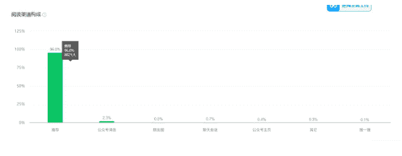

### 二、公众号能做无缝精准引流

公众号和微信一家，风控更友好，引流路径顺滑。

公众号能覆盖18岁以上的几乎所有人群。

我以前做小红书，是因为大家都说年轻人都在小红书，公众号都是老年人。

结果我做下来发现完全不是。

我能稳定从公众号拉18到25岁的年轻人，每篇引流都很准。

身边做高考、副业、求职、情感的朋友，从18到50岁都能在公众号引流转化。

任何平台都有精准和不精准两种玩法。

不是平台决定你吸引谁，是内容决定你推给谁。

平台负责分发，内容负责筛选。


### 2. 我的实战经历：和垂直号的半年

很长一段时间我都不认为公众号能引流，我一直把公众号当私域在发，引流主力是小红书。

直到2025年4月，我的公众号突然来了一波1000+阅读。

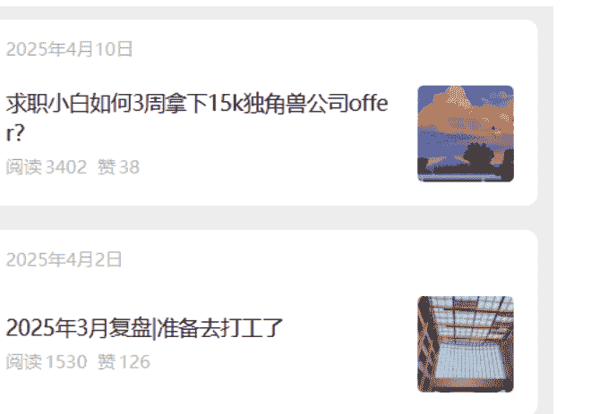

我挺惊讶的，以前阅读基本300左右，转发高峰也就500。

一看后台，推荐流量是个什么东西？

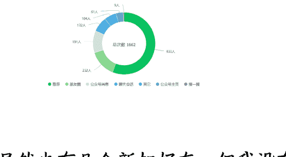

那次虽然加了几个好友，但我没当回事，继续回小红书去了。

到了2025年6月，论文答辩完，我发了篇文章。

2025年6月12日

### 我21岁毕业、赚了40w，还是想对大学生说：别退学

阅读1.3万 赞357 1个朋友赞赏


这次数据把我吓到了。

不仅1w+阅读，还进来了几十个精准好友，上来就买课买陪跑。

一篇文章后端变现5000+。

我原本对“风口”这类说法没什么兴趣，直到自己把两个平台都跑了一遍。

结果很直观：同样投入一篇内容的时间，公众号带来的私域新增，大约是小红书图文的三倍。

于是，我把主要精力从小红书撤了回来，转而集中经营公众号。

为了弄清其中的门道，我前后投入一万多元学习相关课程，把选材、组织内容、承接流量等环节重新梳理了一遍。

到了 8 月，我终于摸索出一套相对稳定的创作方式，文章开始连续获得较高曝光。单篇阅读突破 5 万，也首次完成了从内容到成交的闭环，收入达到五位数。

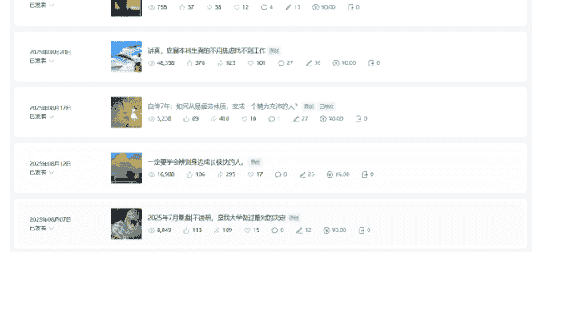

但增长并不会永远直线上升。

由于当时对平台规则理解不够，我多次采用了违规的导流方式，账号随后被降低推荐。9 月到 11 月底，整整三个月，公众号几乎没有正常分发。

那段时间，我又回到小红书尝试，同时也没有放弃公众号：调整版式、重做标题、修改正文，能试的办法几乎都试过，可数据始终没有起色。压力最大的时候，我甚至认真考虑过重新找工作。

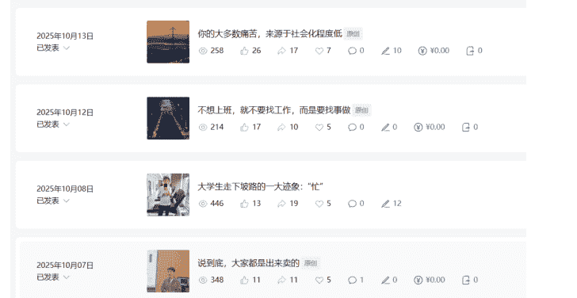

真正的突破发生在 11 月中旬。

我终于定位到账号受限的根源，重新设计了导流路径，并持续进行账号恢复。到 12 月中旬，账号的分发逐步回到正常状态。

（后文 SOP 会具体拆解合规且有效的导流方式）

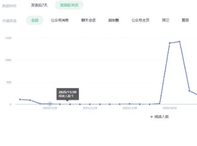

这篇文章发布于 11 月中旬，却直到 12 月初才真正获得推荐。

随后，剧情开始反转。

从 12 月初起，公众号内容接连获得高曝光，新增好友一度多到微信都快承受不住。现在，我基本保持每月进行一次产品发售，月收入能够稳定在 3～5 万。

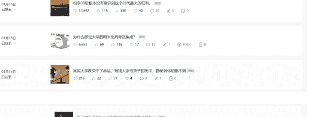


## 3.我想和你说“10w+其实不赚钱”

我曾经也把 10w+ 当成内容创作者的终极目标。

刚入行时，很多人都会下意识地把这几件事画上等号：

有阅读，就能赚钱；  
阅读越高，收入越高；  
真正赚大钱，就得先冲到 10w+。

但后来我才明白，曝光本身并不等于价值。真正有商业意义的，是能持续带来目标客户的曝光。

我就为这个误区交过学费。

2025 年 4 月，我准备做公域内容，花 5000 元报名了一位老师的小红书一对一课程。她提供的选题和内容模板确实有效，在她的指导下，我通过模仿写出了好几篇高阅读笔记，也把 100 多位用户引到了私域。

表面看，场面相当热闹。

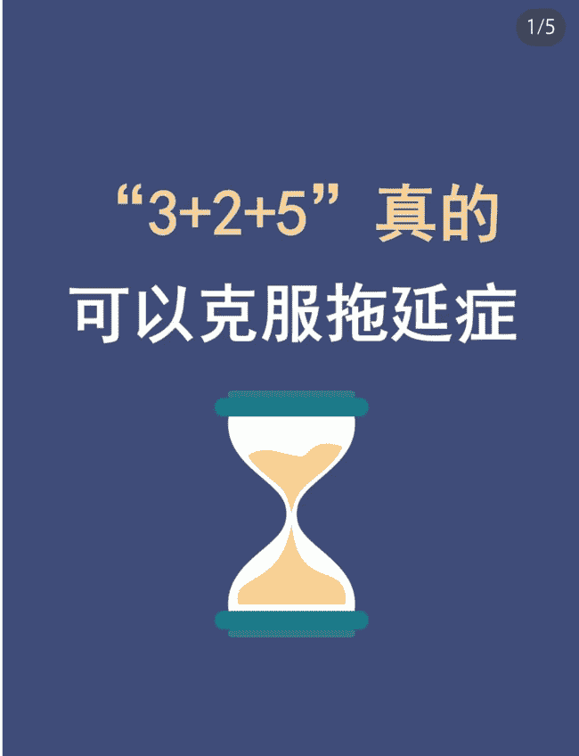

"3+2+5”真的可以克服拖延症

大家好啊，我是枕棠，是一名 985 工科大学生，也是一名时间管理教练，热衷研究与分享时间管理与目标管理


如何高效过好一天 | 24h=7h+8h+9h

大家好啊，我是枕棠，是一名 985 工科大学生，也是一名时间管理教练。

但最后，100 多位新增好友里，真正购买的只有 2 人，而且成交的还是几百元级别的小课。

算下来，这种投入几乎没有回报，甚至不如我花时间经营同行圈子。

后来我才意识到：问题不在阅读数量，而在用户动机。

许多人是冲着免费资料进来的，他们想拿到资料，并没有迫切解决问题的意愿。这样的新增看起来不少，却很难产生交易。

公众号同样如此。

开放推荐后，我见过不少文章轻松获得 10w+ 阅读，可后来其中一些作者成了我的学员，我才发现：高阅读并没有给他们带来相应收入。

所以，单纯复制热门内容，往往只是复制了表面的热闹。它可能带来大量围观者，却未必带来真正认可你、愿意购买的人。

我开始重新追问：

为什么有些人只是领取资料，而有些人却愿意长期信任我，甚至为我的服务付费？

答案主要来自两个方面。

#### 独特的故事，人设。

读者知道我叫枕棠，今年 21 岁，曾经在北京生活，过完年准备去杭州。

他们也了解我的经历：高中阶段在家自学，后来考进 985；读大学时判断继续考研并不适合自己，于是开始创业；工作三个月后，又选择裸辞。

这些经历，我并不是只讲一个结果，而是持续补充过程、细节和当时的选择。

当读者从公众号加到我微信，再翻看我过去三年的朋友圈时，看到的不是一张抽象名片，而是一个有经历、有变化、有情绪的人。

他们会发现，我曾经也和他们处在相似的位置，如今正在靠近他们向往的状态。信任，就是这样一点点形成的。

#### 独特的观点，方法论

我的内容里，也会持续出现一些相对稳定的判断和模型。

比如：

“人生是一场盛大的体验”；  
“时间投入在哪里，结果就会在哪里”；  
“人生管理=时间管理+目标管理+心力管理”；  
“商业闭环=定位+流量+产品+转化”。

普通内容往往追求安全、顺滑、没有争议，但有辨识度的观点会让读者停下来思考。

当一个模型足够清晰、足够有记忆点，读者对你的信任就会增加，产品也会因此拥有更高的价值感。

既然学员会因为这些内容认可我，我曾经也尝试过把它们全部搬到公域。

2024 年，我的公众号几乎都在讲自己的经历、判断和方法。结果却发现，文章越偏向个人表达，读完率越容易下降，获得大范围推荐的机会也越少。

原因在于，大多数高阅读内容都具备几个特点：篇幅较短、表达直接、阅读负担低、观点相对温和。

而真正的 IP 内容往往需要更完整的叙事、更明确的立场和更强的个人色彩。内容一旦过度沉浸在自我表达里，就容易变成作者自我满足，读者却没有继续读下去的动力。

只模仿，吸引来的往往是泛用户；只顾表达自己，又可能没有足够的传播性。

后来，我找到了一种组合方式：

**借热门内容解决传播问题，用个人表达完成识别和转化。**

也就是说，选题、标题、文章推进方式，可以研究已经验证过的热门样本。

不必执着于还原它为什么走红，因为内容传播本来就带有概率成分。一个题目曾经被大量验证，至少说明它具备被用户接受的可能。

但正文里的经历、判断、案例和解决方案，必须来自你自身。

读者每天会刷到大量相似内容，最后愿意付费的原因，通常不是某个标题，而是这个 IP 的故事足够鲜明，方法足够独到，能让人产生“只有你能讲清楚”的感觉。

想明白这一点，我也重新理解了两种内容模式的差异。

#### 流量主模式和个人 IP 模式最大的区别是什么了。

两者确实存在不少不同：

- 前者主要追求阅读规模，后者更在意有效新增；
- 前者通常依靠单篇内容获得收益，后者需要承接产品或服务。

但最根本的差别在于：

流量型账号可以快速借鉴、拆分和复用内容，用户把它当成一个获取信息的工具。

个人 IP 则必须具备不可替代性。读者不仅在文章里获取知识，也在认识一个具体的人：他的经历、选择、成长和情绪。只有当用户愿意相信这个人，后续交易才有可能发生。

### 4.垂直的是人群，而非赛道。

很多人理解“垂直账号”，就是把自己锁定在一个行业标签里：

做情感，就只写情感；  
做副业，就只写赚钱；  
做时间管理，就只谈效率工具。

这种思路看似清晰，却容易带来两个问题：内容空间变窄，用户来源也未必稳定。

以时间管理为例，相关热门主题数量有限，而且从刚入大学的学生到职场中年人，都可能关注这个话题。虽然主题相同，但年龄、支付能力和真实需求差异很大，导流自然容易失真。

我曾经也因此陷入过很长时间的迷茫。

直到 11 月底参加 IP 大会时，听到程弈人老师说：

> “垂直小号，垂直的不是赛道，而是人群。”

这句话让我突然换了一个思考方向。

#### 垂直赛道

我目前主要帮助 18～25 岁的年轻人搭建时间管理体系，完善自媒体商业闭环，逐步成为 AI 超级个体。

最初，我按照业务标签去做内容：需要时间管理，就写时间管理；想做自媒体变现，就写自媒体赚钱。

结果导来的用户非常混杂。

其中甚至有一些五十多岁的用户，他们可能会点赞、挑错，或者留下一句“佛祖保佑”，却很少真正购买课程。

他们对知识付费的接受程度有限，也很难向一个年龄和自己孩子相近的人持续学习。

那时我意识到，内容方向必须从“我教什么”转向“谁最需要我”。

#### 垂直人群

之后，我把内容中心放到了 18～25 岁的年轻人身上。

我开始围绕他们熟悉的生活场景和成长困惑创作，比如大学宿舍、经济独立、00 后的机会、大学阶段的规划等。

当这些主题再融合我的经历、判断和解决方案时，吸引来的用户明显更接近目标客户。

我也逐渐理解了，为什么个人 IP 更应该锁定人群，而不是把自己困在单一赛道里。

做知识付费或个人品牌时，最容易建立信任的，往往是和自己年龄相近、经历相似的人群，大致集中在上下 3～5 岁的范围。

同年龄段的人，生活阶段和主要矛盾往往存在共性。你通过恋爱话题吸引来的年轻人，也可能同时关心收入、成长、选择和职业发展。

这并不意味着所有需求都要在一篇文章里解决，而是说明：同一类人本身就拥有多层需求。

能否把潜在需求转化为真实购买，考验的是你的内容承接与成交能力，而不是话题标签本身。

到这里，垂直账号的底层逻辑已经讲清楚了。下面进入具体执行流程。

## 三。爆款垂直小号 SOP

开始之前，先记住一个判断：

**文章能否获得大范围传播，选题大约占八成，正文占两成。**

所以，后面的流程会把相当多篇幅放在如何找到值得写的题目上。

### 1.搭建选题库

所谓选题，就是从一个大话题中找到更具体、更有吸引力的表达角度；标题，则是这个角度最终呈现出来的形式。

靠灵感偶尔能写出好内容，但无法稳定复用。更可靠的方法，是研究已经被市场验证过的热门内容。

整体路径可以概括为：

**确定内容方向 → 提取用户搜索词 → 检索高表现文章 → 整理成可复用的素材表。**

#### (1) 关键词锚定。

第一步，是找到目标读者可能主动搜索的词。

你可以把下面这段指令交给 AI，帮助你生成初始词表：

你好，你是一名「用户需求调研 + 搜索意图分析」助手。

我是做【XX 赛道】的公众号博主，目标用户是【XX~XX 岁】，他们的常见痛点有【 XX 】

请你基于这个赛道，帮我输出这类用户最常见的：他们遇到问题时会在搜索框输入的词（关键词简单凝练，各不重复相同，20 个即可）

如果你的方向是副业赚钱，就可以先得到一批与收入、兼职、技能变现、个人项目相关的搜索词。


接着，从词表里挑一个，例如“搞钱”，进入平台检索相关内容。

#### (2) 寻找爆款。


把关键词放进搜索框，切换到“最热”排序，优先查看已经获得较高传播的数据样本。

每个词都可以反复挖掘。如果结果太少，不要急着下结论，换一个相近表达继续搜。

#### (3) 搭建选题库。

把值得研究的内容集中收录到表格中，至少保留四项信息：

**文章标题、阅读数据、参考发布时间、原文链接。**

链接尤其重要，后面需要回看标题结构和正文组织方式。

| 文章标题 | 阅读量 | 对标发布日期 | 链接 |
|---|---|---|---|
| ... | 38000 | 2026 年 1 月 1 日 | mp.weixin.qq.com/s/U... |
| ... | 190000 | 2025 年 12 月 26 日 | mp.weixin.qq.com/s/7... |
| ... | 100000 | 2025 年 12 月 23 日 | mp.weixin.qq.com/s/j... |
| ... | 29000 | 2025 年 12 月 20 日 | mp.weixin.qq.com/s/r... |
| ... | 100000 | 2025 年 12 月 17 日 | mp.weixin.qq.com/s/9... |
| ... | 23000 | 2025 年 12 月 16 日 | mp.weixin.qq.com/s/5... |
| ... | 100000 | 2025 年 12 月 12 日 | mp.weixin.qq.com/s/l... |
| ... | 3468 | 2025 年 12 月 11 日 | mp.weixin.qq.com/s/U... |
| ... | 7000 | 2025 年 12 月 9 日 | mp.weixin.qq.com/s/p... |
| ... | 100000 | 2025 年 12 月 7 日 | mp.weixin.qq.com/s/6... |

之后需要创作时，直接从表中挑选，不必临时重新搜集。

### 2.选题二次筛选

一个题目从构思到完成，通常要消耗 2～4 小时。为了避免把时间浪费在低潜力主题上，正式动笔前，可以用 10 分钟做一次快速复核。

#### (1) 发布时间。

人性层面的需求变化不大：收入、亲密关系、认可感，始终有人关注。

但用户对表达方式的接受程度会变化。同一个主题，近期出现的热门标题，通常更贴近当下读者的阅读偏好。

因此，检索同一关键词时，优先研究发布时间更近、表现更好的样本。

#### (2) 爆款数量。

有的主题只有一篇高阅读，有的主题却反复出现多篇高阅读。

优先选择后者。

比如下面两个题目：

- 《你的身材，就是你的阶层》
- 《就算让你 gap 一年，你也做不成自己想做的事情》


- **你的身材，就是你的阶层。** 与其他学习类相 比，身材是最突出的“可视化成果”，你对身材的态度，也反映了你对人生的态度。 “02-心理学说‘延迟满足’，是指为了长期收益，放弃即时快感的能 力。四月槐汐 14 天前

- **你的身材，就是你的阶层** 为什么说你的身材，就是你的阶层？因为它是一个筛选器，它反映了你是否拥有迈向更高阶层的核心品质：强大的精力和顶级的自律。这不是说每个人都 要练成健美冠军。吧猫说财 5 个月前

- **你的身材，暴露了你的阶层** 因为好身材是一个筛选器，它反映了你是否拥有迈向更高阶层的核心品质：旺盛的精力和顶级的自律。你的身材，其实体现了你的生活方式、自我要求和价值观念。每晚一卷书 1 个月前

- **你的身材，就是你的阶层** 你的身材，就是你的阶层——这句话听起来有些扎心，但无比实在。其实不是说根据胖瘦来定阶层的高低，而是身材背后的关键能力：自我管理能力。周的时光源 5 个月前

- **身材和阶层** 你的身材，就是你的阶层，判断一个人的阶层，最简单的办法，就是看他的身材。仔细观察，我们会发现，那些受过良好教育、有强烈进取心、事业有成的人，如普京、奥巴马... 读书以后 10 个月前

- **你的身材，就是你的阶层** 你的身材，就是你的阶层判断一个人的阶层，最简单的办法，就是看 TA 的身材。正如保罗·福塞尔在《格调》一书中所说：“你的体重就是你社会等级的宣言。富书 2018/1/29


- **就算让你 gap 一年，你也做不成自己想做的事** 就算让你 gap 一年，你也做不成自己想做的事，怎么得出来的这个结论呢？就是我一次次在寒暑假国庆假期躺了整整一个假期的时候，上班上学的时候，总觉得自己 的时间 和精... 阿毕抱抱你 3 个月前

- **裸辞 Gap 的年轻人，被职场抛弃了？** 也强调我不是无脑 Gap，而是做了严密的规划，让他们觉得你连裸辞都能当项目管理在做，还有什么活干不了？还提供了一些成果展示，比如 20 天的欧洲旅行、社交媒体更新... 三联生活周刊 2024/3/18

- **“我是 gap 了一年，不是坐牢一年”，中国职场，不欢迎 gap 过的年轻人** 但有很多人能在 gap 期学习了更多专业技能、找到了更适合自己的工作。在 25 岁裸辞之后，网友拿着积蓄出国 gap，在一年的时间里边读书边旅游，进修了英国某大学的人工... 新东方 7 个月前

- **为什么说国内 gap 半年如坐牢，gap 一年等于牢底坐穿，一生不被允许 gap 的中国人，真相到底是什么？** 但是在国外 gap 是一个很常见的场景，很多学生在上学的时候往往就会停下来花一年的时间 去旅行，去创业，去做自己想做的事情，他们通常称之为 gao year，言下之意就是这... ali 老蒋说 2024/2/18

- **为什么「中国职场」不允许有 gap year？** 很容易想到，如果你 gap 一年的话，面试的时候 hr 肯定会围绕这个问题来问你，甚至有的 hr 会很介意，相当介意。哪怕你是在利用时间提升自我、升学学习，他们的内心都会有... 阿琴琴的职场日常 7 个月前

- **我是没上班，不是坐牢！为什么大部分企业都接受不了 gap year？** gap year 指的间隔年，原指青年在毕业之后、工作之前，并不急于盲目踏入社会，而是停下来（通常是一年）去做自己想做的事情，体验不同的生活方式。... 6 个月前

第一个题目在不同账号、不同时间出现过多次高阅读，第二个题目则只有单次验证。

这意味着，第一个主题的表现更可能来自题目本身，而不是某个作者的个人影响力、运气或正文质量。

从概率角度看，经过多次验证的题材，更值得优先尝试。

#### (3) 与我有关。

最终筛题时，最重要的判断不是“它是否热门”，而是“它是否能和我发生关系”。

具体包括：

- 是否与目标客户的现实处境相关；
- 是否能连接到我的真实经历；
- 是否能承载我的观点或解决方案。

如果一个题目与你没有任何关系，强行追热点通常会出现三种结果：

- 没有亲身感受，写作过程中不断拼接材料，很快就会卡住；
- 缺少真正的判断，文章容易失去辨识度；
- 即使获得高曝光，吸引来的用户也未必认可你，后续成交会非常困难。

前面为了省事而跳过的定位工作，往往会在后续转化阶段付出更高代价。

### 3.正文撰写：结构高于一切

很多人以为，写作是靠灵感驱动的。其实，真正系统化写作的第一步，是先搭好骨架，再往里填肉。结构对了，内容才有地方落脚。

今天我想聊的，就是个人IP爆款文章的整个创作框架。

我自己把这套方法叫做“以爆款为骨，以IP为魂”。什么意思呢？

就是说，像封面、标题、开头这些决定读者第一印象的部分，可以直接借鉴爆款——因为它能爆，背后一定存在某种“黑盒”逻辑。但正文、结尾和引流，必须由你自己的思考来填满，这是别人偷不走的部分。

**一篇文章的五个核心组件**

一个完整的个人IP爆款文，通常由这五块构成：

- 封面标题：负责点击率，决定用户要不要点进来。
- 开头引入：决定完读率，让读者愿意停留。
- 正文展开：建立信任，讲清楚一个板块，给出方法论。
- 结尾升华：完成情绪收网，促使点赞、收藏和转化。
- 合规引流：通过展现实力+抛出钩子，把读者从公域引向微信私域。

**正文：没有标准模板，但有方向**

坦白讲，正文部分是最难套模板的。硬套出来的文章，自己读着都别扭，读者一眼也能看穿。

市面上个人IP类的爆款文章，正文形态五花八门：

- 有的讲故事；
- 有的给方法论；
- 有的深挖一件事的底层原因；
- 有的针对具体课题给出解决思路。

怎么找到适合自己的正文风格？

前期最好的办法是拆解对标账号，模仿着写。等你写出了几十篇爆款，慢慢就会沉淀出一套自己的SOP。这个过程没有捷径，就是靠持续输出和总结。

我自己也是写了半年，才逐渐提炼出适合自己的一些结构：比如事实列举式、观点解释式、目标解法式、经历认知式、结构灵感式等。

正文和结尾的原创性高，但封面标题、开头引入、合规引流这三块，是有成熟SOP可以直接用的。

**标题与封面：点击率的生死线**

决定一篇文章能否成为爆款，80%的因素在选题，而选题的直观体现就是标题和封面。

关于标题，前期最省力、最高效的方式，就是直接参考已有的爆款标题。一个标题能爆，背后确实有不可言说的逻辑。在网感还没建立起来之前，模仿是ROI最高的策略。

等你自己写出了十几篇爆款，审美和网感逐渐成熟，再考虑原创。不过我的经验是，把爆款标题的底层逻辑总结成提示词，让AI一次性生成20个选题，我来选，效率更高。

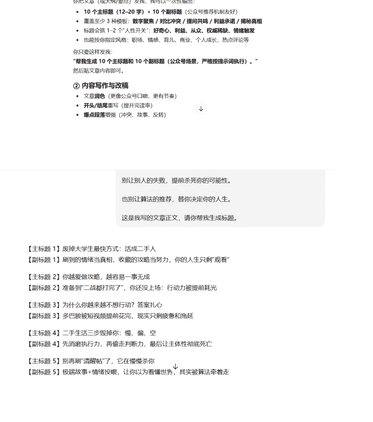

这个智能体是免费的，大家可以拿去用。直接把你写好的文章发过去，它会自动帮你生成10组标题和副标题，你挑顺眼的用就行。科学上网后点击链接即可：

```
https://chatgpt.com/g/g-68da659434488191bfacbf174f9c788e4-gong-zhong-hao-biao-ti-zhu-shou
```

封面这块，我实测下来，它对单篇文章阅读量的影响没那么大，更大的价值在于建立视觉统一感，强化品牌识别度。

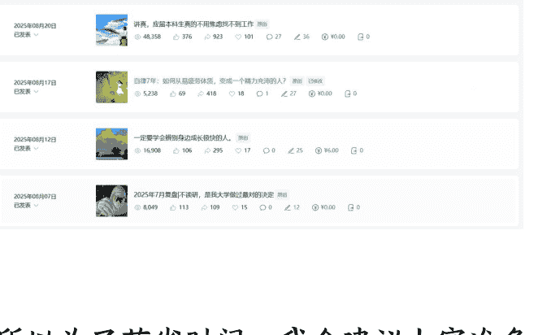

所以别在封面上花太多时间，准备一个素材库（比如风景图、个人照片、甄嬛传截图这类），每次从中取一张就好。下面就是我的封面库。


**开头100字：决定完读率的关键**

短视频有黄金3秒，文章也有黄金100字。开头如果抓不住读者，后面的内容再精彩，人家也早就划走了。

一个能抓住人的开头，通常包含这三个要素：

**第一，说出读者的处境。**

人只关心和自己有关的课题。怎么让读者觉得“这写的就是我”？两种方式：

一种是直接点名，开宗明义地告诉读者，这篇文章就是专门为你写的。比如我写过《自律7年：如何从易疲劳体质，变成一个精力充沛的人？》，开头直接说“如果你总是觉得累，睡再多也没用，那我们可能是一类人”。

另一种是侧面描述，刻画一个群体的典型状态，让目标用户自己代入。比如《大学的本质，是比高考更残酷且精致的筛选》，写的是大学生这个群体，他们一看到就会觉得“这说的就是我”。

**第二，证明你有能力解决这个问题。**

戳中痛点之后，读者的第一反应往往是“你凭什么教我？”这时候你需要给出确定性，用经历让人信服。

方式有三条路径可走：

- 讲自己的故事，用亲历证明。比如我在《自律7年》里写自己从前有多疲惫，直到搭建了人生管理系统，才成为精力充沛的人，能回家自学考上985，大学期间靠自媒体赚到40w+。
- 写学员或身边人的案例，借他人证明。比如我写自己观察到那些成长极快的人，他们有保研的、减肥成功的，还有我的私教学员小A，大一跟着我做自媒体，短短一年多就月入两万。
- 拆解问题的本质，用逻辑碾压。比如《所有大学生完全可以用一年时间去变强》里，我指出目标没实现，本质是投入时间不够，而时间不够是因为精力分散、意志动摇。读者听完觉得有道理，自然愿意继续听下去。

**第三，预告下面有干货。**

痛点戳到了，能力也证明过了，接下来就是给个期待，俗称“画饼”。

可以直白地告诉读者，解决问题需要做好以下三点，然后给出你的框架。也可以提前把正文的小标题露出来，吸引读者继续往下看。

**合规引流：血泪教训换来的经验**

如果你前面的结构都是按这个思路来的，读到结尾时，读者大概率已经被说服，愿意加你微信了。这时候只需要顺势引导。

核心操作就是三件事：**秀肌肉、留钩子、给路径**。

秀肌肉就是简单做一下自我介绍，让对方知道你的来头。留钩子就是加微信送资料包或电子书。给路径就是明确告知读者，如何能加到你。

但有个极其重要的提醒：**千万别在文章底部直接放微信号或二维码。**

这是我被限流三个月换来的教训。微信公众号虽然表面上可以留这些信息，但后台有人工检测，只是还没查到你而已。一旦被降权，去掉二维码，坚持更新一个月，流量还能慢慢恢复。

正确的做法是用微信官方认可的组件：

第一种是“关注弹二维码”的玩法。在文末留下钩子，说“点关注后回复某关键词领取资料”，然后在公众号后台设置好自动回复，用户关注后，二维码会自动弹出来，实现丝滑引流。

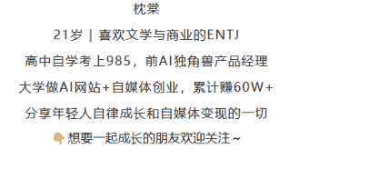


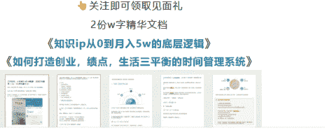

第二种是挂微信小店的引流品链接。这是很多头部博主在用的方式，属于官方组件，安全合规。

一个人真正拥有人生底气的开始，就是能靠自己在市场上独立赚到钱。所以我真诚推荐你报名“启动你的个人事业”2天行动营。已经报名的小伙伴，留意手机短信，点击里面的链接扫码加助教老师，即可进入课程。

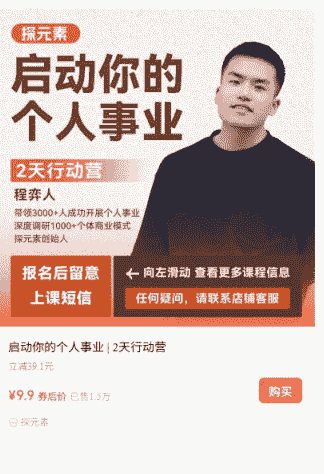

**数据复盘：让文章越写越好**

经过我自己的反复测试，以及和很多头部公众号作者交流，想要提升爆款率，核心盯三个数据：

第一是点击率（由标题和封面决定），第二是完读率（由开头和正文流畅度决定），第三是互动率（由结尾和正文干货度决定）。

我每个月都会把所有文章拉出来，按这三个维度复盘。

如果阅读量不高，就逐层排查：点击率低，去优化标题封面；完读率低，去改开头和排版；互动率低，去提升观点锐度或打磨结尾。

如果阅读量很高但引流效果差，就得看是选题人群不够精准，还是钩子不够诱人。

有了这套复盘习惯，我从来不担心做不起来。看到反馈就调整，正反馈是激励，负反馈是方向，没有反馈，也是反馈。

**写在最后**

我个人是个偏保守的创业者，好听点说，叫长期主义者。

2023年3月我试过很多方向，最终选择了知识付费这条赛道。因为当时统计发现，能穿越周期的项目中，40%都来自知识付费。创业这件事，熬了三年，我才终于等到稳定的收入，也真正理解了“一次月入5万”和“稳定月入5万”是完全不同的两种世界。

第一百万的目标，2026年一定能走完。这次我的信心，不是少年式的一腔热血，而是来自对系统、对SOP、对商业闭环的清醒认知——我知道每一步该怎么走。

回头看这半年，2025年7月大学毕业到北京，经历了很多个身份切换。从线下创业聚会的思维碰撞，到10月分手、裸辞、家人生病、账号被降权的至暗时刻，当时焦虑得已经在boss直聘上找工作了。

但挫折是另一种成全。卡点熬过去之后，我的整个商业闭环反而跑通了。直到现在，我才觉得自己真正算个创业者——我知道自己为什么能赚钱，手里有系统有方法，不再是只给自己打工的忙人。

打算去杭州了，开个工作室，继续长期主义地做下去。

感谢你读到这里。谨以此文，致敬在北京的半年，致敬21岁这段拼尽全力的日子。

圈友们，下次再见。祝各位都能生财有术。

顺便安利一下我的付费群——懒人专属群：


微信：lazyhelper1

这里是你对抗信息过载的护城河。已稳定运营7年，累计拆解3000+互联网商业案例，以及行业前沿内参与时政/宏观文章。我们不搬运垃圾，只做高价值信息的筛选器和放大器。

更新记录见：https://hk57gvlx7u.feishu.cn/docx/H0kRdZbSbolBR0xkaXtcuVE0nTg

【免责声明】本资料归档于社群内部知识库，仅供成员课题研究与学术交流，请在查阅后24小时内删除。