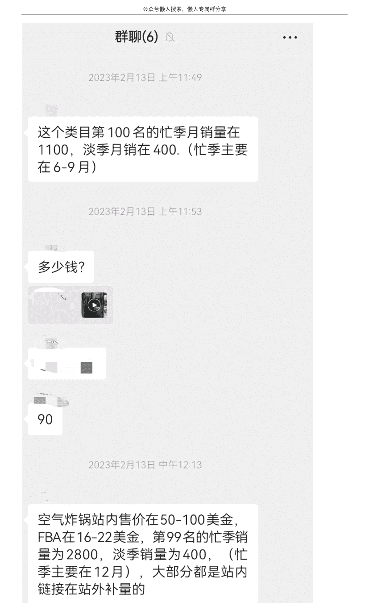
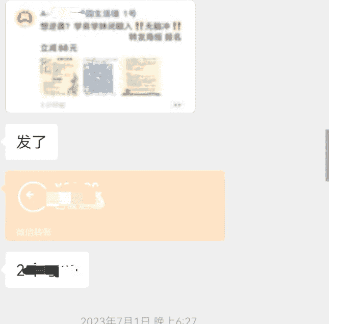
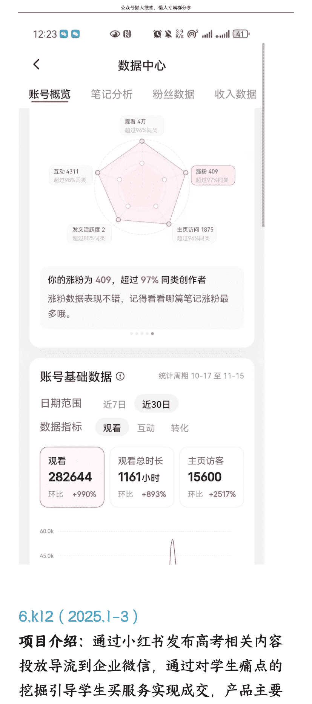
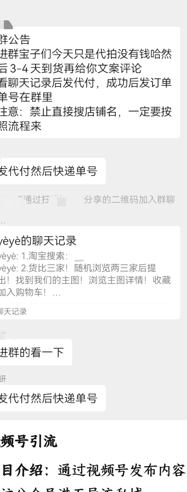
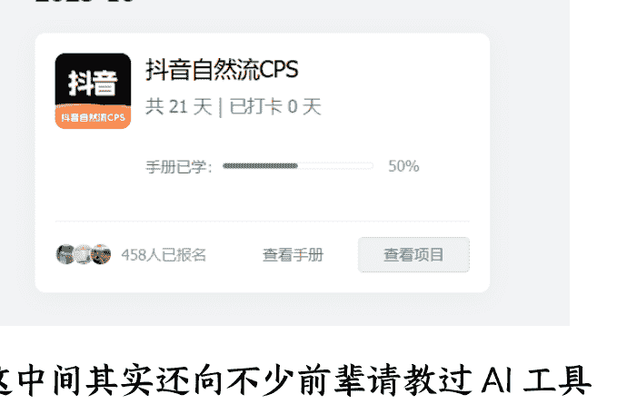

# 三年里我验证了12条赛道，10条跑出了闭环：我是怎么挑项目，又怎么决定止损的

大家好，我是耶耶，目前在广州一所211院校读大四，也在赚钱待了两年。

感谢赚钱鱼丸的邀请，感谢大家把“如何挑到合适的项目、什么时候该换方向”投成小灯塔热门话题。

2023到2025这段时间，我亲自下场实操过12个方向，其中10个做到了不同程度的跑通。经历主要集中在电商、获客、私域。目前的主营是情感陪跑私域和流量代运营，综合月度利润稳定在5到8万区间。

这一路我的困惑和很多人一样：

- 星球里项目琳琅满目，眼下这条是不是最优解？
- 看到别人换赛道就起量，自己要不要跟？
- 一直做下去没突破，是方向错了还是执行不到位？
- 频繁切换会不会永远卡在新手期？

这篇算是我从大一到大四的一次阶段性复盘。

阅读一本书相当于走过别人的一生，那读完这篇文章，也相当于快速浏览我过去三年的试错轨迹。两年前我几乎不敢想象今天的状态，回头看已经是十倍级别的跃迁。

全文约1万字，阅读10到15分钟，分四块：

1. 我当初为什么进入这些方向，最后结果如何
2. 同期进入的人后来有什么样的结果
3. 经历多次验证后，我现在的选品和推进逻辑
4. 怎么判断该继续还是撤退，如何做不后悔的决策

---

## 一、我做过的方向复盘

三年间的主要尝试线如下：

- 2023年2月 抖音、📕带货，日化、车品类
- 2023年5月 抖音无货源百货
- 2023年6月 线下教培闭环测试
- 2024年2月 情感、私域兼职获客
- 2024年10月 注意力类督学获客
- 2025年1月 K12销售板块
- 2025年4月至今 情感私域主营
- 2025年6月 淘宝饰品测试
- 2025年9月至今 视频号导流、Reddit海外种草、抖音CPS

下面按时间拆开讲。

---

## 1. 抖音、📕带货起步

### 当时在做什么
先在抖音卖防晒、洗发等日化，后期把部分品类搬到📕做百货。两个平台不是同期操作，后来合并记述。

### 入场原因
口罩期刚结束，和亲戚去义乌看货。亲戚做美区亚马逊，卖电动牙刷、体重秤、手电筒等。现场看到成本6元的牙刷在亚马逊能卖9.9美金，有触动。

同时身边有人说抖音精选联盟很赚钱。我家里潮汕，身边做电商的有货源，自己有供应链优势，所以觉得可以直接开卖。

再者，已验证过的商品逻辑换个渠道再试，相比淘宝拼多多，当时抖音📕对新人更友好。

### 结果
抖音两类目都跑通了，月收益2000+，但天花板明显。 📕没起来，当时商城曝光弱，笔记基本只有几十浏览。

### 复盘
第一，能力缺口。商业认知接近空白，纯靠闭门造车。主图、详情、补单、拍视频都做了，却不知抓手在哪。防晒走精选联盟利润极薄，一瓶净赚3元，远低于自营的45元。PR能力、达人谈判都没有。

第二，渠道特性。📕当时商城流量分配少，导🛰️成本却很低，是个信号。我当时没读出来。

当时有人提醒我，如果不自己做内容直播，只能靠主播团长分销，利润会被切走。精选联盟很多人单笔利润几毛，靠量堆。这种模式更适合低客单饰品。

---

## 2. 线下教培测试

### 模式
发传单、校园墙投放，收集学生家长🛰️，线下转化。

### 原因
我所在高中在本地排名靠前，有师资场地，想借鉴校友做教培赚钱的案例。

### 结果
咨询寥寥，0成交。

### 复盘
一次投放失败就判死刑是我当时的问题。渠道单一，学生放假没时间测试别的入口。抖音📕招生我完全不了解，只知道做博主带货。

投放学校学习氛围一般，用户支付意愿本身低。

后来我意识到，先用500块左右做最小闭环验证：能不能获客、销售能否复制、后端能不能承接，比先问“我有什么资源”更落地。

---

## 3. 抖音无货源百货

### 模式
用鲸吞代发找搜索量大的蓝海品，从拼多多找代发货源，一键批量上架，赚差价。

### 原因
做精选联盟期间被MCN和知识付费团队围攻，朋友圈晒销售额刺激我交了学费。

### 结果
跑通了但质量差。日销售额5000-10000，利润100-300，回款周期14-21天，客服消息爆炸。类目太杂，不懂品。发货慢导致店铺评分下降。

### 复盘
第一次深刻体会账期。长期做至少要垫7万，月净利可能只有1400，会被账期拖死。

早期流量比货源重要。没有入口，再好的货也卖不出去。

别所有环节自己扛，发货客服运营可以外协。

---

## 4. 情感、兼职私域

### 模式
抖音📕发内容私信引流到🛰️，情感咨询和兼职需求。

### 起点
抖音评论区有人加我🛰️咨询，闭环了，我发现解决困惑也能变现。兼职粉是朋友圈看到招聘信息才发现的需求。

2024年4月加入赚钱，还不懂私域mvp ltv，只知道用户愿意付费。

### 结果
抖音📕引流约2万广州兼职粉，情感没放大但招到了现在的助理。之后旅居大半年。

### 复盘
当时没同行拆解，没做可复制流程，只是接单。信息输入不足，放大动作缺失。

---

## 5. ADHD督学

### 模式
📕发拖延作息相关内容，引流到🛰️，朋友圈营销+一对一成交，后续监督师交付。

### 原因
线下局圈友提到ADHD人群。📕情感类目常被限流，本质都是内心困惑。看到圈友把非标服务标准化，觉得可模仿。

### 结果
旺季月入3-4万。不会投放，复购低。

### 收获
这是我比较满意的一次尝试，核心是我对这类人群有体感。别人赚钱不可照搬，要先确认自己是否理解客户。

后来招线上助教交付，意识到客单不高交付重也能赚钱，关键在标准化差异化运营。

---

## 6. K12销售

### 模式
📕发高考内容导流企业🛰️，挖掘痛点卖线上私教，🛰️群交付。

### 原因
赚钱线下局认识做高考教育的圈友，ADHD进入淡季想学规模化，且我熟悉高考生。付一给了加入机会，特别感谢。

### 结果
亏损，流程逻辑通但很费力。

### 复盘
赛道卷，需要真人出镜建立信任，获客成本高。

转化链路长：学生兴趣→说服家长→家长信任→付款，丢点多。

资料引流不精准，需要长期种草，我们却做一对一硬卖，后端交付成本高。

明白放大不是发帖增招人，而是SOP、百问百答、案例库、数据统计、培训质检。

---

## 7. 情感私域主营

### 打法
抖音📕发情感内容，吸引女性用户评论私信导流🛰️，低客单微咨询转高客单陪跑。不是个人IP，是机构打法，朋友圈生活化。

### 原因
海量面试拆解同行内容模板和销售流程，需求刚性。

先收款后服务，账期短，用户刚需。

同行sop不细甚至没有，我能复制。

K12教会我用户可按画像分层，情感也一样可标准化漏斗。

### 现状
一名助理一名后端交付，月利润5-8万。315前后平台风控严，会刻意避开再评估规模。

---

## 8. 另几个小试验

### 淘宝饰品
当时热度高，朋友做饰品，想扩展试了淘宝。初期赚钱，投放后亏损。退货率高，品类泛无主打款，战略失焦。

反思：假设要快速验证闭环，及时止损；善于合作不自己全学；私域好卖不等于公域好卖。

### 视频号导流
多年未联系的朋友做这个项目找我放大，日引流5千到2万兼职副业人群到企业🛰️。

启发是多发声，信息闭塞才迷茫。

如果后端成熟就全吃；没后端就找服务商变现，同时扩前端。确认需求长期存在可留20-30%用户自建后端。

### Reddit ToB素人种草
帮甲方在Reddit做素人发帖评论。国内获客贵想试海外。

签了长期单：每月稳定VPN、25篇Thread、20条Comment、点赞评论、汇报。

感受：海外信息差大，同样工作国内报价两千，海外几万。甲方缺稳定执行的人。之前加的人一年半后变关键资源，要维护私域。

### 抖音CPS
发布内容带口令导流赚佣金。想学习怡然老师内容理解，测试视频分发。

变现500左右。问题在基建，流量入口和承接没维护好。直播学到控制变量，每次只改一个因子。

---

## 二、我现在的选品框架

### 1. 需求是否持续
热点会退，真实痛点不会。关系、升学、就业、效率、健康等方向更稳定。还要看是否愿付费、能否触达、是否可复制。

### 2. 个人筹码盘点
不只是本金，还包括对客户的熟悉度、内容表达、获客渠道、资源、成交经验、交付能力。

### 3. 现金流优先
适合先收款后交付、周期短、回款快、不需囤货、不依赖重投放。

### 4. 先小闭环再放大
验证曝光咨询、客户精准度、销售可复制、交付可稳定。

### 5. 检查复制性
能沉淀选题范本、获客步骤、话术、分层规则、服务标准、培训资料、数据表。若全靠创始人，规模受时间限制。

---

## 三、何时该离开

过去怕换赛道，后来明白要问的是验证是否充分。

### 五个自检点
1. 实验是否足够？不同选题、入口、人群、话术、价格都要试。
2. 没咨询还是咨询质量差？入口问题还是定向问题？
3. 用户不买是销售问题还是产品问题？信任、痛点、定价、价值表达、链路长短。
4. 赚得少还是干得重？利润薄回款慢耗精力，不值得。
5. 是否有更匹配的机会？需求强度、回款、利润、匹配度、复制难度、试错成本综合比较。

---

## 四、减少遗憾的方法

把情绪决策变指标决策。提前写清内容数量、预算、咨询目标、转化率、最低利润线、停损条件，按计划复盘。

项目不只有死磕和清零，还可以降配维护、保留渠道和客户、暂停主攻、时机成熟再重启。

三年里我碰过电商、教育、情感、督学、海外服务。有的能成交但利润低，有的赛道好但打法不对，有的渠道不行，有的卡资金交付。

真正学会的是不追风口、不一败即否定、不被截图带偏、验证后再加码、看回款、选自己懂的人群、沉淀可复制流程、持续表达连接真实的人。

一门值得投的生意：需求清晰且持久、能合理触达、有付费意愿、现金流安全、可拆解复制、自己有优势或能快速补齐。

如果你也在犹豫，是不是该继续还是转向，记住先拆问题先做小验证让数据说话。需要坚守就沉下去，需要调整就及时止损。长期主义不是死守一个项目，而是在持续行动中找到更适合自己的位置。

三年下来我累计操盘了十二个方向，绝大多数都是小本启动。回望这条路线，普通人照着走是可行的。期间也跟不少前辈聊过 AI 站点、TikTok/Facebook 引流这类玩法，但自己没上手就没细说。起初做项目更多是出于好奇，想要把商业闭环跑通、了解行业，后来重点就放在验证不同的流量获取路径上。我算是真正去市场上试水，而不是纸上谈兵。跑完才明白，很多生意 0 到 1 没问题，1 到 10 放大却很难。

再看现在还在坚持的人，分化很明显：

1. 笔记平台的百货实体零售，和我当时做的品类一致。2023 年并未跑通，如今单店月度利润稳定在三万以上。
2. 抖音短视频挂车，团队持续两年没起色，2025 年下半年一条视频爆了，单店月利润做到十万左右。但周期很残酷：2024 年 9 月他们有六个直播间，计划继续扩张；到 2025 年 10 月只剩一个。2025 年下半年身边有人从公司出来，在广州租了千平工作室做抖音带货，专做尾货女装；还有做抖音精选联盟的团队，已自建电商品牌并签约主播带货，年营收上亿，是我接触里体量最大的。
3. 抖音无货源电商，如今基本没人做。平台对无货源管控极严，第三方拍单发快递的路子已走不通。淘宝、拼多多、闲鱼上仍有在做。说到底无货源本质是分销，能否存续看平台规则。
4. ADHD 督学。有朋友找到十倍增长的新赛道后主动放弃了它。该项目月利润十万以上是可行的，但必须走付费获客，自然流量效率太低，2025 年笔记平台管控收紧，也很考验团队组织力。交付重、产品非标，不过本质仍可做成 SOP。今年一月我了解过，有公司深耕 ADHD 人群，和高校实验室合作做家长教育，教家长如何带 ADHD 孩子，客单上万，年利润约两百万。
5. K12 高考教育，通过对接 IP，视频号粉丝做到两百多万。
6. 美区亚马逊电商。合伙不顺，分开后直接成竞争对手，互相打价格战，规模和利润都回不到从前，人心力被耗尽。当然选品也有问题，关税影响并不大。
7. 情感项目，山东有团队单月利润百万，也有团队放弃转向海外 Facebook、TikTok 引流至 WhatsApp 成交。

看完会觉得市场变化太快，能穿越周期的人很少。说实话，若大学时就知道创业带团队如此不易，或许我也会去考公。

为什么同样赛道，有人能放大有人退场？差距在平台政策？天花板？个人能力？运气？合伙人？擅长？商业模式？时代红利？不确定性？看起来都是，又都不是。

现在我找项目、做项目的方式变了。

第一个反常识：不要用好坏去给项目定性。

每个人对好项目的定义不同。有人说是门槛高越做越轻松的长期主义，有人说是高客单高利润，有人说是超级个体，靠影响力放大、搭建自运转系统，有人说是渠道多元能快速跑通闭环。标准不统一，怎么找？

过去我总想先找到独特优势再选赛道，后来发现这个优势往往不客观，很多时候只是想做赛道后硬找的理由。

现在评估一个项目只看三点，满足则有机会做到百万到千万：

1. 是否有真带路人或圈内前辈手把手带。有带路人胜过一切。
2. 我能否复制模仿。包括内容形态、商业模式、现金流、获客路径。学习成本可控就可以边做边学。
3. 能否把非标事项做成标准化流程。这是规模化的前提。标准化产品普通人难有机会，非标才有高额利润，但大部分非标难放大。若能把非标标准化，比如把咨询变成 SOP 或边际成本极低的产品，就是普通人的胜机。

落地到个人，还要参考两方面。

一是当下状态：是否负债急需现金流求生上岸；还是想改善生活找第二曲线顺便赚零花钱；或是野心强想深耕创业。

二是经验积累：是否从未跑通过；是否多次做过 0 到 1 但没做过 1 到 10；是否既做过 0 到 1 也做过 1 到 10。

不同阶段选项目标准不同，核心差异在能接受正反馈的周期和收入预期。

处于急需现金流阶段，千万别碰工具站这种反馈极慢的项目。SEO 找词铺词本身就慢，做产品自传播也需深度用户洞察，不是一蹴而就。要么把执行力拉满给自己 2-3 年试错期，要么找带路人优先做正反馈快的项目。离钱最近的事是什么？卖别人的产品，做流量找客户，而不是先学再赚。先学再赚离变现太远。

想做第二曲线，主业外用互联网放大个人能力，可考虑做垂直细分👸号。别小看👸号，有圈友靠细分赛道加私域做到千万元。若只是想做副业享受正反馈，航海计划里的多数项目都可以。但公开项目规模化难度通常会大。

想把创业当事业，核心是打开视野接受新事物，培养两个踏实能干的助手或左右手，搭建标准化手册招基层员工。也有人能做差异化精细化运营或模式创新。同时不同业务对人要求不同，有些易放大有些难，跟城市也有关。比如深圳就不适合低毛利需堆人的业务，这类更适合广州、长沙、郑州、沈阳等。

但也会问：标准都满足为何仍跑不通？

再强的人也有失败项目，大厂也会砍业务线。我曾请教怡然老师一个问题：内容创作很非标，如何培训新人？

她的说法是：爆款是无数爆点的组合。一个 30 秒视频爆了，拆成十个画面就有十个变量，真正起作用的可能只是某个分镜。团队会让新人模仿迭代已爆视频，而非直接原创。可能新人觉得 A 画面好，团队觉得 B 好，就用保 ROI 的投放消耗去推断哪个变量真正有效。

因此项目是否跑通放大，本质是组合：A×B×C + D×E×F + G×H×J + …… + n。成功答案有 n 组，找到任意一组即可。小明可能靠 A×B×C，小李靠 D×E×F，你适合 G×H×J。但动手前没人知道自己的答案在哪。

第二个反常识：项目不是选出来的，是测出来的。选只是初步判断，可行性靠验证。比起拍脑袋选择，更重要的是提出假设、快速验证、用数据驱动迭代再做决定。

具体每个项目怎么测，各有方法论，可去赚钱官网查，这里不展开。长期看，比打法更重要的是测项目的思维与习惯。分享三个受益习惯：

第一，找到优秀的具体同行或圈友请教。

我早期爱用 BOSS 直聘，美化简历海量面试，和 HR 或老板换信息。一天面十家就能用 A 家信息换 B 家。这样做的好处是线下见过真实的人和公司，执行时会更笃定。但效率低，只适合起步。

更高效率做法：付费找猎头；开 BOSS 公司账号批量面试求职者获取信息；或包装身份面试更高阶岗位，如流量合伙人、销售管理。最好线上线下结合，很多厉害圈友不在线上发声。

核心逻辑：公司或猎头只愿和更高阶候选人聊更多，身份包装高一点能拿到更多信息。我试过用“流量服务商”身份，还是听不到真话，后端爱包装数据，转化率被夸大。耶耶反问：说是流量服务商吗？她更建议直接包装简历。比如实际 0-3 年经验、期望十几二十万，就包装成 5-7 年经验、期望 50-60 万，投到 BOSS 直聘和脉脉，有心仪岗位就投。猎头出手找的岗位一定不是初级岗，包装成小朋友就接触不到猎头渠道；而猎头渠道的信息价值更高。

补充一点：愿意交流的同行极少，真正赚钱的流量渠道或账号极少人分享，除非笃定你抄不了。流量服务商这个理由我也用过，后端数据易失真、转化率被夸大，甲方又想压价，不过仍算一种切入方式。

第二，做好日报周报。

项目放大的本质是发现能赚钱的事，提炼方法论，重复有效动作。日报周报方便控制变量做 AB 测试、回溯分析，搞清哪里做对、哪里做错、关键变量是什么。对个人团队都有意义。

比如做导流🛰️获客，一天发五条笔记/👸号/视频号，不同平台、不同内容策略，会产生不同阅读量、客资数、线索质量、转化率。变量多了不做统计就难找共性，也就难标准化规模化。

有人觉得是流水账写了也不看。但时代变了，AI 能分析日常记录，帮助发现微小思维习惯和行为模式。人生太多事由无数微小念头决定。

我也讨厌打卡式日报，所以做轻量化。两个办法：一是建🛰️群，用语音输入聊框，后续转文字丢给 AI，长期价值大；二是每晚跟 AI 语音通话，我最近很爱这个功能，常聊着就睡着了。

第三，列一份“不为清单”。

好战略是做对的事并把事做对。但我们常不知道对错，只能靠犯错避坑来找到方向。

我现在的不为清单在实时迭代：减少多余信息输入，不要频繁看别人项目；不要为学而学；不要不做数据统计不写日报；不要完美主义想太多做太少；不做国内实物电商。

测项目时常有 FOMO 怕错过 AI。但大部分项目想放大都离不开招助理，超级个体也一样。与其焦虑，不如聚焦：如何提升产出？我现在做的能否被助理替代？这个思维就是十倍增长，对时薪的重视。我这里不写 AI，是因为目前仍有社交媒体不接受 AI 工具批量化操作，若未来解决，再交给 AI 和助理。

何时该换项目？如何决策不后悔不内耗？

判断是否换，核心是量化思维。很多人没有量化，被情绪困住。有量化标准决策会理性很多。

量化三个维度：

1. 时间投入。每天投入多少小时，同行优秀者投入多少；愿意用几个月或几年测试？一般我给自己 2-3 个月跑通 0-1。
2. 资金投入。设备、账号、AI 工具、学费、付费请教等必要开支，预算常比想象多。
3. 精力损耗。这一点极重要，可想象成血条。具体玩法可问 AI。每次拿到数据正反馈加一滴血，负反馈减一滴血。一个项目最多承受一百滴血。一旦时间到、钱耗尽、血条见底，就果断换，不要恋战，否则看不到头。

如何勇敢决策？

理性上，先质疑问题再拆解。比如“焦虑”怎么定义？“不焦虑”怎么定义？边界在哪？很多人只有模糊感受，能描述出神经紧绷、失眠、心悸。但只知症状不找病根解决不了。焦虑词义泛，模糊就难找发力点，连问题都模糊 AI 也帮不了。要往下深挖：是因为想看到大结果，还是恐慌 AI？是因为不会创作内容，还是别的？找到病根后针对性求助。

感性上，我现在偶尔会焦虑，因有所求很正常。但很少内耗，也几乎不后悔决策。从小很多事自己决定，包括初高中、大学选择。分享一个好用的 tips：每次做完决定，不管结果如何，在决定那一刻告诉自己——我真的很牛，太他妈牛了。对赚钱或亲密关系都适用。变成习惯后会更笃定，敢信直觉。人就活一次，连自己都不信太可惜。

顺便附上已一猫一狗、30 岁退休的怡然教练的见解。

她说本质是心态问题。第二次创业时遇疫情，拿不到下一笔融资；同期朋友幸运拿到钱。但半年后双减等政策下来，那个朋友反而陷入更大困境。因有融资不愿停，钱花完又借贷坚持两个月，最后负债。她自己因没融资，反而掉头更快。后来意识到很多事要用更长时间看。当时不如意，后来可能反而是幸运，没必要纠结当下困境。

她还会用 Vlog 博主视角看生活。遇到不如意就记录下来，反而成好素材。平平无奇的事没人看，但黑店、被骗、被坑这些博主爱看。用这种方式记录生活，心态完全不同。

她说精神自由最难，所以排在财富自由和时间自由后面。真精神自由的人，不会因现金流紧张焦虑，不会因涨跌焦虑，因为那对他们就是游戏。

最后说，成功路径千千万。同项目不同人方法论可能完全相反，世界就是矛盾体，没有唯一正确。

这篇文章我写个人经历偏多，方法论少。因为人往往通过故事和他人经历理解世界。大道至简，很多人绕一圈才发现没有比大道理更简单的道理。在此之前我们要看无数具体的人和事，直到某天蓦然回首，答案在灯火阑珊处。

希望我的经历能给你补充心力，也希望你能听进简单道理，坚决执行快速迭代，毕竟这是唯一确定之事。

祝大家过个好年，找到属于自己的窄门，一起龙哥盟，马上有钱！

最后安利懒人专属群。

该群稳定运行七年，累计拆解研读三千多个互联网商业实战案例，还有行业前沿内参和时政宏观文章。不搬运垃圾，只做高价值信息的筛选器和放大镜，是对抗信息过载的护城河。

🛰️：lazyhelper1

更新记录：https://hk57gvlx7u.feishu.cn/docx/H0kRdZbSbolBR0xkaXtcuVE0nTg

【免责声明】本资料归档于社群内部知识库，仅供成员课题研究与学术交流，请在查阅后 24 小时内删除。