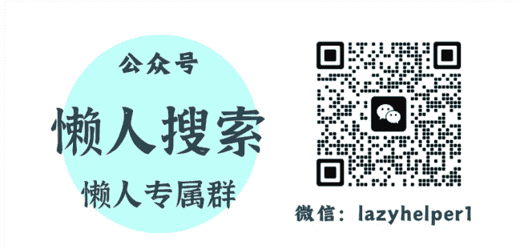

# 平民流量手册 (一) 聊聊普通人副业创业

# 普通人副业/创业，先把这些流量基本功练好

很多人问我，普通人从副业到一个人创业，到底该学什么？我的答案可能和你想的不一样：先别急着追风口，也别迷信爆款，真正决定你能不能赚到钱的，往往是一些很笨、很基础、但极其有用的流量思维。今天把它们一次性讲透。

## 客户最好的来源：主动搜索你的人

先说一个共识：在互联网上，主动搜索找到你的客户，几乎是质量最高的客户。同样是获客，一个搜索流量能抵多少个表单流量、多少个推荐流量？不同行业数字不同，有的行业能做到1：10：80，甚至更夸张。

搜索的本质是关键词。每个行业的关键词都很多，但关键词分“真实需求”和“伪需求”。对关键词的理解，就是网感的体现。

比如本地生活，最好的关键词结构通常是一套组合：地域词+产品主词+属性词。真正有消费意愿的人，不会搜“医美”这种大词，而是会搜“广州越秀小气泡”“深圳沙井隆鼻机构”，可能还会加上价格、流程、街道。美甲、美甲师、美甲培训、西安高新区小雁塔附近美甲师培训……每多一个词，人群就换一次，竞争也换一次。

再比如“大闸蟹”这种大词，当年有人把它的单次点击做到了99块，几乎是金融产品。但如果你加上“礼盒”，竞争立刻小一截；再加上“上海陆家嘴”，变成“上海陆家嘴大闸蟹礼盒品牌哪家强”，精准度和转化率就完全不同了。前缀后缀，可以玩出花来。

更要提醒的是：算法推荐的流量，和算法眷顾不到的关键词，是两种完全不同的生意。一旦客户是通过推荐广告留资，接下来几天他会收到一堆同类推送。作为商家，你就只能和同行赛马、比价、拼服务，最后被一个不要命的卷王用你给不了的价格抢走。平台还会把流量应卖尽卖，一个线索卖给多个商家，让商家互相卷；甚至五家都没成交，还要收保底费，只要一家成交，五家都付高额线索费。土巴兔、汽车之家、新氧，以及抖音、淘宝，本质上都是这个逻辑。

而长尾关键词恰恰相反，竞争小、精准、转化好。普通人赚钱不用看太多宏观，把关键词吃透就够了。

## 占住入口，等于杀死赛道

再讲一个词：占位思维。

每个关键词在每个平台、每个App的搜索框里，都是一个入口。你能在前三屏占住位置，占的比例越大，吃到的流量越多。甚至有些词，整个平台只有5个内容，你一口气铺100个，就等于把这个词“杀死”了，自己独享。

我当年给龙哥盟做推广，用的就是这招。那时候把“龙哥盟”相关搜索词全占了，还投放了几毛钱的关键词，做了个仿官网承接页，量哗哗地来，后来官方发现，差点提刀来找我。现在身份不合适了，不跟你们抢量，你们只要不越界，就可以放开手脚干。

你可以马上做个测试：打开抖音、快手、微信、📕，按消费者思维搜十几个行业词。你会看到很多奇观——有的词排在头条只有5个赞；股票开户这样的大词，微信搜索结果前三都是新号；📕上有些同行用同一套模板铺了前三屏，粉丝却只有几十个；搜索“城市+spa”，可能当晚就有几十个小姐姐头像来加你。这些词背后，全是被低估的商业价值。

有些大微商品牌，连官网、社媒都没有，你是不是可以独霸好几个关键词？有些刚进入中国市场的国际品牌，在中文互联网上还没自己的名字，你是不是可以提前把名字占住？在蓝海词上发两个视频，吃一年长尾，这种事真的存在。

## 关键词、内容、受众，三者要匹配

有一次听一位高手分享，记下一个词：match。关键词-内容-受众，三者互相匹配，效率才能最大化。

举个例子。有两个人同时做内容：一个做“晨跑和夜跑哪个好”，一个做“练肩的六个黄金动作”。后者可能拿到1000万曝光，前者只有100万。但如果引流手法差不多，最后赚钱的往往是前者。为什么？会搜“练肩”的，大多是有训练基础的老手，早就被割过无数遍，对套路无感；而搜“晨跑夜跑哪个好”的，是刚萌生身材焦虑、想改变的新人，才是真正的新鲜用户。

再比如我们做高客单价的医疗服务，只把一个词——“广州天河 机构考察”和一二线城市核心商圈的地名组合起来做内容，上门客户和转化周期立刻就不一样了。这种词不复杂，但每个月都能“妙手偶得”几个。

搜“Ki-6试剂”的是什么人？搜“勃锐精”的是什么人？“购买A杯文胸的年轻女生”是不是丰胸产品的潜在客户？思路打开，你就会明白：把相关病种词、药词、前后缀全做了，就是一条隐形流量通道。

还有一种玩法叫“图文不符”，只发图、带一堆tag，主打懂的人自然懂。饭圈、腐圈、亚文化圈里，暗号本身就是身份认同，用户会异常主动。这类神仙词，等着你去发掘。

## 四小时，成为流量高手

很多人问：入行一个新项目，最快上手的方法是什么？我的回答是：四小时流量速成法。

先说一个共识：能投流就投流。投流能把生意变简单，算好账、控好回款就行。世上没有真正免费的流量，免费流量的设备、人工、创作成本也是钱，而且很难同时做到稳定、精准、可规模。但长尾流量某种意义上接近免费，因为它有边际成本递减、规模效应和关键词效应。

怎么速成？拿📕举例。你花3个小时，用纯用户视角，换各种不同的关键词，去加30-50个同行。为什么是30到50个？因为一个特别朴素又特别硬的逻辑：你今天找不到同行，以后客户也大概率找不到你。本质上我们都是去平台偷流量的人，不对抗这件事祛魅，你就搞不定获客。

加同行的过程中，你会看到大量优秀的标题、封面、笔记、评论区，还有各种细节：评论区有没有运营、有没有截流、有没有引导加群；群简介怎么写的；进群之后怎么把带微信的图片、卡片或数字发给你；有没有@小号，有没有设计诱饵，比如“加我领资料”；加过去之后，破冰话术、昵称、报价表、海报、朋友圈怎么发。你甚至可以翻他三年的朋友圈，看他是不是三年前就在做这个行业——如果是，说明他赚到钱，而且值得学。

然后你顺手能收集到30-50份资料，把水印去掉，整理一下，就变成你自己的引流资料了。

到这里3小时过去，第4小时做什么？整理套路。你会发现，到第3个小时你已经看不到任何新东西了。所有封面、文案、整个链路，来来去去就是那几套。任何一个行业，真正有效的模板大概只有5-8套。挑一套和你自身条件最匹配的，听话照做，像素级模仿。同行就是最好的老师。

你还可以做个实验：打开📕，随便搜一个你行业的用户思维关键词，只看前三屏的11个内容，点开作者头像，数粉丝。你会发现大部分只有几百粉，甚至几十粉。为什么？因为📕是种草平台，它早就不愿意把流量全给大V了。“低粉爆款”被说滥了，但确实存在，而且还有巨大的情绪价值。新入行的人，请带着仪式感把这一步走完。

还有一个细节：在你加30-50个同行的过程中，如果你反复加到同一个人，三次、四次，一定要特别留意，他一定是高手。把他的主页整个拆解，模仿他、连接他、向他学习。

加了这么多同行，另一个好处是：他们是你免费的问答机器。刚入行，客户的问题你答不上来，就直接复制去问同行。30-50个人里总有几位特别热情，他们会回答你。我入局高端医美、高端医疗这类术语密集的行业时，甚至会反复伪装成客户去“刁难”同行，直到整理出一套属于自己的行业百问百答——等于让最优秀的同行，用最标准的答案，替我做好了售前培训。

评论区也要重视。刷笔记时别只看内容，把评论区从头翻到尾，那里藏着最真实的需求。我还会做一件事：找到用户聚集的帖子，大规模爬取发帖和评论，丢给Claude去总结痛点和需求，效率极高。

评论区也是可以运营的。做高端医疗时，我会安排一条“差评”：“集美们别去，这家态度太差了，虽然我最后还是……”做妊娠纹的会说“虽然效果挺好，但实在太受罪了”；第二条接着说“虽然成功了，但那个戴眼镜的张主任服务太差”；第三条补“你们都找张主任，我找杨主任，人又帅又温柔”。看懂了吗？“虽然……但是……”的意思是她做成了。在高端医美和医疗里，结果比态度重要，再圆回去就显得特别真实。这就是评论区的魔力。

这套四小时法则，不只📕适用，抖音、快手、视频号都一样。视频的开篇、结尾、视觉锤、听觉锤、文字钉、评论区置顶、作者回复、五个托……换一个平台，底层逻辑完全通用。

## 三个不能忘的词

再送大家三个词：

**超级客户**：如果一个客户愿意跳出原来的浏览环境，去另一个平台输入一串晦涩难记的号码，甚至还要返回去看一眼，走了这么长的路径只为了加上你，那他就是超级用户。路径是可以设计的。

**工具论**：平台只是获取流量、达成销售的工具，不是项目的全部。📕是工具，抖音是工具，但项目本身才是主线。

**流量结构**：流量结构必须健康，抗风险能力才强。做货架电商，就要规划“淘客、活动、综搜、硬广”的构成；做知识付费，就要考虑“混群、换量、裂变”这些来源。越健康，越长久。

## 选择即经营：场景-需求-产品

最后讲一个更有意义的框架：选择即经营。

在做任何事之前，先想清楚：你基于哪个场景下的哪个需求，去选择产品/服务？不一定要有标准答案，但你只要开始想，就已经赢了。

如果选对了，和自己的软硬件、技能、资源都匹配，你就可以进退自如：退，能专精一个细分需求；进，能围绕客户的其他需求持续创造价值。

这就叫“一盘货”。

正着举例：看病这个场景，能衍生出陪诊、绿通、高端医疗、护理疗养、名医、药、康复、床位、人道主义关怀等无数需求，每一个都可以做成产品。再细分，儿科、慢病、不孕不育，每个病种下面又有一片市场。有了一个产品，你积累的客户大概率还有同场景的其他需求，再延伸出保险、养老、理财，一盘货就转起来了。

反着举例：小绿书当年靠鲨鱼裤出圈，鲨鱼裤背后有一整个货盘：瘦腿袜、提臀裤、美背、天鹅臂、束腰、塑身衣……买其中一个的人，很可能买其他。它们共享同一个场景：遮丑；同一个需求：看起来更美、更瘦、更体面。再比如过年摆摊，泡泡机、充气城堡、气球、挖沙、抽奖、盲盒、套圈，这些从来都是一起做的。人都来了，不做一盘货，怎么拉高客单价和转化率？

这里有两个词，建议刻在脑子里：

**流量价值**：你做来的流量，能带来多少利益？是否符合“五高”——高客单、高利润、高粘性、高复购、高转介绍？至少符合两三个，否则就要想清楚它是不是只是过渡。记住一句话：搞富人的零花钱，别赚穷人的生活费。

**客户价值**：和你发生金钱交易的客户，是否迈过了最基础的信任门槛？你今天出100单蓝月亮套装，客单价128元，也加到了微信，这些人有价值，但有限。如果同样是128元客单，卖的是祛斑、祛痘、减肥这类要上脸、要入口的产品，那就不同了——客户敢买，说明真的信任你，价值就大得多。

所以，做事可以骚、可以浪、可以试错、可以过渡，但一定要用这两个标准去框定终局：流量价值，客户价值。能积累起迈过信任门槛客户的事业，才是更正确的事业。对你的事业来说，客户才是最重要的生产要素。

你也许早就发现了：五年前在炒股的人，五年后大概率还在炒股；五年前在减肥的人，五年后大概率还在减肥；五年前在知识付费的人，五年后大概率还在付费。很多需求不是一次性交易，而是一辈子的循环。看懂这一点，你就明白为什么要把流量基本功练好，为什么要把客户当资产来经营。

别急着搞宏大叙事，先把搜索词、占位、四小时法则、一盘货这些基本功做扎实，普通人的副业和创业，才真正开始。

先聊一个听起来很“鸡汤”的结论：怎么选，往往比怎么拼更重要。但我越来越觉得，这其实是最硬核的战略问题。为什么？制药巨头默克那句老话已经把答案说透了——药是拿来治病的，利润只是病治好了以后，自然跟过来的附属品。你越记得这一点，利润反而来得越早、越多、越稳。说白了，赚钱从来不是目的本身，而是你把事做对的回报。

这套逻辑放到客户身上，就非常具体。比如你卖的是减肥茶，来买的人绝不是一个只会买一次的过客。她大概率还需要减肥药，需要运动装备，需要普拉提和瑜伽的配件，需要代餐、辅食；接着是皮肤管理、美白、祛斑、祛痘，再到医美、生美、科美；再往后，她还可能是母婴、大健康产品的潜在买家，甚至愿意跟你做副业、做微商、做知识付费，参加读书会，关注身心灵和情感成长。一个人一旦信任了你，她身上的需求几乎可以一层一层被打开。这样的用户，是你最具确定性的基本盘，也是你穿越行业周期的底气。

所以说，别急着抱怨手里没有选择权。年轻时候受年龄、环境限制，确实没得挑。但不用焦虑，也不用一步到位。只要你在干，在琢磨，人生战略说白了就是下一件事还没清晰之前，把手头的事做成最优解。先在心里埋下一粒种子，未来自然会慢慢长出来。

接下来一个话题，也许比赚钱更值得玩味：平台的流量，到底是怎么分配的？抖音是典型的推荐逻辑，系统不断推，你只需被动接受；淘宝则是老派的搜索货架，你想买什么，搜出来，下单；📕呢，我体感是大概70%搜索、20%多推荐，那它会不会只是用户做决策的“最后一站”，并不负责成交的最后一环？腾讯的生态就更有意思了，你在搜一搜底部能看到一个“小店”标签，这基本就是微信在把流量往电商方向引。总盘子是动态平衡的，多给电商一点，必然有哪个板块要少一点——可能被挤的就是👸号。我看到一个数据说“小绿书”分走了3亿日活，接着我留意了20个以前篇篇10万+的号，过去连续100天都雷打不动，最近却开始掉到7万、6万，一个两个还能说是偶然，集体变少就很难不让人多想。当然这只是我个人的日常观察，给大家做个参考。

微信这半年做的灰度测试，也很值得琢磨。去年有人在群里打出“龙与地下城”，屏幕里忽然蹦出两个小人打来打去，还能下载；今年端午节输入“龙舟节”，一只龙舟就冒了出来，点进去可以购物。这两个小动作，其实透着一股既兴奋又吓人的野心。但以微信“慢、稳、温柔”的调性，它不会激进到你在聊天框里说句“剃须刀”，就弹出来一个剃须刀链接，真那样就太恐怖了。你看现在的搜一搜结果页，头部一左一右两个视频号，下面👸号、广告、百科，再一左一右两个视频号，接着一堆文章……这种布局完全可以在某个位置插一个购物栏位。一级入口不好动，二级入口却可以慢慢试。别忘了，微信主界面早就有个“购物”入口，现在导给京东，将来一旦想自己做电商，随时收回来也不稀奇。

还有个小细节，你试过同样的关键词，白天和晚上在百度上分别搜一次吗？结果可能完全不同。夜间搜索和白天搜索，简直像两个不同的百度。所以创业赚钱真的需要大量看案例，但光看没用，还得花时间琢磨、保持好奇，我今天说的这些，正是日常生活中一点点攒出来的碎片思考。

今天就聊这么多，欢迎各位老师指正，小涛一向“闻过则喜”。另外厚着脸皮讨个赞，点赞过2000，我头秃都给你们安排下集。最后照例安利一下懒人专属群：它相当于一道信息防波堤，已经稳定运转7年，把3000多个商业实战案例、行业内参与宏观文章一一拆透。我们不做垃圾搬运工，只当好信息的筛选器。想进群可加微信 lazyhelper1。