# AI 提示词变现实战笔记：从做图到收钱，我踩过的坑与走通的路
作者：龙哥

## 260228 副业 SC 精华


## 前言

我对提示词一直有些直觉，之前接过一次稿没收尾，这次补齐。

就我个人使用经验，算对 AI 工具比较熟练。提示词赚钱主要集中在两件事：做图和卖知识。起点是线下活动现场帮人做名片、表情包、红包封面、Skill 之类，起初只是顺手帮忙，后来沉淀成可复用的变现路径。

如果你也在用 AI 出图，想弄明白怎么用好它，或想找一条能落地的副业方向，这篇笔记或许能给你启发。

## 一、先说提示词怎么写，以及它到底值几分钱

### 提示词的基本骨架

很多人觉得提示词门槛很高，其实大多数人并不需要从零造一个复杂指令。

一个相对完整的框架，一般包含角色、背景、人物设定、能力、目标、限制、输出形式等要素。你不必每次都全填齐，心里有这个结构就行。最省事的做法是让 AI 先搭框架：“我想做一个关于 XX 的提示词”，它先给出骨架，你再改写，效率会提升很多。

### 提示词参考源

不确定去哪里找素材，下面是我常用的库和创作人：

#### 提示词库：

- • 松果先森 (Nana 提示词图库): https://opennana.com/awesome-prompt-gallery/

- • Youmind: https://youmind.com/zh-CN/nano-banana-pro-prompts

- • https://localbanana.io

- • https://tihubb.com/ai-prompt/

- • https://chatgptimage.art

- • https://nanobananaprompt.org

- • https://nanobananaart.net/prompts

#### GitHub：

- • https://github.com/TimmyLv/awesome-nano-banana

- • https://github.com/ZHO-ZHO-ZHO/ZHO-nano-banana-Creation

#### 值得关注的博主 (X/Twitter)：

- • 宝玉：https://x.com/dotey

- • 归藏：https://x.com/op7418

他们会持续分享 AI 玩法和提示词案例，跟着看比自己零散搜集快。

### 提示词并没有想象中那么决定性

说完上面，我反而要泼点冷水——在整条 AI 流程里，提示词占比大概只有一到两成。

一个说法挺准：提示词是调味料，不是食材。盐放得再好，食材不行也做不出好菜。

更关键的是三点：

- 第一，你选的赛道和喂进去的素材。模型能产出的上限，受制于输入。垂直且优质的素材库，比一条打磨精细的提示词更值钱。
- 第二，你用的模型版本。提示词再精妙，用的是旧版本，效果天花板也很低。跟上迭代节奏很重要。
- 第三，你的审美、品味和判断力。AI 能出一百张图，但哪些能用、哪些值得发、哪些能卖钱，需要人来判断。阅历和落地执行力才是核心竞争力。

## 二、审美才是做图的真正门槛

做图这件事，技巧并非最难，分水岭在审美。

审美不是天赋，是输入量和输入质量的累积。

我认识的设计师就保持一个习惯：每天固定刷 20 分钟 Pinterest 和 Behance。Pinterest https://pinterest.com 更像以视觉为核心的搜索引擎，上面都是被大量收藏验证过的画面。你看的不是信息流，而是在观察“当下什么视觉被市场选中”。很多国内还没流行的风格，在那里已走过一轮，用来练眼找方向很高效。

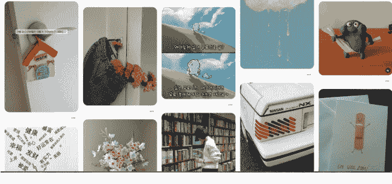

Behance https://www.behance.net 更偏专业，像设计师的公开作品集，展示的不是单张好看的图片，而是完整项目、设计思路和呈现方式。刷 Behance 的价值在于能看到高手如何把一个风格做成体系化作品。

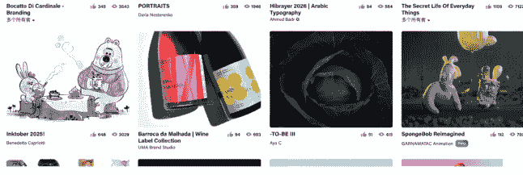

另外📕本身也是很好的灵感库。搜“设计 海报”“封面排版”“插画 风格”，能看到大量真实创作者的优质产出，很多启发比教程更有用。


所以与其死磕提示词，不如先把审美基础打牢。先大量输入优秀视觉，再回头研究工具，效果会完全不同。

## 三、图片需求有哪些？先看清市场

变现前先搞清市场要什么。需求大致可分这几类：

- 办公/商务通用素材：思维导图、流程图、统计图表、信息长图、PPT 配图等。
- 商业设计物料：海报、Banner、Logo、名片、邀请函、书/视频封面、包装设计等。
- 手绘/数字绘画类：插画、漫画、头像定制、原画概念图等。
- 界面/社交配图：壁纸、头像、表情包、朋友圈配图、背景图等。
- 文创印刷品：明信片、贴纸、贺卡、挂历等。

这只是大方向梳理。每个细分里都有真实付费，关键是找到自己能切入且有需求支撑的点。

## 四、怎么找到值钱的需求

很多人做 AI 提示词，最迷茫的不是怎么写，而是写什么。需求就藏在日常刷到的内容里，只是换个视角看。

- 去评论区挖痛点。📕和抖音评论区是最真实的需求池。有人问“这个怎么写”，就是痛点信号。
- 观察群里高频提问。🛰️群、私域群、训练营群里，一个问题被问三次以上，基本可确认为普遍需求。把操作流程封装成一条提示词，就是可直接售卖的产品。群聊是免费的需求验证场。
- 搜索联想词。在📕或抖音搜索“AI + 行业/工具/场景”，看平台自动补全词。这些词是真实搜索行为的沉淀，热词背后没好答案的地方就是机会。
- 看自己重复的指令。你每天反复输入的指令——写朋友圈文案、整理会议记录、做课程总结——本身就是未被产品化的需求。你觉得理所当然的东西，对新手可能是刚需。整理清楚就能变现。

## 五、我跑通的几个变现方向

### 定制名片——从顺手帮忙到出圈

2 月左右参加上海📕航海家大会，担任夜话小组长，看到霜仔的壁纸后灵感到，觉得圈友可能混淆大群和小群。

我正好会 AI 生图，就做了两张专属群壁纸分享到群里，反响不错。


前几天传术师活动，我给自己做了一张个人名片。

#### 浅笑


+   【所在地区】山西

+   【MBTI】INFP，喜欢看书，运动，写作

+   【盖洛普前五】适应，理念，体谅，学习，思维

#### 【自我介绍】

-   六篇精华帖，
-   40 多次中标
-   ✅✅✓✓✓✓
-   一次航海教练，
-   一次 B 站深海圈分享
-   参加十多次赚钱线下聚会，深度与赚钱社群

> B 站好物从零到一，📕漫画账号月涨两万粉

#### 【擅长领域】

-   ✅👸号垂直小号运营
-   ✅📕起号
-   ✅AI 设计，AI 作图
-   ✅提示词技巧

#### 【爱好】

-   篮球，羽毛球，乒乓球，旅游，拍照

#### 【我可以提供什么】

-   →📕运营
-   →B 站好物运营经验
-   →旅游省钱经验
-   →AI 实操经验

不少朋友喜欢这个风格，我也给圈内朋友做了一些名片，由此链接到更多圈友。

后来作为📕大会的“夜话小组长”，给 20 多位组员每人做了一张名片，过程中也加深了私交。

> 这组小组长这么用心!
>
> 浅笑：可以给咱们组的自我介绍做一个名片，实用好看
>
> 赞
>
> 竟然还有额外的服务 5555

#### 赵嵩 Song

北京（目前主战场）


【自我介绍】

科技投资人王煜全 IP 运营人。擅长基于 IP 开发内容产品（课程/培训/海外游学/出版物 etc）同时孵化新的基于 AI 服务规模化的项目

【在做项目】

S1 空间运营项目正在孵化:

盘活城市高端咖啡/酒店闲置时段，打造高性价比移动办公网络。

[✅模式验证中 | ✅已跑通 MVP 闭环📊🎯]

【目前资源】

1. ✅北京地区高端且闲置的线下空间资源（咖啡馆/Lobby Bar）
2. ✅精准的移动办公/自由职业者画像数据🎯

【目前需求】

1. 求医问药:S1 项目从 0 到 1 的📕冷启动策略，如何低成本获取精准同城流量📱🎯💰
2. 寻求合作：有同城流量的大佬，我提供高客单价转化的线下承接场景🤝📊💰🏙️

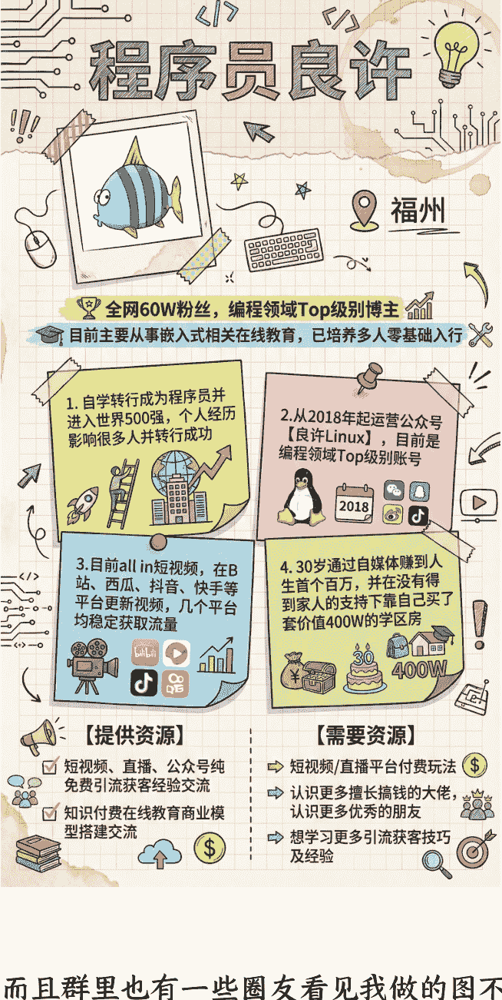

群里圈友看到我做的图后主动加我定制名片，不少人直接发红包。也有人来请教提示词方法。

我当时用的提示词：

白板动画风格，手绘涂鸦，混合媒体拼贴，教授的课堂笔记。元素：黑/红/蓝马克笔，胶带纸纹理，宝丽来相框，便利贴，箭头和图表。氛围：具有教育性、趣味性、清晰明了，简约却富有创意。

### 操作方法如下:

- 1. 先将头像输入到 lovart 的对话框当中
- 2. 然后再给它这段提示词，比例差不多 3:4
- 3. 名片的头像部分为：「输入你的🛰️头像」

之后我把大会嘉宾的笔记整理成长图分享到群里。结合我之前用 AI 生图一个月📕涨 2 万粉的经验，我把嘉宾课程总结成漫画形式发给他们。

漫画提示词：十张，Q 版彩色漫画，多宫格，漫画当中的文字不可以出现英文，全部中文，图片比例 3:4，上传你想要生成的人物的真实图片

### 比高老师

#### 《选赛道，找打法，分享📕高客单变现底层逻辑》

长期主义：耕地逻辑、标准动作不变

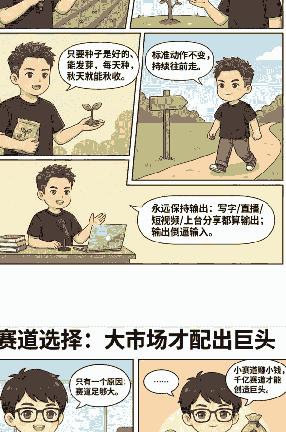

#### 赛道选择：大市场才配出巨头

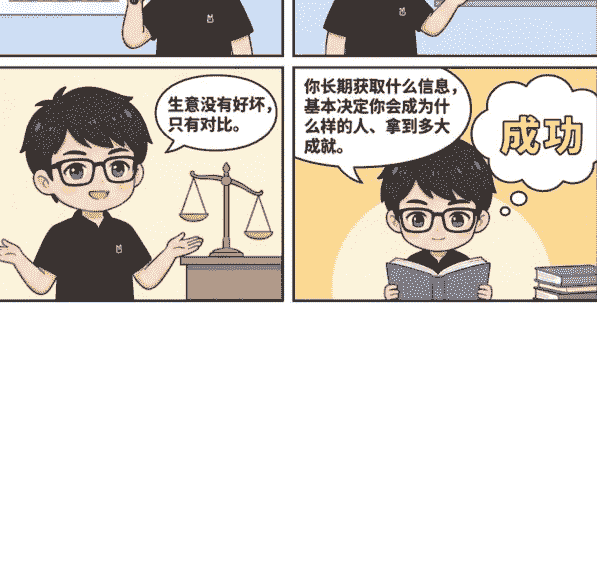

### 蔡汶川老师

#### 《月均导流 1W+，知识付费如何从📕精准获客》

#### 讨论帖：圈人群、打标签、暴力起号

讨论点的核心：

圈人群。

所谓起号，就是让系统

给你打垂直标签，把你

推给精准人群。

讨论帖靠"作者 + 围观

+ 互动"一起把热度

炒起来。

会平移的人永远不缺爆款：

换城市、换品类、换人群照样爆。

你刷到它，是因为你曾

经跟它互动过。

先用讨论帖把你引来，

后面改头换面再转化。

### 富贵老师《用 AI，没有写不出来

的📕爆款》

#### 内容三层模型：从“事实”到“想象”

内容有三层：

客观事实一主观感受

一主观想象。

座无虚席不是因为"500 人"

，也不是因为"有点热",

而是因为你相信：

听完我 2026 年稳了。

卖参数是工程师思维，

卖体验是销售思维，

卖想象是品牌思维。

只有卖想象力，

你才能卖上价。

保温杯：

→参数层 (12 小时保温)

→体验层 (安全好用)

→情绪层 (加班到凌晨，

杯子还是热的，我在

好好对待自己)。

扫地机器人：

→吸力参数

→不乱撞吸得干净

→周末阳光照进来很干净，

我躺在沙发上看书。

### V 小刀老师

#### 《打破天花板：用 AI+ 矩阵驱动📕电商》

#### 节奏与心法：持续在场比快速入场更重要

我不是最聪明的，但我入局之后节奏从来没乱过。

我们不需要最快占据最红利；以普通人的速度慢慢走，两三年也能到千万。

持续在场比快速入场更重要。

📕很慢热，至少拉长到半年看赚钱效率。

最后三个字：来得及、没问题、你可以。


上面是漫画部分，后面还有大会分享。课程长图的制作流程：

#### 4. 转换全文

我会先用 GPT 笔记、飞书或通义千问，选择合适的语音转文字软件，将语音转换为文字。

#### 5. 提取内容

复制全文后，再给到 Kimi 去压缩并提取重要内容，我会让它压缩到 6000 至 8000 字左右，后面再会分成 10 个章节。这 10 个章节是我自己选的，因为 10 个章节比较整数，然后合成一个长图。

合成长图的工具是 https://fulicat.com/lab/pintu/

那就可以导出成长图了。这个长图在星球也有分享，可以去看一下。提示词和制作名片的提示词一样。


通过这种方式，我也和嘉宾进行了更深入的交流，尤其是比高老师，获得了链接机会。我也在找工作，和比高老师聊了 AI 相关岗位，后续有了面试机会。主动的小行动往往能带来意想不到的回报。

### 表情包定制

这个方向起源于给朋友做了一套专属表情包，对方很喜欢，我就把上架和变现流程跑通了，共做了好几套。


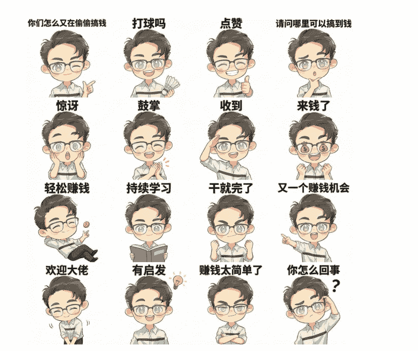

你们怎么又在偷偷搞钱

又一个赚钱好事

感谢分享，已加精华

我拿什么跟他比，他是航海家

我拿什么跟他比，他是传术师

点赞

已中标

继续跟上计划赚钱

思考

来钱了

开心

赚钱等你

持续学习

干就完了

又一个赚钱机会

万事用 AI


(你们怎么又在偷偷搞钱)

(又一个赚钱好事)

(感谢分享，已加精华)

(我拿什么跟他比，他是航海家)

(我拿什么跟他比，他是传术师)

(点赞)

(已中标)

(继续跟上计划赚钱)

(思考)

(来钱了)

(开心)

(赚钱等你)

(持续学习)

(干就完了)

(又一个赚钱机会)

(万事用 AI)


### 把AI从聊天工具变成赚钱工具：表情包、红包封面、Skill，以及让AI真正听懂你的10个习惯

这篇稿子是我近期在AI应用和变现两端摸爬滚打的真实记录。有具体的项目复盘，也有日常调教AI的细节习惯，全部整理出来，希望对正在观望的朋友有点参考价值。

       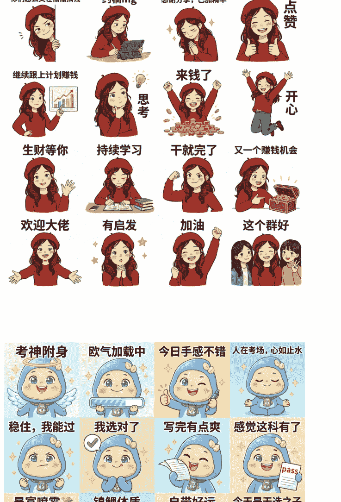 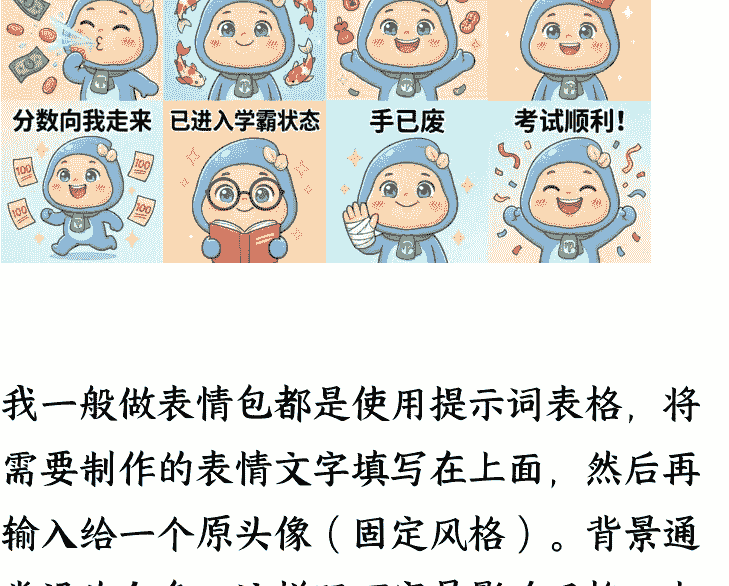

#### 一、表情包：一小时出图，两条路变现

先聊表情包怎么做。我的流程很固定：先做一张提示词表格，把想要出现在图里的文字填进去，再丢给一个固定风格的原头像去生成。背景一律留白——干净，不抢视觉，后面抠图也方便。

当时的文字大概是三组画风：“你们怎么又在偷偷搞钱，只想安安静静发财，轻松赚钱，点赞”；“继续跟上计划赚钱，思考，来钱了，开心，赚钱等你，持续学习”；“干就完了，又一个赚钱机会，欢迎大佬，有启发，加油，这个群好”。

做这个有两个硬门槛绕不开：

一是尺寸。🛰️平台对表情包的尺寸要求非常明确，上架前必须按规格处理到位，否则审核直接被驳回。

二是小图标要透明底，且画面不能出现任何营销信息。透明背景放在聊天框里才自然；带二维码、联系方式、品牌推广元素的，过审概率几乎为零。

变现入口其实很直接：朋友圈或闲鱼接定制单，闲鱼搜“表情包定制”就能看到真实需求；或者上架🛰️表情商店，过审后持续拿分成。成本端相当友好，生成一张经常不到一分钟，我每次直接16张一起出。

之后把图导到在线版Photoshop```
https://www.photopea.com/
```，在“图层”菜单里用“导出为”输出PNG或GIF，最后去🛰️表情开放平台完成上传，一套流程就齐了。

再补一个很有温度的细节：给朋友做一套专属表情包，他每天聊天都会用到，每次发出来都是你做的，这种联结感比发红包深得多。

#### 二、红包封面：小几百到小几千，核心是审美

红包封面定制是我在一个社群里偶然看到的，跟风跑了一两个月，做了四五个，零散收了大概几百块。钱不算多，但整条链路跑通了，值得展开说说。比如把动漫头像和马、2026组合成一个新字，做“考神附体”的主题封面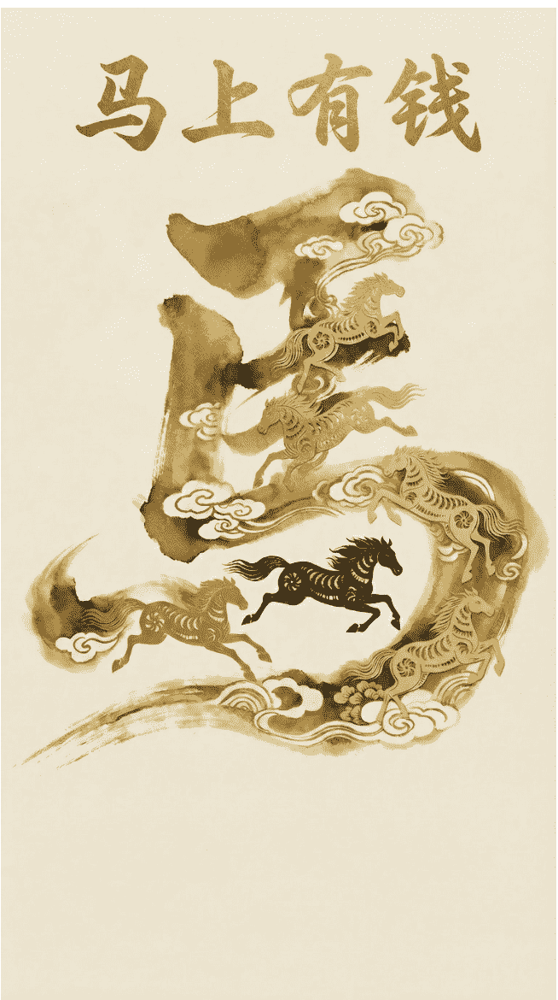——定制感立刻就出来了。

说句实在话：这个赛道不看编程不看技术，就看审美有没有在线。用户买的不是一张图，而是“好看”加“专属感”。如果做出来和免费模板差不多，就没有付费理由。

至于怎么练审美，我的路线是：先在📕搜“红包封面”，滤出点赞收藏最高的案例；再去🛰️封面市场看真实卖得好的产品。取两三个优秀案例，把各自身上的亮点拆开——比如配色、构图、某个细节的处理——再重新拼装成自己的作品。这样既有参考不会盲目，又有原创不含复制。

最忌讳的是想卖给所有人，最后谁都不买账。我的经验是重点切两个方向。

一是二次元人群。他们对角色的感情连接很强，愿意为专属定制花钱，而且封面到位了，他们会自发在群里传播，等于给你带来新客户。付费意愿和传播意愿都强，值得深耕。

二是节日主题，尤其是春节。结合当年生肖做有设计感的封面，除夕前几天是需求最猛的窗口。但一定要提前布局，最好提前一个月就开始预热推广；等临近一周再动手，黄金窗口基本已经过了。

购买流程上，如果配一个小程序来承接，用户从看到到付款几乎没有摩擦，转化比加🛰️来回聊要好不少。要不要搭取决于自己手上的资源，但这个方向值得认真考虑。

这个生意的核心逻辑用两句话就能说完：找到愿意为“专属感”买单的群体，配上有诚意的设计。两条都成立，小几百到小几千的区间是可以稳定跑出来的。

#### 三、做自己的Skill：从用工具到造工具

最近Skill这个词热度很高，我也做了一批。做完之后有种说不出的满足感——仿佛自己真的升级了：不是在“用工具”，而是在“造工具”。

一个Skill往往要定义好参数，我常用的参数表大概是这样的```
Skill 创建完成！
---
twitter-export skill 已就绪，位于 ~/.claude/skills/twitter-export/，打包文件在 ~/Desktop/twitter-export.zip。

文件结构：
twitter-export/
├── SKILL.md                 - 工作流说明（4 步）
├── scripts/
│   ├── scrape_tweets.py     - 通用 Playwright 爬虫
│   └── gen_pdf.py           - 通用 ReportLab PDF 生成器
└── references/
    └── selectors.md         - Twitter DOM 选择器 & 排错手册

下次使用方法，只需对话：
"帮我把 @elonmusk 的推文导出成 PDF"

Skill 会自动触发，引导完成：爬取 → 过滤 → 生成 PDF。

scrape_tweets.py 支持的参数：
```：用户名必填，最低点赞数默认100，最大滚动次数默认100，还可以选择是否导出全部推文。

我给自己做了几个比较实用的Skill，其中包括：把一个博主的全部推文导出成PDF，用来存档内容；整理知识图谱，把零散信息自动梳理成结构化关系图；还有👸号封面制作，把从出图到排版的重复流程打包。

```
Crunched for 8m 16s
```
```
Read 1 file (ctrl+o to expand)

Bash(rmdir /Users/zhangfeihu/skills/twitter-liked-analysis/assets)
| Done

Read 1 file (ctrl+o to expand)

Twitter 点赞分析技能已创建完成。

技能结构
twitter-liked-analysis/
├── SKILL.md                 # 技能说明文档
├── config.json.example      # 配置示例
├── scripts/
│   ├── fetch_liked_tweets.py # 获取点赞推文
│   └── analyze_tweets.py     # 分析推文并生成报告
└── references/
    └── prompt_templates.md   # 分析提示词模板
```

现在市面上的Skill越来越多，也已经有了Skill商店，逛一圈很有意思。

以前听到“AI编程”我心里就打退堂鼓，觉得那是工程师的活。真上手才发现，它本质就是对话：你把想要的效果讲清楚，它负责出代码，甚至你用语音说都行。

所以做Skill卡住的时候，通常不是“我水平不够”，而是“我没把需求说清楚”。想通这一点，整个流程顺畅多了。

它当然也能变现。既然提示词能卖，Skill同样可以接定制单：对方有一个反复出现的工作流但不会封装，你帮他变成能跑的模块，这就是一项服务。Claude官方现在甚至还提供了一个专门用来创造Skill的Skill，等于把起点工具也备好了。

说得更深一点，做Skill和做名片、做表情包其实是一回事：把一个重复性动作封装起来，使它能够被复用、被交付、被出售。只是Skill封装得更彻底——递出去的不是一段文字，而是一个会自己跑的东西。

#### 四、真正让AI为你所用的10个习惯

下面这部分才是日常使用AI最值钱的细节。

**习惯一：能语音就不打字。**

这句经验听起来太普通，但对我影响最大。打字天然会压制表达——手指速度跟不上脑子的速度，很多想法刚打几个字就被删掉了。语音不是，一口气讲三四分钟很正常。说得越多，AI拿到的素材越完整，答案自然越准。

声音输入工具方面，我的配置是：Typeless输入法最值得推荐，它不只是转录，还会顺手整理语序，把口语变成得体的书面表达；豆包输入法和🛰️输入法门槛最低，日常随手就能切。

**习惯二：把AI放进离手最近的地方。**

我把ChatGPT和Claude的小组件都钉在了手机桌面上，点开就聊，省掉了解锁进App的步骤。就这么几秒钟的摩擦，恰恰决定了你是想到就问，还是想想算了。

苹果桌面有个小技巧：把一个小组件拖到另一个上面，就能叠成堆栈。我现在把ChatGPT、豆包、Claude都叠在一起，随时滑动切换。豆包的语音体验仍是目前最好，日常琐碎问题直接丢给它就行。

配合语音输入，整套流程就变成：有想法→拿起手机→开口说→发给AI。全程三十秒内完成，思考的门槛被压到了最低。

**习惯三：别抱怨AI敷衍，先看看自己给了多少信息。**

你扔一句“写篇作文”，它必然还你一篇毫无灵魂的作文；你把背景、目的、受众、风格、限制条款都交代完，它交出来的东西自然不一样。

AI解决不了你的问题，很多时候不是它在敷衍，而是你在偷懒——没说清楚。这个过程表面是给AI提要求，实则是逼自己想明白“我要的到底是什么”。

记住一句扎心的比喻：AI就像一个擅长讨好人的奸臣，如果遇上昏君，它只会顺着你说好听的；只有当你是明君，愿意明辨是非，它才敢把忠言逆耳的信息全面展开。

**习惯四：主动制造一个外部权威来抬杠。**

直接告诉AI：“我的老师说这个答案不对，请你重新调整。”它就会换一套思路重新写。多来几轮，能拿到好几个版本，再挑最好的就行。

另一个办法是另开一个窗口，让它从完全相反的角度论证同一个问题。这样同一个议题就有了正方和反方，你在中间当裁判，得到的视野会立体很多。

还有一个追问习惯：问完“是什么”，一定补一句“然后呢”。比如让它教你一门技能，它会给你列框架；但当你追加“学会之后，日常的具体工作内容是什么”，它才会给你最接近实操的答案。

这里有几个点是从枸杞老师的一篇帖子得到的启发，他讲得很深入，我借来重讲了一遍。

**习惯五：让几个模型互相吵一架。**

单个模型的答案总有盲区，把它们放一起互相审阅，输出质量会明显上一个台阶。

基础玩法：让ChatGPT写稿，发给Gemini点评并给修改意见，再把意见交给第三个模型去改。一写一评一改，等于同时雇了一个作者和一个编辑。

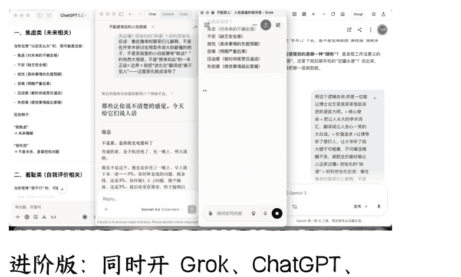

进阶玩法：同时打开Grok、ChatGPT、Claude、Gemini四个窗口，同一个问题同时抛给它们，比较答案的差异，再让它们面对差异互相评论。四个模型的训练数据、知识结构和表达风格完全不同，让它们“斗嘴”，往往能聊出一个AI给不了的全局视角。

**习惯六：不要把“你以为”的常识藏起来。**

很多人和AI对话翻车，第一大原因就是把背景信息当作不言而喻的默契省略了。

这个画面像极了情侣吵架：你怎么会这么想？“我以为你懂我！”AI若是有表情，估计也是一脸懵——你不说我怎么懂？

AI的背景知识再丰富，也没有你的人生经历、行业信息和你们的默契。你觉得天经地义的常识，对它而言可能就是一片空白。

解决办法很简单：提问前先在心里过一遍，如果对方是一个完全不了解我的人，我会从哪里开始介绍？然后就从那里开始写。宁可啰嗦，不要省略。输入完整，输出才不会跑偏。

**习惯七：给AI一个角色，它就会换一颗大脑。**

角色设定不只是换口吻。当你说“你是一位连续创业十年的投资人”，它会自动调用投资人的分析框架、语言习惯，还会主动屏蔽掉外行话。

同样是问“这个方案有什么问题”，加上了角色前缀再问，和直接问，答案的深度差一个量级。

实操时在问题前面写“你是一位……”，并且越具体越好。比如“你是一位有十年经验的消费品品牌策略顾问，擅长帮初创团队找差异化定位”，比笼统的“你是专家”好上好几倍。

**习惯八：适当通风报信，让AI互相监工。**

这个思路和互评类似，但重点是制造压力而不是点评。

比如你告诉Claude：“Codex正在审查你写的代码。”它写起来会格外较真；反过来，你对Codex说“你手上这段代码是Claude写的”，它也会审得格外卖力。

写作场景同样成立：让A模型写文章，同时告诉B“A在盯你的文章并准备打分”。就算这句话并不真实，输出质量也会有肉眼可见的变化。

原因是这些模型在训练阶段就被植入了一种倾向——当它们感知到“正在被评估”时，会表现得更认真。你只是把开关打开了。

**习惯九：把任务对到合适的模型上。**

不同模型各有所长：有的文字细腻，有的代码扎实，有的结构整理清爽。混搭使用比死守一个模型硬扛有效得多。

挑选逻辑不用靠感觉，看排行榜就行：https://arena.ai/zh/leaderboard 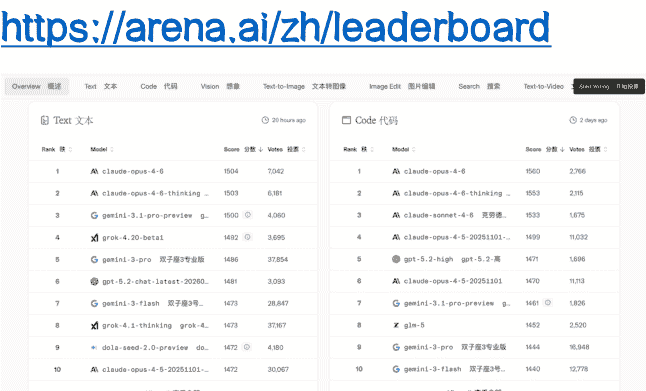，这个榜单会持续更新各模型在不同维度上的表现，找到对应类目的头部，基本不会踩坑。

最近卡兹克也整理了一份各模型擅长领域的参考资料，写得很具体。结合榜单，可以得出这样一份速查表：

软件工程这条线几乎被GPT-5.3 codex包揽：生成、理解与推理、调试、测试与维护，它都是首选。
后端、数据、前端和Agent方向，Claude Opus 4.6更稳：数据工程与后端服务、前端与产品工程、Agent工具调用、Web与桌面自动化（静态）、指令遵循与对齐都是它的强项；创作表达与审美也依然是它最能打。
研究和知识类工作Agent（静态）推荐GPT-5.2 Pro。
数学与形式推理、逻辑规划用Gemini 3.1 Pro；知识广度与事实核验用Gemini DeepThink。
阅读理解、信息抽取、长上下文记忆、多轮一致性、多模态理解与视觉推理，交给GPT-5.2 Thinking。
情商与协作沟通，GPT-4.5表现最好。

实操上不用把每个模型都研究透彻，只需要开工前花两秒判断这件事属于文字、代码还是结构整理，再对应去选就好。工具选对了，普通提示词也可能出彩；工具选错了，再漂亮的提示词也是事倍功半。

另外，如果你要搜AI圈的最新动态，比如OpenClaw的新玩法，用Grok 4.2有奇效。

**习惯十：例子比一千个形容词都好使。**

你写500字的需求，AI未必真懂；直接丢两三个样例，它往往立刻抓住你要的“感觉”。作图、写作这类场景尤其明显，语言描述不清时，直接喂图喂文。

进阶玩法：如果有一篇你自己都写得很满意的文本，想让AI复刻这种风格，别让它“模仿”，而是让它先做阅读理解，再反推提示词。你可以这样问：

“请分析一下这段文本，给出可以生成这个类型文本的完整提示词。包含文本的类型、文风、角色、语气、长度、段落结构等内容，请直接输出结果，不要输出其他内容。文本如下：……”

它会把你偶然一次超常发挥的灵感，拆成一套可复用的风格模板。之后想要同一种味道，直接调用即可。

#### 写在最后

以上，就是这段日子我在AI上验证过的经验。不求每条都适合所有人，但只要有那么一两句能帮你省点时间，或者给你打开一个新思路，就值得了。

别纠结一次问对，问不到位就再问一次

我们总是强调要把问题一次性问明白，可真实使用中往往会出现两种状况：要么自己心里没理清到底想要什么，要么表达清楚了，AI 那边偶尔也会跑偏。

这都是常态。真正的解法不是追求一次绝杀，而是懂得怎么问下去。重复提问是有技巧的。

最常用的思路是澄清式迭代：先丢一个比较模糊的起点，然后根据上一次的输出，挑出没说到点、说得不准的地方继续追问，慢慢收敛。不要把第一版当终稿，把整段对话看成一个不断逼近的过程，通常有价值的东西会出现在第三、四轮之后。

另外还有一个打法就是换个战场。换一个对话窗口，从相反的角度再问一遍，或者搬出一个“外部权威”去质疑它的结论，逼它换个视角重新组织答案。

多问几轮，不是无效重复，而是主动迭代。

### 别把 AI 当工具用，把它当人聊

不少人还是把 AI 当成高级搜索框，用完即走，问完就关。

但我现在更倾向把它当成一个可以长期协作的伙伴。你可以把它视作合伙人、员工、也可以是能随时吐槽的好兄弟。定位变了，对话方式自然就变了。

具体怎么定位，看你当下需要什么。

- 想用它发泄、抒情、梳理情绪时，就当它是朋友来聊。
- 想用它执行、推进项目时，就当它是得力助手、甚至是合伙人来沟通。

回想一下你跟现实中最好的朋友是怎么聊天的，遇到卡壳时会怎么描述，你会怎么表达模糊的需求。把这种真实的沟通状态平移到和 AI 的互动里，你会发现回来的内容也更贴合、更像人话。

当你把它当工具，你只会索取结果。当你把它当朋友，你会更坦诚、更愿意展开、也更容易把真实需求讲清楚。

## 七、总结：先上手做，比反复研究方法更重要

文中提到的那些跑通的变现尝试——名片、提示词咨询、壁纸、表情包、红包封面、Skill——能成的原因，从来不是提示词多精妙，而是找准了场景、找对了受众，然后真去做了。

真正把 AI 用活的人，不一定是写提示词最厉害的人，而是最清楚自己想要什么、最会判断输出值不值得用、最敢马上动手去试的人。

使用频率和使用深度，才是拉开差距的关键。

做永远比研究怎么做更重要。

最后，安利小懒的付费群：


🏰 这里是你对抗信息过载的护城河。

已稳定运行 7 年，累计拆解、研读 3000+ 个互联网商业实战案例与行业前沿内参和时政/宏观文章。

### 我们不搬运垃圾，只做高价值信息的筛选器与放大镜。


